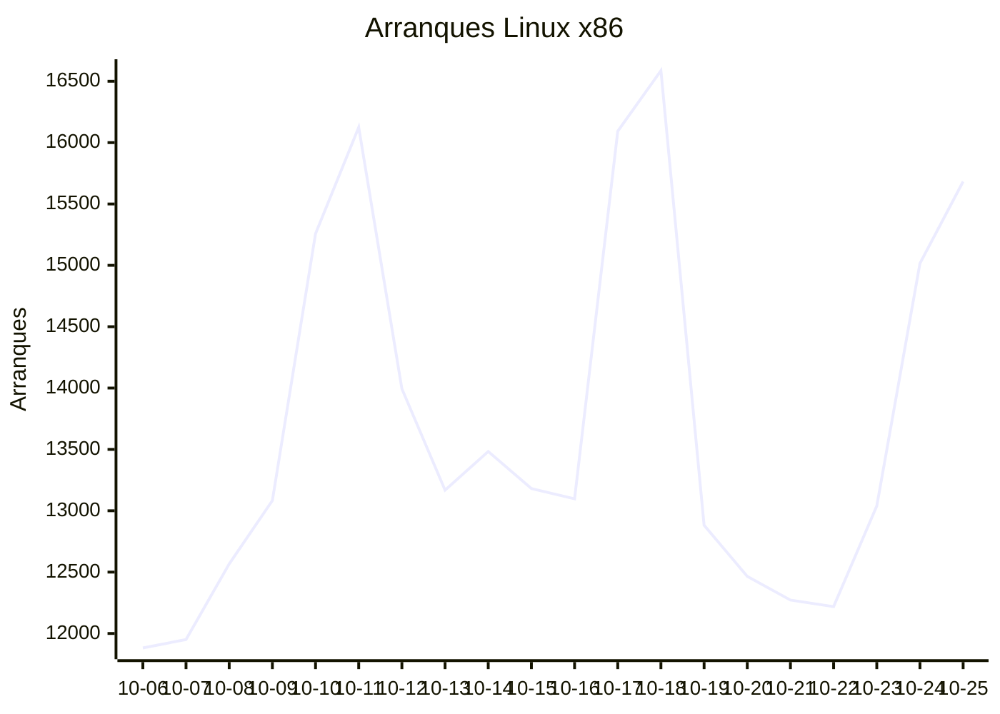
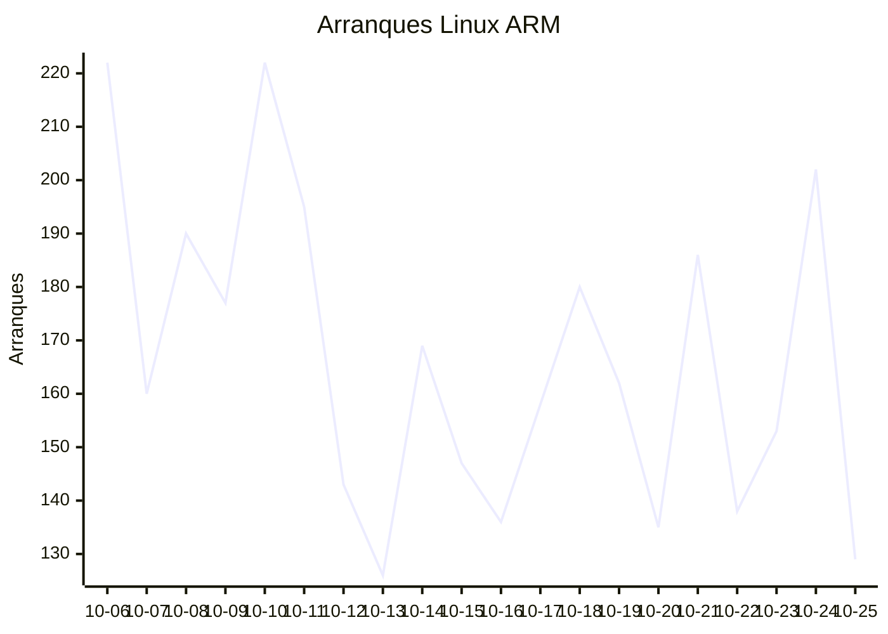
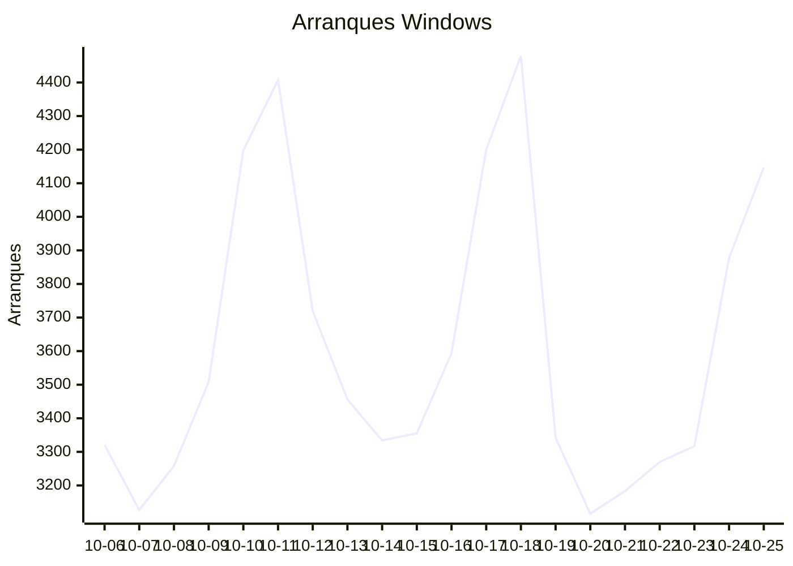
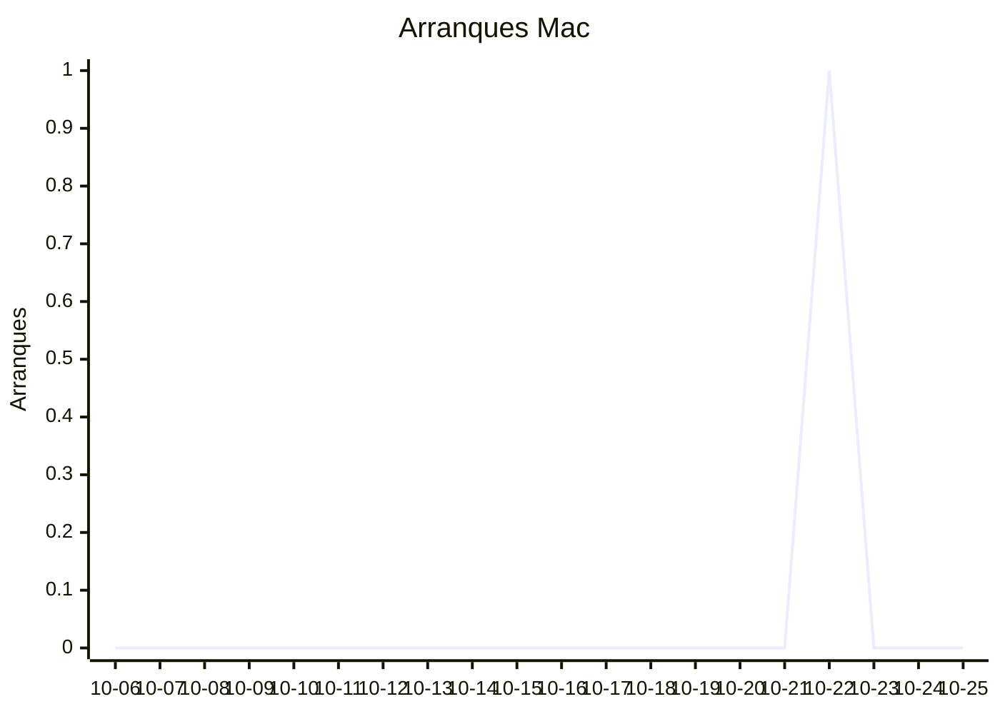
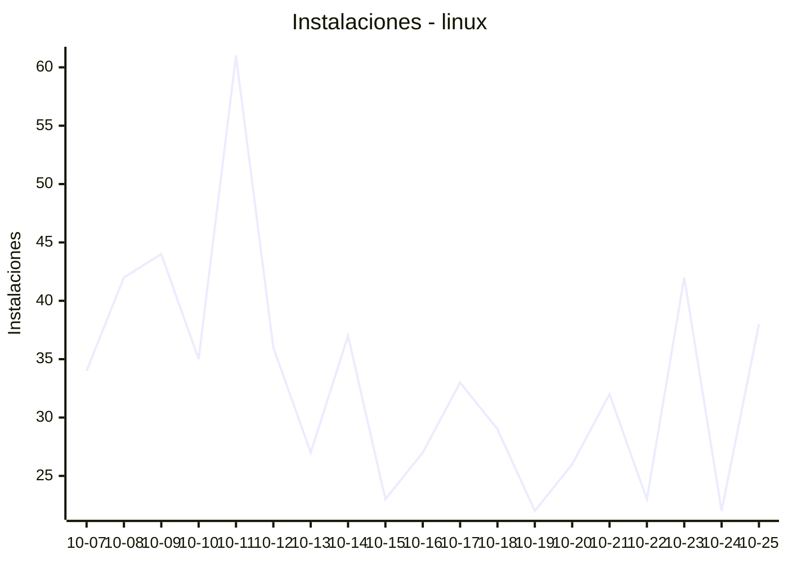
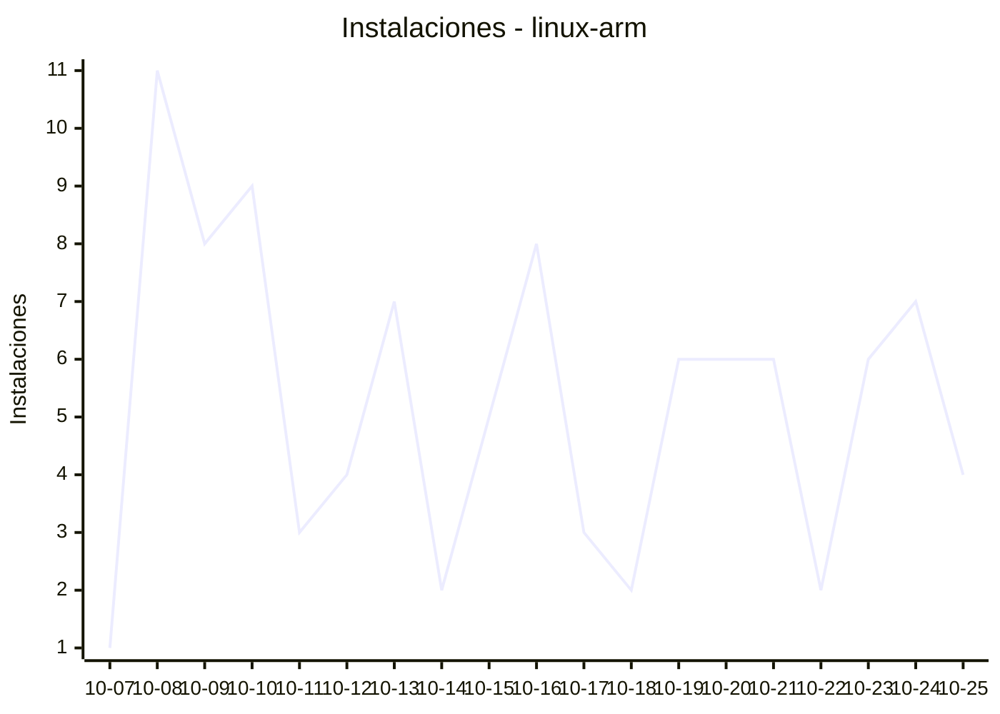
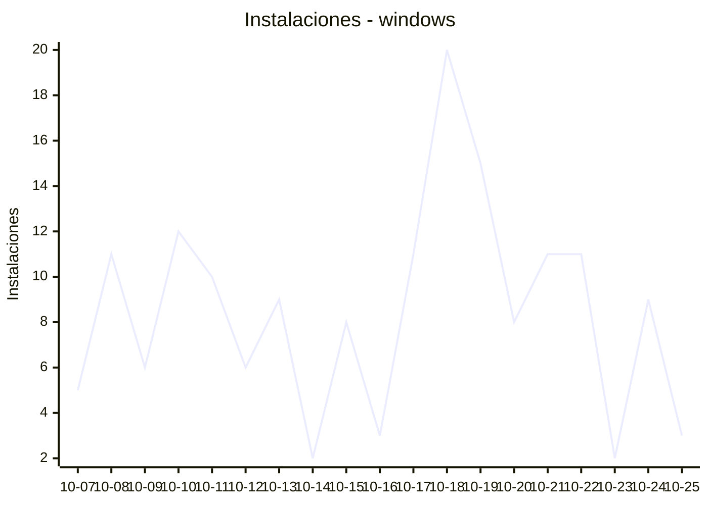
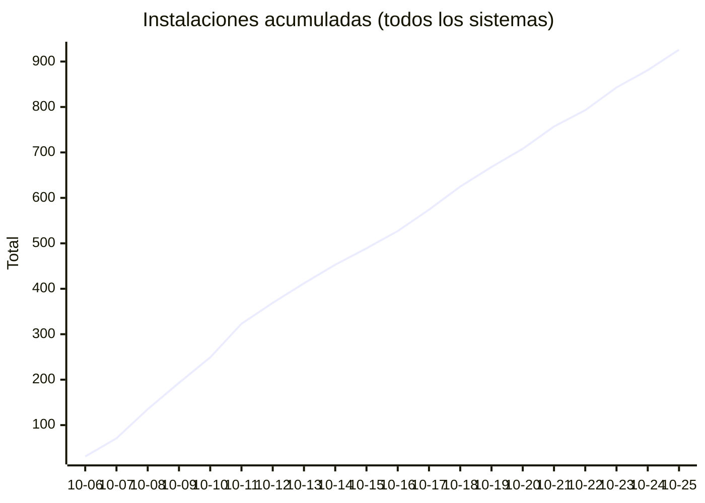
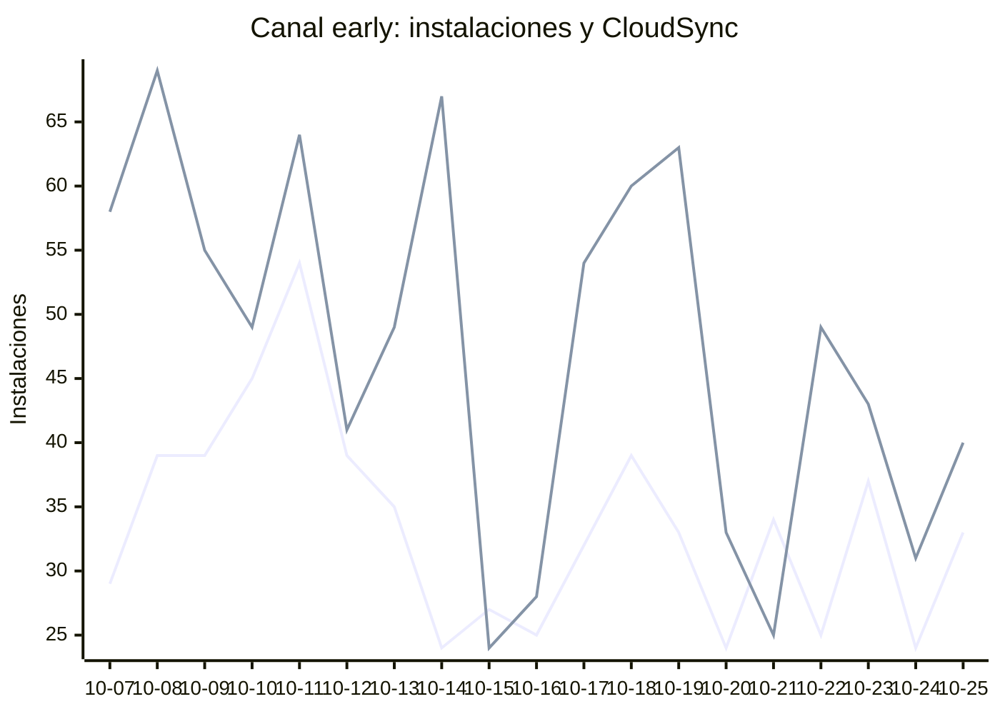

# Estadísticas de EmuDeck

Actualizado: 2026-10-26 23:38 UTC. Las gráficas no incluyen el día de hoy porque aún está incompleto.

## Arranques de la app (comprobaciones de actualización)

Cada arranque descarga el `latest*.yml` de su sistema. Cuenta arranques, no personas.

| Sistema | Ayer | Últimos 7 días |
|---|---|---|
| Linux x86 | 15683 | 93576 |
| Linux ARM | 129 | 1105 |
| Windows | 4147 | 24252 |
| Mac | 0 | 1 |

Instalaciones nuevas estimadas en Windows (7 días, `.exe` menos `.blockmap`): **2055**

## Instalaciones de EmuDeck (beacons)

Cada `setup` descarga `system-<sistema>.txt` y cada instalación de un emulador `<emulador>-<plataforma>.txt`. Los emuladores cuentan también las actualizaciones. Histórico completo desde el primer día.

| Sistema | Ayer | Últimos 7 días | Últimos 30 días | Total |
|---|---|---|---|---|
| linux | 38 | 205 | 633 | 687 |
| linux-arm | 4 | 37 | 100 | 104 |
| windows | 3 | 59 | 162 | 181 |

### Por mes

| Mes | Linux | Linux ARM | Windows | Total |
|---|---|---|---|---|
| 2026-10 | 633 | 100 | 162 | 895 |

### Canal early (early + early-unstable)

Instalaciones de EmuDeck con el backend en una rama early, y cuántas de ellas instalan CloudSync.

| | Últimos 7 días | Últimos 30 días | Total |
|---|---|---|---|
| Instalaciones early | 210 | 637 | 687 |
| Con CloudSync | 284 | 902 | 1046 |
| % con CloudSync | | | 152% |

Línea de arriba: instalaciones early. Línea de abajo: de ellas, con CloudSync.

### Por emulador

| Emulador | Linux (total) | Linux ARM (total) | Windows (total) | Últimos 7 días | Últimos 30 días | Total |
|---|---|---|---|---|---|---|
| pcsx2 | 1887 | 22 | 212 | 682 | 1944 | 2121 |
| duckstation | 1804 | 140 | 89 | 671 | 1868 | 2033 |
| azahar | 1649 | 155 | 211 | 662 | 1853 | 2015 |
| esde | 1531 | 120 | 344 | 652 | 1790 | 1995 |
| ryujinx | 1614 | 149 | 222 | 662 | 1828 | 1985 |
| rpcs3 | 1703 | 142 | 90 | 644 | 1773 | 1935 |
| cemu | 1659 | 146 | 72 | 624 | 1728 | 1877 |
| srm | 1500 | 133 | 238 | 668 | 1744 | 1871 |
| xenia | 1536 | 114 | 182 | 620 | 1685 | 1832 |
| shadps4 | 1444 | 119 | 155 | 556 | 1568 | 1718 |
| vita3k | 1505 | 126 | 58 | 549 | 1547 | 1689 |
| cloudsync | 730 | 29 | 326 | 296 | 936 | 1085 |
| ppsspp | 609 | 87 | 161 | 263 | 785 | 857 |
| ra | 663 | 92 | 102 | 269 | 790 | 857 |
| dolphin | 662 | 96 | 91 | 255 | 781 | 849 |
| mgba | 667 | 51 | 49 | 253 | 715 | 767 |
| xemu | 571 | 78 | 69 | 227 | 661 | 718 |
| melonds | 561 | 74 | 68 | 211 | 649 | 703 |
| primehack | 494 | 71 | 70 | 199 | 586 | 635 |
| supermodel | 481 | 86 | 16 | 171 | 538 | 583 |
| scummvm | 466 | 63 | 45 | 173 | 527 | 574 |
| model2 | 473 | 89 | 7 | 165 | 526 | 569 |
| bigpemu | 459 | 10 | 11 | 166 | 444 | 480 |
| armsx2 | 145 | 165 | 0 | 118 | 283 | 310 |
| flycast | 125 | 16 | 18 | 47 | 149 | 159 |
| rmg | 122 | 27 | 0 | 43 | 142 | 149 |
| eden | 82 | 9 | 0 | 16 | 74 | 91 |
| mame | 68 | 2 | 15 | 22 | 80 | 85 |
| pegasus | 15 | 0 | 12 | 8 | 25 | 27 |
| yuzu | 8 | 0 | 2 | 4 | 10 | 10 |
| ares | 8 | 1 | 0 | 4 | 8 | 9 |
| citron | 5 | 0 | 0 | 0 | 4 | 5 |
