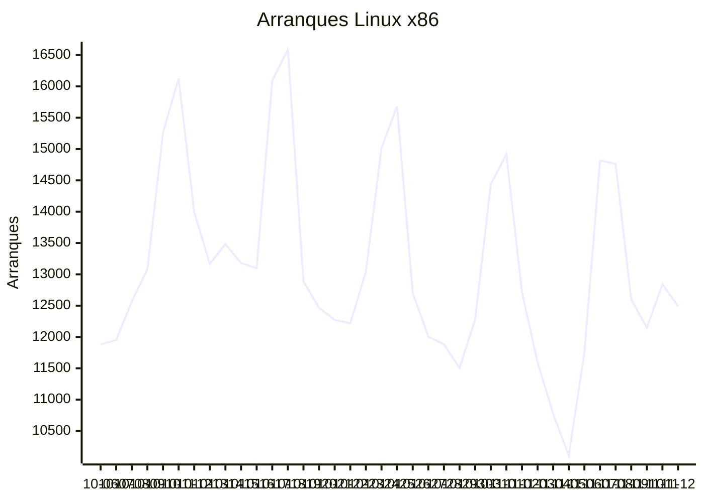
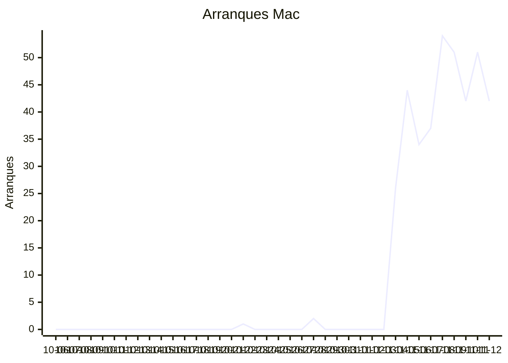
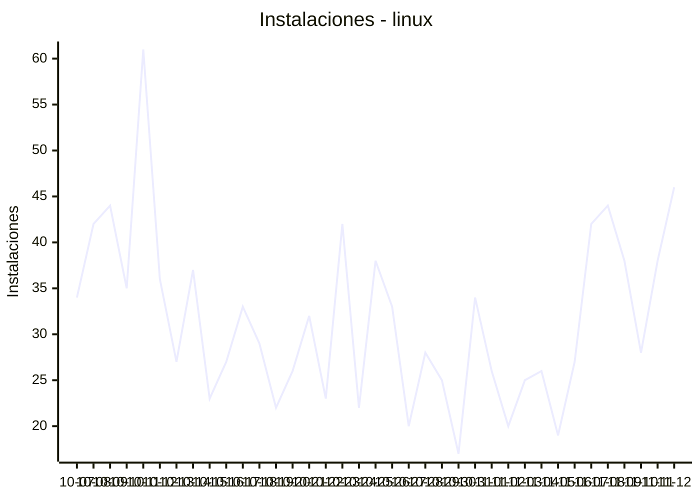
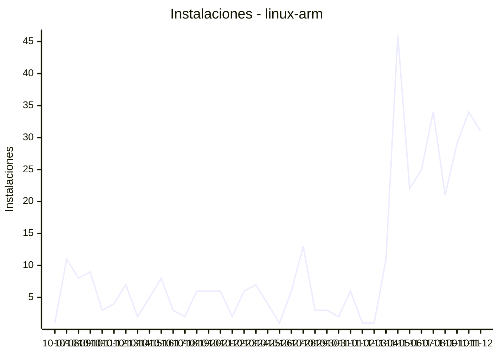
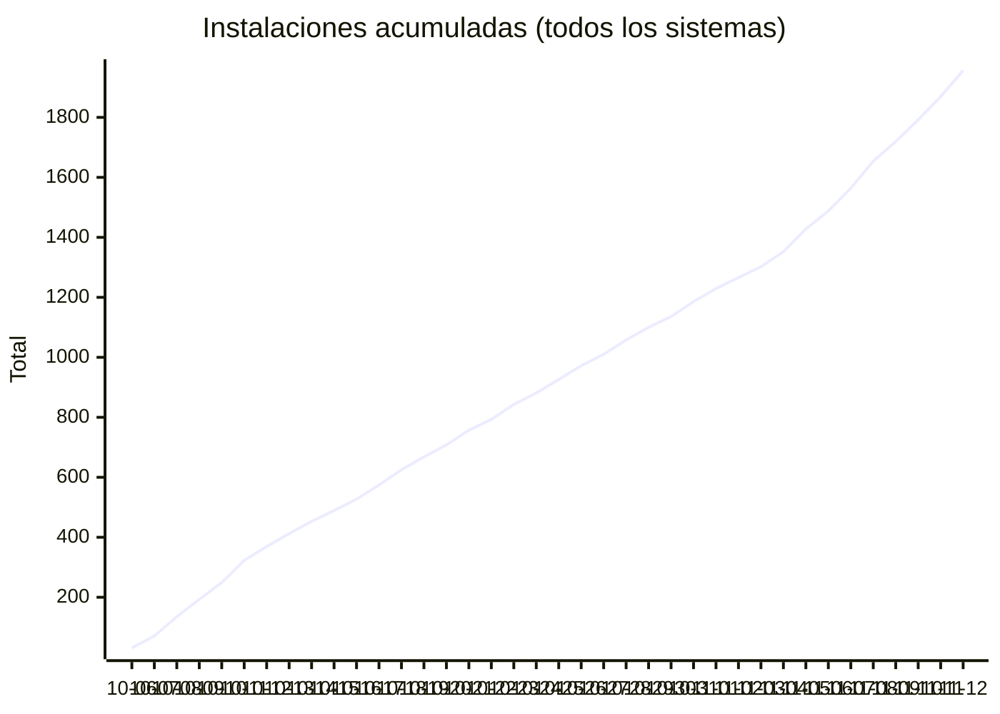
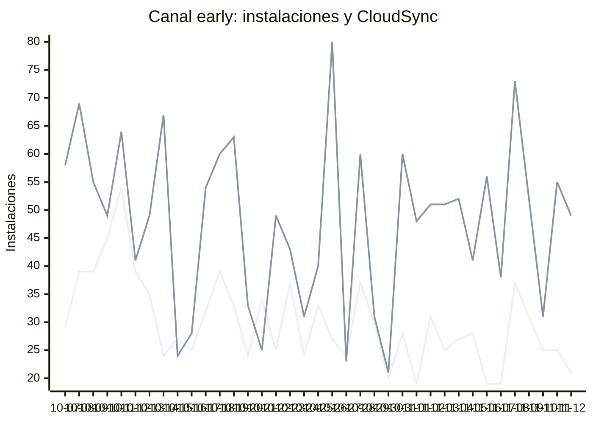

# Estadísticas de EmuDeck

Actualizado: 2026-11-13 14:35 UTC. Las gráficas no incluyen el día de hoy porque aún está incompleto.

## Arranques de la app (comprobaciones de actualización)

Cada arranque descarga el `latest*.yml` de su sistema. Cuenta arranques, no personas.

| Sistema | Ayer | Últimos 7 días |
|---|---|---|
| Linux x86 | 12491 | 91406 |
| Linux ARM | 139 | 882 |
| Windows | 3174 | 24441 |
| Mac | 42 | 311 |

Instalaciones nuevas estimadas en Windows (7 días, `.exe` menos `.blockmap`): **2454**

## Instalaciones de EmuDeck (beacons)

Cada `setup` descarga `system-<sistema>.txt` y cada instalación de un emulador `<emulador>-<plataforma>.txt`. Los emuladores cuentan también las actualizaciones. Histórico completo desde el primer día.

| Sistema | Ayer | Últimos 7 días | Últimos 30 días | Total |
|---|---|---|---|---|
| linux | 46 | 263 | 890 | 1216 |
| linux-arm | 31 | 196 | 346 | 406 |
| windows | 10 | 69 | 308 | 379 |

### Por mes

| Mes | Linux | Linux ARM | Windows | Total |
|---|---|---|---|---|
| 2026-11 | 379 | 261 | 130 | 770 |
| 2026-10 | 790 | 128 | 237 | 1155 |

### Canal early (early + early-unstable)

Instalaciones de EmuDeck con el backend en una rama early, y cuántas de ellas instalan CloudSync.

| | Últimos 7 días | Últimos 30 días | Total |
|---|---|---|---|
| Instalaciones early | 177 | 830 | 1148 |
| Con CloudSync | 354 | 1389 | 1858 |
| % con CloudSync | | | 162% |

Línea de arriba: instalaciones early. Línea de abajo: de ellas, con CloudSync.

### Por emulador

| Emulador | Linux (total) | Linux ARM (total) | Windows (total) | Últimos 7 días | Últimos 30 días | Total |
|---|---|---|---|---|---|---|
| esde | 2701 | 421 | 757 | 801 | 3014 | 3879 |
| azahar | 2865 | 492 | 418 | 790 | 2903 | 3775 |
| pcsx2 | 3270 | 35 | 442 | 682 | 2846 | 3747 |
| duckstation | 3116 | 460 | 164 | 774 | 2866 | 3740 |
| ryujinx | 2797 | 486 | 417 | 812 | 2872 | 3700 |
| rpcs3 | 2966 | 457 | 170 | 754 | 2780 | 3593 |
| srm | 2659 | 392 | 499 | 802 | 2802 | 3550 |
| cemu | 2826 | 446 | 148 | 697 | 2613 | 3420 |
| xenia | 2632 | 370 | 366 | 680 | 2591 | 3368 |
| vita3k | 2565 | 401 | 117 | 633 | 2370 | 3083 |
| shadps4 | 2458 | 227 | 330 | 520 | 2316 | 3015 |
| cloudsync | 1239 | 50 | 631 | 363 | 1431 | 1920 |
| ppsspp | 1048 | 310 | 348 | 417 | 1296 | 1706 |
| dolphin | 1145 | 352 | 174 | 401 | 1264 | 1671 |
| ra | 1149 | 330 | 192 | 400 | 1268 | 1671 |
| mgba | 1194 | 105 | 87 | 286 | 1063 | 1386 |
| xemu | 974 | 274 | 136 | 333 | 1046 | 1384 |
| melonds | 948 | 275 | 120 | 324 | 1011 | 1343 |
| primehack | 877 | 285 | 139 | 331 | 995 | 1301 |
| supermodel | 821 | 270 | 41 | 275 | 850 | 1132 |
| scummvm | 786 | 242 | 86 | 270 | 836 | 1114 |
| model2 | 807 | 285 | 13 | 273 | 824 | 1105 |
| bigpemu | 789 | 34 | 35 | 166 | 658 | 858 |
| armsx2 | 252 | 514 | 0 | 249 | 624 | 766 |
| flycast | 206 | 36 | 35 | 60 | 195 | 277 |
| rmg | 206 | 56 | 0 | 69 | 189 | 262 |
| mame | 118 | 13 | 44 | 48 | 121 | 175 |
| eden | 122 | 11 | 20 | 46 | 124 | 153 |
| pegasus | 38 | 3 | 27 | 16 | 57 | 68 |
| yuzu | 15 | 0 | 8 | 6 | 19 | 23 |
| ares | 17 | 2 | 0 | 6 | 14 | 19 |
| citron | 6 | 0 | 2 | 2 | 7 | 8 |
