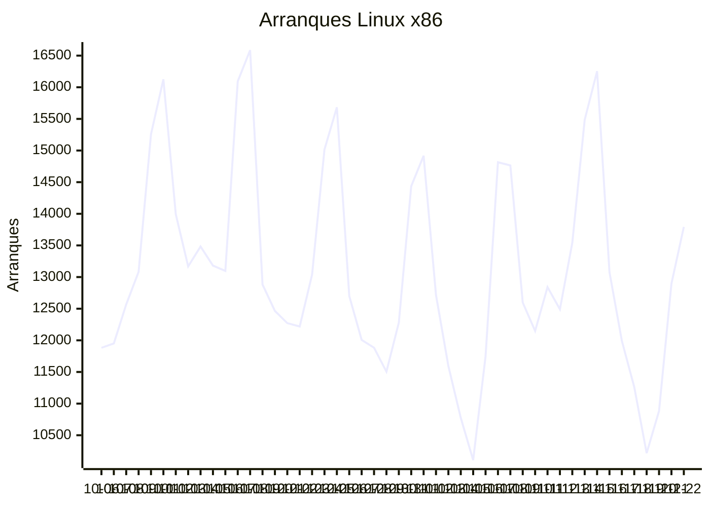
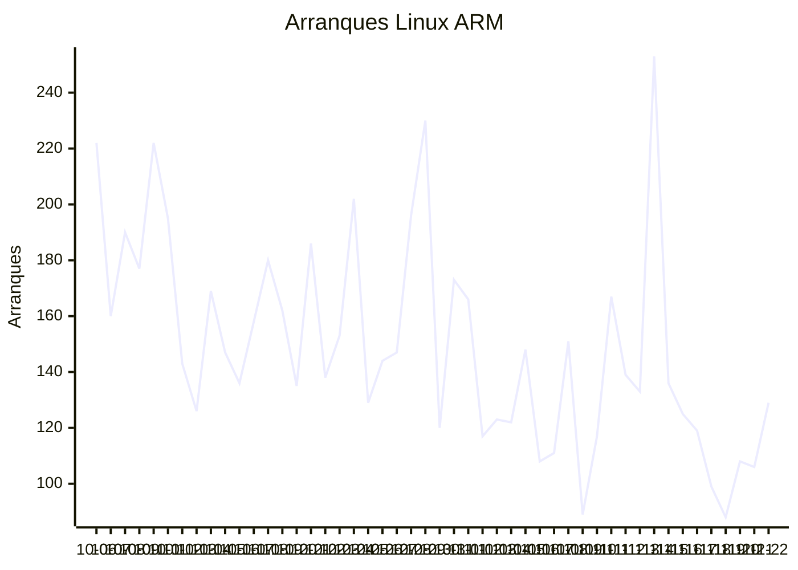
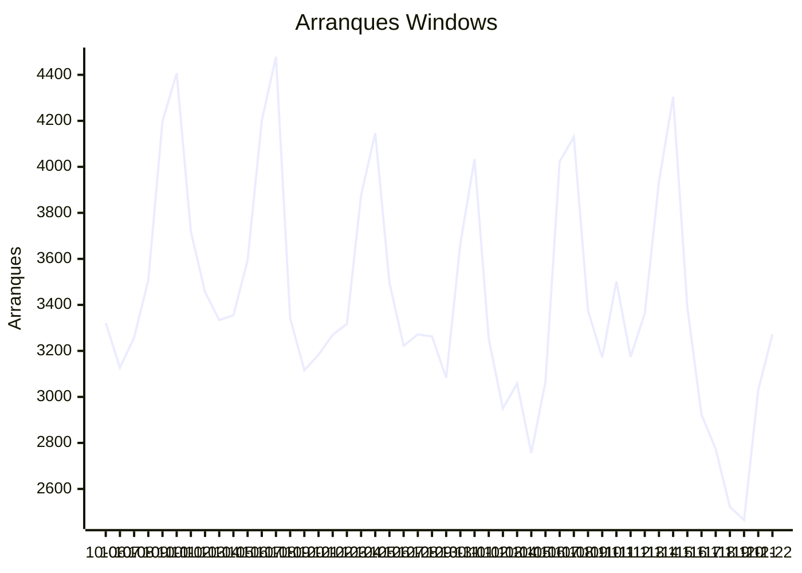
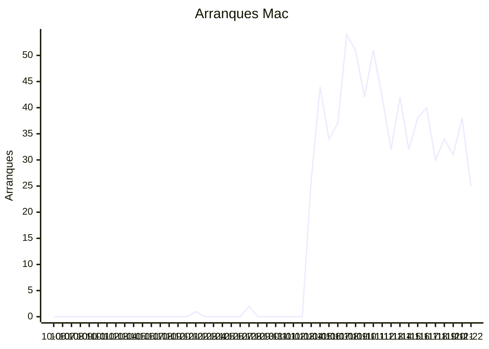
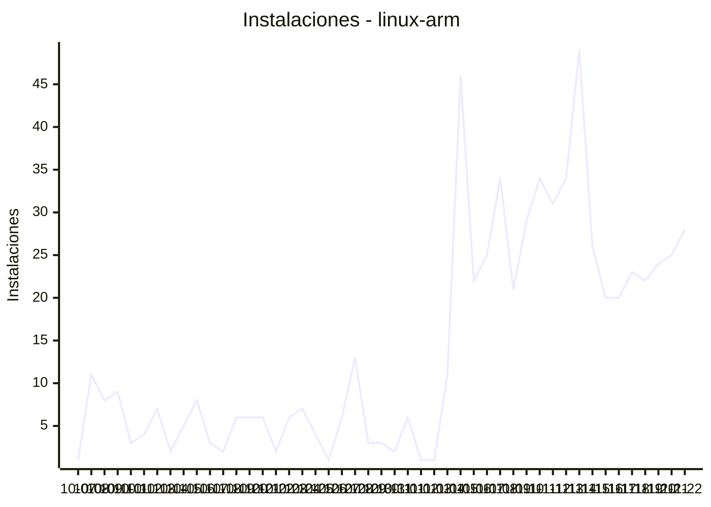
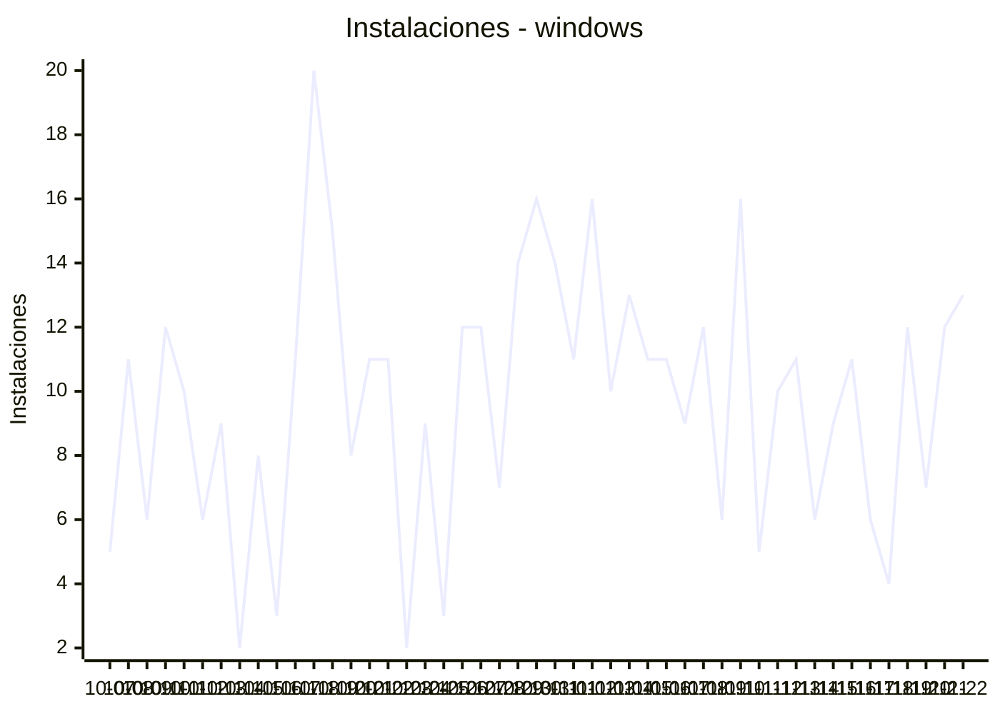
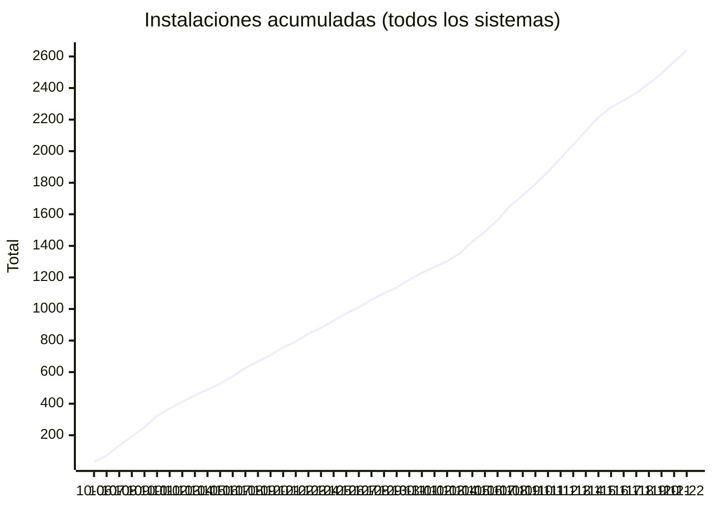
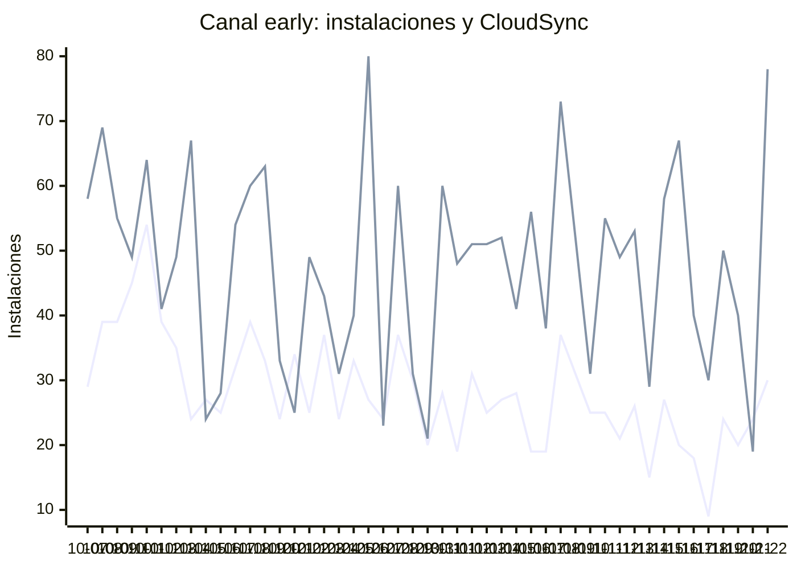

# Estadísticas de EmuDeck

Actualizado: 2026-11-23 12:14 UTC. Las gráficas no incluyen el día de hoy porque aún está incompleto.

## Arranques de la app (comprobaciones de actualización)

Cada arranque descarga el `latest*.yml` de su sistema. Cuenta arranques, no personas.

| Sistema | Ayer | Últimos 7 días |
|---|---|---|
| Linux x86 | 13792 | 84117 |
| Linux ARM | 129 | 774 |
| Windows | 3272 | 20376 |
| Mac | 25 | 236 |

Instalaciones nuevas estimadas en Windows (7 días, `.exe` menos `.blockmap`): **2147**

## Instalaciones de EmuDeck (beacons)

Cada `setup` descarga `system-<sistema>.txt` y cada instalación de un emulador `<emulador>-<plataforma>.txt`. Los emuladores cuentan también las actualizaciones. Histórico completo desde el primer día.

| Sistema | Ayer | Últimos 7 días | Últimos 30 días | Total |
|---|---|---|---|---|
| linux | 32 | 197 | 917 | 1526 |
| linux-arm | 28 | 162 | 571 | 669 |
| windows | 13 | 65 | 308 | 468 |

### Por mes

| Mes | Linux | Linux ARM | Windows | Total |
|---|---|---|---|---|
| 2026-11 | 700 | 532 | 221 | 1453 |
| 2026-10 | 790 | 128 | 237 | 1155 |

### Canal early (early + early-unstable)

Instalaciones de EmuDeck con el backend en una rama early, y cuántas de ellas instalan CloudSync.

| | Últimos 7 días | Últimos 30 días | Total |
|---|---|---|---|
| Instalaciones early | 145 | 743 | 1359 |
| Con CloudSync | 324 | 1407 | 2330 |
| % con CloudSync | | | 171% |

Línea de arriba: instalaciones early. Línea de abajo: de ellas, con CloudSync.

### Por emulador

| Emulador | Linux (total) | Linux ARM (total) | Windows (total) | Últimos 7 días | Últimos 30 días | Total |
|---|---|---|---|---|---|---|
| esde | 3417 | 693 | 974 | 794 | 3374 | 5084 |
| azahar | 3612 | 808 | 510 | 761 | 3168 | 4930 |
| ryujinx | 3548 | 809 | 508 | 743 | 3132 | 4865 |
| duckstation | 3889 | 741 | 206 | 725 | 3056 | 4836 |
| srm | 3410 | 639 | 650 | 736 | 3087 | 4699 |
| rpcs3 | 3732 | 760 | 205 | 716 | 3026 | 4697 |
| pcsx2 | 4090 | 41 | 549 | 610 | 2838 | 4680 |
| cemu | 3537 | 713 | 187 | 657 | 2793 | 4437 |
| xenia | 3309 | 610 | 445 | 658 | 2777 | 4364 |
| vita3k | 3217 | 648 | 136 | 598 | 2518 | 4001 |
| shadps4 | 3081 | 255 | 393 | 458 | 2239 | 3729 |
| cloudsync | 1526 | 76 | 821 | 349 | 1467 | 2423 |
| ppsspp | 1296 | 530 | 433 | 351 | 1490 | 2259 |
| dolphin | 1426 | 588 | 217 | 358 | 1467 | 2231 |
| ra | 1430 | 549 | 240 | 352 | 1451 | 2219 |
| xemu | 1199 | 458 | 159 | 281 | 1178 | 1816 |
| melonds | 1176 | 464 | 149 | 290 | 1147 | 1789 |
| mgba | 1508 | 163 | 108 | 264 | 1104 | 1779 |
| primehack | 1100 | 477 | 162 | 278 | 1171 | 1739 |
| supermodel | 1023 | 437 | 51 | 245 | 980 | 1511 |
| scummvm | 982 | 406 | 106 | 244 | 971 | 1494 |
| model2 | 1003 | 457 | 14 | 240 | 950 | 1474 |
| armsx2 | 325 | 829 | 0 | 242 | 887 | 1154 |
| bigpemu | 971 | 54 | 49 | 136 | 643 | 1074 |
| flycast | 256 | 64 | 44 | 63 | 215 | 364 |
| rmg | 249 | 91 | 0 | 59 | 203 | 340 |
| mame | 140 | 23 | 65 | 40 | 145 | 228 |
| eden | 163 | 11 | 22 | 31 | 115 | 196 |
| pegasus | 54 | 3 | 30 | 15 | 64 | 87 |
| yuzu | 18 | 0 | 8 | 2 | 19 | 26 |
| ares | 22 | 3 | 0 | 3 | 16 | 25 |
| citron | 6 | 2 | 2 | 2 | 6 | 10 |
