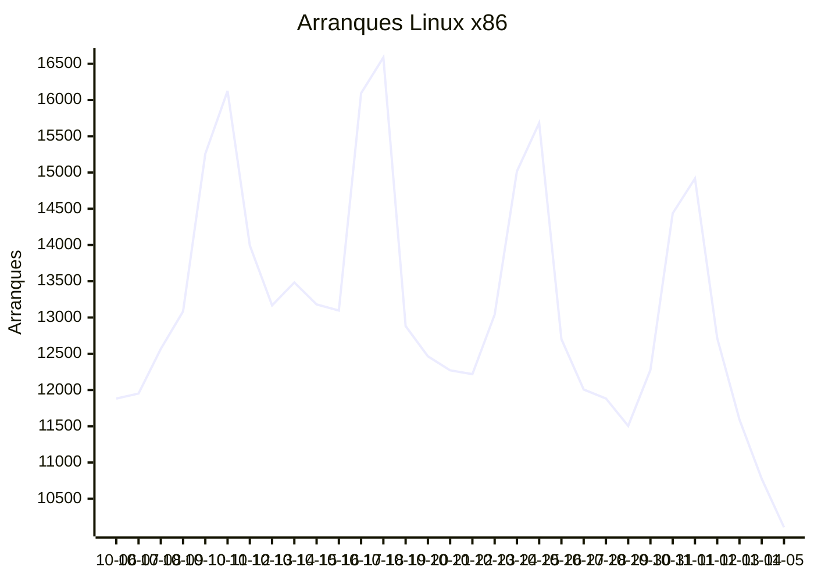
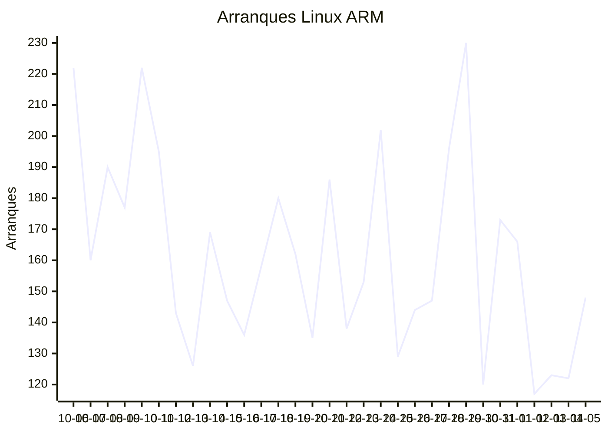
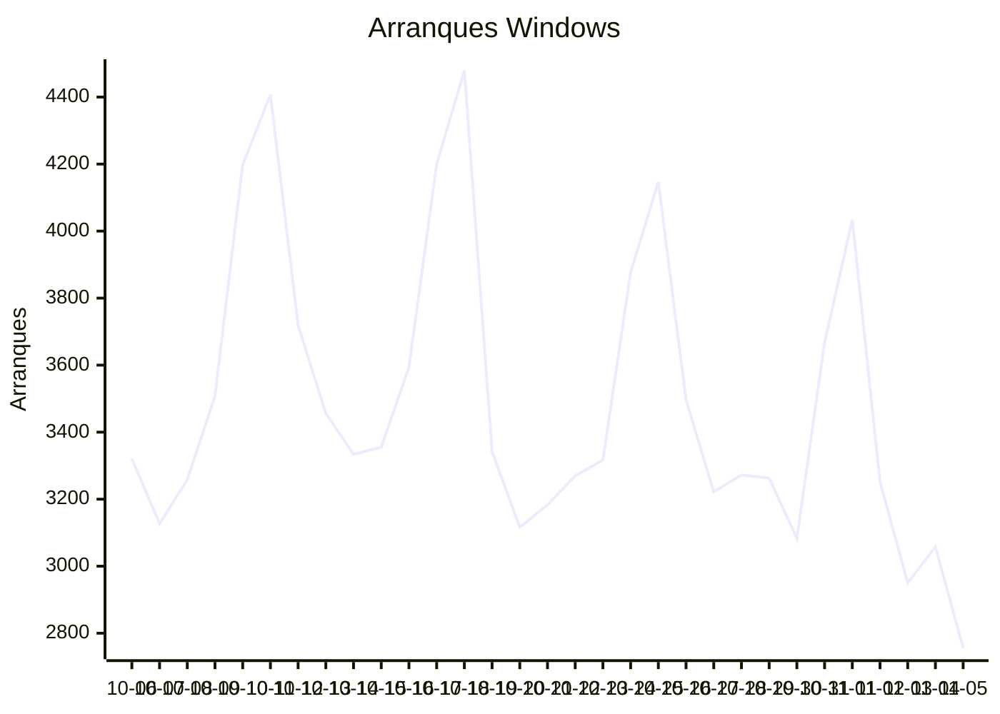
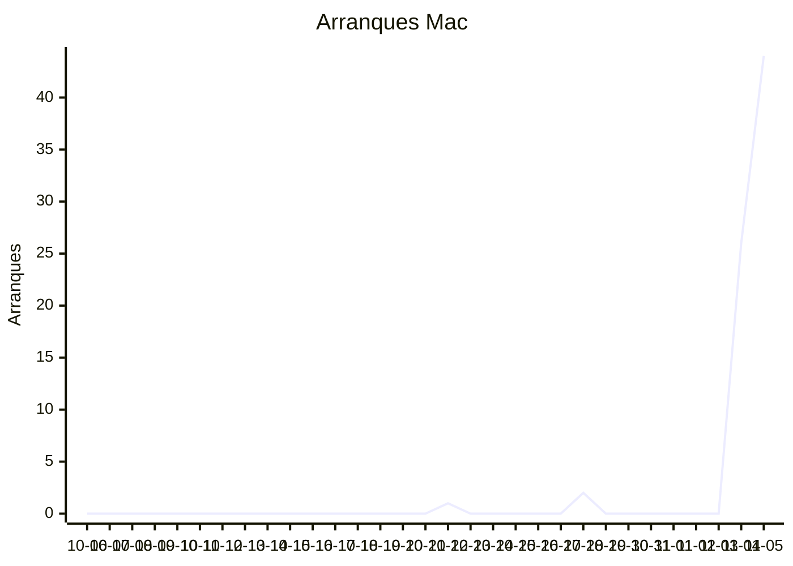
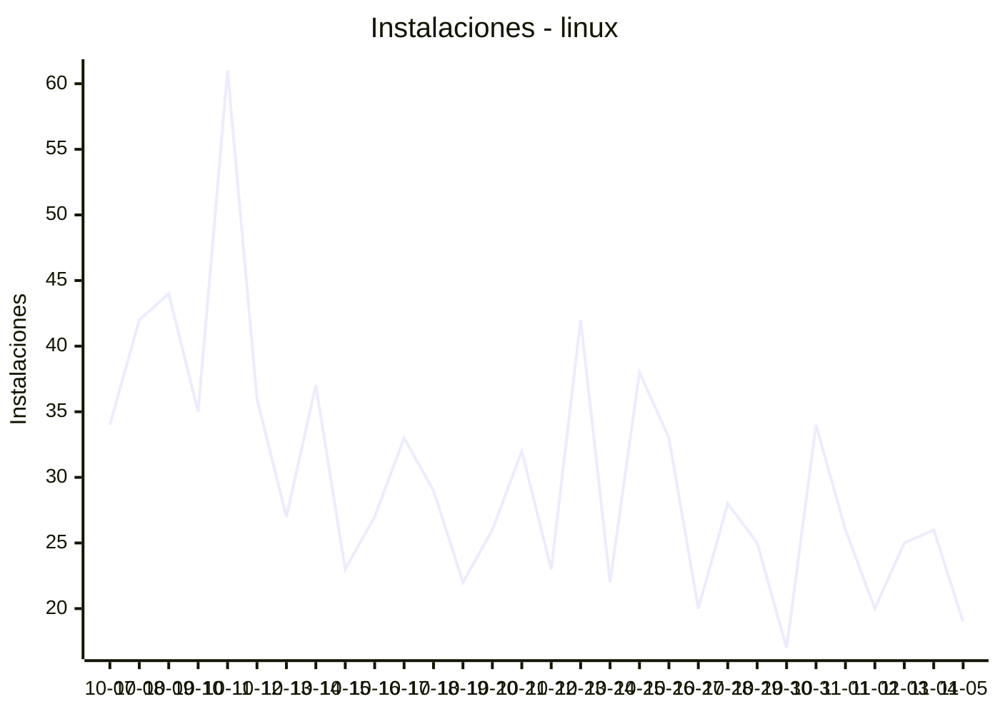
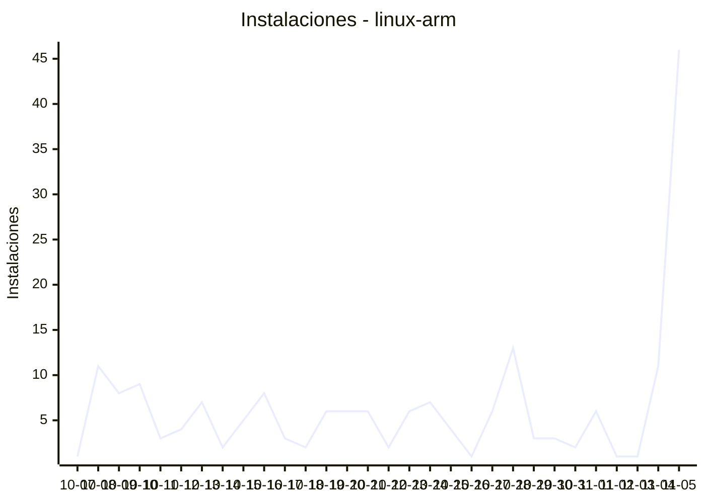
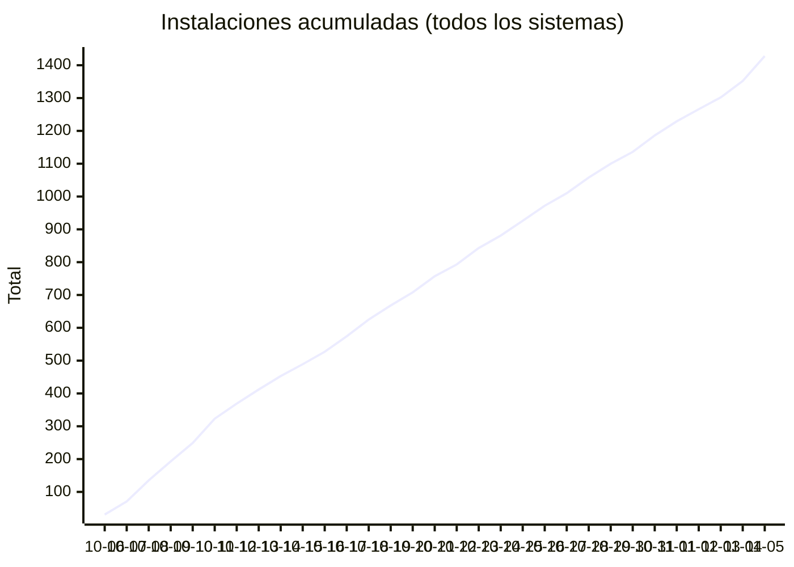
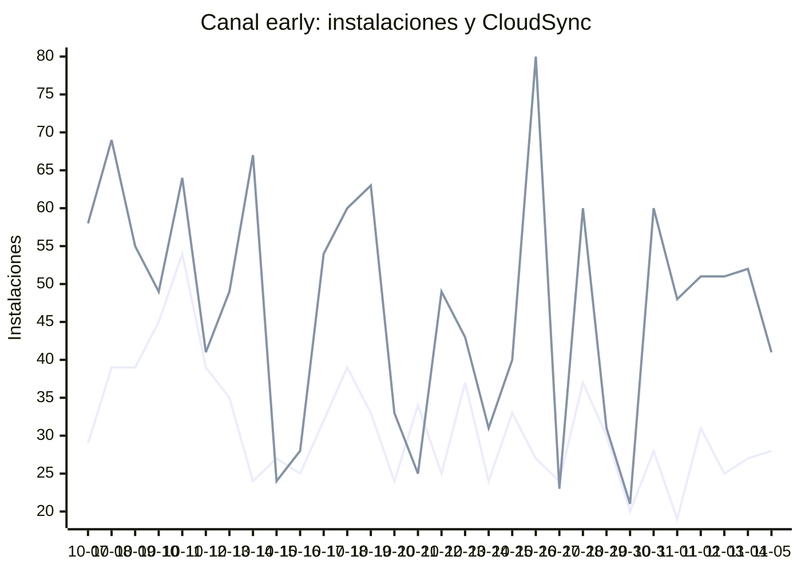

# Estadísticas de EmuDeck

Actualizado: 2026-11-06 21:07 UTC. Las gráficas no incluyen el día de hoy porque aún está incompleto.

## Arranques de la app (comprobaciones de actualización)

Cada arranque descarga el `latest*.yml` de su sistema. Cuenta arranques, no personas.

| Sistema | Ayer | Últimos 7 días |
|---|---|---|
| Linux x86 | 10107 | 86823 |
| Linux ARM | 148 | 969 |
| Windows | 2756 | 22800 |
| Mac | 44 | 70 |

Instalaciones nuevas estimadas en Windows (7 días, `.exe` menos `.blockmap`): **2228**

## Instalaciones de EmuDeck (beacons)

Cada `setup` descarga `system-<sistema>.txt` y cada instalación de un emulador `<emulador>-<plataforma>.txt`. Los emuladores cuentan también las actualizaciones. Histórico completo desde el primer día.

| Sistema | Ayer | Últimos 7 días | Últimos 30 días | Total |
|---|---|---|---|---|
| linux | 19 | 167 | 906 | 950 |
| linux-arm | 46 | 70 | 193 | 214 |
| windows | 11 | 91 | 298 | 315 |

### Por mes

| Mes | Linux | Linux ARM | Windows | Total |
|---|---|---|---|---|
| 2026-11 | 116 | 65 | 61 | 242 |
| 2026-10 | 790 | 128 | 237 | 1155 |

### Canal early (early + early-unstable)

Instalaciones de EmuDeck con el backend en una rama early, y cuántas de ellas instalan CloudSync.

| | Últimos 7 días | Últimos 30 días | Total |
|---|---|---|---|
| Instalaciones early | 178 | 933 | 974 |
| Con CloudSync | 324 | 1420 | 1525 |
| % con CloudSync | | | 157% |

Línea de arriba: instalaciones early. Línea de abajo: de ellas, con CloudSync.

### Por emulador

| Emulador | Linux (total) | Linux ARM (total) | Windows (total) | Últimos 7 días | Últimos 30 días | Total |
|---|---|---|---|---|---|---|
| esde | 2205 | 248 | 614 | 751 | 2899 | 3067 |
| pcsx2 | 2667 | 28 | 369 | 630 | 2917 | 3064 |
| azahar | 2339 | 291 | 350 | 638 | 2830 | 2980 |
| duckstation | 2542 | 270 | 145 | 611 | 2807 | 2957 |
| ryujinx | 2270 | 276 | 338 | 602 | 2745 | 2884 |
| rpcs3 | 2426 | 262 | 141 | 596 | 2686 | 2829 |
| srm | 2123 | 235 | 398 | 578 | 2622 | 2756 |
| cemu | 2318 | 268 | 127 | 550 | 2582 | 2713 |
| xenia | 2154 | 213 | 311 | 557 | 2556 | 2678 |
| shadps4 | 2021 | 192 | 273 | 503 | 2375 | 2486 |
| vita3k | 2107 | 231 | 101 | 494 | 2316 | 2439 |
| cloudsync | 1021 | 45 | 511 | 338 | 1471 | 1577 |
| ppsspp | 832 | 166 | 286 | 273 | 1219 | 1284 |
| ra | 923 | 181 | 168 | 271 | 1204 | 1272 |
| dolphin | 910 | 197 | 151 | 261 | 1199 | 1258 |
| mgba | 972 | 67 | 72 | 230 | 1055 | 1111 |
| xemu | 774 | 149 | 117 | 203 | 988 | 1040 |
| melonds | 760 | 146 | 104 | 204 | 961 | 1010 |
| primehack | 700 | 147 | 121 | 214 | 910 | 968 |
| supermodel | 662 | 158 | 32 | 177 | 807 | 852 |
| scummvm | 634 | 127 | 76 | 170 | 791 | 837 |
| model2 | 652 | 165 | 12 | 170 | 785 | 829 |
| bigpemu | 654 | 23 | 22 | 153 | 658 | 699 |
| armsx2 | 201 | 310 | 0 | 138 | 482 | 511 |
| flycast | 166 | 22 | 29 | 41 | 208 | 217 |
| rmg | 158 | 34 | 0 | 30 | 185 | 192 |
| mame | 94 | 7 | 28 | 35 | 121 | 129 |
| eden | 93 | 9 | 7 | 13 | 99 | 109 |
| pegasus | 28 | 1 | 22 | 14 | 47 | 51 |
| yuzu | 12 | 0 | 5 | 7 | 17 | 17 |
| ares | 11 | 2 | 0 | 2 | 12 | 13 |
| citron | 6 | 0 | 0 | 1 | 6 | 6 |
