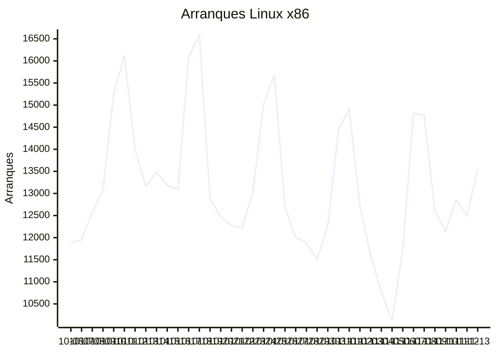
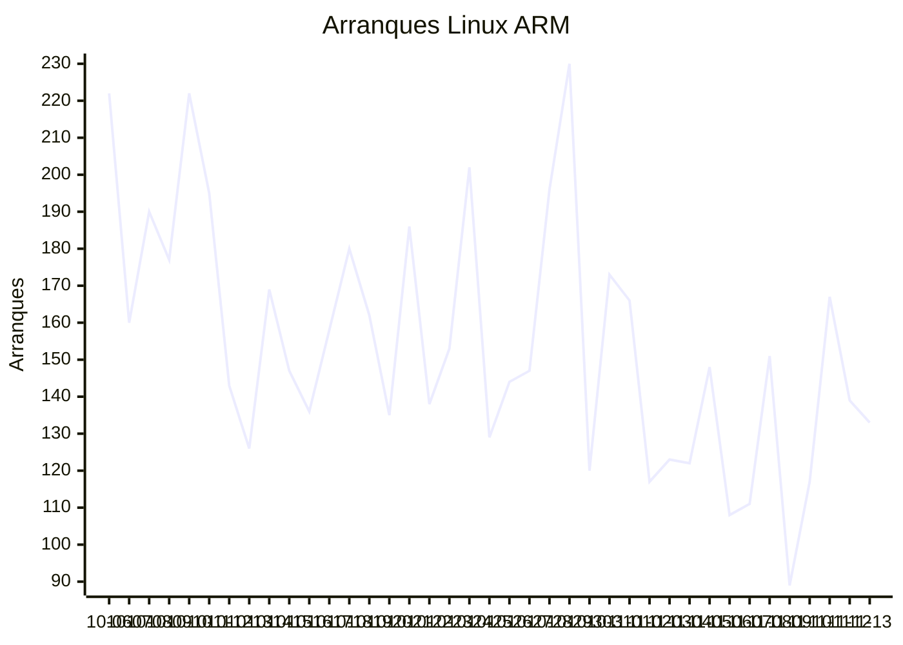
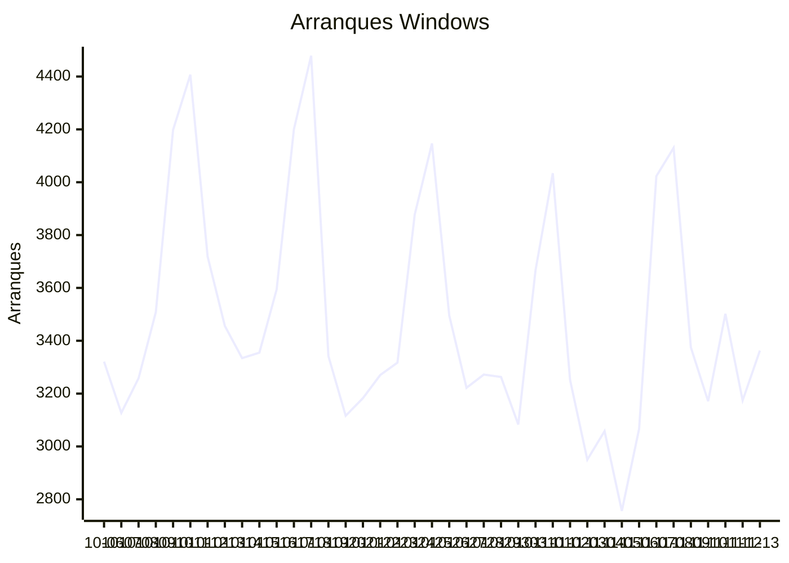
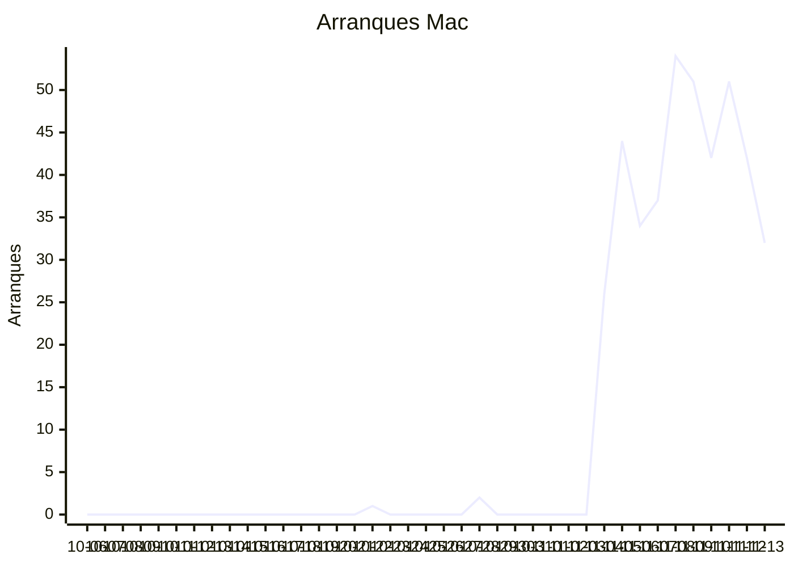
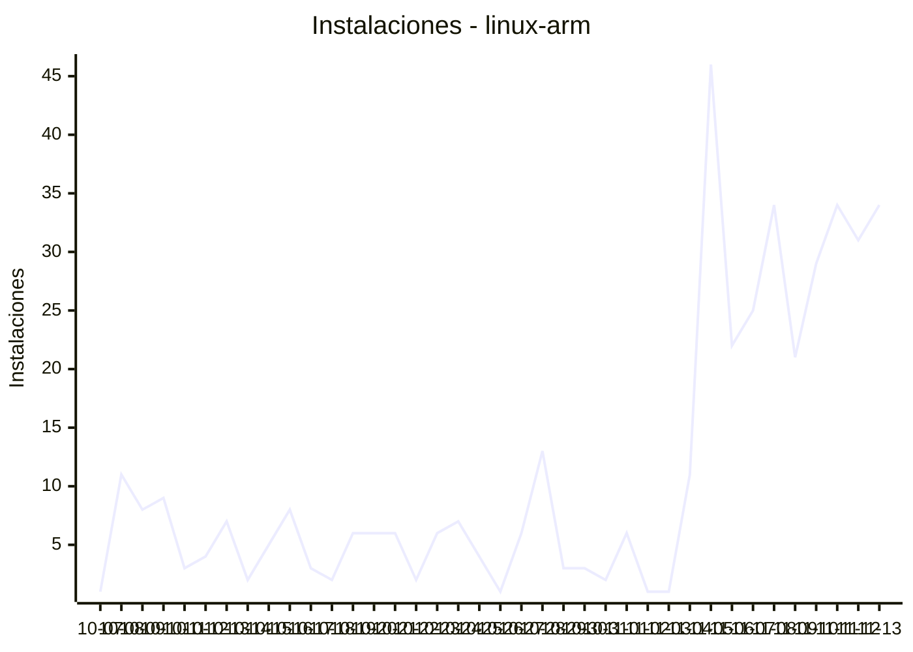
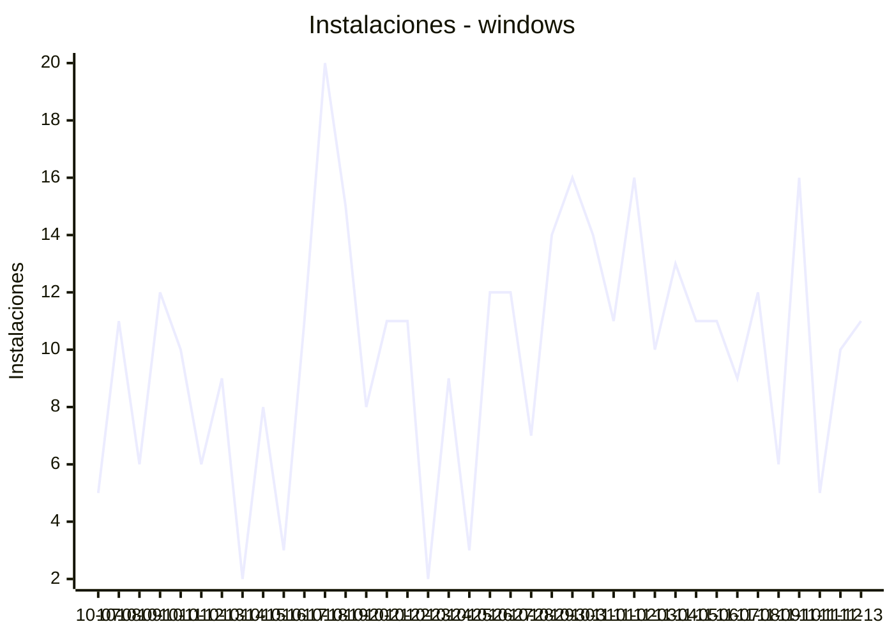
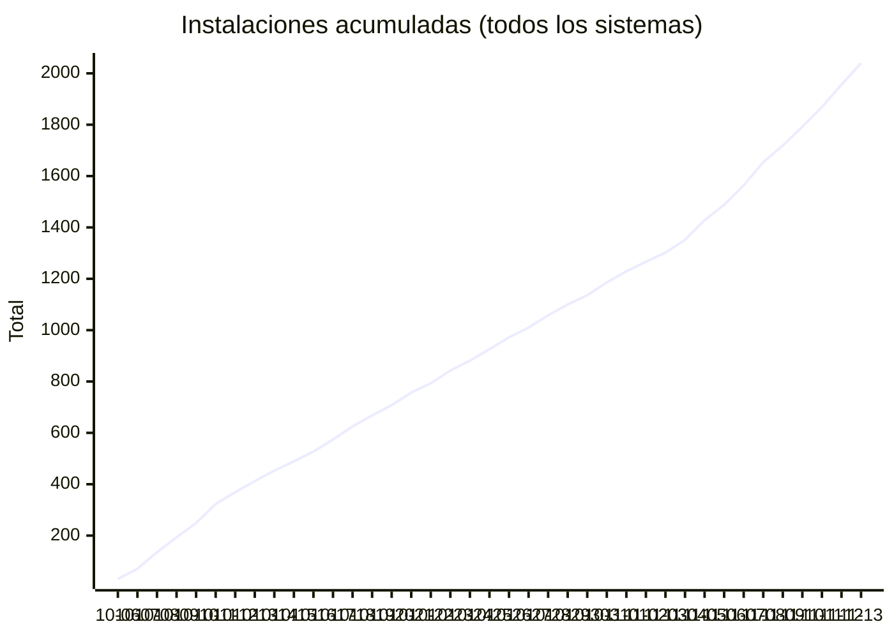
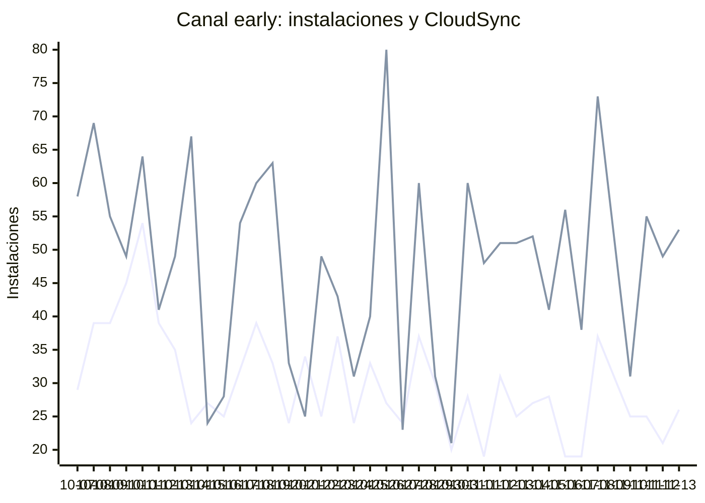

# Estadísticas de EmuDeck

Actualizado: 2026-11-14 08:35 UTC. Las gráficas no incluyen el día de hoy porque aún está incompleto.

## Arranques de la app (comprobaciones de actualización)

Cada arranque descarga el `latest*.yml` de su sistema. Cuenta arranques, no personas.

| Sistema | Ayer | Últimos 7 días |
|---|---|---|
| Linux x86 | 13541 | 93199 |
| Linux ARM | 133 | 907 |
| Windows | 3363 | 24738 |
| Mac | 32 | 309 |

Instalaciones nuevas estimadas en Windows (7 días, `.exe` menos `.blockmap`): **2518**

## Instalaciones de EmuDeck (beacons)

Cada `setup` descarga `system-<sistema>.txt` y cada instalación de un emulador `<emulador>-<plataforma>.txt`. Los emuladores cuentan también las actualizaciones. Histórico completo desde el primer día.

| Sistema | Ayer | Últimos 7 días | Últimos 30 días | Total |
|---|---|---|---|---|
| linux | 39 | 275 | 892 | 1238 |
| linux-arm | 34 | 208 | 378 | 440 |
| windows | 11 | 69 | 317 | 387 |

### Por mes

| Mes | Linux | Linux ARM | Windows | Total |
|---|---|---|---|---|
| 2026-11 | 418 | 295 | 141 | 854 |
| 2026-10 | 790 | 128 | 237 | 1155 |

### Canal early (early + early-unstable)

Instalaciones de EmuDeck con el backend en una rama early, y cuántas de ellas instalan CloudSync.

| | Últimos 7 días | Últimos 30 días | Total |
|---|---|---|---|
| Instalaciones early | 184 | 832 | 1163 |
| Con CloudSync | 351 | 1375 | 1897 |
| % con CloudSync | | | 163% |

Línea de arriba: instalaciones early. Línea de abajo: de ellas, con CloudSync.

### Por emulador

| Emulador | Linux (total) | Linux ARM (total) | Windows (total) | Últimos 7 días | Últimos 30 días | Total |
|---|---|---|---|---|---|---|
| esde | 2757 | 451 | 788 | 871 | 3062 | 3996 |
| azahar | 2923 | 537 | 426 | 854 | 2945 | 3886 |
| duckstation | 3176 | 490 | 168 | 826 | 2898 | 3834 |
| pcsx2 | 3333 | 35 | 451 | 721 | 2847 | 3819 |
| ryujinx | 2862 | 523 | 423 | 868 | 2913 | 3808 |
| rpcs3 | 3023 | 501 | 175 | 817 | 2820 | 3699 |
| srm | 2721 | 435 | 515 | 848 | 2872 | 3671 |
| cemu | 2881 | 487 | 152 | 755 | 2643 | 3520 |
| xenia | 2678 | 403 | 372 | 732 | 2618 | 3453 |
| vita3k | 2616 | 438 | 119 | 690 | 2397 | 3173 |
| shadps4 | 2509 | 227 | 338 | 560 | 2306 | 3074 |
| cloudsync | 1261 | 50 | 649 | 362 | 1418 | 1960 |
| ppsspp | 1066 | 337 | 356 | 450 | 1331 | 1759 |
| dolphin | 1163 | 381 | 177 | 431 | 1286 | 1721 |
| ra | 1168 | 353 | 196 | 421 | 1292 | 1717 |
| mgba | 1212 | 118 | 89 | 298 | 1078 | 1419 |
| xemu | 986 | 292 | 137 | 357 | 1065 | 1415 |
| melonds | 961 | 295 | 122 | 346 | 1020 | 1378 |
| primehack | 892 | 309 | 140 | 352 | 1018 | 1341 |
| supermodel | 835 | 287 | 41 | 293 | 855 | 1163 |
| scummvm | 798 | 258 | 87 | 290 | 849 | 1143 |
| model2 | 819 | 301 | 13 | 288 | 830 | 1133 |
| bigpemu | 804 | 35 | 35 | 169 | 655 | 874 |
| armsx2 | 260 | 559 | 0 | 286 | 667 | 819 |
| flycast | 208 | 37 | 37 | 62 | 197 | 282 |
| rmg | 206 | 59 | 0 | 70 | 188 | 265 |
| mame | 118 | 13 | 46 | 45 | 122 | 177 |
| eden | 131 | 11 | 20 | 48 | 121 | 162 |
| pegasus | 38 | 3 | 27 | 17 | 58 | 68 |
| yuzu | 16 | 0 | 8 | 6 | 17 | 24 |
| ares | 17 | 2 | 0 | 5 | 15 | 19 |
| citron | 6 | 0 | 2 | 2 | 6 | 8 |
