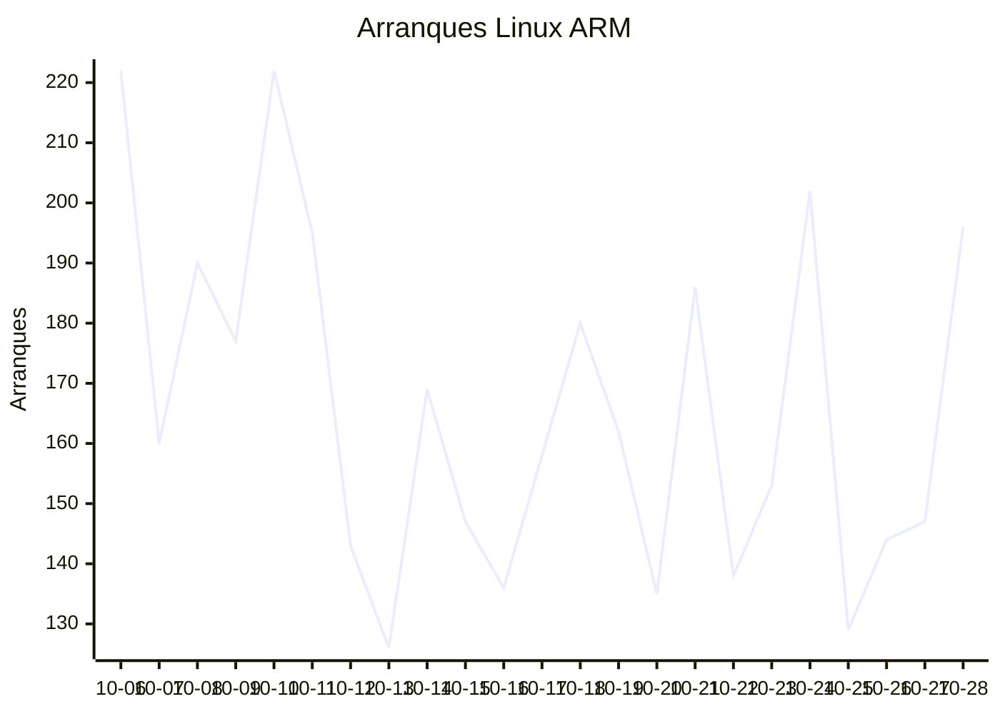
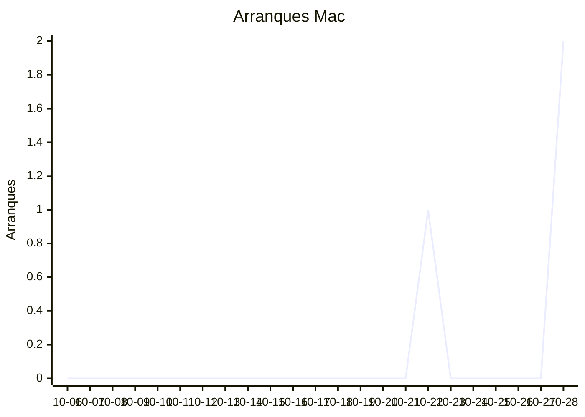
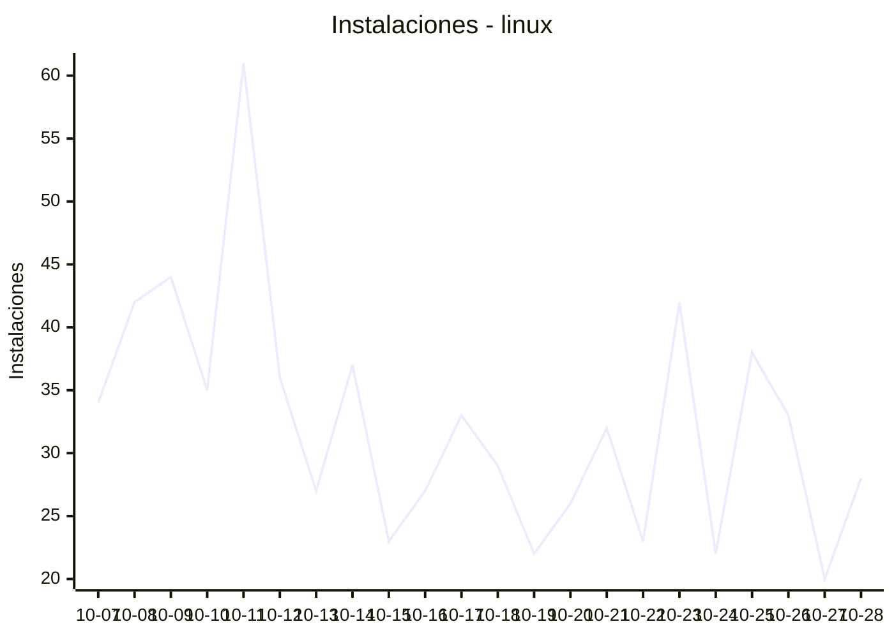
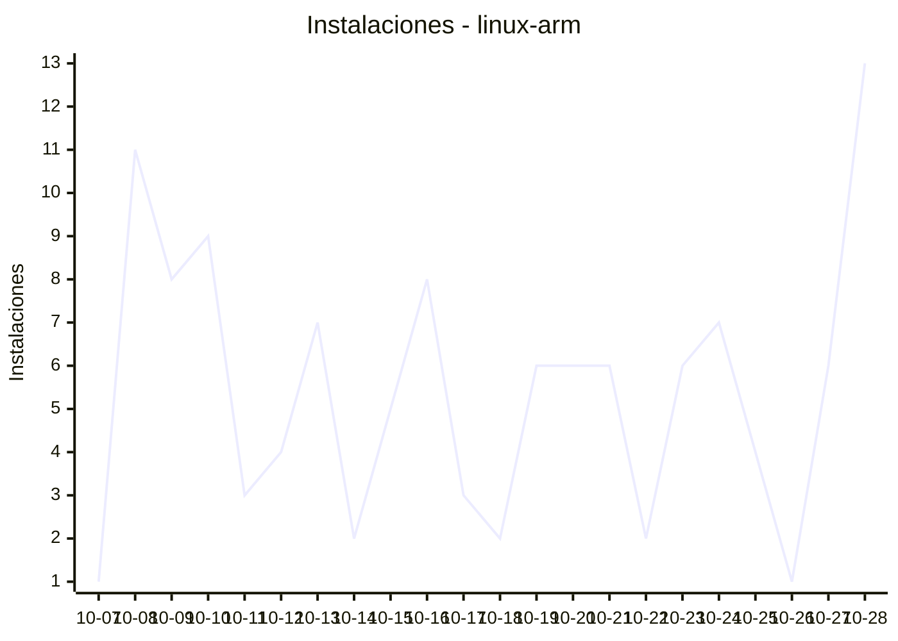
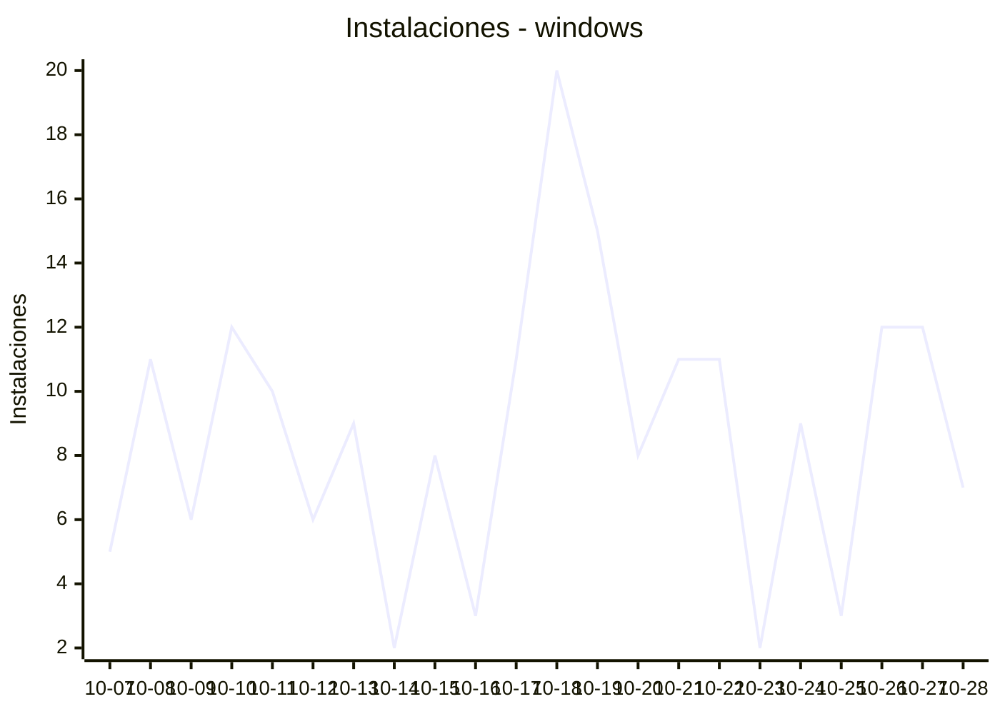
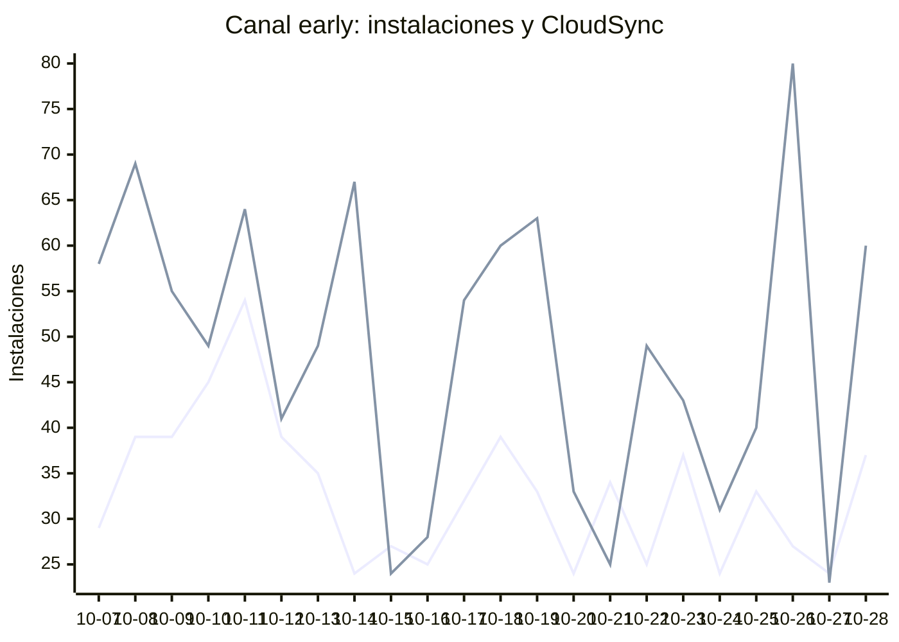

# Estadísticas de EmuDeck

Actualizado: 2026-10-29 00:54 UTC. Las gráficas no incluyen el día de hoy porque aún está incompleto.

## Arranques de la app (comprobaciones de actualización)

Cada arranque descarga el `latest*.yml` de su sistema. Cuenta arranques, no personas.

| Sistema | Ayer | Últimos 7 días |
|---|---|---|
| Linux x86 | 11883 | 92549 |
| Linux ARM | 196 | 1109 |
| Windows | 3272 | 24601 |
| Mac | 2 | 3 |

Instalaciones nuevas estimadas en Windows (7 días, `.exe` menos `.blockmap`): **2310**

## Instalaciones de EmuDeck (beacons)

Cada `setup` descarga `system-<sistema>.txt` y cada instalación de un emulador `<emulador>-<plataforma>.txt`. Los emuladores cuentan también las actualizaciones. Histórico completo desde el primer día.

| Sistema | Ayer | Últimos 7 días | Últimos 30 días | Total |
|---|---|---|---|---|
| linux | 28 | 206 | 714 | 737 |
| linux-arm | 13 | 39 | 120 | 123 |
| windows | 7 | 56 | 193 | 202 |

### Por mes

| Mes | Linux | Linux ARM | Windows | Total |
|---|---|---|---|---|
| 2026-10 | 714 | 120 | 193 | 1027 |

### Canal early (early + early-unstable)

Instalaciones de EmuDeck con el backend en una rama early, y cuántas de ellas instalan CloudSync.

| | Últimos 7 días | Últimos 30 días | Total |
|---|---|---|---|
| Instalaciones early | 207 | 725 | 750 |
| Con CloudSync | 326 | 1065 | 1131 |
| % con CloudSync | | | 151% |

Línea de arriba: instalaciones early. Línea de abajo: de ellas, con CloudSync.

### Por emulador

| Emulador | Linux (total) | Linux ARM (total) | Windows (total) | Últimos 7 días | Últimos 30 días | Total |
|---|---|---|---|---|---|---|
| pcsx2 | 2022 | 22 | 237 | 669 | 2200 | 2281 |
| duckstation | 1933 | 167 | 101 | 658 | 2121 | 2201 |
| azahar | 1767 | 184 | 239 | 650 | 2110 | 2190 |
| esde | 1635 | 148 | 372 | 661 | 2059 | 2155 |
| ryujinx | 1725 | 175 | 240 | 645 | 2066 | 2140 |
| rpcs3 | 1824 | 168 | 99 | 639 | 2019 | 2091 |
| cemu | 1780 | 170 | 84 | 620 | 1965 | 2034 |
| srm | 1609 | 147 | 258 | 616 | 1962 | 2014 |
| xenia | 1645 | 134 | 205 | 598 | 1917 | 1984 |
| shadps4 | 1539 | 139 | 184 | 560 | 1792 | 1862 |
| vita3k | 1612 | 148 | 65 | 538 | 1756 | 1825 |
| cloudsync | 780 | 39 | 351 | 336 | 1102 | 1170 |
| ppsspp | 655 | 104 | 183 | 280 | 907 | 942 |
| dolphin | 712 | 119 | 103 | 273 | 901 | 934 |
| ra | 709 | 111 | 113 | 273 | 902 | 933 |
| mgba | 709 | 53 | 55 | 235 | 794 | 817 |
| xemu | 614 | 92 | 78 | 232 | 755 | 784 |
| melonds | 597 | 88 | 75 | 207 | 730 | 760 |
| primehack | 530 | 88 | 78 | 207 | 670 | 696 |
| supermodel | 511 | 99 | 19 | 171 | 608 | 629 |
| scummvm | 495 | 75 | 52 | 174 | 597 | 622 |
| model2 | 503 | 103 | 8 | 160 | 592 | 614 |
| bigpemu | 486 | 10 | 13 | 146 | 490 | 509 |
| armsx2 | 150 | 194 | 0 | 120 | 335 | 344 |
| flycast | 132 | 17 | 19 | 44 | 162 | 168 |
| rmg | 129 | 27 | 0 | 35 | 152 | 156 |
| eden | 82 | 9 | 3 | 16 | 86 | 94 |
| mame | 71 | 2 | 17 | 20 | 86 | 90 |
| pegasus | 18 | 0 | 12 | 9 | 28 | 30 |
| ares | 9 | 1 | 0 | 5 | 10 | 10 |
| yuzu | 8 | 0 | 2 | 4 | 10 | 10 |
| citron | 5 | 0 | 0 | 1 | 5 | 5 |
