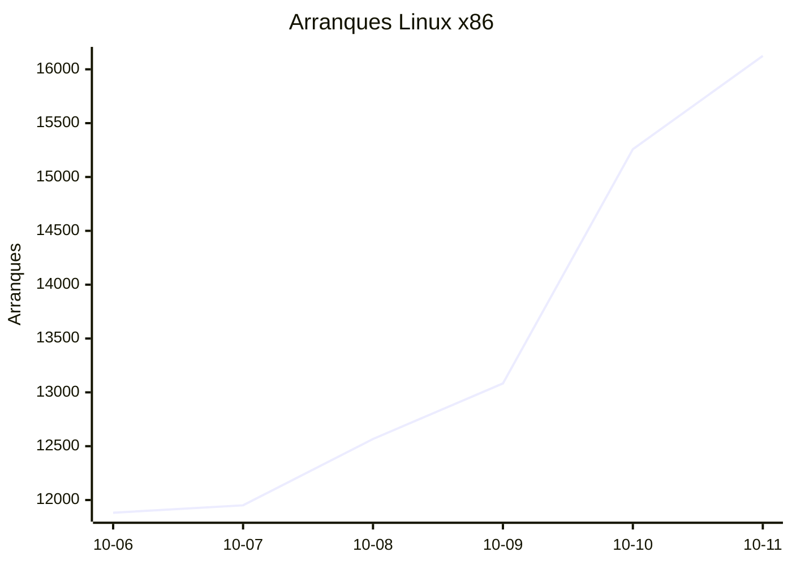
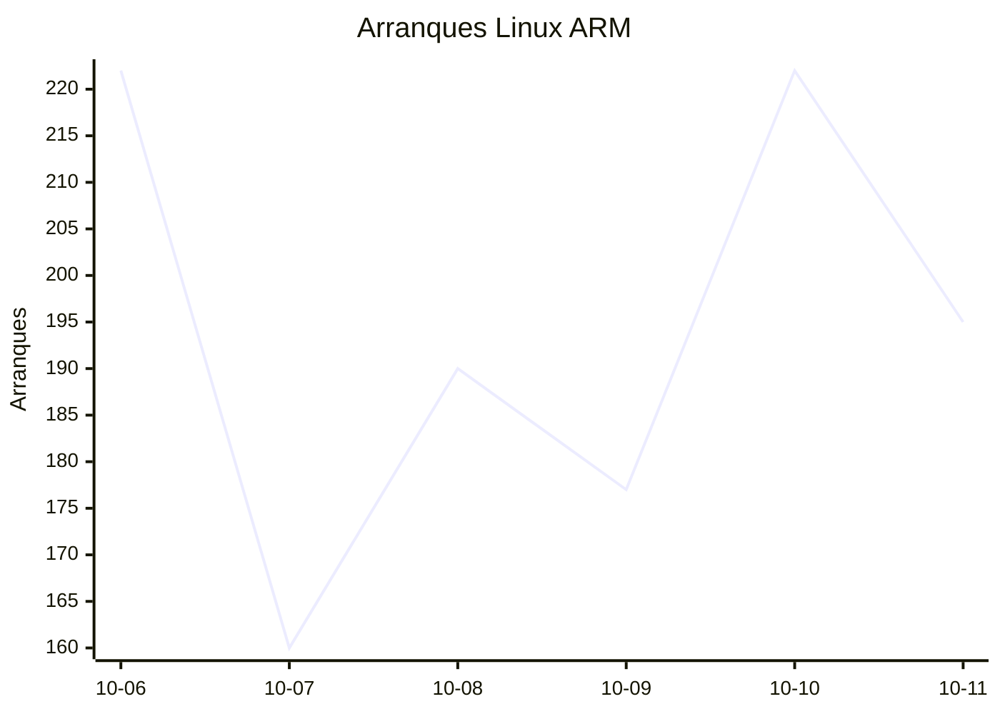
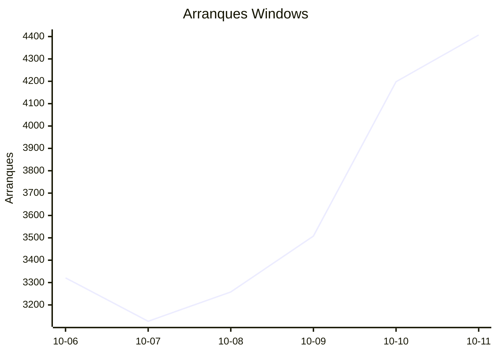
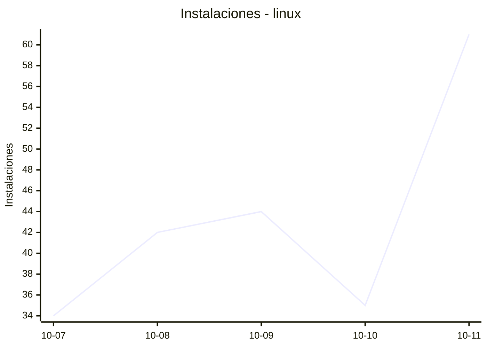
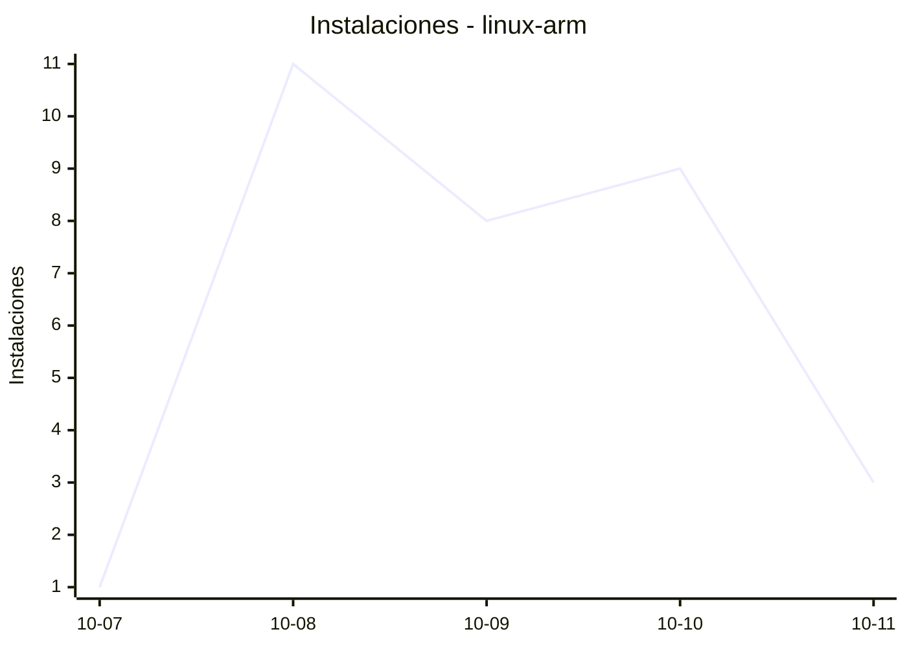
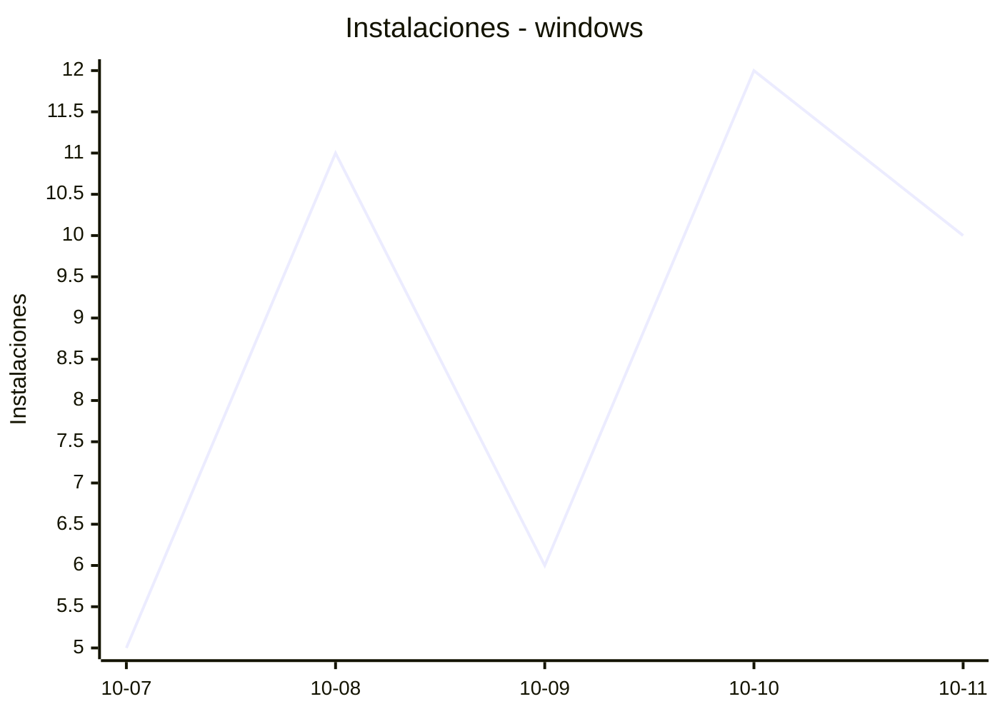
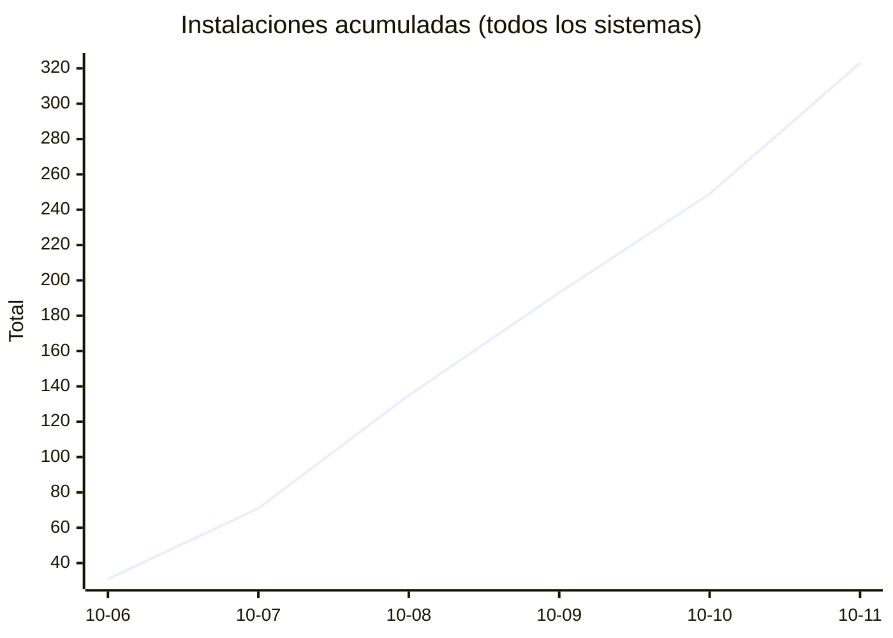
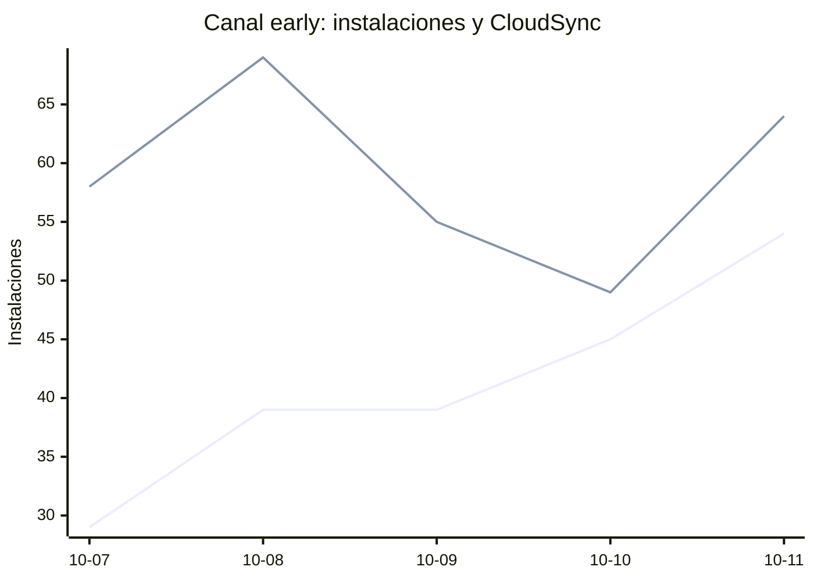

# Estadísticas de EmuDeck

Actualizado: 2026-10-12 21:40 UTC. Las gráficas no incluyen el día de hoy porque aún está incompleto.

## Arranques de la app (comprobaciones de actualización)

Cada arranque descarga el `latest*.yml` de su sistema. Cuenta arranques, no personas.

| Sistema | Ayer | Últimos 7 días |
|---|---|---|
| Linux x86 | 16125 | 80866 |
| Linux ARM | 195 | 1166 |
| Windows | 4407 | 21819 |
| Mac | 0 | 0 |

Instalaciones nuevas estimadas en Windows (7 días, `.exe` menos `.blockmap`): **1216**

## Instalaciones de EmuDeck (beacons)

Cada `setup` descarga `system-<sistema>.txt` y cada instalación de un emulador `<emulador>-<plataforma>.txt`. Los emuladores cuentan también las actualizaciones. Histórico completo desde el primer día.

| Sistema | Ayer | Últimos 7 días | Últimos 30 días | Total |
|---|---|---|---|---|
| linux | 61 | 216 | 216 | 268 |
| linux-arm | 3 | 32 | 32 | 39 |
| windows | 10 | 44 | 44 | 57 |

### Por mes

| Mes | Linux | Linux ARM | Windows | Total |
|---|---|---|---|---|
| 2026-10 | 216 | 32 | 44 | 292 |

### Canal early (early + early-unstable)

Instalaciones de EmuDeck con el backend en una rama early, y cuántas de ellas instalan CloudSync.

| | Últimos 7 días | Últimos 30 días | Total |
|---|---|---|---|
| Instalaciones early | 206 | 206 | 264 |
| Con CloudSync | 295 | 295 | 391 |
| % con CloudSync | | | 148% |

Línea de arriba: instalaciones early. Línea de abajo: de ellas, con CloudSync.

### Por emulador

| Emulador | Linux (total) | Linux ARM (total) | Windows (total) | Últimos 7 días | Últimos 30 días | Total |
|---|---|---|---|---|---|---|
| pcsx2 | 630 | 12 | 78 | 561 | 561 | 720 |
| azahar | 563 | 49 | 75 | 531 | 531 | 687 |
| duckstation | 613 | 47 | 24 | 530 | 530 | 684 |
| esde | 516 | 44 | 117 | 505 | 505 | 677 |
| ryujinx | 531 | 50 | 77 | 518 | 518 | 658 |
| cemu | 569 | 48 | 17 | 487 | 487 | 634 |
| rpcs3 | 561 | 46 | 23 | 487 | 487 | 630 |
| xenia | 512 | 42 | 53 | 466 | 466 | 607 |
| srm | 494 | 33 | 46 | 460 | 460 | 573 |
| shadps4 | 475 | 47 | 44 | 439 | 439 | 566 |
| vita3k | 507 | 42 | 11 | 425 | 425 | 560 |
| cloudsync | 286 | 13 | 112 | 311 | 311 | 411 |
| ppsspp | 237 | 34 | 55 | 258 | 258 | 326 |
| ra | 264 | 37 | 23 | 259 | 259 | 324 |
| dolphin | 257 | 36 | 25 | 254 | 254 | 318 |
| xemu | 219 | 27 | 22 | 210 | 210 | 268 |
| melonds | 218 | 26 | 18 | 204 | 204 | 262 |
| mgba | 213 | 21 | 18 | 197 | 197 | 252 |
| primehack | 192 | 28 | 21 | 190 | 190 | 241 |
| supermodel | 183 | 34 | 5 | 176 | 176 | 222 |
| model2 | 184 | 34 | 2 | 176 | 176 | 220 |
| scummvm | 182 | 26 | 12 | 174 | 174 | 220 |
| bigpemu | 147 | 3 | 2 | 121 | 121 | 152 |
| armsx2 | 46 | 50 | 0 | 76 | 76 | 96 |
| flycast | 52 | 8 | 5 | 53 | 53 | 65 |
| rmg | 42 | 14 | 0 | 45 | 45 | 56 |
| mame | 33 | 1 | 9 | 38 | 38 | 43 |
| eden | 17 | 3 | 0 | 8 | 8 | 20 |
| pegasus | 5 | 0 | 1 | 4 | 4 | 6 |
| ares | 3 | 1 | 0 | 2 | 2 | 4 |
| yuzu | 4 | 0 | 0 | 4 | 4 | 4 |
| citron | 1 | 0 | 0 | 1 | 1 | 1 |
