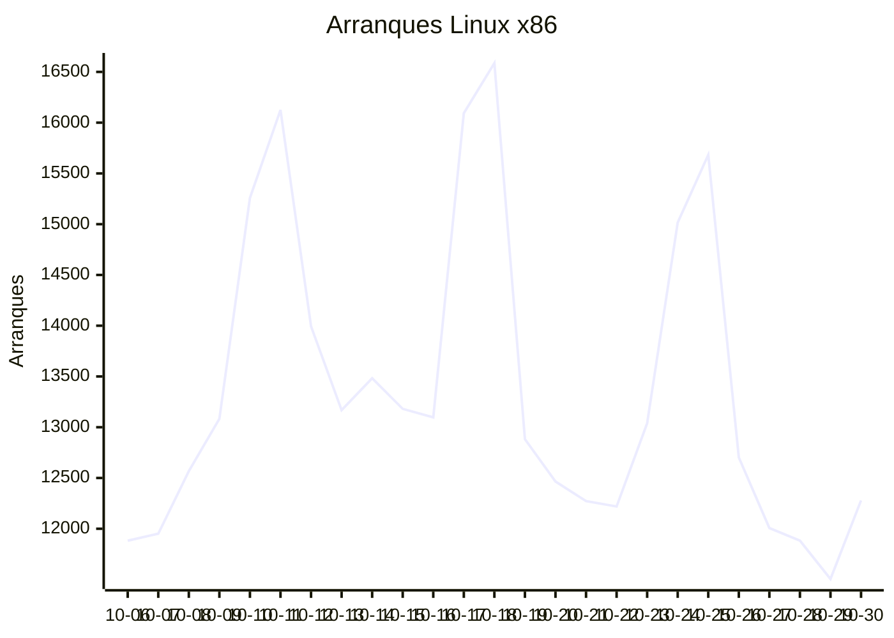
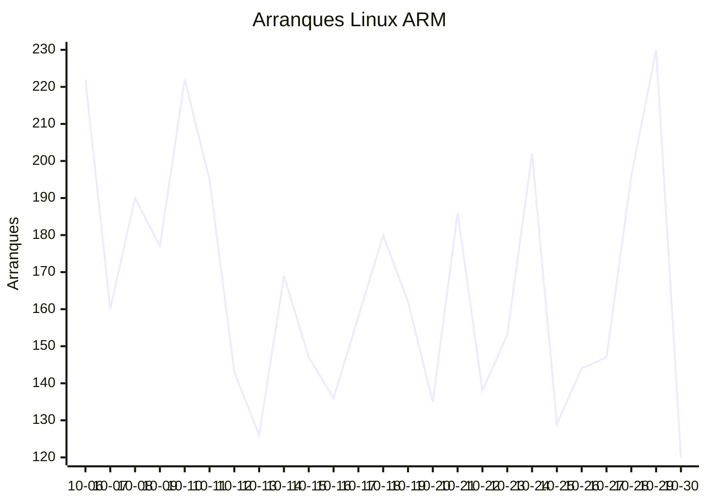
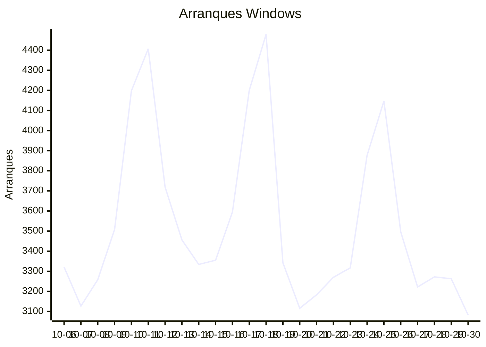
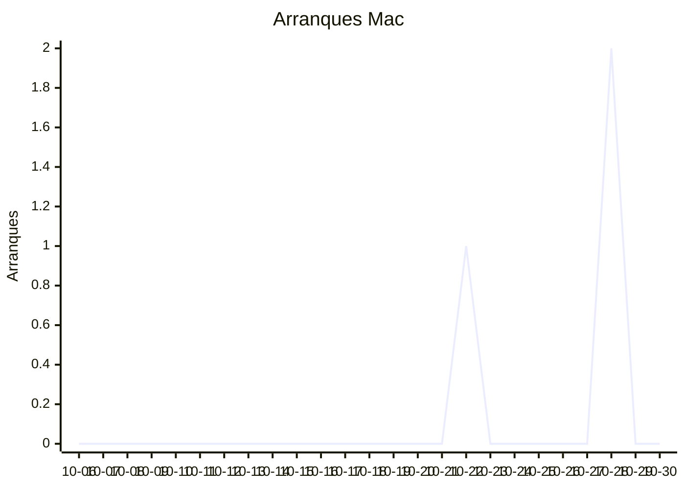
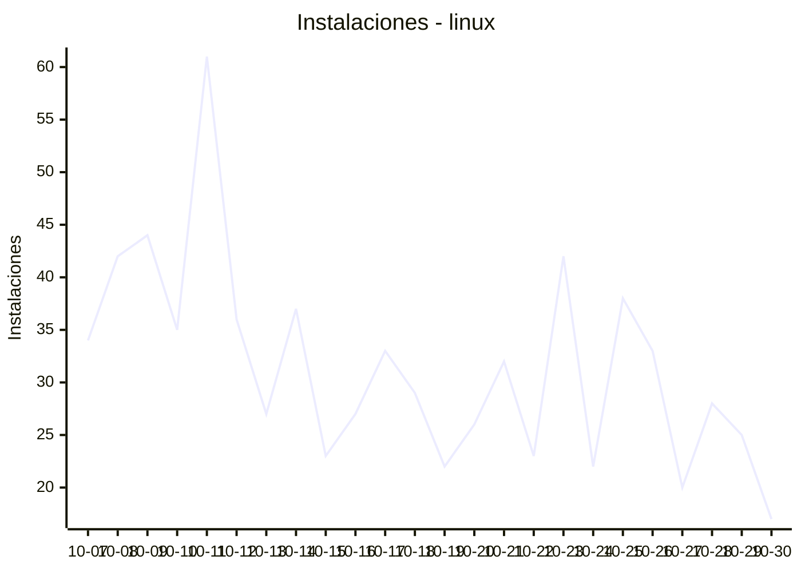
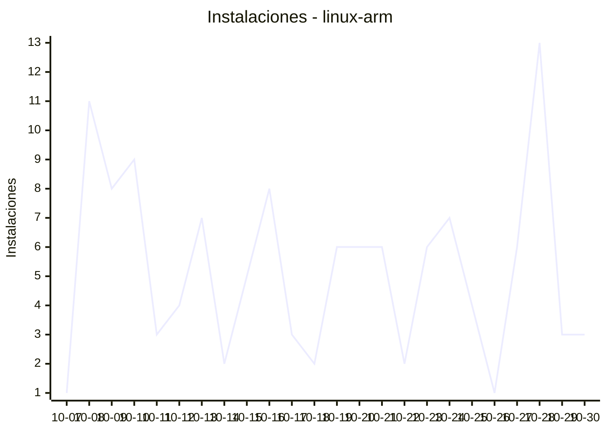
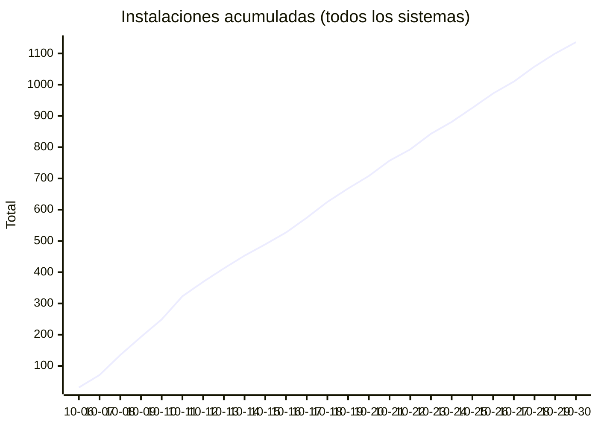
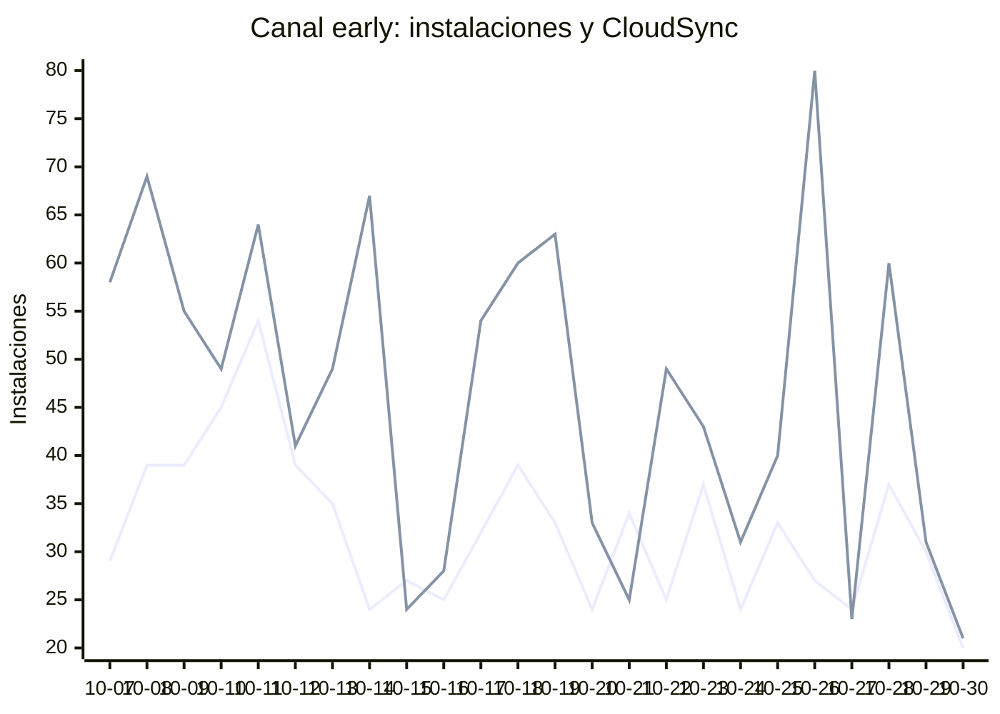

# Estadísticas de EmuDeck

Actualizado: 2026-10-31 13:07 UTC. Las gráficas no incluyen el día de hoy porque aún está incompleto.

## Arranques de la app (comprobaciones de actualización)

Cada arranque descarga el `latest*.yml` de su sistema. Cuenta arranques, no personas.

| Sistema | Ayer | Últimos 7 días |
|---|---|---|
| Linux x86 | 12279 | 91075 |
| Linux ARM | 120 | 1168 |
| Windows | 3083 | 24360 |
| Mac | 0 | 2 |

Instalaciones nuevas estimadas en Windows (7 días, `.exe` menos `.blockmap`): **2300**

## Instalaciones de EmuDeck (beacons)

Cada `setup` descarga `system-<sistema>.txt` y cada instalación de un emulador `<emulador>-<plataforma>.txt`. Los emuladores cuentan también las actualizaciones. Histórico completo desde el primer día.

| Sistema | Ayer | Últimos 7 días | Últimos 30 días | Total |
|---|---|---|---|---|
| linux | 17 | 183 | 756 | 799 |
| linux-arm | 3 | 37 | 126 | 130 |
| windows | 16 | 73 | 223 | 232 |

### Por mes

| Mes | Linux | Linux ARM | Windows | Total |
|---|---|---|---|---|
| 2026-10 | 756 | 126 | 223 | 1105 |

### Canal early (early + early-unstable)

Instalaciones de EmuDeck con el backend en una rama early, y cuántas de ellas instalan CloudSync.

| | Últimos 7 días | Últimos 30 días | Total |
|---|---|---|---|
| Instalaciones early | 195 | 775 | 815 |
| Con CloudSync | 286 | 1117 | 1207 |
| % con CloudSync | | | 148% |

Línea de arriba: instalaciones early. Línea de abajo: de ellas, con CloudSync.

### Por emulador

| Emulador | Linux (total) | Linux ARM (total) | Windows (total) | Últimos 7 días | Últimos 30 días | Total |
|---|---|---|---|---|---|---|
| pcsx2 | 2209 | 23 | 264 | 655 | 2371 | 2496 |
| esde | 1815 | 176 | 431 | 682 | 2252 | 2422 |
| azahar | 1929 | 201 | 271 | 633 | 2275 | 2401 |
| duckstation | 2105 | 180 | 107 | 616 | 2270 | 2392 |
| ryujinx | 1881 | 190 | 257 | 609 | 2218 | 2328 |
| rpcs3 | 1996 | 181 | 102 | 603 | 2159 | 2279 |
| cemu | 1935 | 186 | 91 | 573 | 2105 | 2212 |
| srm | 1752 | 162 | 292 | 597 | 2112 | 2206 |
| xenia | 1804 | 146 | 227 | 587 | 2073 | 2177 |
| shadps4 | 1683 | 157 | 205 | 553 | 1940 | 2045 |
| vita3k | 1760 | 160 | 70 | 512 | 1884 | 1990 |
| cloudsync | 829 | 40 | 386 | 301 | 1163 | 1255 |
| ppsspp | 711 | 110 | 207 | 269 | 978 | 1028 |
| dolphin | 772 | 127 | 113 | 255 | 964 | 1012 |
| ra | 771 | 118 | 120 | 240 | 957 | 1009 |
| mgba | 789 | 55 | 60 | 236 | 865 | 904 |
| xemu | 667 | 97 | 83 | 210 | 805 | 847 |
| melonds | 651 | 93 | 80 | 186 | 779 | 824 |
| primehack | 579 | 92 | 83 | 188 | 715 | 754 |
| supermodel | 556 | 106 | 22 | 155 | 649 | 684 |
| scummvm | 540 | 79 | 55 | 156 | 636 | 674 |
| model2 | 549 | 110 | 8 | 145 | 631 | 667 |
| bigpemu | 533 | 11 | 16 | 141 | 536 | 560 |
| armsx2 | 159 | 212 | 0 | 108 | 353 | 371 |
| flycast | 146 | 18 | 20 | 35 | 175 | 184 |
| rmg | 138 | 28 | 0 | 31 | 161 | 166 |
| eden | 85 | 9 | 4 | 14 | 86 | 98 |
| mame | 76 | 3 | 19 | 17 | 93 | 98 |
| pegasus | 20 | 1 | 16 | 13 | 34 | 37 |
| yuzu | 9 | 0 | 2 | 4 | 11 | 11 |
| ares | 9 | 1 | 0 | 3 | 10 | 10 |
| citron | 5 | 0 | 0 | 1 | 5 | 5 |
