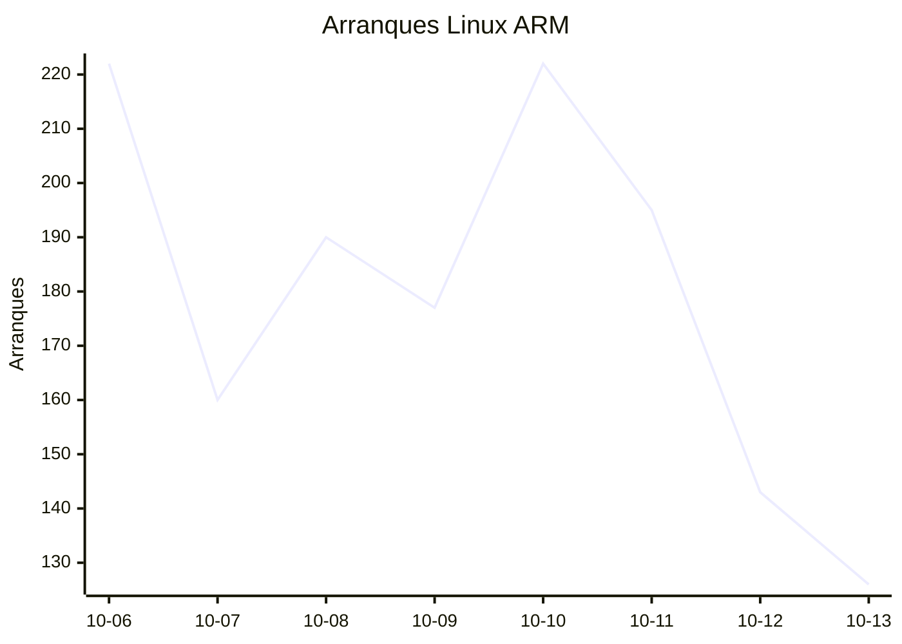
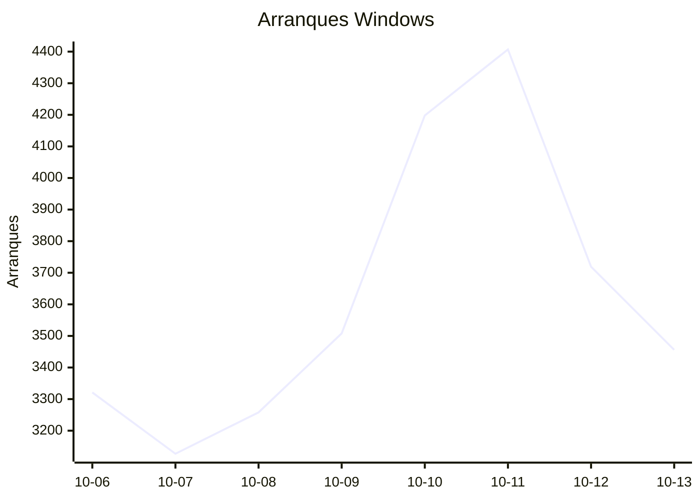
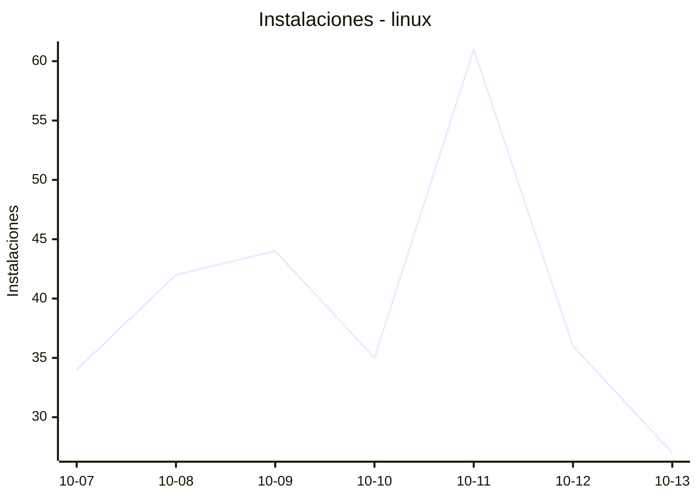
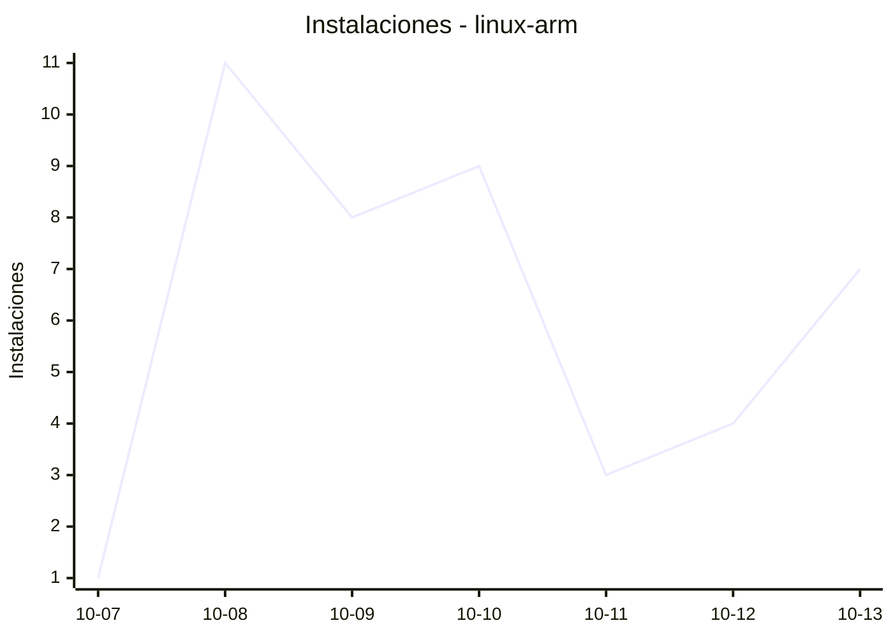
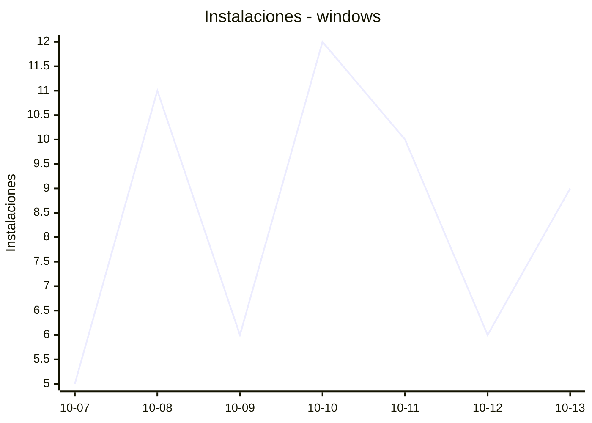
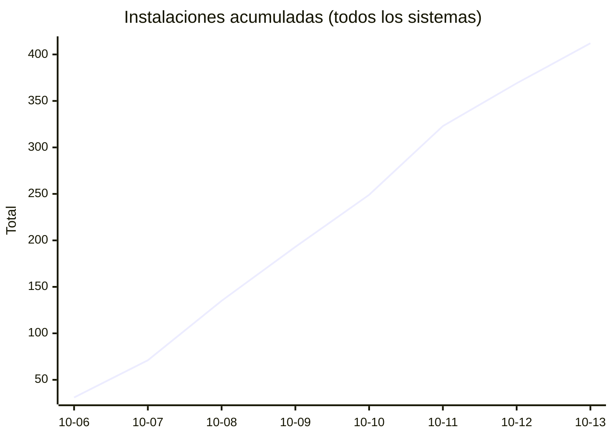
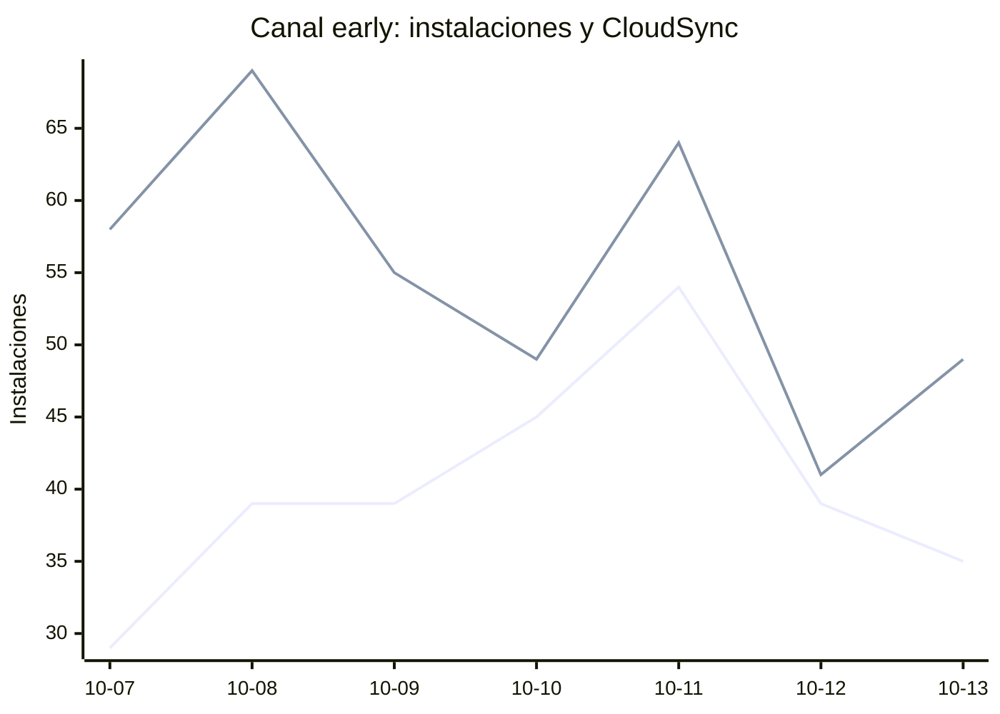

# Estadísticas de EmuDeck

Actualizado: 2026-10-14 01:23 UTC. Las gráficas no incluyen el día de hoy porque aún está incompleto.

## Arranques de la app (comprobaciones de actualización)

Cada arranque descarga el `latest*.yml` de su sistema. Cuenta arranques, no personas.

| Sistema | Ayer | Últimos 7 días |
|---|---|---|
| Linux x86 | 13168 | 96146 |
| Linux ARM | 126 | 1213 |
| Windows | 3456 | 25673 |
| Mac | 0 | 0 |

Instalaciones nuevas estimadas en Windows (7 días, `.exe` menos `.blockmap`): **1566**

## Instalaciones de EmuDeck (beacons)

Cada `setup` descarga `system-<sistema>.txt` y cada instalación de un emulador `<emulador>-<plataforma>.txt`. Los emuladores cuentan también las actualizaciones. Histórico completo desde el primer día.

| Sistema | Ayer | Últimos 7 días | Últimos 30 días | Total |
|---|---|---|---|---|
| linux | 27 | 279 | 279 | 302 |
| linux-arm | 7 | 43 | 43 | 46 |
| windows | 9 | 59 | 59 | 66 |

### Por mes

| Mes | Linux | Linux ARM | Windows | Total |
|---|---|---|---|---|
| 2026-10 | 279 | 43 | 59 | 381 |

### Canal early (early + early-unstable)

Instalaciones de EmuDeck con el backend en una rama early, y cuántas de ellas instalan CloudSync.

| | Últimos 7 días | Últimos 30 días | Total |
|---|---|---|---|
| Instalaciones early | 280 | 280 | 305 |
| Con CloudSync | 385 | 385 | 460 |
| % con CloudSync | | | 151% |

Línea de arriba: instalaciones early. Línea de abajo: de ellas, con CloudSync.

### Por emulador

| Emulador | Linux (total) | Linux ARM (total) | Windows (total) | Últimos 7 días | Últimos 30 días | Total |
|---|---|---|---|---|---|---|
| pcsx2 | 732 | 14 | 91 | 753 | 753 | 837 |
| azahar | 656 | 58 | 85 | 717 | 717 | 799 |
| duckstation | 714 | 56 | 27 | 715 | 715 | 797 |
| esde | 608 | 50 | 129 | 686 | 686 | 787 |
| ryujinx | 612 | 59 | 88 | 685 | 685 | 759 |
| rpcs3 | 652 | 56 | 29 | 660 | 660 | 737 |
| cemu | 659 | 58 | 19 | 666 | 666 | 736 |
| xenia | 599 | 50 | 63 | 645 | 645 | 712 |
| srm | 574 | 45 | 59 | 622 | 622 | 678 |
| shadps4 | 551 | 52 | 49 | 579 | 579 | 652 |
| vita3k | 587 | 50 | 13 | 579 | 579 | 650 |
| cloudsync | 339 | 13 | 128 | 403 | 403 | 480 |
| ppsspp | 267 | 40 | 65 | 340 | 340 | 372 |
| dolphin | 292 | 43 | 31 | 336 | 336 | 366 |
| ra | 296 | 43 | 27 | 336 | 336 | 366 |
| mgba | 262 | 22 | 20 | 278 | 278 | 304 |
| melonds | 248 | 32 | 22 | 274 | 274 | 302 |
| xemu | 246 | 33 | 23 | 275 | 275 | 302 |
| primehack | 213 | 34 | 24 | 246 | 246 | 271 |
| model2 | 208 | 43 | 4 | 234 | 234 | 255 |
| supermodel | 208 | 40 | 6 | 232 | 232 | 254 |
| scummvm | 207 | 30 | 12 | 225 | 225 | 249 |
| bigpemu | 183 | 3 | 2 | 166 | 166 | 188 |
| armsx2 | 59 | 59 | 0 | 107 | 107 | 118 |
| flycast | 63 | 10 | 5 | 73 | 73 | 78 |
| rmg | 52 | 17 | 0 | 65 | 65 | 69 |
| mame | 41 | 2 | 9 | 48 | 48 | 52 |
| eden | 26 | 3 | 0 | 21 | 21 | 29 |
| pegasus | 5 | 0 | 3 | 6 | 6 | 8 |
| ares | 3 | 1 | 0 | 4 | 4 | 4 |
| yuzu | 4 | 0 | 0 | 4 | 4 | 4 |
| citron | 1 | 0 | 0 | 1 | 1 | 1 |
