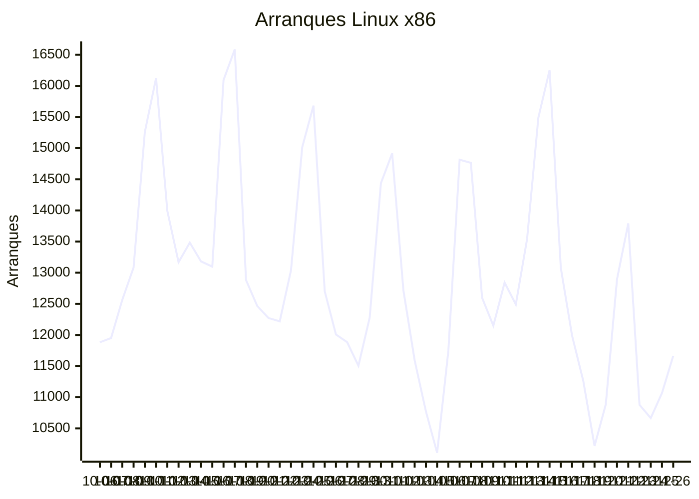
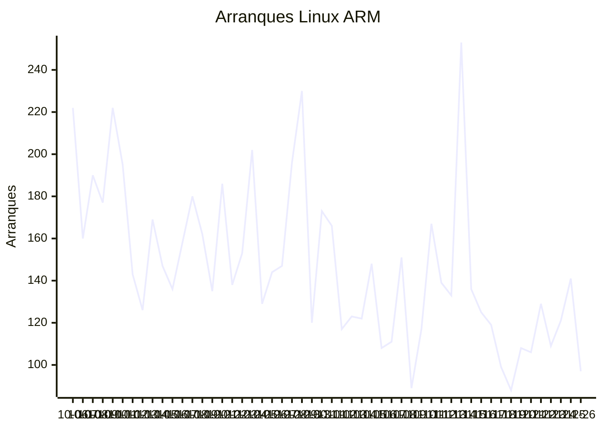
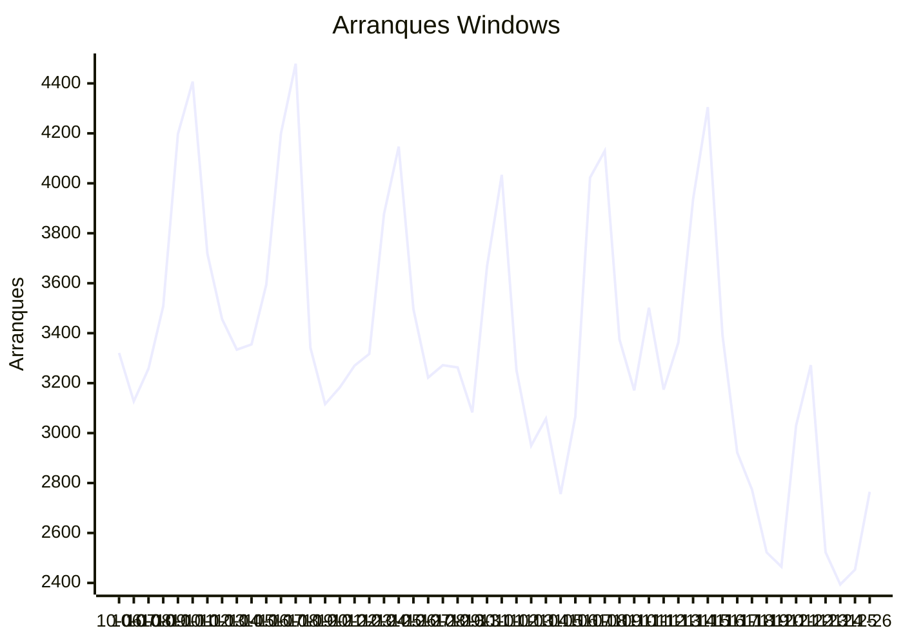
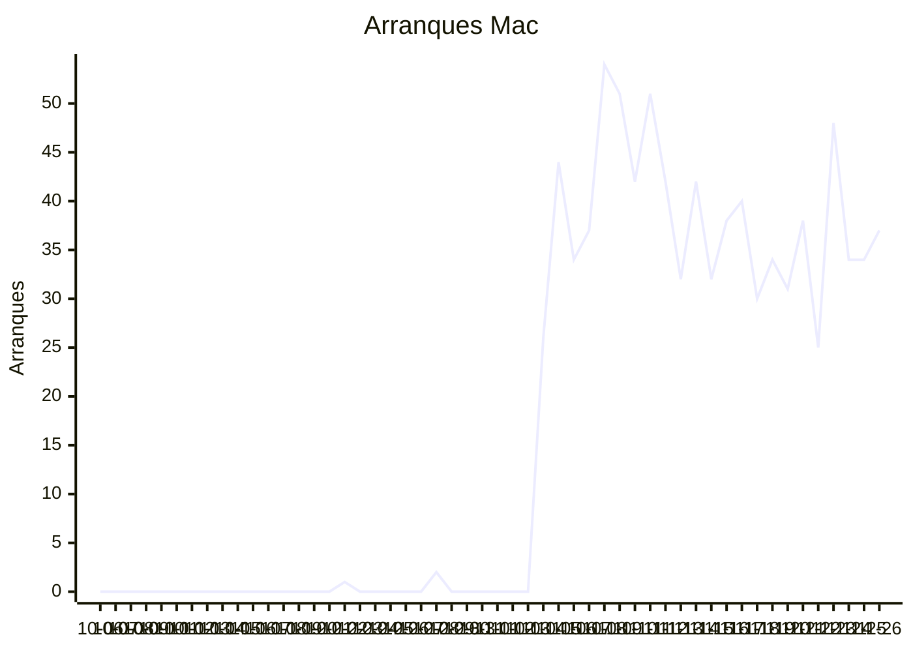
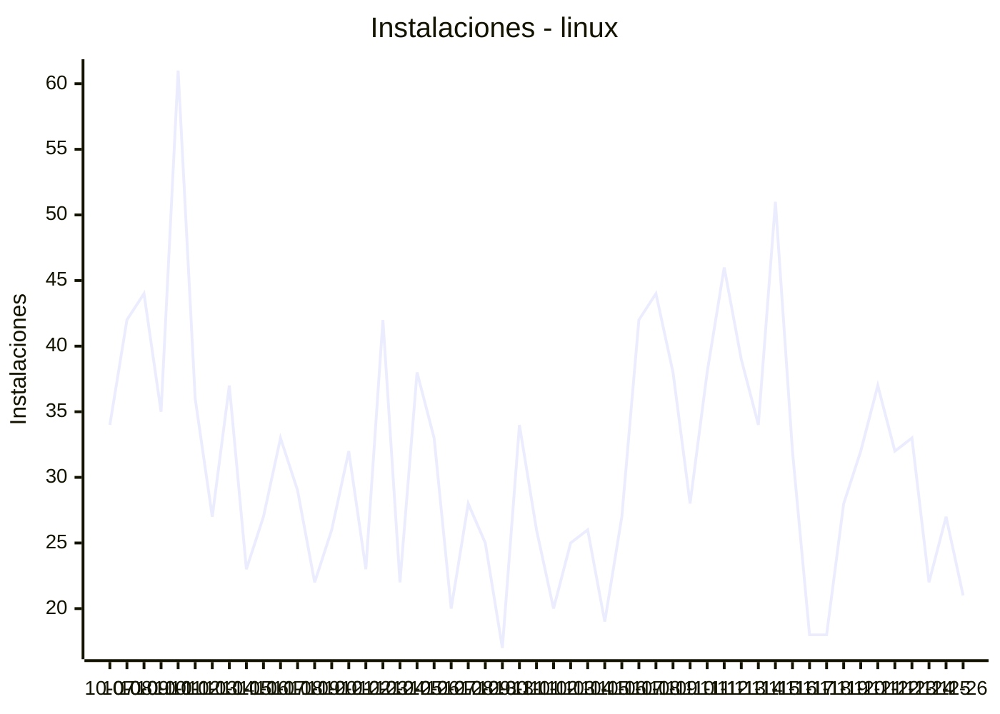
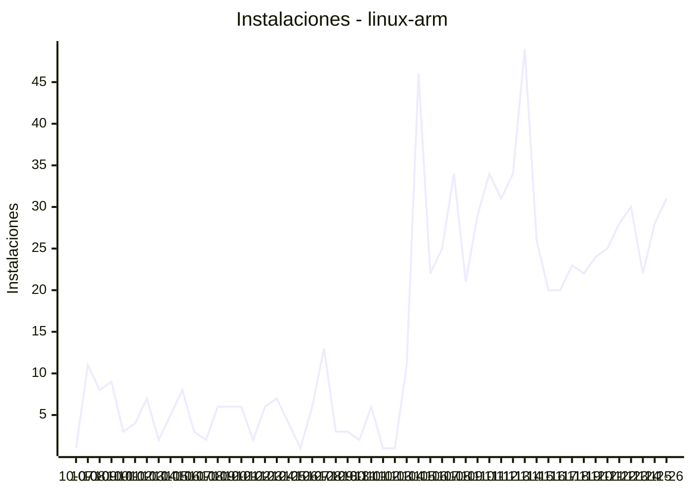
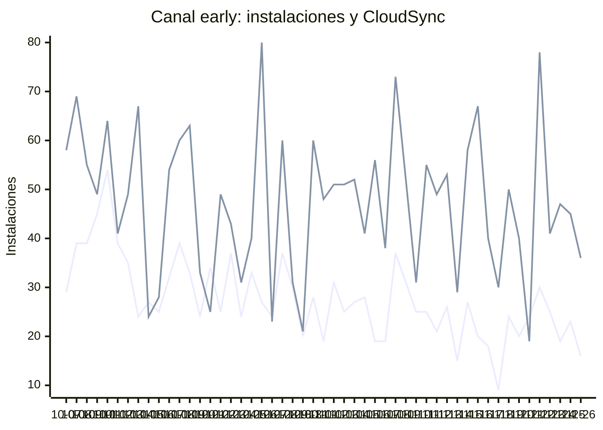

# Estadísticas de EmuDeck

Actualizado: 2026-11-27 03:11 UTC. Las gráficas no incluyen el día de hoy porque aún está incompleto.

## Arranques de la app (comprobaciones de actualización)

Cada arranque descarga el `latest*.yml` de su sistema. Cuenta arranques, no personas.

| Sistema | Ayer | Últimos 7 días |
|---|---|---|
| Linux x86 | 11664 | 81848 |
| Linux ARM | 97 | 811 |
| Windows | 2765 | 18902 |
| Mac | 37 | 247 |

Instalaciones nuevas estimadas en Windows (7 días, `.exe` menos `.blockmap`): **1941**

## Instalaciones de EmuDeck (beacons)

Cada `setup` descarga `system-<sistema>.txt` y cada instalación de un emulador `<emulador>-<plataforma>.txt`. Los emuladores cuentan también las actualizaciones. Histórico completo desde el primer día.

| Sistema | Ayer | Últimos 7 días | Últimos 30 días | Total |
|---|---|---|---|---|
| linux | 21 | 204 | 907 | 1615 |
| linux-arm | 31 | 188 | 664 | 776 |
| windows | 11 | 71 | 311 | 505 |

### Por mes

| Mes | Linux | Linux ARM | Windows | Total |
|---|---|---|---|---|
| 2026-11 | 803 | 643 | 260 | 1706 |
| 2026-10 | 790 | 128 | 237 | 1155 |

### Canal early (early + early-unstable)

Instalaciones de EmuDeck con el backend en una rama early, y cuántas de ellas instalan CloudSync.

| | Últimos 7 días | Últimos 30 días | Total |
|---|---|---|---|
| Instalaciones early | 157 | 718 | 1429 |
| Con CloudSync | 306 | 1402 | 2475 |
| % con CloudSync | | | 173% |

Línea de arriba: instalaciones early. Línea de abajo: de ellas, con CloudSync.

### Por emulador

| Emulador | Linux (total) | Linux ARM (total) | Windows (total) | Últimos 7 días | Últimos 30 días | Total |
|---|---|---|---|---|---|---|
| esde | 3654 | 778 | 1034 | 782 | 3384 | 5466 |
| azahar | 3849 | 922 | 556 | 783 | 3222 | 5327 |
| ryujinx | 3801 | 922 | 534 | 782 | 3189 | 5257 |
| duckstation | 4150 | 845 | 213 | 753 | 3087 | 5208 |
| rpcs3 | 3985 | 873 | 212 | 760 | 3057 | 5070 |
| srm | 3640 | 724 | 679 | 714 | 3098 | 5043 |
| pcsx2 | 4357 | 42 | 588 | 638 | 2781 | 4987 |
| cemu | 3761 | 814 | 196 | 677 | 2823 | 4771 |
| xenia | 3514 | 702 | 480 | 691 | 2791 | 4696 |
| vita3k | 3429 | 744 | 141 | 635 | 2563 | 4314 |
| shadps4 | 3288 | 262 | 420 | 493 | 2180 | 3970 |
| cloudsync | 1620 | 87 | 863 | 318 | 1458 | 2570 |
| ppsspp | 1371 | 619 | 468 | 403 | 1560 | 2458 |
| dolphin | 1497 | 686 | 224 | 369 | 1523 | 2407 |
| ra | 1502 | 642 | 255 | 374 | 1507 | 2399 |
| xemu | 1266 | 537 | 166 | 314 | 1223 | 1969 |
| melonds | 1232 | 543 | 154 | 306 | 1206 | 1929 |
| mgba | 1620 | 188 | 110 | 267 | 1121 | 1918 |
| primehack | 1156 | 555 | 170 | 303 | 1224 | 1881 |
| supermodel | 1074 | 505 | 52 | 267 | 1030 | 1631 |
| scummvm | 1034 | 474 | 109 | 273 | 1026 | 1617 |
| model2 | 1055 | 526 | 14 | 266 | 1009 | 1595 |
| armsx2 | 341 | 944 | 0 | 250 | 958 | 1285 |
| bigpemu | 1030 | 58 | 50 | 144 | 641 | 1138 |
| flycast | 264 | 70 | 44 | 43 | 214 | 378 |
| rmg | 269 | 108 | 0 | 60 | 222 | 377 |
| mame | 146 | 24 | 69 | 37 | 150 | 239 |
| eden | 171 | 11 | 22 | 31 | 112 | 204 |
| pegasus | 58 | 3 | 31 | 11 | 61 | 92 |
| yuzu | 18 | 0 | 8 | 0 | 16 | 26 |
| ares | 22 | 3 | 0 | 2 | 16 | 25 |
| citron | 6 | 2 | 3 | 1 | 6 | 11 |
