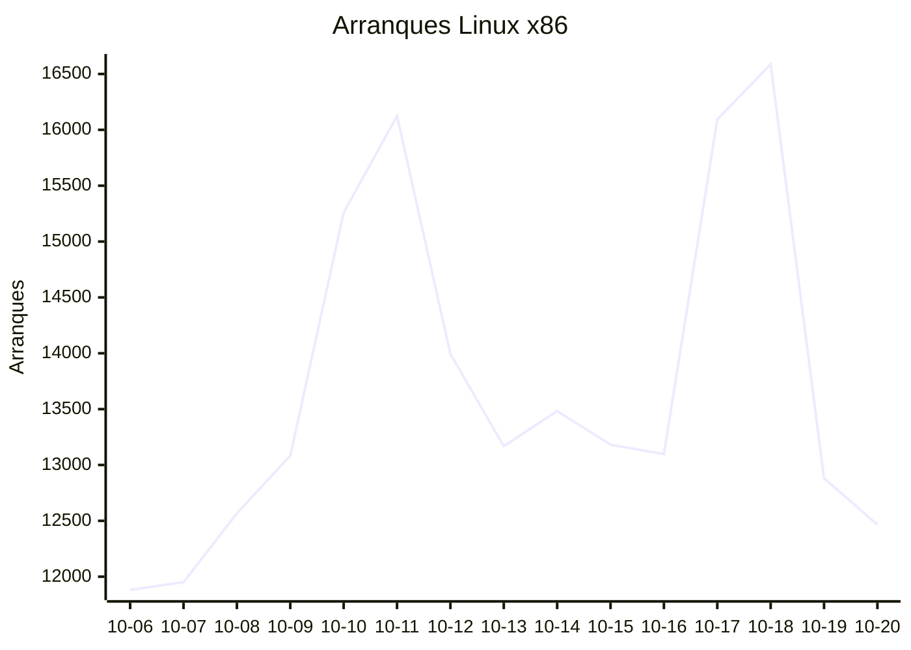
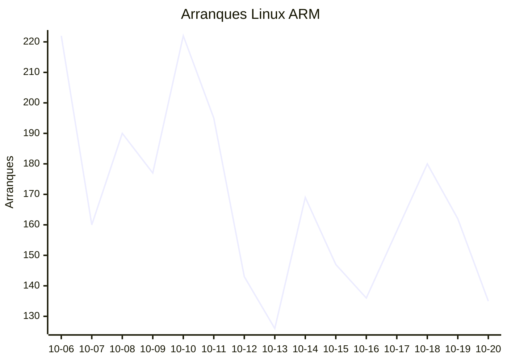
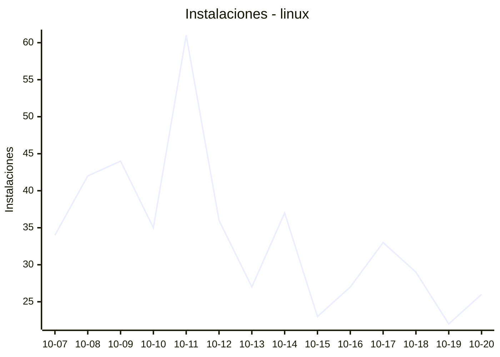
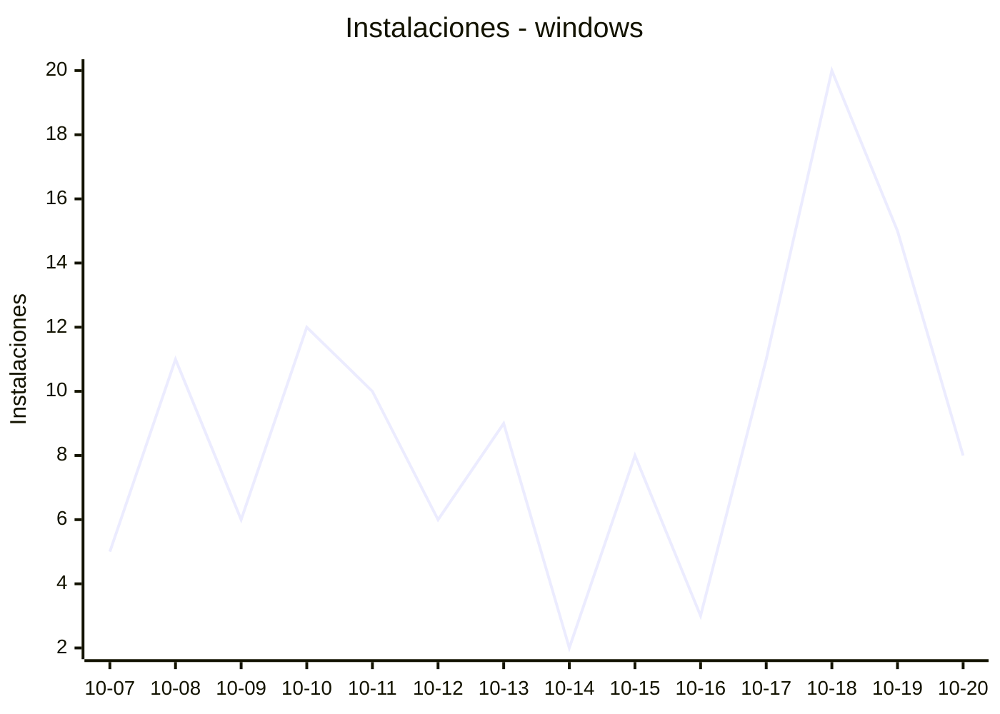
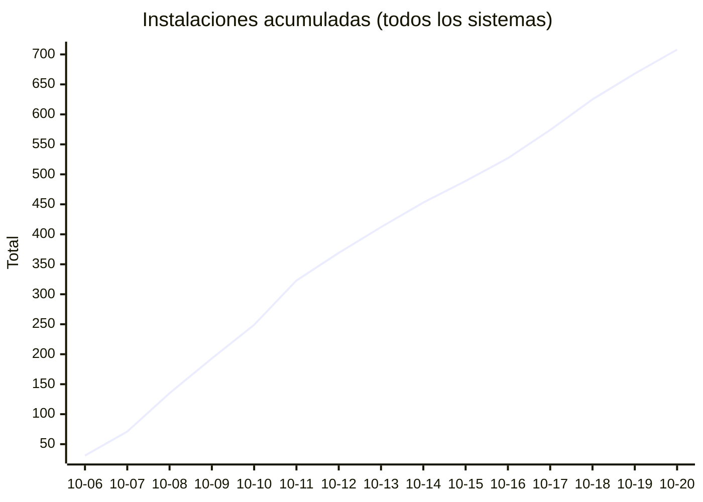
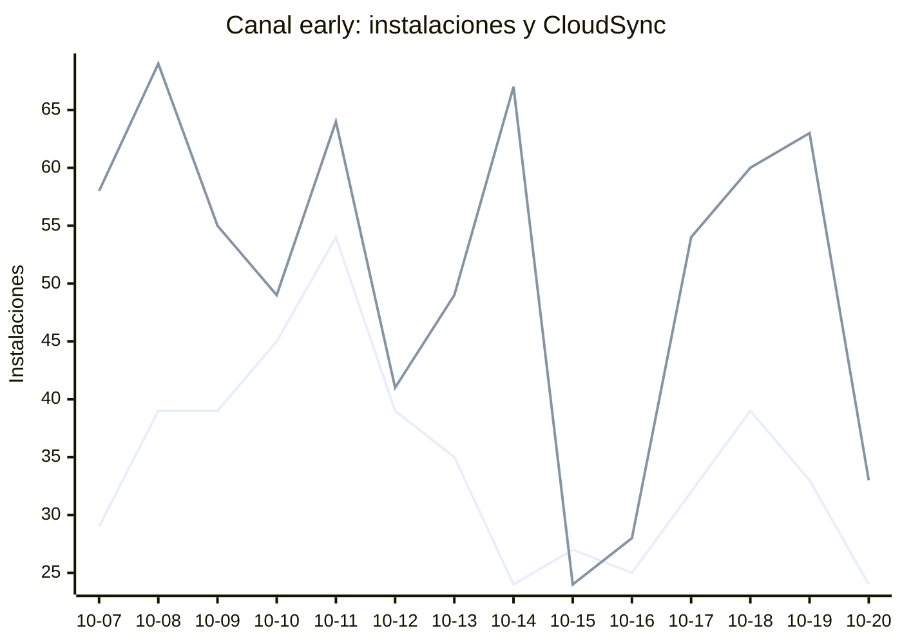

# Estadísticas de EmuDeck

Actualizado: 2026-10-21 03:44 UTC. Las gráficas no incluyen el día de hoy porque aún está incompleto.

## Arranques de la app (comprobaciones de actualización)

Cada arranque descarga el `latest*.yml` de su sistema. Cuenta arranques, no personas.

| Sistema | Ayer | Últimos 7 días |
|---|---|---|
| Linux x86 | 12465 | 97788 |
| Linux ARM | 135 | 1087 |
| Windows | 3116 | 25420 |
| Mac | 0 | 0 |

Instalaciones nuevas estimadas en Windows (7 días, `.exe` menos `.blockmap`): **2069**

## Instalaciones de EmuDeck (beacons)

Cada `setup` descarga `system-<sistema>.txt` y cada instalación de un emulador `<emulador>-<plataforma>.txt`. Los emuladores cuentan también las actualizaciones. Histórico completo desde el primer día.

| Sistema | Ayer | Últimos 7 días | Últimos 30 días | Total |
|---|---|---|---|---|
| linux | 26 | 197 | 476 | 509 |
| linux-arm | 6 | 32 | 75 | 81 |
| windows | 8 | 67 | 126 | 133 |

### Por mes

| Mes | Linux | Linux ARM | Windows | Total |
|---|---|---|---|---|
| 2026-10 | 476 | 75 | 126 | 677 |

### Canal early (early + early-unstable)

Instalaciones de EmuDeck con el backend en una rama early, y cuántas de ellas instalan CloudSync.

| | Últimos 7 días | Últimos 30 días | Total |
|---|---|---|---|
| Instalaciones early | 204 | 484 | 520 |
| Con CloudSync | 329 | 714 | 787 |
| % con CloudSync | | | 151% |

Línea de arriba: instalaciones early. Línea de abajo: de ellas, con CloudSync.

### Por emulador

| Emulador | Linux (total) | Linux ARM (total) | Windows (total) | Últimos 7 días | Últimos 30 días | Total |
|---|---|---|---|---|---|---|
| pcsx2 | 1343 | 19 | 160 | 673 | 1426 | 1522 |
| duckstation | 1297 | 101 | 54 | 641 | 1356 | 1452 |
| azahar | 1191 | 107 | 153 | 634 | 1351 | 1451 |
| ryujinx | 1148 | 107 | 153 | 633 | 1318 | 1408 |
| esde | 1080 | 87 | 239 | 616 | 1302 | 1406 |
| rpcs3 | 1209 | 103 | 55 | 617 | 1277 | 1367 |
| cemu | 1187 | 103 | 43 | 583 | 1249 | 1333 |
| xenia | 1085 | 91 | 126 | 576 | 1221 | 1302 |
| srm | 1060 | 87 | 154 | 602 | 1224 | 1301 |
| shadps4 | 1030 | 85 | 115 | 568 | 1147 | 1230 |
| vita3k | 1093 | 90 | 33 | 553 | 1132 | 1216 |
| cloudsync | 553 | 21 | 242 | 338 | 741 | 816 |
| ppsspp | 453 | 68 | 113 | 252 | 592 | 634 |
| ra | 492 | 72 | 67 | 252 | 588 | 631 |
| dolphin | 495 | 73 | 61 | 250 | 586 | 629 |
| mgba | 479 | 39 | 36 | 243 | 521 | 554 |
| melonds | 428 | 58 | 44 | 217 | 491 | 530 |
| xemu | 422 | 60 | 42 | 213 | 488 | 524 |
| primehack | 370 | 55 | 46 | 191 | 437 | 471 |
| supermodel | 365 | 69 | 9 | 178 | 410 | 443 |
| model2 | 361 | 72 | 7 | 173 | 407 | 440 |
| scummvm | 356 | 51 | 25 | 173 | 398 | 432 |
| bigpemu | 330 | 5 | 8 | 154 | 320 | 343 |
| armsx2 | 99 | 110 | 0 | 87 | 194 | 209 |
| flycast | 93 | 14 | 10 | 37 | 110 | 117 |
| rmg | 89 | 23 | 0 | 42 | 107 | 112 |
| eden | 70 | 7 | 0 | 47 | 68 | 77 |
| mame | 56 | 2 | 10 | 15 | 63 | 68 |
| pegasus | 10 | 0 | 10 | 11 | 17 | 20 |
| yuzu | 6 | 0 | 0 | 2 | 6 | 6 |
| ares | 4 | 1 | 0 | 1 | 5 | 5 |
| citron | 4 | 0 | 0 | 3 | 4 | 4 |
