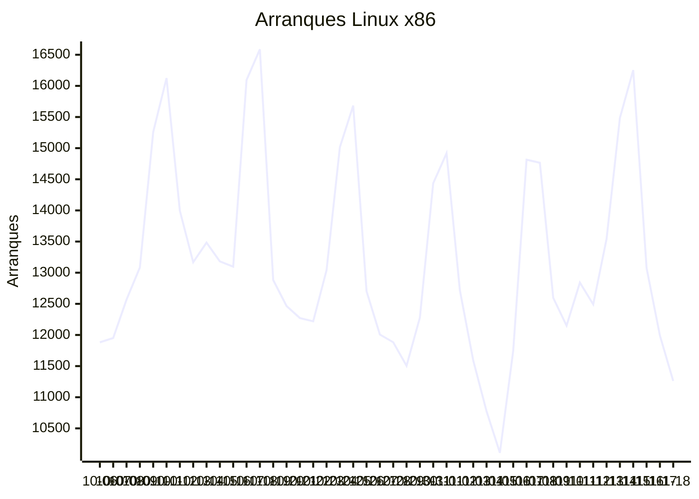
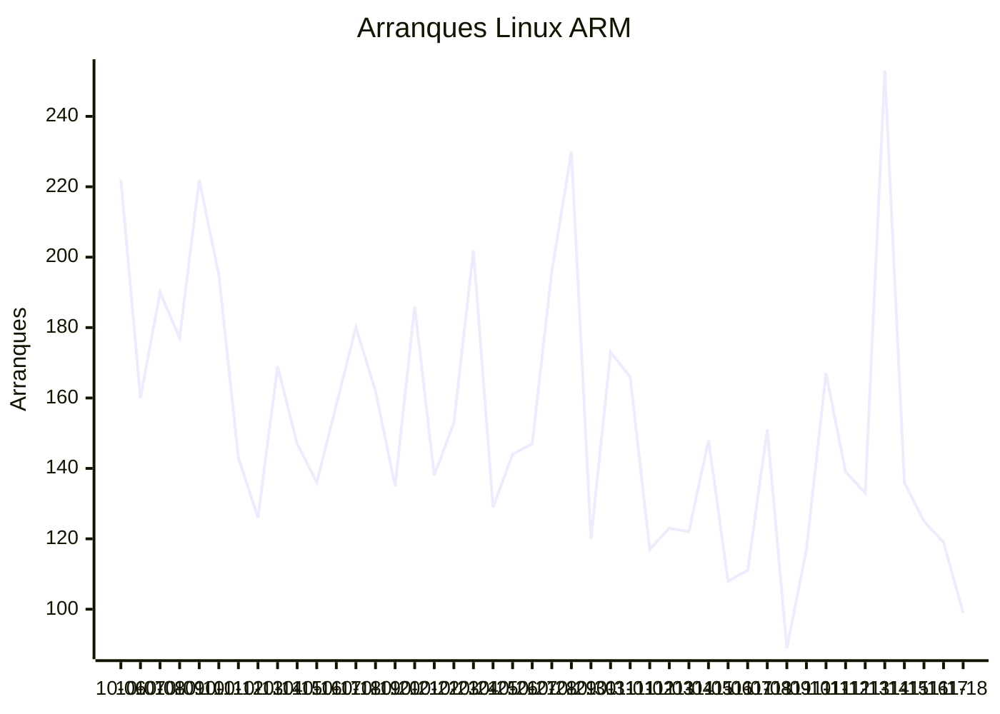
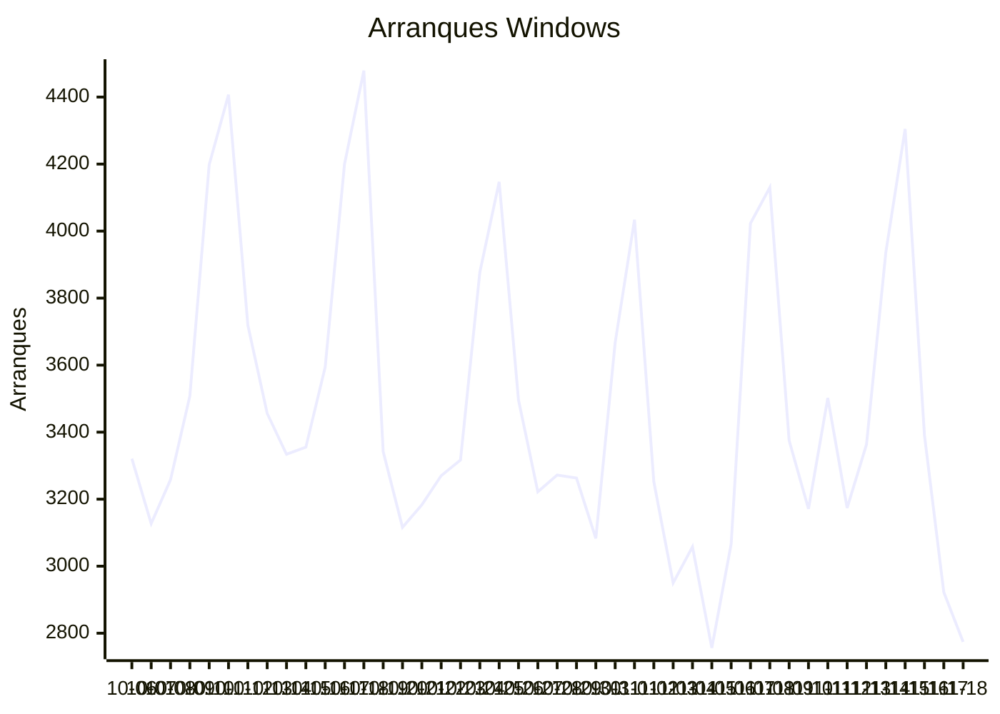
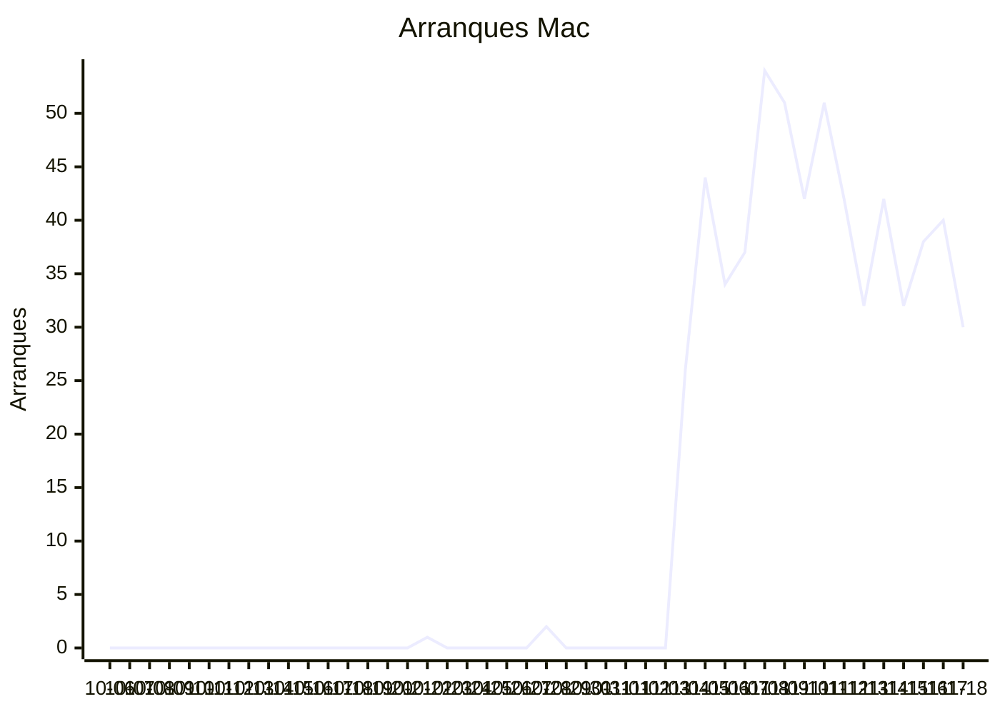
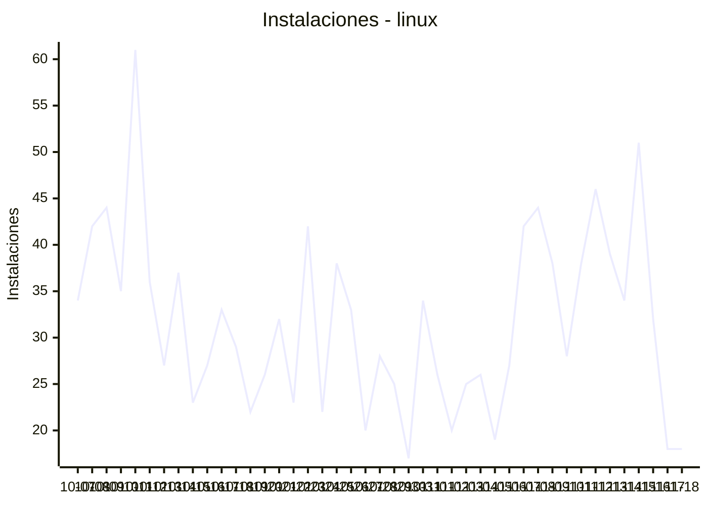
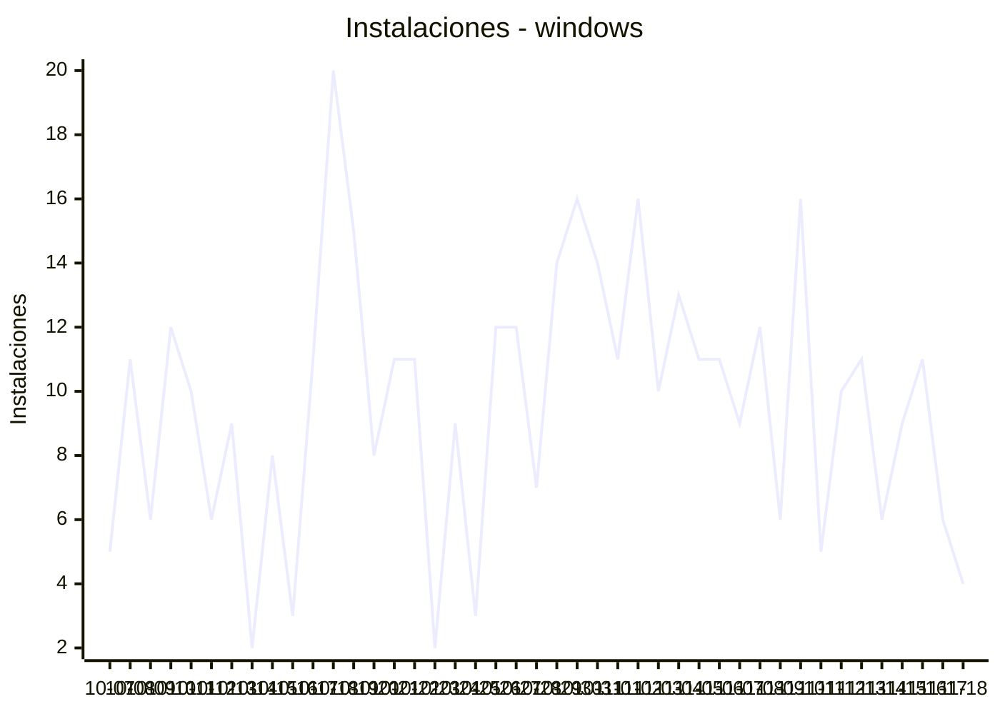
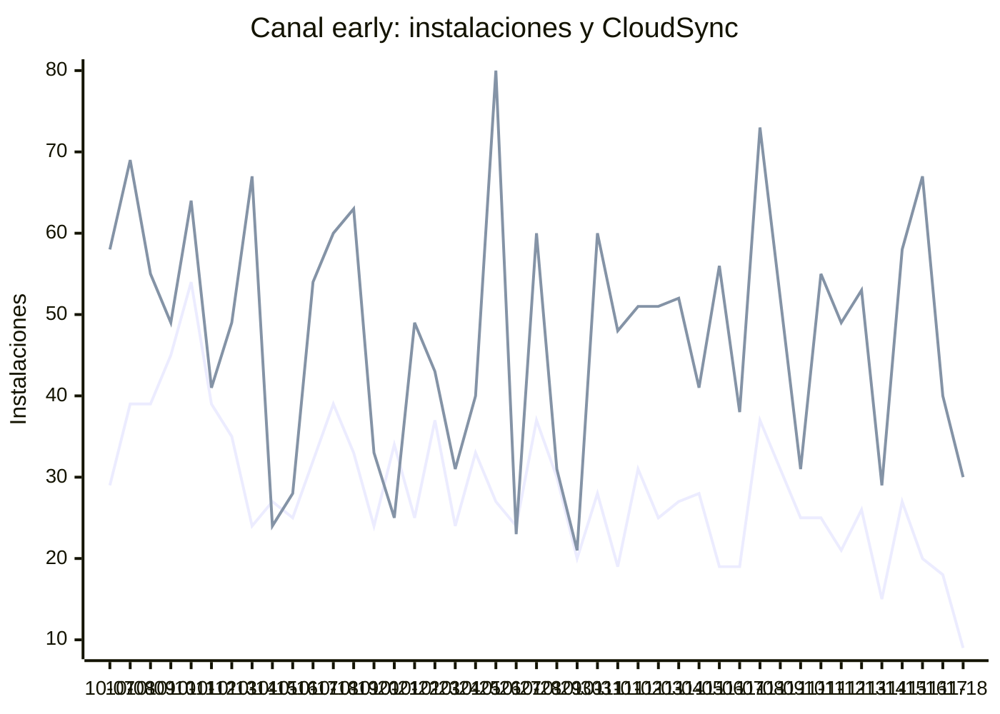

# Estadísticas de EmuDeck

Actualizado: 2026-11-19 09:10 UTC. Las gráficas no incluyen el día de hoy porque aún está incompleto.

## Arranques de la app (comprobaciones de actualización)

Cada arranque descarga el `latest*.yml` de su sistema. Cuenta arranques, no personas.

| Sistema | Ayer | Últimos 7 días |
|---|---|---|
| Linux x86 | 11261 | 94100 |
| Linux ARM | 99 | 1004 |
| Windows | 2774 | 23865 |
| Mac | 30 | 256 |

Instalaciones nuevas estimadas en Windows (7 días, `.exe` menos `.blockmap`): **2336**

## Instalaciones de EmuDeck (beacons)

Cada `setup` descarga `system-<sistema>.txt` y cada instalación de un emulador `<emulador>-<plataforma>.txt`. Los emuladores cuentan también las actualizaciones. Histórico completo desde el primer día.

| Sistema | Ayer | Últimos 7 días | Últimos 30 días | Total |
|---|---|---|---|---|
| linux | 18 | 238 | 911 | 1399 |
| linux-arm | 23 | 203 | 492 | 570 |
| windows | 4 | 57 | 296 | 429 |

### Por mes

| Mes | Linux | Linux ARM | Windows | Total |
|---|---|---|---|---|
| 2026-11 | 571 | 433 | 177 | 1181 |
| 2026-10 | 790 | 128 | 237 | 1155 |

### Canal early (early + early-unstable)

Instalaciones de EmuDeck con el backend en una rama early, y cuántas de ellas instalan CloudSync.

| | Últimos 7 días | Últimos 30 días | Total |
|---|---|---|---|
| Instalaciones early | 136 | 765 | 1267 |
| Con CloudSync | 326 | 1370 | 2145 |
| % con CloudSync | | | 169% |

Línea de arriba: instalaciones early. Línea de abajo: de ellas, con CloudSync.

### Por emulador

| Emulador | Linux (total) | Linux ARM (total) | Windows (total) | Últimos 7 días | Últimos 30 días | Total |
|---|---|---|---|---|---|---|
| esde | 3142 | 596 | 889 | 922 | 3252 | 4627 |
| azahar | 3313 | 691 | 472 | 866 | 3071 | 4476 |
| ryujinx | 3259 | 680 | 476 | 881 | 3047 | 4415 |
| duckstation | 3574 | 635 | 186 | 823 | 2988 | 4395 |
| pcsx2 | 3762 | 40 | 504 | 701 | 2832 | 4306 |
| srm | 3106 | 564 | 592 | 877 | 3019 | 4262 |
| rpcs3 | 3413 | 652 | 186 | 824 | 2926 | 4251 |
| cemu | 3254 | 616 | 170 | 766 | 2746 | 4040 |
| xenia | 3028 | 515 | 409 | 735 | 2701 | 3952 |
| vita3k | 2950 | 553 | 125 | 680 | 2449 | 3628 |
| shadps4 | 2832 | 241 | 364 | 522 | 2249 | 3437 |
| cloudsync | 1413 | 60 | 755 | 343 | 1424 | 2228 |
| ppsspp | 1188 | 446 | 393 | 409 | 1414 | 2027 |
| dolphin | 1311 | 497 | 202 | 422 | 1395 | 2010 |
| ra | 1313 | 460 | 221 | 405 | 1387 | 1994 |
| xemu | 1100 | 383 | 148 | 324 | 1125 | 1631 |
| mgba | 1380 | 149 | 96 | 302 | 1095 | 1625 |
| melonds | 1079 | 385 | 135 | 321 | 1087 | 1599 |
| primehack | 1005 | 400 | 147 | 322 | 1095 | 1552 |
| supermodel | 933 | 365 | 46 | 270 | 920 | 1344 |
| scummvm | 894 | 336 | 95 | 266 | 910 | 1325 |
| model2 | 915 | 383 | 14 | 260 | 892 | 1312 |
| armsx2 | 294 | 715 | 0 | 309 | 808 | 1009 |
| bigpemu | 892 | 47 | 42 | 163 | 653 | 981 |
| flycast | 237 | 54 | 40 | 59 | 217 | 331 |
| rmg | 235 | 78 | 0 | 64 | 204 | 313 |
| mame | 128 | 18 | 54 | 33 | 132 | 200 |
| eden | 141 | 11 | 21 | 20 | 99 | 173 |
| pegasus | 47 | 3 | 29 | 13 | 58 | 79 |
| yuzu | 18 | 0 | 8 | 3 | 19 | 26 |
| ares | 20 | 3 | 0 | 7 | 18 | 23 |
| citron | 6 | 2 | 2 | 2 | 6 | 10 |
