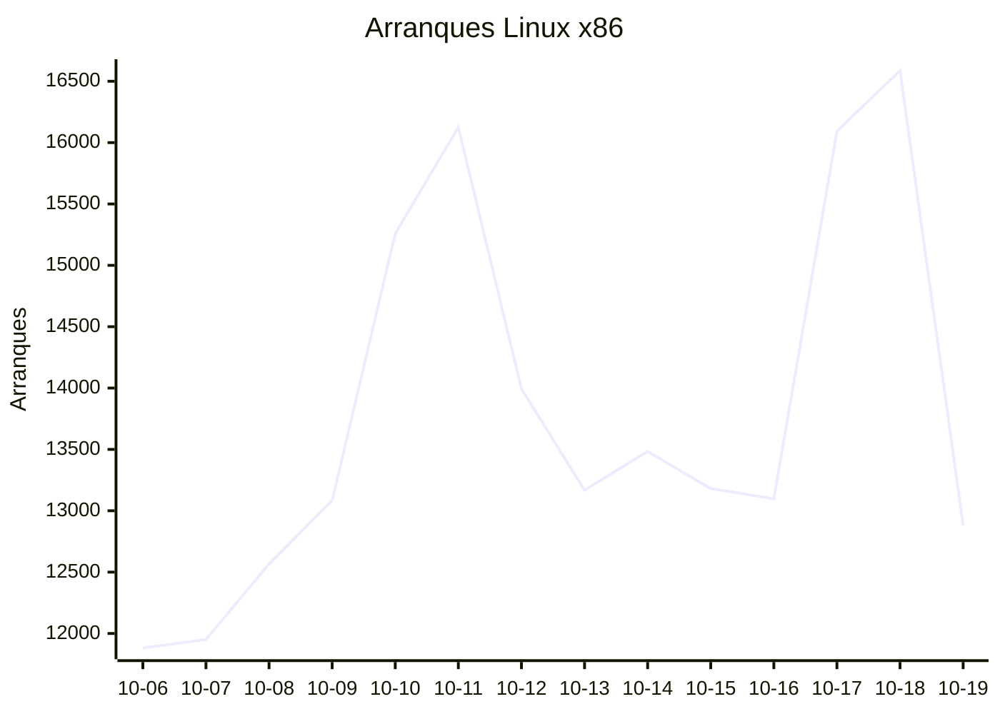
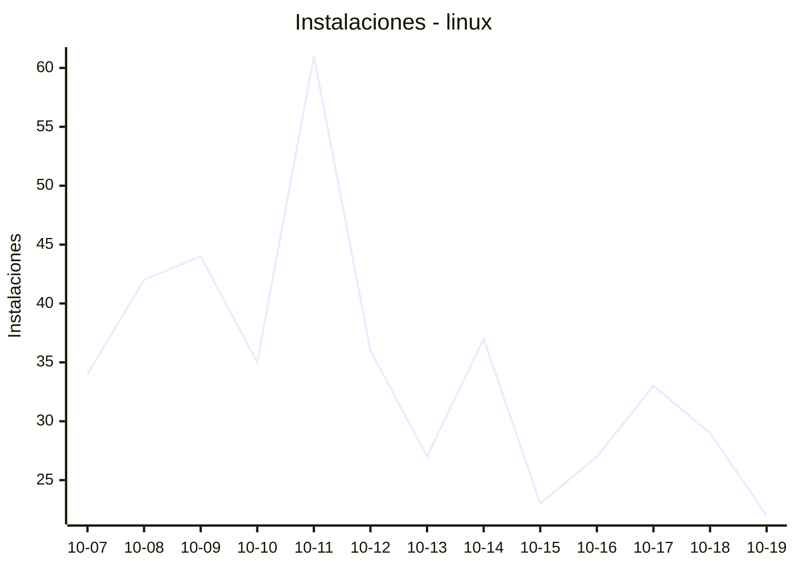
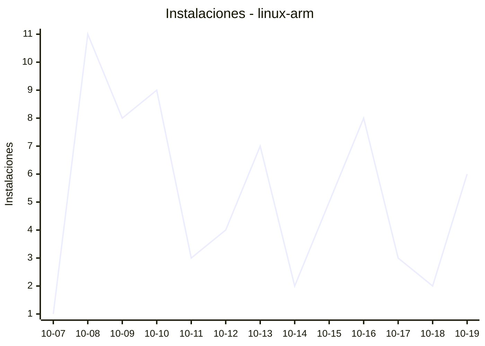
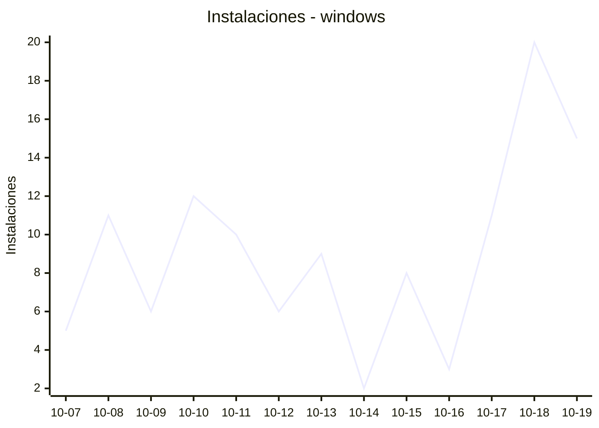
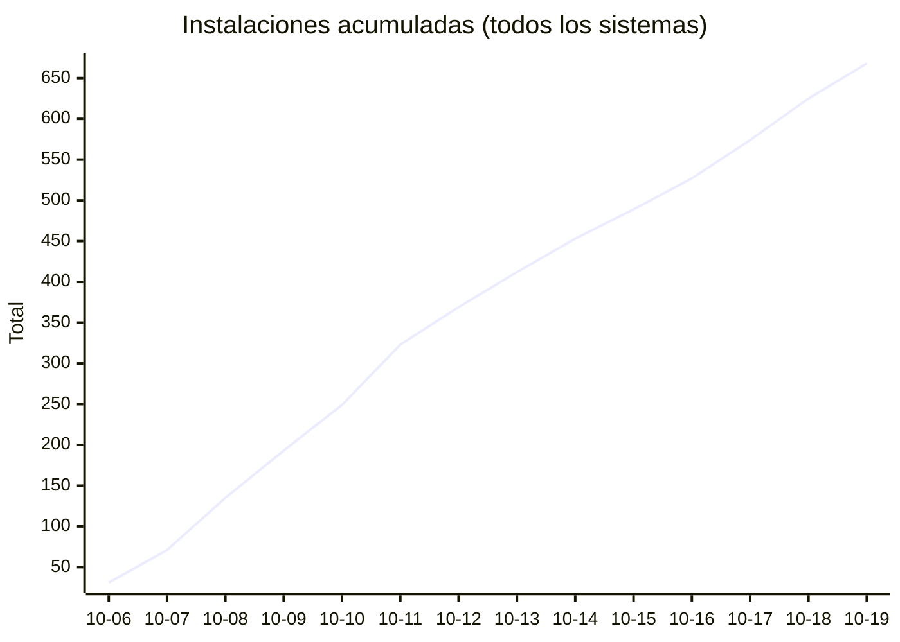
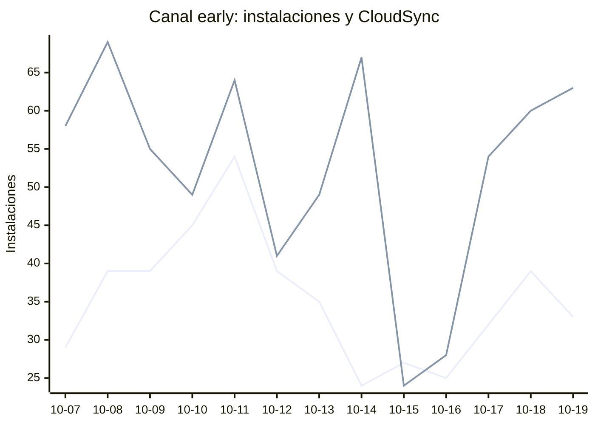

# Estadísticas de EmuDeck

Actualizado: 2026-10-20 00:37 UTC. Las gráficas no incluyen el día de hoy porque aún está incompleto.

## Arranques de la app (comprobaciones de actualización)

Cada arranque descarga el `latest*.yml` de su sistema. Cuenta arranques, no personas.

| Sistema | Ayer | Últimos 7 días |
|---|---|---|
| Linux x86 | 12882 | 98491 |
| Linux ARM | 162 | 1078 |
| Windows | 3342 | 25760 |
| Mac | 0 | 0 |

Instalaciones nuevas estimadas en Windows (7 días, `.exe` menos `.blockmap`): **2032**

## Instalaciones de EmuDeck (beacons)

Cada `setup` descarga `system-<sistema>.txt` y cada instalación de un emulador `<emulador>-<plataforma>.txt`. Los emuladores cuentan también las actualizaciones. Histórico completo desde el primer día.

| Sistema | Ayer | Últimos 7 días | Últimos 30 días | Total |
|---|---|---|---|---|
| linux | 22 | 198 | 450 | 472 |
| linux-arm | 6 | 33 | 69 | 72 |
| windows | 15 | 68 | 118 | 125 |

### Por mes

| Mes | Linux | Linux ARM | Windows | Total |
|---|---|---|---|---|
| 2026-10 | 450 | 69 | 118 | 637 |

### Canal early (early + early-unstable)

Instalaciones de EmuDeck con el backend en una rama early, y cuántas de ellas instalan CloudSync.

| | Últimos 7 días | Últimos 30 días | Total |
|---|---|---|---|
| Instalaciones early | 215 | 460 | 484 |
| Con CloudSync | 345 | 681 | 745 |
| % con CloudSync | | | 154% |

Línea de arriba: instalaciones early. Línea de abajo: de ellas, con CloudSync.

### Por emulador

| Emulador | Linux (total) | Linux ARM (total) | Windows (total) | Últimos 7 días | Últimos 30 días | Total |
|---|---|---|---|---|---|---|
| pcsx2 | 1261 | 19 | 152 | 698 | 1355 | 1432 |
| duckstation | 1223 | 92 | 53 | 668 | 1290 | 1368 |
| azahar | 1121 | 96 | 144 | 658 | 1281 | 1361 |
| esde | 1019 | 83 | 226 | 641 | 1233 | 1328 |
| ryujinx | 1082 | 96 | 146 | 654 | 1254 | 1324 |
| rpcs3 | 1137 | 93 | 53 | 639 | 1211 | 1283 |
| cemu | 1121 | 94 | 40 | 605 | 1187 | 1255 |
| xenia | 1018 | 80 | 116 | 596 | 1153 | 1214 |
| srm | 994 | 75 | 141 | 622 | 1156 | 1210 |
| shadps4 | 968 | 77 | 108 | 575 | 1086 | 1153 |
| vita3k | 1028 | 81 | 31 | 567 | 1073 | 1140 |
| cloudsync | 522 | 20 | 228 | 350 | 704 | 770 |
| ppsspp | 426 | 61 | 105 | 260 | 560 | 592 |
| dolphin | 467 | 64 | 59 | 266 | 560 | 590 |
| ra | 460 | 64 | 63 | 256 | 558 | 587 |
| mgba | 448 | 36 | 33 | 261 | 494 | 517 |
| melonds | 400 | 50 | 42 | 225 | 465 | 492 |
| xemu | 395 | 53 | 41 | 215 | 463 | 489 |
| primehack | 346 | 49 | 42 | 191 | 413 | 437 |
| supermodel | 339 | 60 | 9 | 181 | 388 | 408 |
| model2 | 335 | 63 | 7 | 180 | 385 | 405 |
| scummvm | 331 | 44 | 23 | 173 | 375 | 398 |
| bigpemu | 314 | 4 | 8 | 170 | 306 | 326 |
| armsx2 | 95 | 100 | 0 | 95 | 183 | 195 |
| flycast | 87 | 13 | 10 | 45 | 105 | 110 |
| rmg | 86 | 22 | 0 | 52 | 104 | 108 |
| eden | 65 | 7 | 0 | 52 | 64 | 72 |
| mame | 54 | 2 | 10 | 22 | 61 | 66 |
| pegasus | 9 | 0 | 10 | 13 | 17 | 19 |
| yuzu | 6 | 0 | 0 | 2 | 6 | 6 |
| ares | 4 | 1 | 0 | 1 | 5 | 5 |
| citron | 4 | 0 | 0 | 3 | 4 | 4 |
