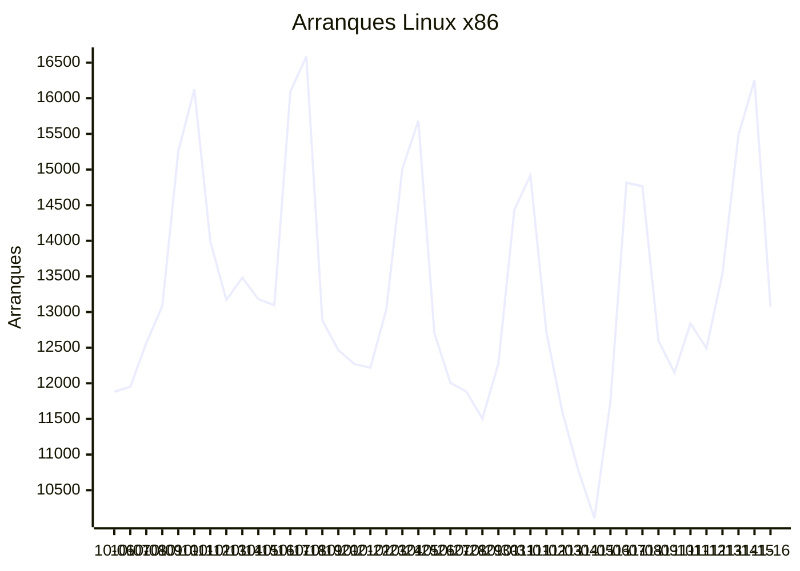
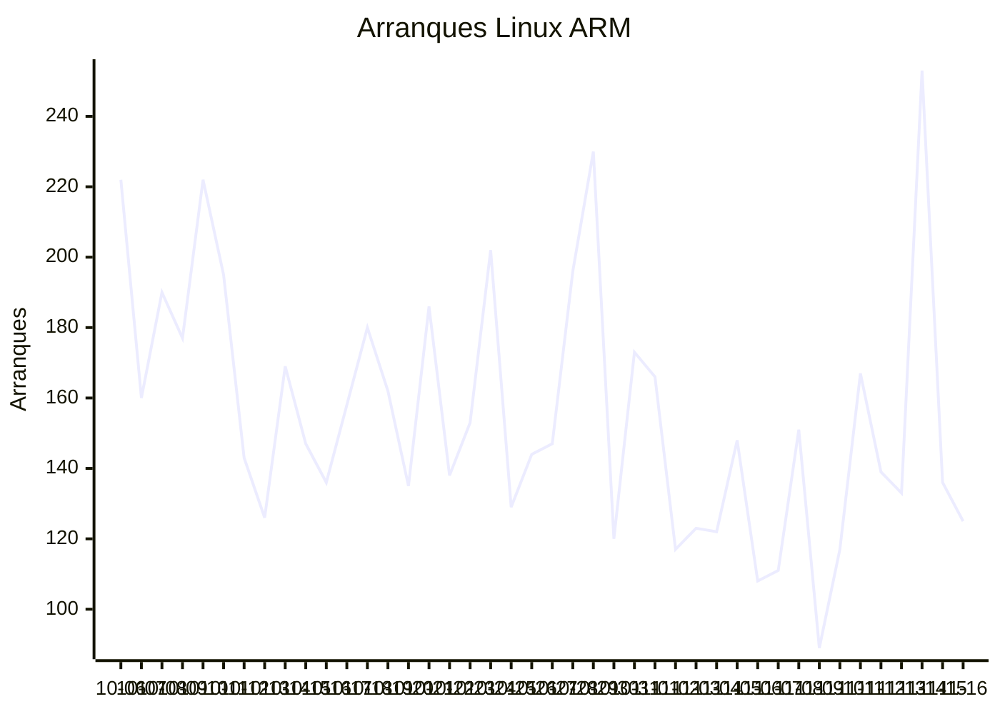
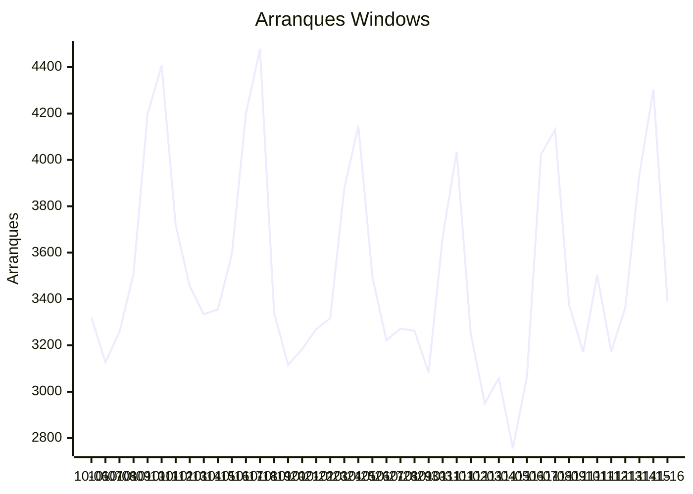
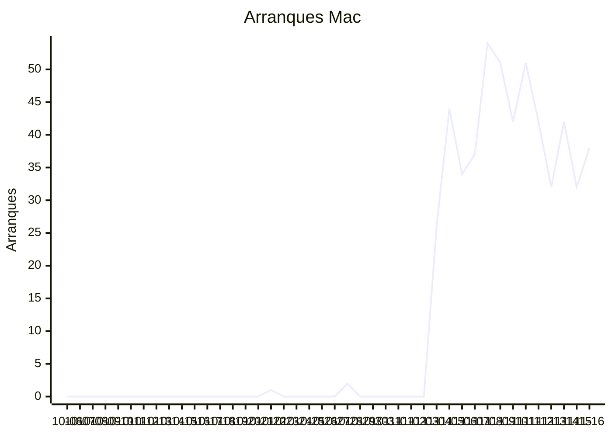
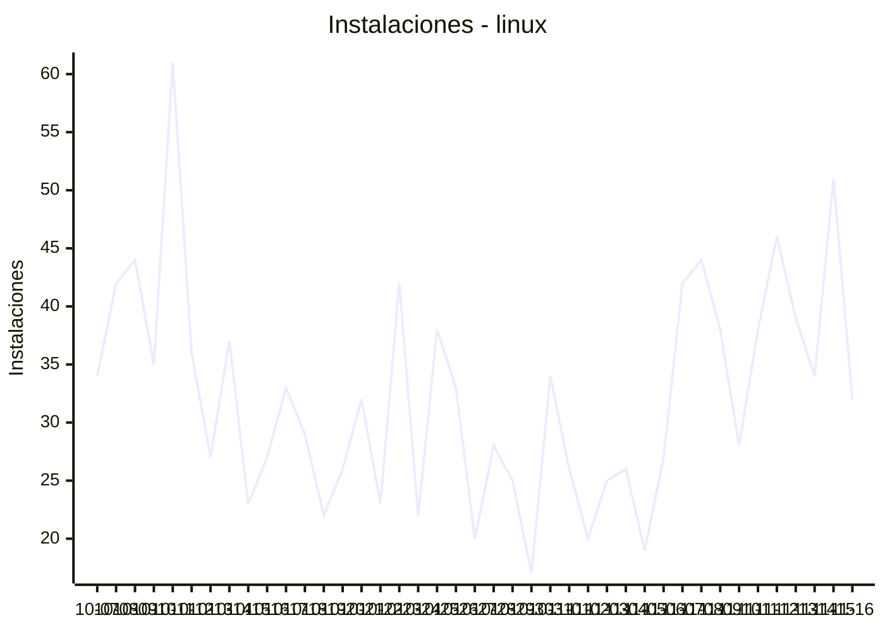
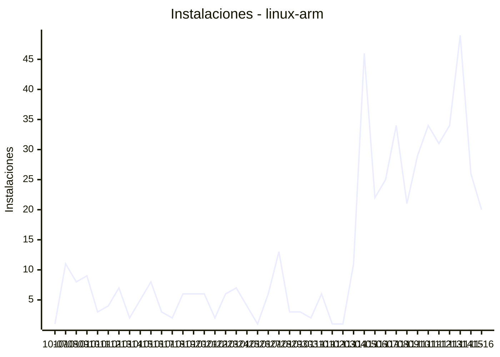
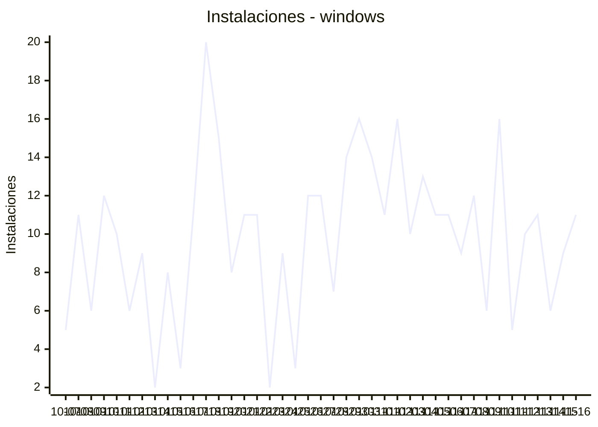
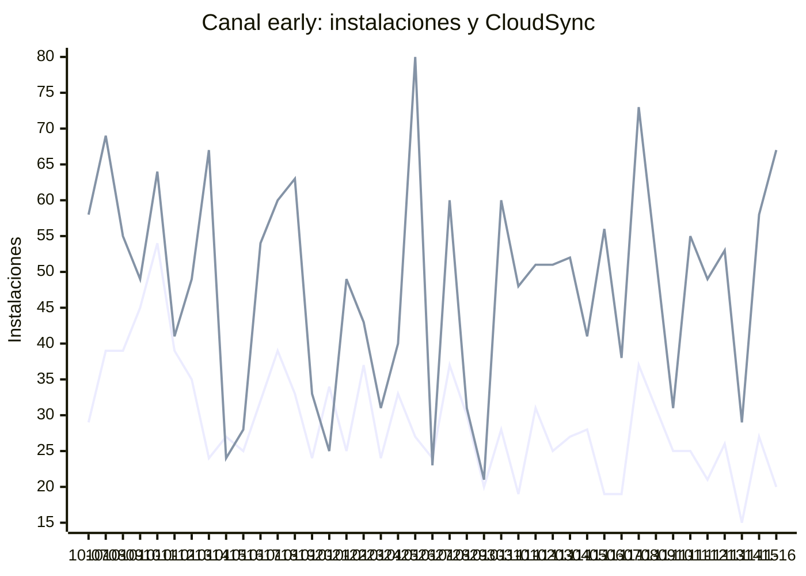

# Estadísticas de EmuDeck

Actualizado: 2026-11-17 01:37 UTC. Las gráficas no incluyen el día de hoy porque aún está incompleto.

## Arranques de la app (comprobaciones de actualización)

Cada arranque descarga el `latest*.yml` de su sistema. Cuenta arranques, no personas.

| Sistema | Ayer | Últimos 7 días |
|---|---|---|
| Linux x86 | 13077 | 95838 |
| Linux ARM | 125 | 1070 |
| Windows | 3391 | 24842 |
| Mac | 38 | 279 |

Instalaciones nuevas estimadas en Windows (7 días, `.exe` menos `.blockmap`): **2475**

## Instalaciones de EmuDeck (beacons)

Cada `setup` descarga `system-<sistema>.txt` y cada instalación de un emulador `<emulador>-<plataforma>.txt`. Los emuladores cuentan también las actualizaciones. Histórico completo desde el primer día.

| Sistema | Ayer | Últimos 7 días | Últimos 30 días | Total |
|---|---|---|---|---|
| linux | 32 | 268 | 926 | 1347 |
| linux-arm | 20 | 223 | 457 | 523 |
| windows | 11 | 68 | 321 | 411 |

### Por mes

| Mes | Linux | Linux ARM | Windows | Total |
|---|---|---|---|---|
| 2026-11 | 535 | 390 | 167 | 1092 |
| 2026-10 | 790 | 128 | 237 | 1155 |

### Canal early (early + early-unstable)

Instalaciones de EmuDeck con el backend en una rama early, y cuántas de ellas instalan CloudSync.

| | Últimos 7 días | Últimos 30 días | Total |
|---|---|---|---|
| Instalaciones early | 159 | 810 | 1223 |
| Con CloudSync | 342 | 1423 | 2047 |
| % con CloudSync | | | 167% |

Línea de arriba: instalaciones early. Línea de abajo: de ellas, con CloudSync.

### Por emulador

| Emulador | Linux (total) | Linux ARM (total) | Windows (total) | Últimos 7 días | Últimos 30 días | Total |
|---|---|---|---|---|---|---|
| esde | 3000 | 537 | 846 | 951 | 3253 | 4383 |
| azahar | 3175 | 633 | 458 | 912 | 3098 | 4266 |
| ryujinx | 3120 | 620 | 457 | 941 | 3062 | 4197 |
| duckstation | 3433 | 578 | 182 | 862 | 3023 | 4193 |
| pcsx2 | 3608 | 39 | 485 | 740 | 2911 | 4132 |
| srm | 2969 | 516 | 569 | 916 | 3039 | 4054 |
| rpcs3 | 3275 | 591 | 183 | 867 | 2951 | 4049 |
| cemu | 3127 | 565 | 164 | 812 | 2778 | 3856 |
| xenia | 2913 | 469 | 397 | 783 | 2744 | 3779 |
| vita3k | 2833 | 508 | 123 | 723 | 2487 | 3464 |
| shadps4 | 2720 | 235 | 352 | 567 | 2321 | 3307 |
| cloudsync | 1358 | 60 | 708 | 365 | 1481 | 2126 |
| ppsspp | 1152 | 408 | 381 | 466 | 1428 | 1941 |
| dolphin | 1266 | 454 | 194 | 467 | 1397 | 1914 |
| ra | 1271 | 421 | 212 | 446 | 1395 | 1904 |
| xemu | 1071 | 351 | 146 | 369 | 1142 | 1568 |
| mgba | 1316 | 132 | 93 | 302 | 1100 | 1541 |
| melonds | 1046 | 352 | 132 | 367 | 1098 | 1530 |
| primehack | 973 | 370 | 144 | 368 | 1106 | 1487 |
| supermodel | 907 | 339 | 45 | 312 | 927 | 1291 |
| scummvm | 869 | 310 | 93 | 310 | 920 | 1272 |
| model2 | 890 | 355 | 14 | 304 | 899 | 1259 |
| bigpemu | 861 | 42 | 40 | 165 | 671 | 943 |
| armsx2 | 283 | 654 | 0 | 314 | 766 | 937 |
| flycast | 229 | 45 | 38 | 65 | 212 | 312 |
| rmg | 226 | 69 | 0 | 72 | 197 | 295 |
| mame | 126 | 17 | 49 | 40 | 132 | 192 |
| eden | 135 | 11 | 20 | 40 | 109 | 166 |
| pegasus | 42 | 3 | 29 | 17 | 56 | 74 |
| yuzu | 16 | 0 | 8 | 5 | 18 | 24 |
| ares | 19 | 3 | 0 | 7 | 18 | 22 |
| citron | 6 | 2 | 2 | 3 | 7 | 10 |
