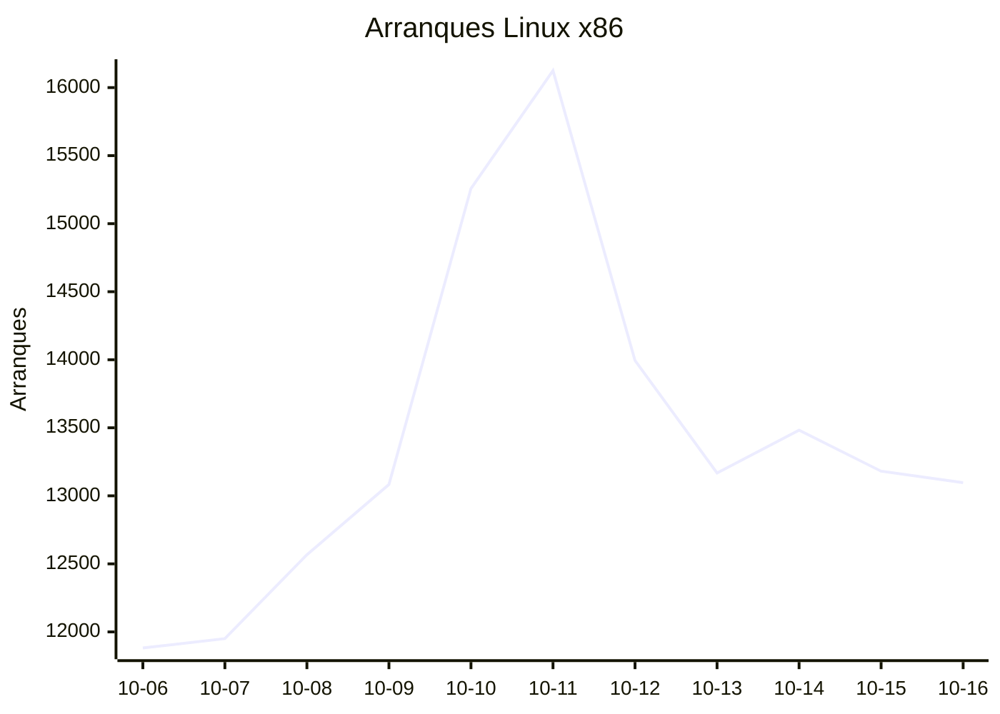
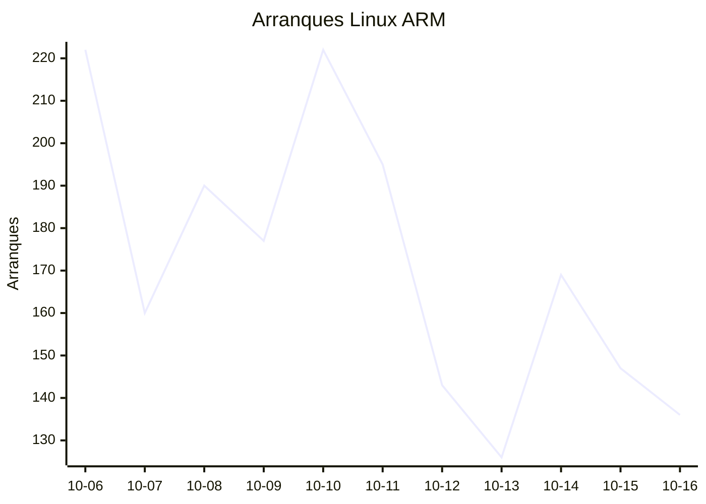
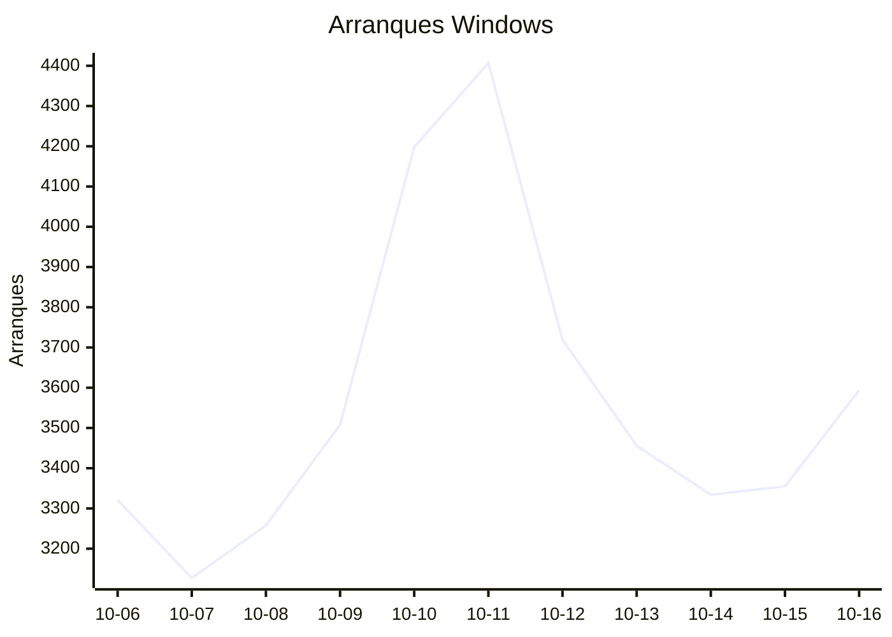
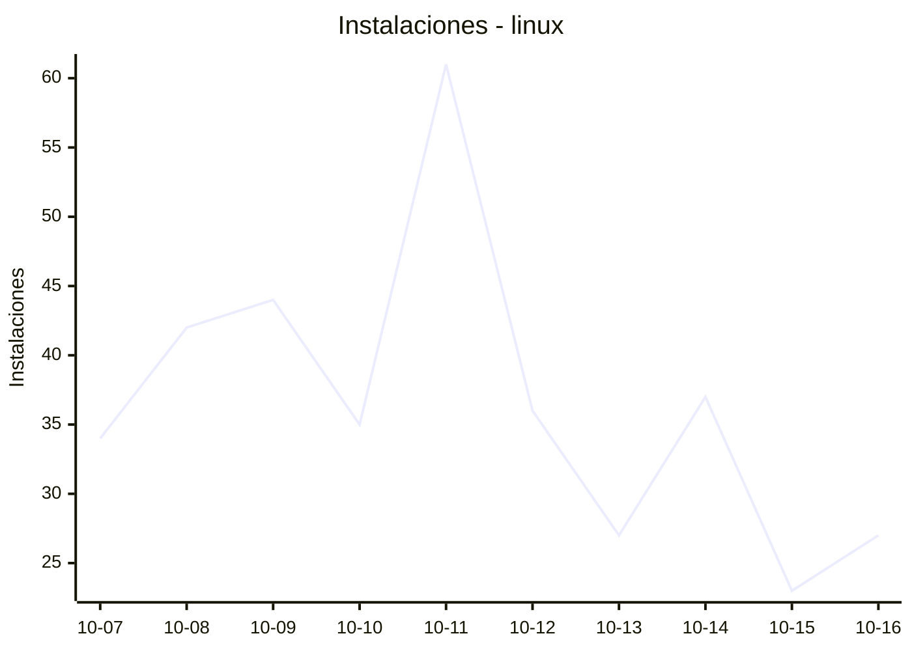
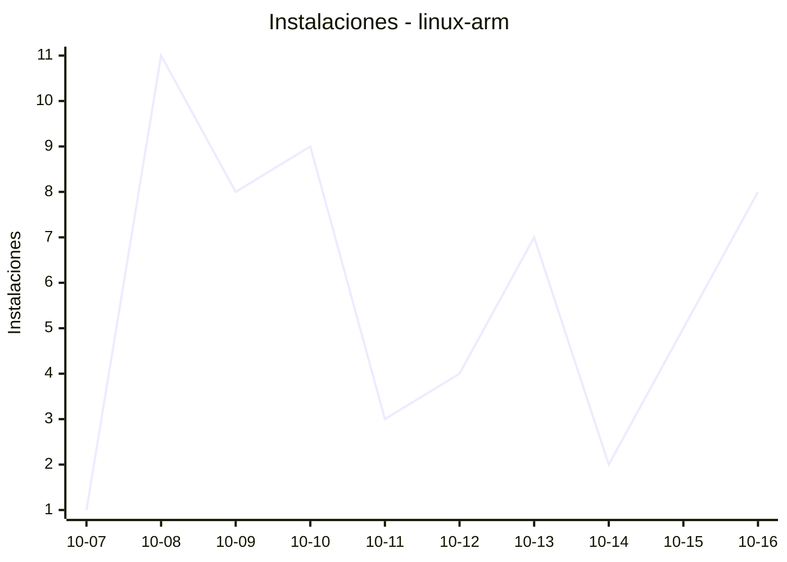
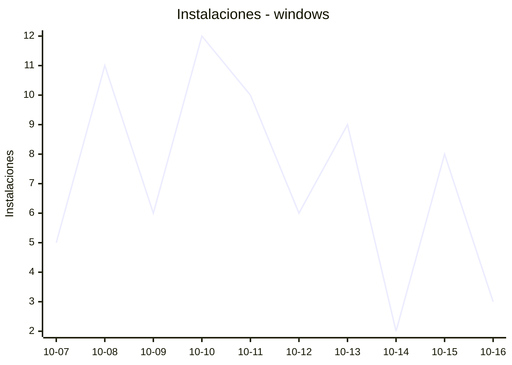
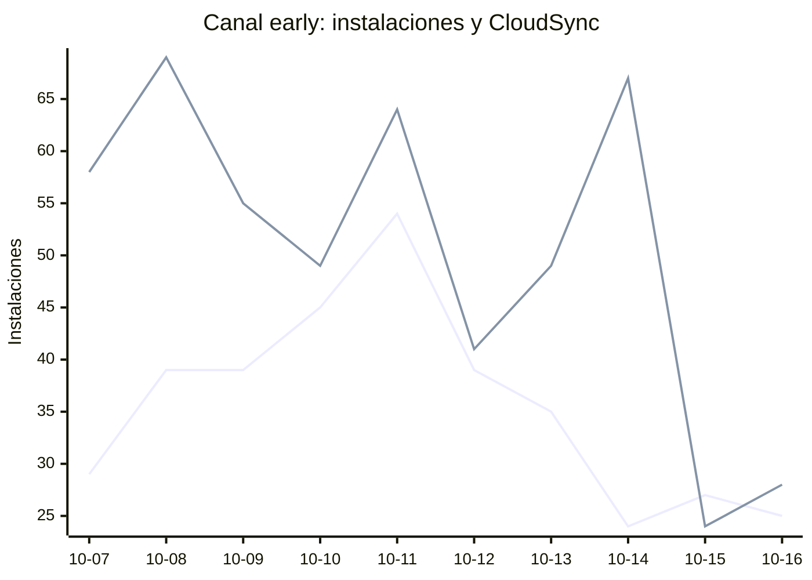

# Estadísticas de EmuDeck

Actualizado: 2026-10-17 13:36 UTC. Las gráficas no incluyen el día de hoy porque aún está incompleto.

## Arranques de la app (comprobaciones de actualización)

Cada arranque descarga el `latest*.yml` de su sistema. Cuenta arranques, no personas.

| Sistema | Ayer | Últimos 7 días |
|---|---|---|
| Linux x86 | 13097 | 98306 |
| Linux ARM | 136 | 1138 |
| Windows | 3594 | 26063 |
| Mac | 0 | 0 |

Instalaciones nuevas estimadas en Windows (7 días, `.exe` menos `.blockmap`): **1812**

## Instalaciones de EmuDeck (beacons)

Cada `setup` descarga `system-<sistema>.txt` y cada instalación de un emulador `<emulador>-<plataforma>.txt`. Los emuladores cuentan también las actualizaciones. Histórico completo desde el primer día.

| Sistema | Ayer | Últimos 7 días | Últimos 30 días | Total |
|---|---|---|---|---|
| linux | 27 | 246 | 366 | 401 |
| linux-arm | 8 | 38 | 58 | 62 |
| windows | 3 | 50 | 72 | 86 |

### Por mes

| Mes | Linux | Linux ARM | Windows | Total |
|---|---|---|---|---|
| 2026-10 | 366 | 58 | 72 | 496 |

### Canal early (early + early-unstable)

Instalaciones de EmuDeck con el backend en una rama early, y cuántas de ellas instalan CloudSync.

| | Últimos 7 días | Últimos 30 días | Total |
|---|---|---|---|
| Instalaciones early | 249 | 356 | 396 |
| Con CloudSync | 322 | 504 | 589 |
| % con CloudSync | | | 149% |

Línea de arriba: instalaciones early. Línea de abajo: de ellas, con CloudSync.

### Por emulador

| Emulador | Linux (total) | Linux ARM (total) | Windows (total) | Últimos 7 días | Últimos 30 días | Total |
|---|---|---|---|---|---|---|
| pcsx2 | 1024 | 18 | 114 | 710 | 1026 | 1156 |
| azahar | 924 | 79 | 113 | 682 | 983 | 1116 |
| duckstation | 987 | 78 | 39 | 683 | 977 | 1104 |
| ryujinx | 882 | 80 | 116 | 656 | 955 | 1078 |
| esde | 839 | 66 | 168 | 639 | 927 | 1073 |
| rpcs3 | 924 | 77 | 36 | 649 | 918 | 1037 |
| cemu | 918 | 77 | 26 | 631 | 907 | 1021 |
| xenia | 837 | 64 | 84 | 621 | 880 | 985 |
| srm | 805 | 65 | 91 | 600 | 862 | 961 |
| shadps4 | 793 | 64 | 73 | 580 | 820 | 930 |
| vita3k | 838 | 68 | 19 | 579 | 812 | 925 |
| cloudsync | 431 | 16 | 163 | 331 | 523 | 610 |
| dolphin | 395 | 55 | 45 | 307 | 448 | 495 |
| ppsspp | 357 | 52 | 79 | 303 | 438 | 488 |
| ra | 390 | 56 | 42 | 295 | 442 | 488 |
| mgba | 364 | 32 | 24 | 271 | 380 | 420 |
| melonds | 340 | 42 | 30 | 258 | 371 | 412 |
| xemu | 333 | 45 | 30 | 259 | 368 | 408 |
| primehack | 292 | 44 | 29 | 214 | 327 | 365 |
| supermodel | 291 | 51 | 8 | 222 | 319 | 350 |
| model2 | 287 | 54 | 5 | 216 | 315 | 346 |
| scummvm | 282 | 39 | 15 | 204 | 299 | 336 |
| bigpemu | 245 | 3 | 6 | 167 | 226 | 254 |
| armsx2 | 76 | 83 | 0 | 98 | 146 | 159 |
| flycast | 79 | 12 | 6 | 62 | 90 | 97 |
| rmg | 74 | 20 | 0 | 56 | 88 | 94 |
| mame | 47 | 2 | 9 | 29 | 53 | 58 |
| eden | 42 | 7 | 0 | 32 | 34 | 49 |
| pegasus | 9 | 0 | 8 | 11 | 14 | 17 |
| yuzu | 6 | 0 | 0 | 5 | 6 | 6 |
| ares | 3 | 1 | 0 | 2 | 4 | 4 |
| citron | 3 | 0 | 0 | 3 | 3 | 3 |
