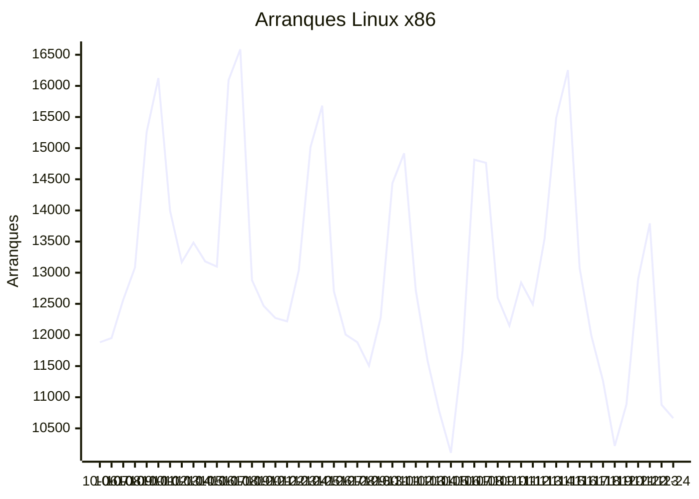
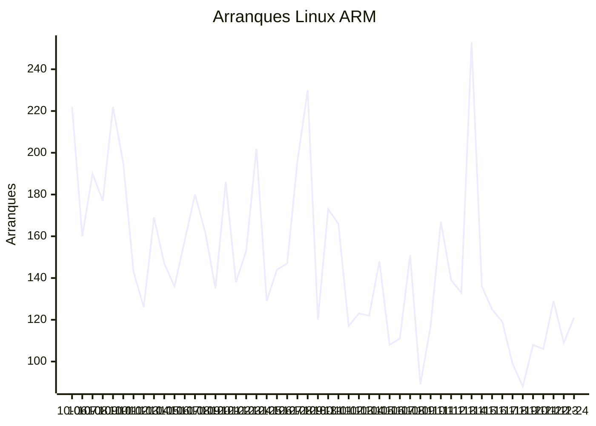
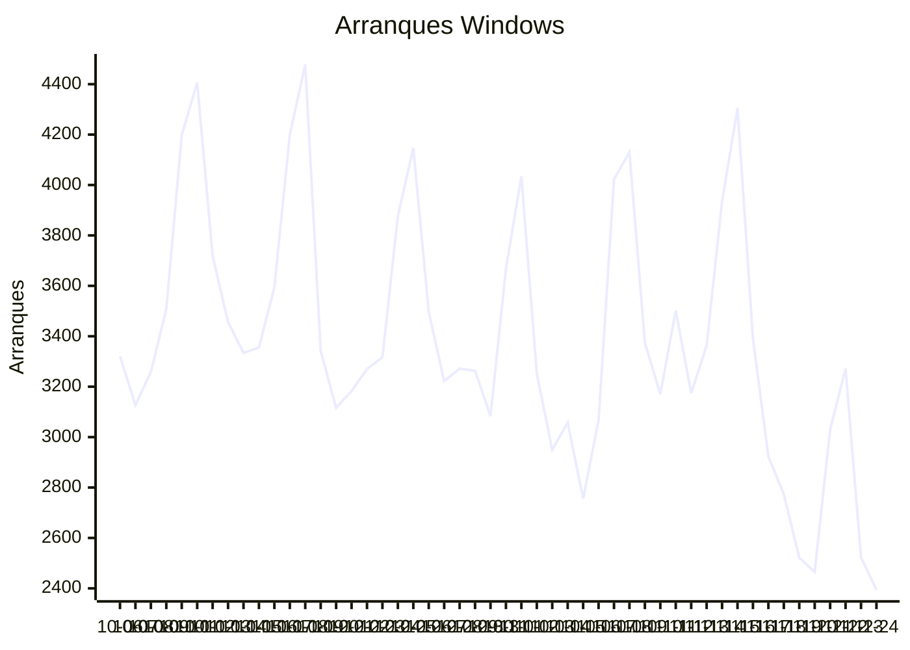
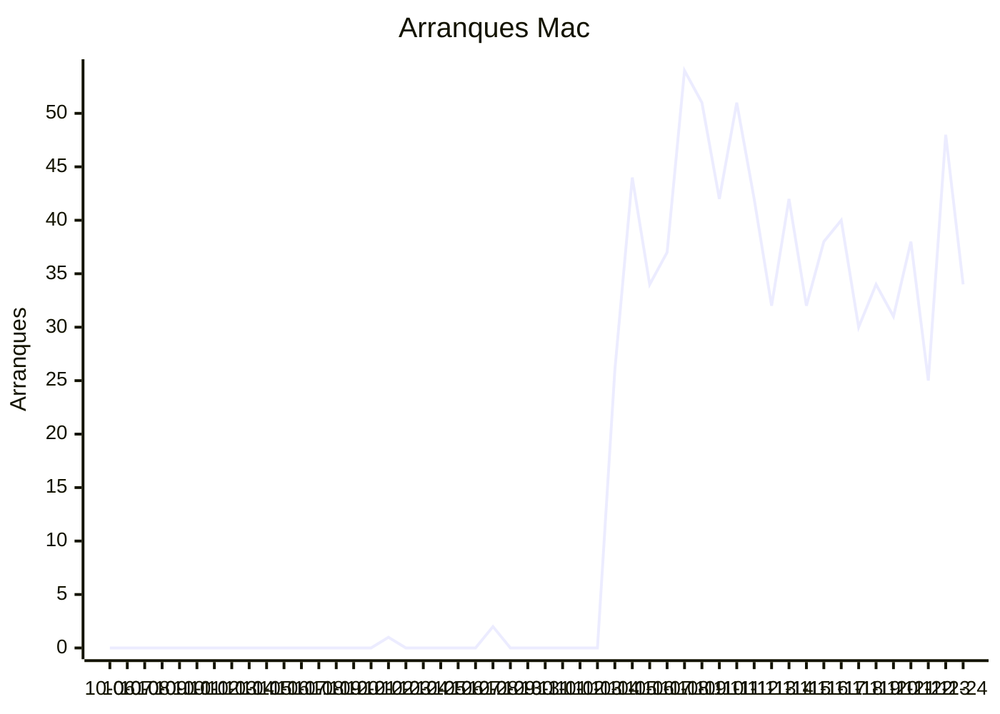
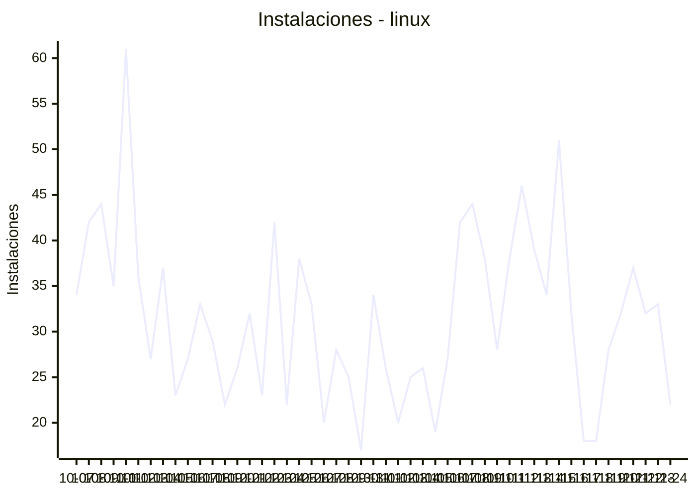
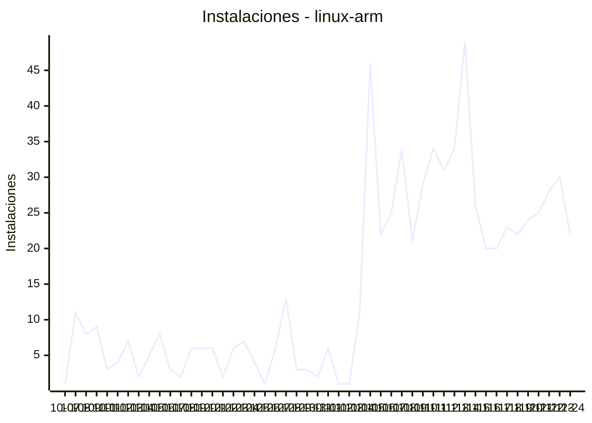

# Estadísticas de EmuDeck

Actualizado: 2026-11-25 03:36 UTC. Las gráficas no incluyen el día de hoy porque aún está incompleto.

## Arranques de la app (comprobaciones de actualización)

Cada arranque descarga el `latest*.yml` de su sistema. Cuenta arranques, no personas.

| Sistema | Ayer | Últimos 7 días |
|---|---|---|
| Linux x86 | 10665 | 80593 |
| Linux ARM | 121 | 760 |
| Windows | 2394 | 18980 |
| Mac | 34 | 240 |

Instalaciones nuevas estimadas en Windows (7 días, `.exe` menos `.blockmap`): **1991**

## Instalaciones de EmuDeck (beacons)

Cada `setup` descarga `system-<sistema>.txt` y cada instalación de un emulador `<emulador>-<plataforma>.txt`. Los emuladores cuentan también las actualizaciones. Histórico completo desde el primer día.

| Sistema | Ayer | Últimos 7 días | Últimos 30 días | Total |
|---|---|---|---|---|
| linux | 22 | 202 | 912 | 1572 |
| linux-arm | 22 | 174 | 612 | 720 |
| windows | 14 | 70 | 318 | 489 |

### Por mes

| Mes | Linux | Linux ARM | Windows | Total |
|---|---|---|---|---|
| 2026-11 | 755 | 584 | 243 | 1582 |
| 2026-10 | 790 | 128 | 237 | 1155 |

### Canal early (early + early-unstable)

Instalaciones de EmuDeck con el backend en una rama early, y cuántas de ellas instalan CloudSync.

| | Últimos 7 días | Últimos 30 días | Total |
|---|---|---|---|
| Instalaciones early | 151 | 730 | 1397 |
| Con CloudSync | 305 | 1424 | 2405 |
| % con CloudSync | | | 172% |

Línea de arriba: instalaciones early. Línea de abajo: de ellas, con CloudSync.

### Por emulador

| Emulador | Linux (total) | Linux ARM (total) | Windows (total) | Últimos 7 días | Últimos 30 días | Total |
|---|---|---|---|---|---|---|
| esde | 3540 | 729 | 1012 | 769 | 3379 | 5281 |
| azahar | 3729 | 859 | 538 | 761 | 3176 | 5126 |
| ryujinx | 3680 | 861 | 520 | 772 | 3144 | 5061 |
| duckstation | 4021 | 787 | 210 | 733 | 3060 | 5018 |
| rpcs3 | 3857 | 812 | 209 | 736 | 3017 | 4878 |
| srm | 3518 | 689 | 664 | 706 | 3058 | 4871 |
| pcsx2 | 4224 | 42 | 571 | 626 | 2803 | 4837 |
| cemu | 3655 | 760 | 192 | 670 | 2800 | 4607 |
| xenia | 3422 | 653 | 462 | 672 | 2774 | 4537 |
| vita3k | 3325 | 689 | 139 | 619 | 2529 | 4153 |
| shadps4 | 3187 | 259 | 409 | 493 | 2212 | 3855 |
| cloudsync | 1577 | 81 | 842 | 321 | 1483 | 2500 |
| ppsspp | 1338 | 571 | 453 | 377 | 1532 | 2362 |
| dolphin | 1466 | 634 | 220 | 362 | 1497 | 2320 |
| ra | 1474 | 596 | 249 | 373 | 1490 | 2319 |
| xemu | 1236 | 493 | 164 | 294 | 1198 | 1893 |
| melonds | 1203 | 498 | 152 | 292 | 1170 | 1853 |
| mgba | 1567 | 178 | 108 | 265 | 1107 | 1853 |
| primehack | 1132 | 513 | 165 | 297 | 1193 | 1810 |
| supermodel | 1051 | 469 | 51 | 258 | 1008 | 1571 |
| scummvm | 1011 | 437 | 107 | 262 | 1000 | 1555 |
| model2 | 1033 | 490 | 14 | 253 | 984 | 1537 |
| armsx2 | 334 | 880 | 0 | 242 | 915 | 1214 |
| bigpemu | 1009 | 57 | 49 | 149 | 650 | 1115 |
| flycast | 262 | 66 | 44 | 52 | 218 | 372 |
| rmg | 262 | 104 | 0 | 61 | 218 | 366 |
| mame | 144 | 23 | 67 | 38 | 150 | 234 |
| eden | 165 | 11 | 22 | 27 | 116 | 198 |
| pegasus | 55 | 3 | 31 | 12 | 61 | 89 |
| yuzu | 18 | 0 | 8 | 1 | 16 | 26 |
| ares | 22 | 3 | 0 | 2 | 17 | 25 |
| citron | 6 | 2 | 3 | 1 | 7 | 11 |
