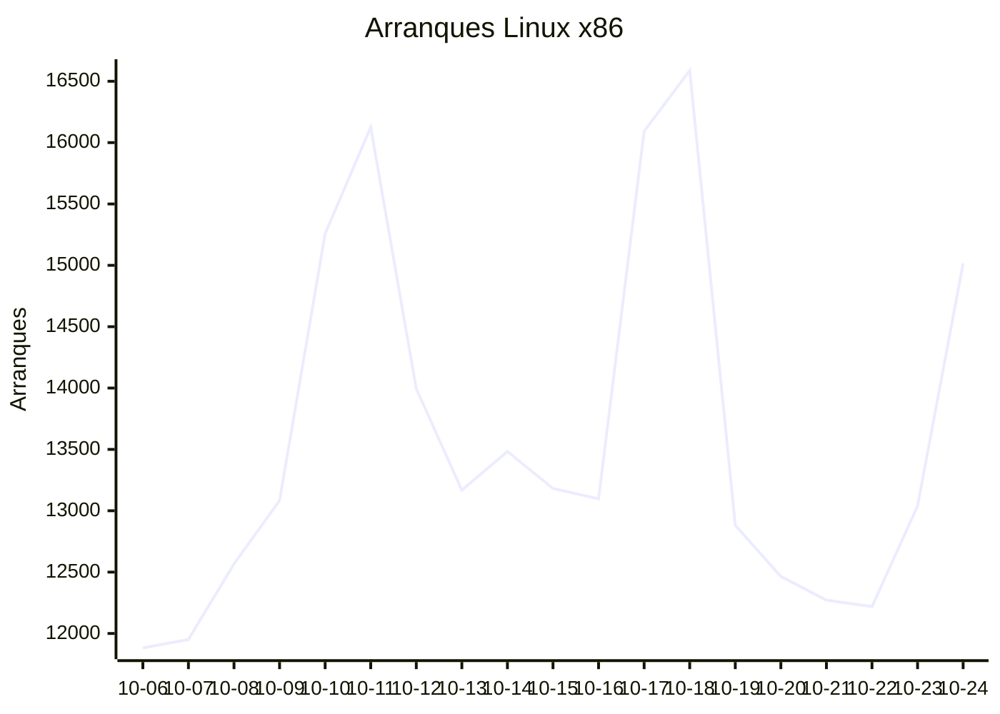
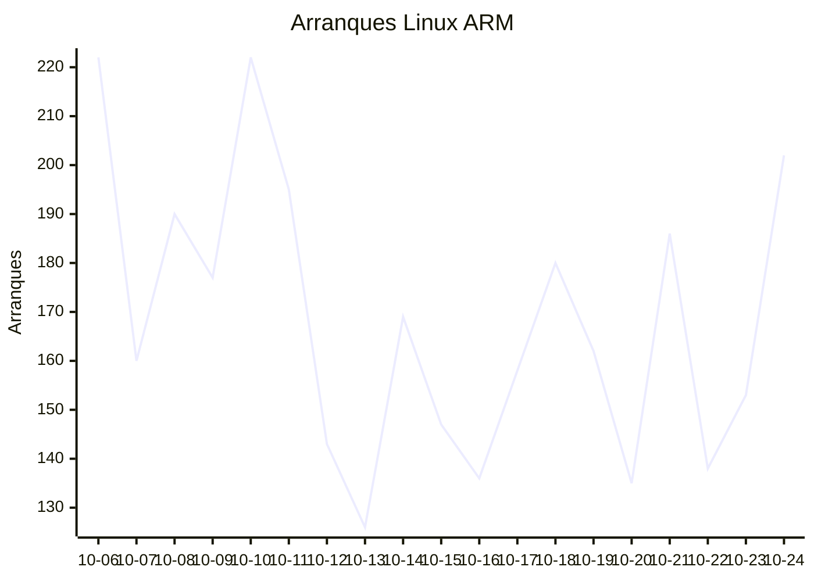
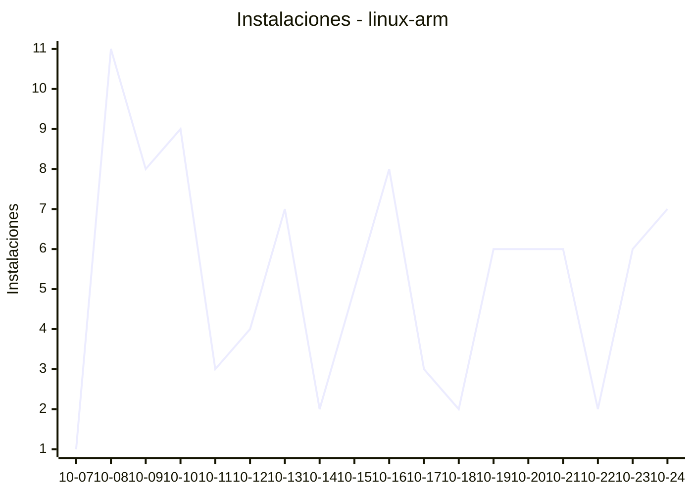
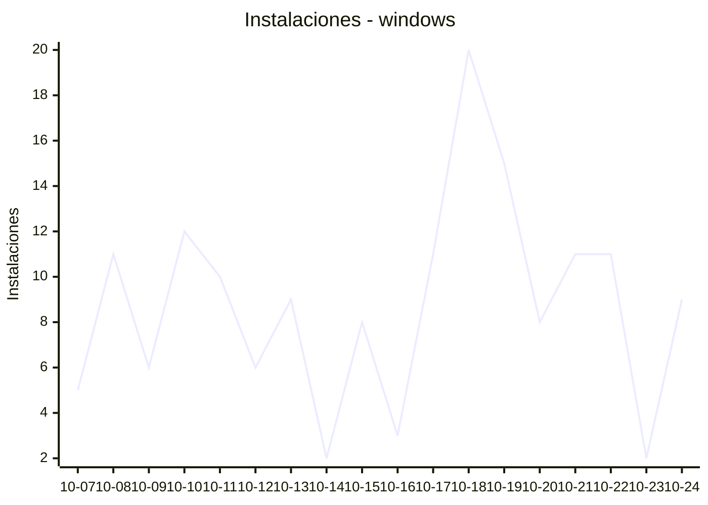
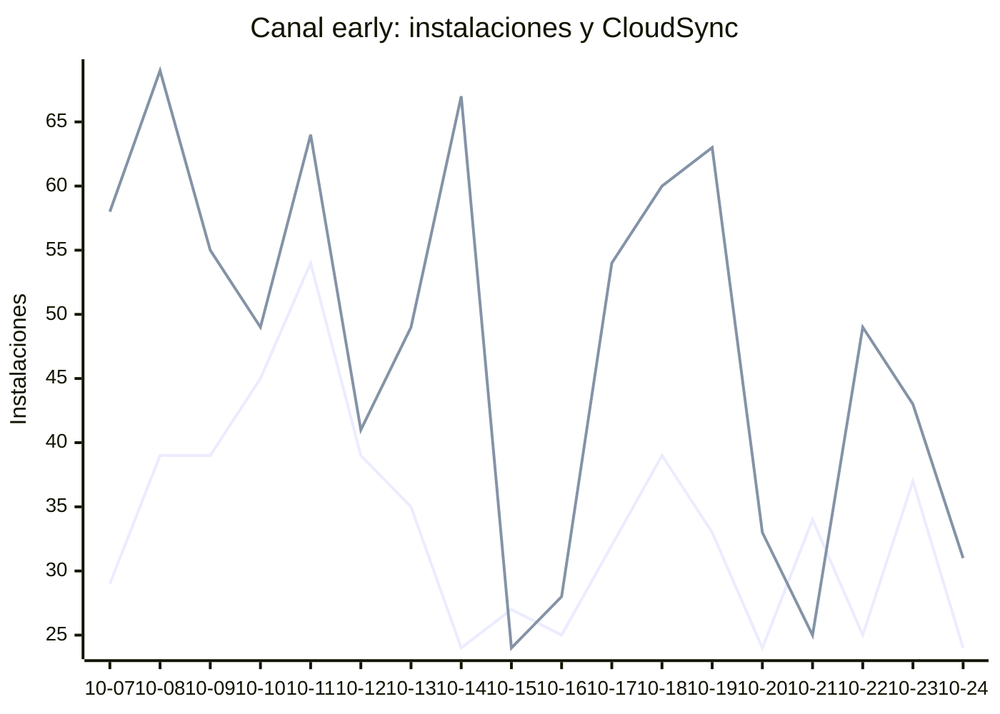

# Estadísticas de EmuDeck

Actualizado: 2026-10-25 13:37 UTC. Las gráficas no incluyen el día de hoy porque aún está incompleto.

## Arranques de la app (comprobaciones de actualización)

Cada arranque descarga el `latest*.yml` de su sistema. Cuenta arranques, no personas.

| Sistema | Ayer | Últimos 7 días |
|---|---|---|
| Linux x86 | 15016 | 94480 |
| Linux ARM | 202 | 1156 |
| Windows | 3877 | 24584 |
| Mac | 0 | 1 |

Instalaciones nuevas estimadas en Windows (7 días, `.exe` menos `.blockmap`): **2046**

## Instalaciones de EmuDeck (beacons)

Cada `setup` descarga `system-<sistema>.txt` y cada instalación de un emulador `<emulador>-<plataforma>.txt`. Los emuladores cuentan también las actualizaciones. Histórico completo desde el primer día.

| Sistema | Ayer | Últimos 7 días | Últimos 30 días | Total |
|---|---|---|---|---|
| linux | 22 | 196 | 595 | 634 |
| linux-arm | 7 | 35 | 96 | 100 |
| windows | 9 | 76 | 159 | 167 |

### Por mes

| Mes | Linux | Linux ARM | Windows | Total |
|---|---|---|---|---|
| 2026-10 | 595 | 96 | 159 | 850 |

### Canal early (early + early-unstable)

Instalaciones de EmuDeck con el backend en una rama early, y cuántas de ellas instalan CloudSync.

| | Últimos 7 días | Últimos 30 días | Total |
|---|---|---|---|
| Instalaciones early | 216 | 604 | 643 |
| Con CloudSync | 304 | 862 | 949 |
| % con CloudSync | | | 148% |

Línea de arriba: instalaciones early. Línea de abajo: de ellas, con CloudSync.

### Por emulador

| Emulador | Linux (total) | Linux ARM (total) | Windows (total) | Últimos 7 días | Últimos 30 días | Total |
|---|---|---|---|---|---|---|
| pcsx2 | 1739 | 22 | 195 | 684 | 1828 | 1956 |
| duckstation | 1662 | 134 | 83 | 662 | 1755 | 1879 |
| azahar | 1526 | 149 | 192 | 659 | 1747 | 1867 |
| esde | 1405 | 111 | 313 | 657 | 1690 | 1829 |
| ryujinx | 1484 | 145 | 200 | 651 | 1715 | 1829 |
| rpcs3 | 1563 | 133 | 80 | 628 | 1656 | 1776 |
| cemu | 1535 | 136 | 63 | 612 | 1624 | 1734 |
| srm | 1382 | 125 | 219 | 665 | 1625 | 1726 |
| xenia | 1407 | 108 | 166 | 600 | 1573 | 1681 |
| shadps4 | 1327 | 112 | 142 | 548 | 1468 | 1581 |
| vita3k | 1385 | 120 | 52 | 544 | 1454 | 1557 |
| cloudsync | 674 | 25 | 286 | 319 | 896 | 985 |
| ra | 611 | 88 | 97 | 268 | 747 | 796 |
| ppsspp | 563 | 84 | 147 | 266 | 745 | 794 |
| dolphin | 610 | 91 | 85 | 254 | 739 | 786 |
| mgba | 613 | 51 | 48 | 250 | 669 | 712 |
| xemu | 528 | 74 | 63 | 225 | 624 | 665 |
| melonds | 523 | 71 | 62 | 214 | 617 | 656 |
| primehack | 457 | 68 | 66 | 200 | 555 | 591 |
| supermodel | 447 | 82 | 15 | 170 | 512 | 544 |
| scummvm | 434 | 60 | 40 | 173 | 500 | 534 |
| model2 | 440 | 85 | 7 | 163 | 501 | 532 |
| bigpemu | 434 | 10 | 11 | 170 | 422 | 455 |
| armsx2 | 132 | 150 | 0 | 109 | 267 | 282 |
| flycast | 119 | 15 | 16 | 50 | 144 | 150 |
| rmg | 116 | 26 | 0 | 41 | 134 | 142 |
| mame | 66 | 2 | 15 | 23 | 78 | 83 |
| eden | 73 | 7 | 0 | 23 | 72 | 80 |
| pegasus | 15 | 0 | 12 | 7 | 23 | 27 |
| yuzu | 8 | 0 | 2 | 4 | 10 | 10 |
| ares | 7 | 1 | 0 | 3 | 7 | 8 |
| citron | 4 | 0 | 0 | 1 | 4 | 4 |
