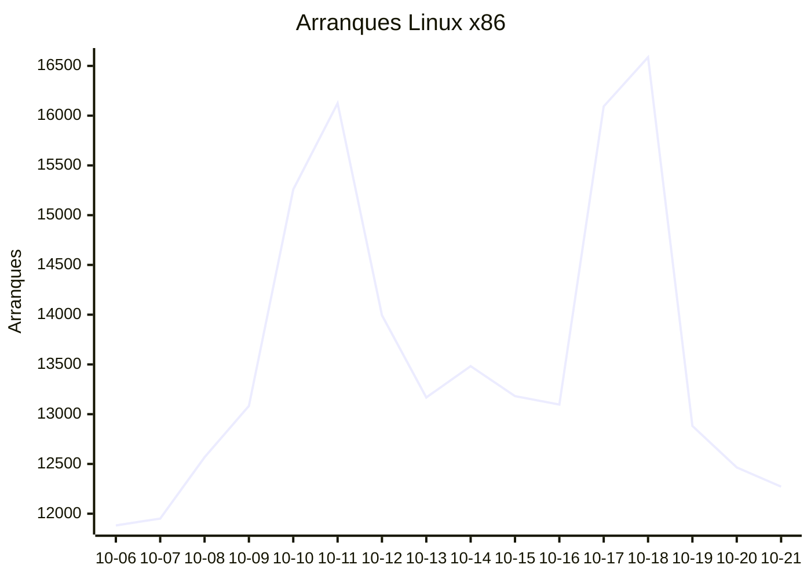
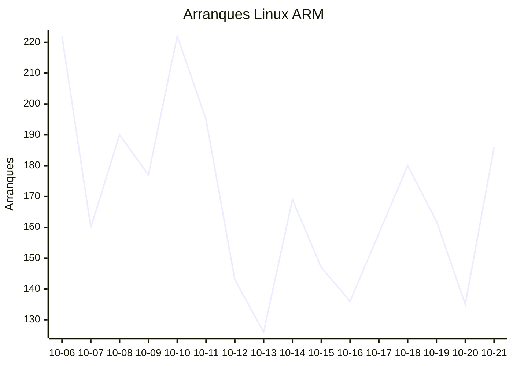
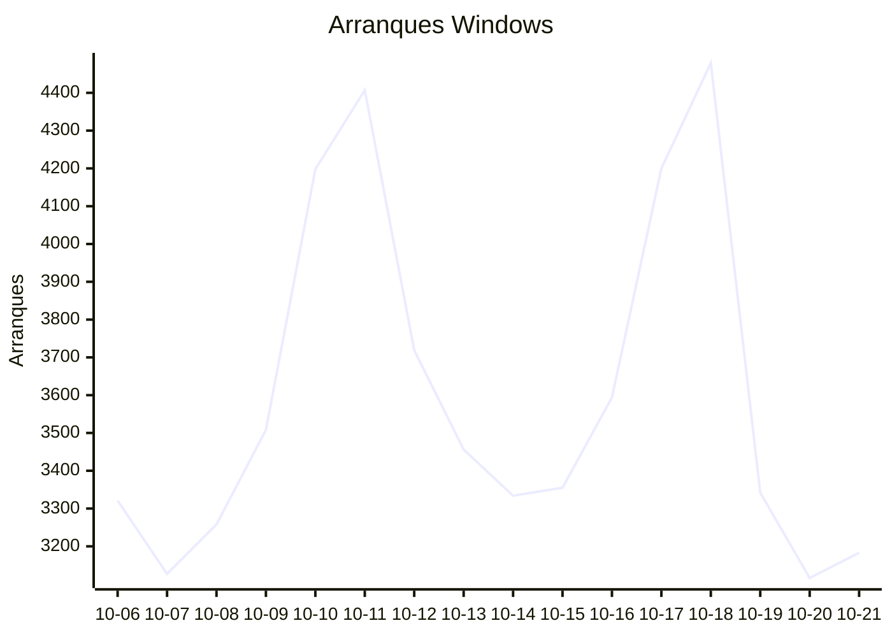
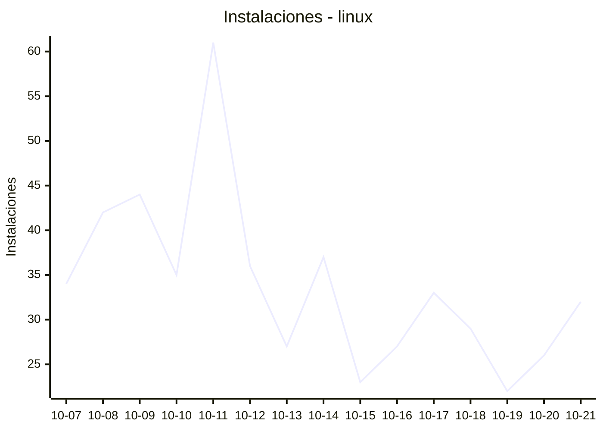
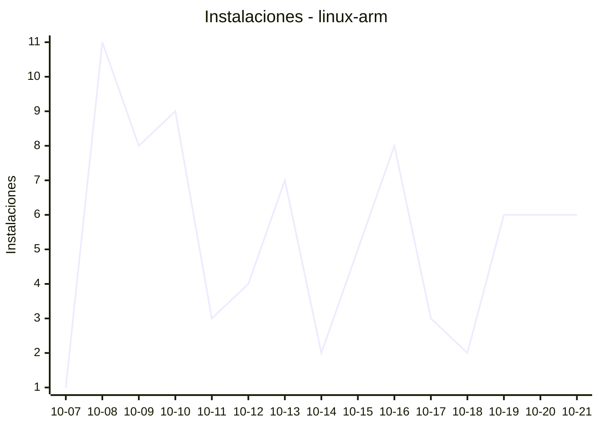
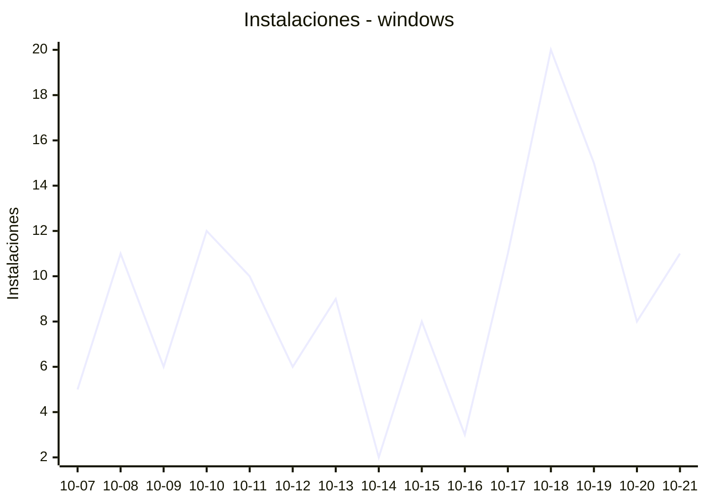
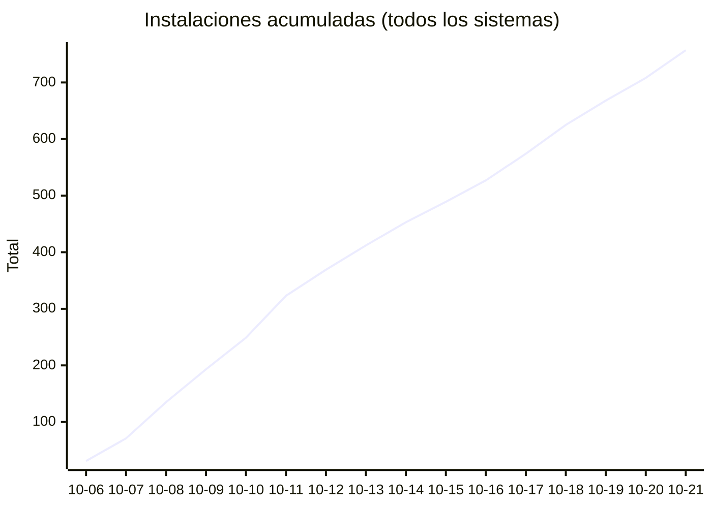
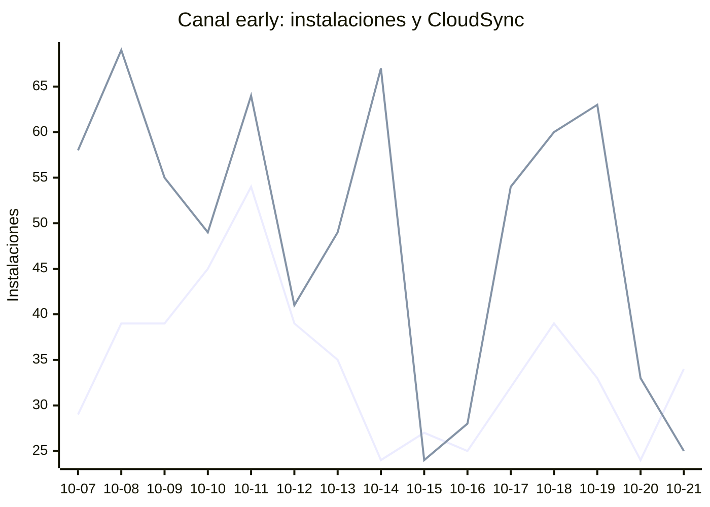

# Estadísticas de EmuDeck

Actualizado: 2026-10-22 06:24 UTC. Las gráficas no incluyen el día de hoy porque aún está incompleto.

## Arranques de la app (comprobaciones de actualización)

Cada arranque descarga el `latest*.yml` de su sistema. Cuenta arranques, no personas.

| Sistema | Ayer | Últimos 7 días |
|---|---|---|
| Linux x86 | 12272 | 96577 |
| Linux ARM | 186 | 1104 |
| Windows | 3183 | 25269 |
| Mac | 0 | 0 |

Instalaciones nuevas estimadas en Windows (7 días, `.exe` menos `.blockmap`): **2120**

## Instalaciones de EmuDeck (beacons)

Cada `setup` descarga `system-<sistema>.txt` y cada instalación de un emulador `<emulador>-<plataforma>.txt`. Los emuladores cuentan también las actualizaciones. Histórico completo desde el primer día.

| Sistema | Ayer | Últimos 7 días | Últimos 30 días | Total |
|---|---|---|---|---|
| linux | 32 | 192 | 508 | 531 |
| linux-arm | 6 | 36 | 81 | 84 |
| windows | 11 | 76 | 137 | 151 |

### Por mes

| Mes | Linux | Linux ARM | Windows | Total |
|---|---|---|---|---|
| 2026-10 | 508 | 81 | 137 | 726 |

### Canal early (early + early-unstable)

Instalaciones de EmuDeck con el backend en una rama early, y cuántas de ellas instalan CloudSync.

| | Últimos 7 días | Últimos 30 días | Total |
|---|---|---|---|
| Instalaciones early | 214 | 518 | 547 |
| Con CloudSync | 287 | 739 | 810 |
| % con CloudSync | | | 148% |

Línea de arriba: instalaciones early. Línea de abajo: de ellas, con CloudSync.

### Por emulador

| Emulador | Linux (total) | Linux ARM (total) | Windows (total) | Últimos 7 días | Últimos 30 días | Total |
|---|---|---|---|---|---|---|
| pcsx2 | 1431 | 19 | 176 | 658 | 1531 | 1626 |
| azahar | 1271 | 116 | 170 | 633 | 1460 | 1557 |
| duckstation | 1379 | 109 | 66 | 638 | 1463 | 1554 |
| esde | 1166 | 89 | 267 | 605 | 1398 | 1522 |
| ryujinx | 1228 | 111 | 167 | 633 | 1421 | 1506 |
| rpcs3 | 1293 | 106 | 65 | 604 | 1380 | 1464 |
| cemu | 1268 | 110 | 51 | 570 | 1345 | 1429 |
| srm | 1145 | 96 | 172 | 642 | 1346 | 1413 |
| xenia | 1164 | 92 | 140 | 572 | 1319 | 1396 |
| shadps4 | 1096 | 90 | 126 | 548 | 1232 | 1312 |
| vita3k | 1160 | 96 | 42 | 536 | 1218 | 1298 |
| cloudsync | 570 | 24 | 245 | 296 | 766 | 839 |
| ppsspp | 468 | 71 | 128 | 248 | 627 | 667 |
| ra | 510 | 75 | 79 | 248 | 629 | 664 |
| dolphin | 514 | 76 | 72 | 244 | 628 | 662 |
| mgba | 507 | 42 | 40 | 246 | 559 | 589 |
| melonds | 442 | 61 | 52 | 206 | 523 | 555 |
| xemu | 439 | 63 | 51 | 209 | 523 | 553 |
| primehack | 381 | 58 | 54 | 180 | 463 | 493 |
| supermodel | 376 | 72 | 11 | 160 | 437 | 459 |
| model2 | 372 | 75 | 7 | 159 | 432 | 454 |
| scummvm | 366 | 52 | 33 | 163 | 423 | 451 |
| bigpemu | 354 | 5 | 8 | 147 | 344 | 367 |
| armsx2 | 111 | 118 | 0 | 90 | 215 | 229 |
| flycast | 98 | 14 | 11 | 40 | 118 | 123 |
| rmg | 96 | 25 | 0 | 46 | 117 | 121 |
| eden | 71 | 7 | 0 | 41 | 70 | 78 |
| mame | 56 | 2 | 13 | 17 | 66 | 71 |
| pegasus | 11 | 0 | 11 | 11 | 19 | 22 |
| ares | 5 | 1 | 0 | 1 | 5 | 6 |
| yuzu | 6 | 0 | 0 | 0 | 6 | 6 |
| citron | 4 | 0 | 0 | 2 | 4 | 4 |
