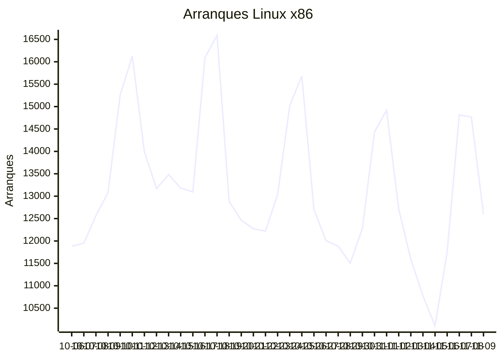
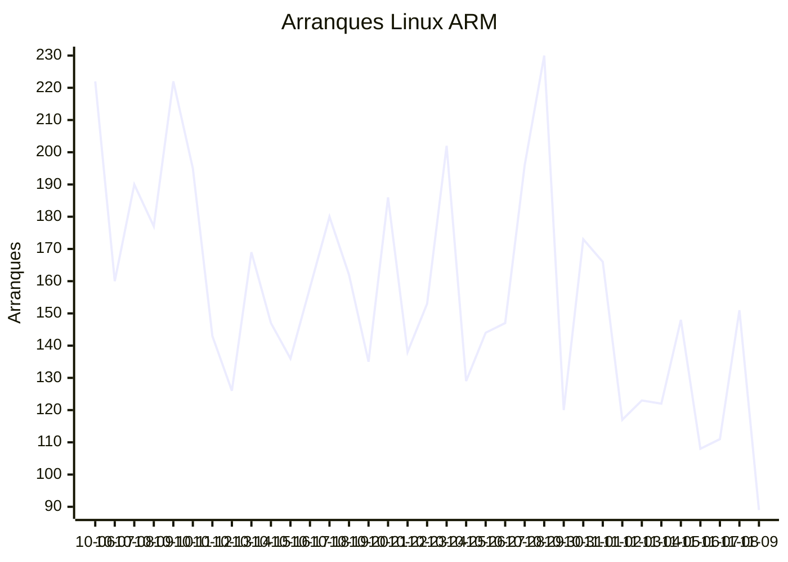
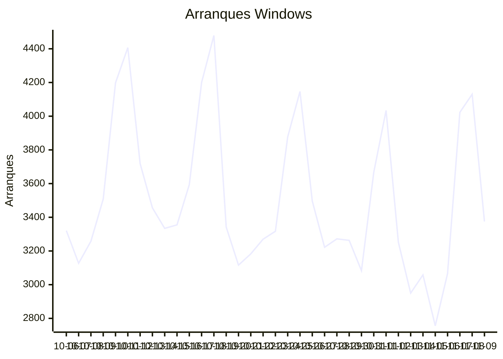
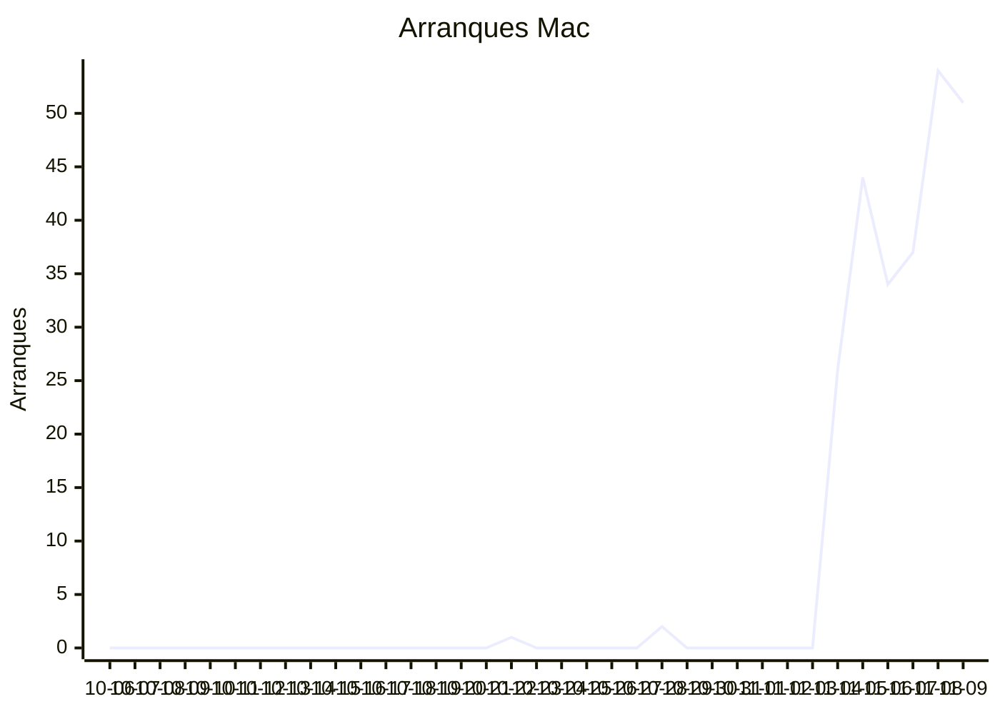
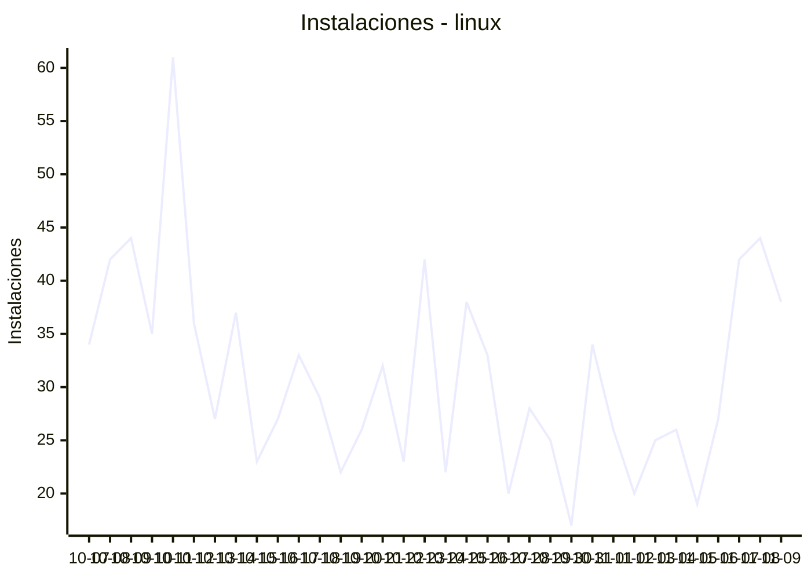
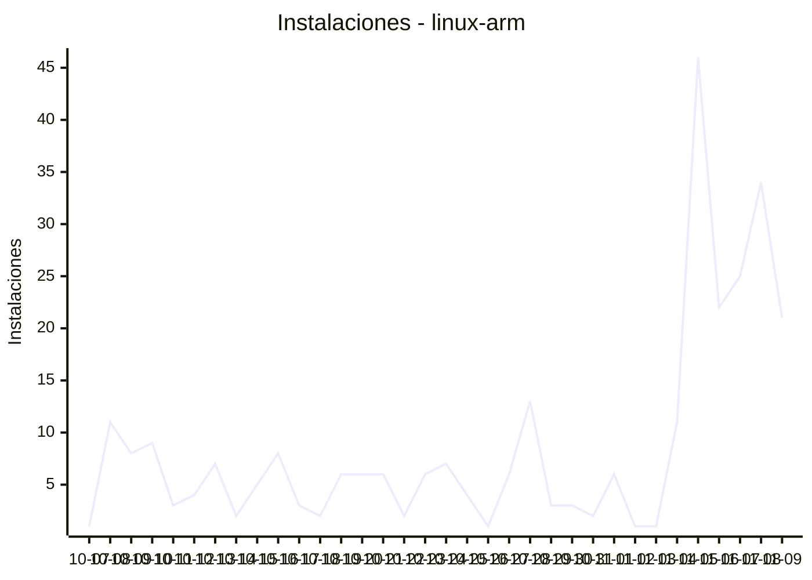
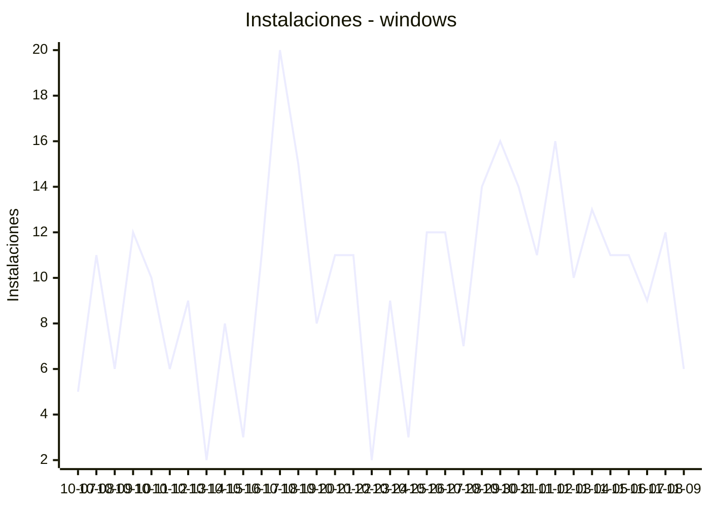
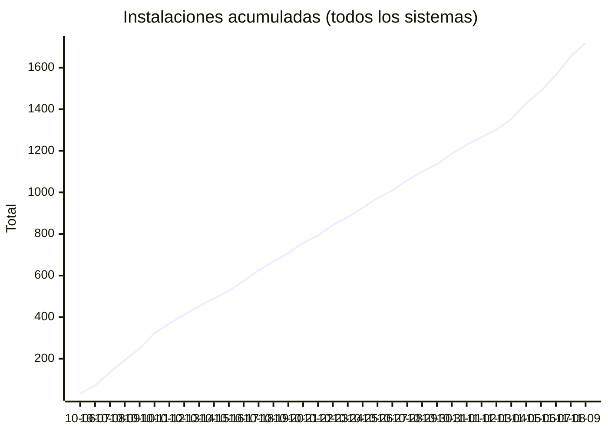
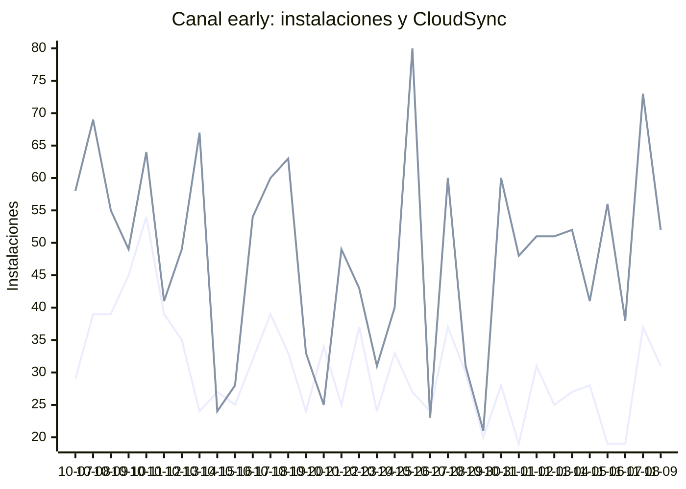

# Estadísticas de EmuDeck

Actualizado: 2026-11-10 22:08 UTC. Las gráficas no incluyen el día de hoy porque aún está incompleto.

## Arranques de la app (comprobaciones de actualización)

Cada arranque descarga el `latest*.yml` de su sistema. Cuenta arranques, no personas.

| Sistema | Ayer | Últimos 7 días |
|---|---|---|
| Linux x86 | 12597 | 86399 |
| Linux ARM | 89 | 852 |
| Windows | 3375 | 23358 |
| Mac | 51 | 246 |

Instalaciones nuevas estimadas en Windows (7 días, `.exe` menos `.blockmap`): **2363**

## Instalaciones de EmuDeck (beacons)

Cada `setup` descarga `system-<sistema>.txt` y cada instalación de un emulador `<emulador>-<plataforma>.txt`. Los emuladores cuentan también las actualizaciones. Histórico completo desde el primer día.

| Sistema | Ayer | Últimos 7 días | Últimos 30 días | Total |
|---|---|---|---|---|
| linux | 38 | 221 | 902 | 1105 |
| linux-arm | 21 | 160 | 266 | 322 |
| windows | 6 | 72 | 302 | 359 |

### Por mes

| Mes | Linux | Linux ARM | Windows | Total |
|---|---|---|---|---|
| 2026-11 | 267 | 167 | 99 | 533 |
| 2026-10 | 790 | 128 | 237 | 1155 |

### Canal early (early + early-unstable)

Instalaciones de EmuDeck con el backend en una rama early, y cuántas de ellas instalan CloudSync.

| | Últimos 7 días | Últimos 30 días | Total |
|---|---|---|---|
| Instalaciones early | 186 | 887 | 1087 |
| Con CloudSync | 363 | 1408 | 1732 |
| % con CloudSync | | | 159% |

Línea de arriba: instalaciones early. Línea de abajo: de ellas, con CloudSync.

### Por emulador

| Emulador | Linux (total) | Linux ARM (total) | Windows (total) | Últimos 7 días | Últimos 30 días | Total |
|---|---|---|---|---|---|---|
| esde | 2501 | 343 | 699 | 738 | 2920 | 3543 |
| pcsx2 | 3019 | 32 | 418 | 656 | 2874 | 3469 |
| azahar | 2657 | 396 | 391 | 726 | 2852 | 3444 |
| duckstation | 2881 | 373 | 161 | 721 | 2838 | 3415 |
| ryujinx | 2576 | 389 | 389 | 721 | 2773 | 3354 |
| rpcs3 | 2741 | 365 | 163 | 684 | 2727 | 3269 |
| srm | 2420 | 321 | 475 | 732 | 2718 | 3216 |
| cemu | 2618 | 364 | 143 | 636 | 2592 | 3125 |
| xenia | 2440 | 298 | 345 | 612 | 2572 | 3083 |
| vita3k | 2377 | 322 | 112 | 575 | 2342 | 2811 |
| shadps4 | 2276 | 214 | 317 | 498 | 2333 | 2807 |
| cloudsync | 1135 | 48 | 607 | 368 | 1449 | 1790 |
| ppsspp | 961 | 244 | 327 | 354 | 1254 | 1532 |
| ra | 1053 | 263 | 187 | 365 | 1232 | 1503 |
| dolphin | 1043 | 278 | 170 | 346 | 1226 | 1491 |
| mgba | 1106 | 83 | 83 | 249 | 1053 | 1272 |
| xemu | 889 | 219 | 132 | 282 | 1019 | 1240 |
| melonds | 870 | 217 | 115 | 276 | 984 | 1202 |
| primehack | 803 | 220 | 133 | 296 | 943 | 1156 |
| supermodel | 757 | 219 | 38 | 240 | 827 | 1014 |
| scummvm | 721 | 192 | 82 | 234 | 808 | 995 |
| model2 | 744 | 230 | 13 | 238 | 800 | 987 |
| bigpemu | 730 | 31 | 31 | 165 | 657 | 792 |
| armsx2 | 230 | 420 | 0 | 211 | 545 | 650 |
| flycast | 195 | 32 | 33 | 47 | 199 | 260 |
| rmg | 189 | 45 | 0 | 47 | 177 | 234 |
| mame | 110 | 13 | 37 | 41 | 115 | 160 |
| eden | 101 | 11 | 19 | 21 | 114 | 131 |
| pegasus | 35 | 2 | 24 | 11 | 52 | 61 |
| yuzu | 13 | 0 | 8 | 5 | 17 | 21 |
| ares | 14 | 2 | 0 | 3 | 13 | 16 |
| citron | 6 | 0 | 1 | 2 | 7 | 7 |
