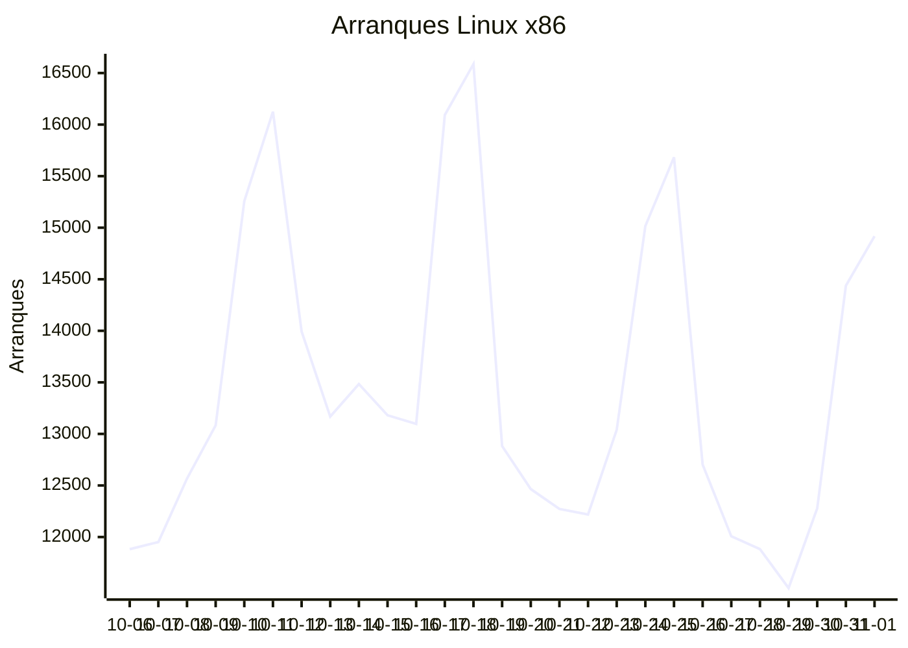
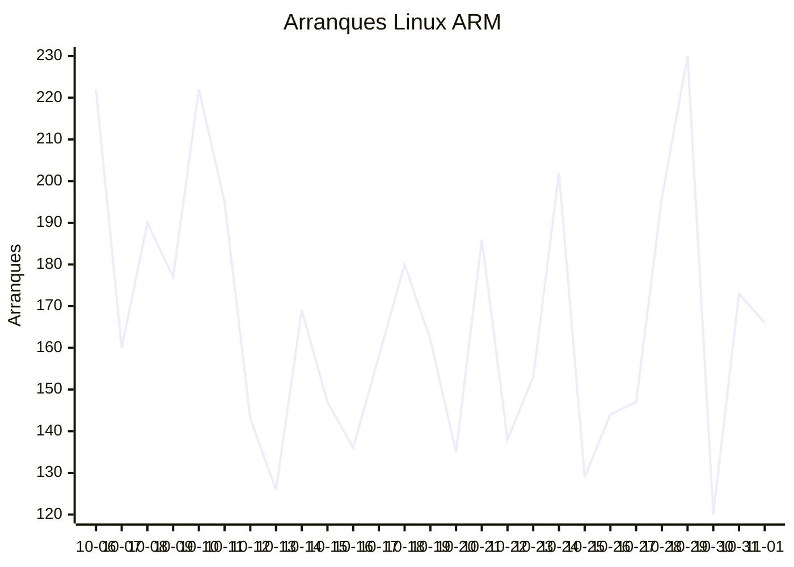
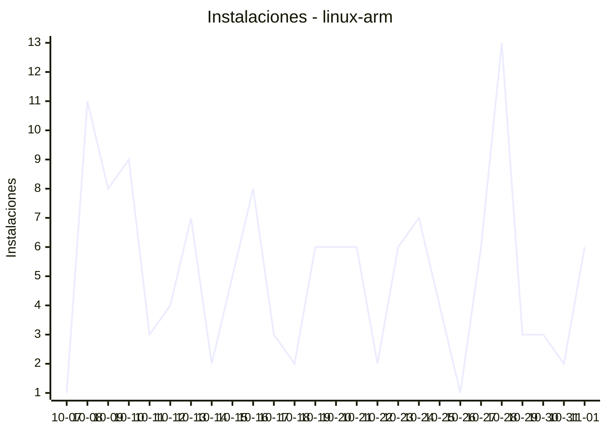
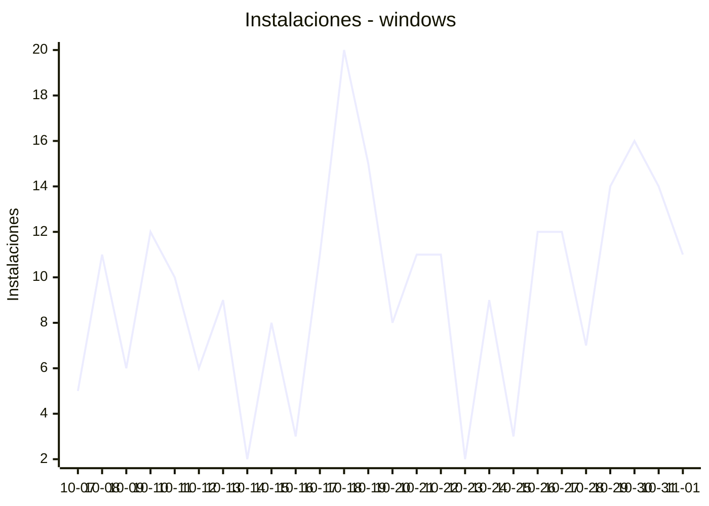
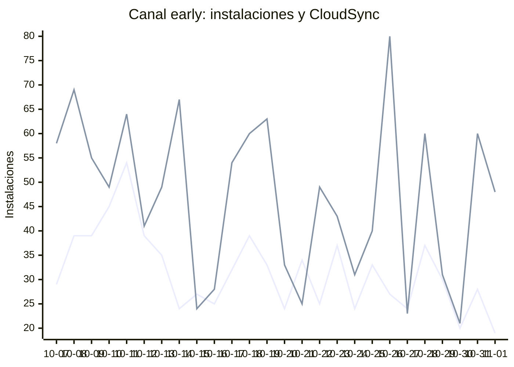

# Estadísticas de EmuDeck

Actualizado: 2026-11-02 01:10 UTC. Las gráficas no incluyen el día de hoy porque aún está incompleto.

## Arranques de la app (comprobaciones de actualización)

Cada arranque descarga el `latest*.yml` de su sistema. Cuenta arranques, no personas.

| Sistema | Ayer | Últimos 7 días |
|---|---|---|
| Linux x86 | 14917 | 89730 |
| Linux ARM | 166 | 1176 |
| Windows | 4034 | 24037 |
| Mac | 0 | 2 |

Instalaciones nuevas estimadas en Windows (7 días, `.exe` menos `.blockmap`): **2313**

## Instalaciones de EmuDeck (beacons)

Cada `setup` descarga `system-<sistema>.txt` y cada instalación de un emulador `<emulador>-<plataforma>.txt`. Los emuladores cuentan también las actualizaciones. Histórico completo desde el primer día.

| Sistema | Ayer | Últimos 7 días | Últimos 30 días | Total |
|---|---|---|---|---|
| linux | 26 | 183 | 816 | 837 |
| linux-arm | 6 | 34 | 134 | 137 |
| windows | 11 | 86 | 248 | 259 |

### Por mes

| Mes | Linux | Linux ARM | Windows | Total |
|---|---|---|---|---|
| 2026-11 | 26 | 6 | 11 | 43 |
| 2026-10 | 790 | 128 | 237 | 1155 |

### Canal early (early + early-unstable)

Instalaciones de EmuDeck con el backend en una rama early, y cuántas de ellas instalan CloudSync.

| | Últimos 7 días | Últimos 30 días | Total |
|---|---|---|---|
| Instalaciones early | 185 | 822 | 848 |
| Con CloudSync | 323 | 1225 | 1296 |
| % con CloudSync | | | 153% |

Línea de arriba: instalaciones early. Línea de abajo: de ellas, con CloudSync.

### Por emulador

| Emulador | Linux (total) | Linux ARM (total) | Windows (total) | Últimos 7 días | Últimos 30 días | Total |
|---|---|---|---|---|---|---|
| pcsx2 | 2329 | 24 | 298 | 628 | 2572 | 2651 |
| esde | 1921 | 192 | 491 | 711 | 2501 | 2604 |
| azahar | 2033 | 218 | 299 | 618 | 2471 | 2550 |
| duckstation | 2223 | 199 | 116 | 594 | 2462 | 2538 |
| ryujinx | 1983 | 207 | 278 | 573 | 2401 | 2468 |
| rpcs3 | 2116 | 199 | 113 | 586 | 2359 | 2428 |
| cemu | 2038 | 203 | 104 | 552 | 2280 | 2345 |
| srm | 1848 | 173 | 311 | 534 | 2278 | 2332 |
| xenia | 1908 | 163 | 254 | 580 | 2265 | 2325 |
| shadps4 | 1782 | 172 | 227 | 546 | 2114 | 2181 |
| vita3k | 1856 | 176 | 78 | 500 | 2047 | 2110 |
| cloudsync | 889 | 41 | 417 | 338 | 1274 | 1347 |
| ppsspp | 744 | 116 | 230 | 272 | 1057 | 1090 |
| dolphin | 812 | 135 | 124 | 261 | 1042 | 1071 |
| ra | 808 | 125 | 129 | 243 | 1033 | 1062 |
| mgba | 834 | 62 | 63 | 222 | 937 | 959 |
| xemu | 695 | 104 | 95 | 207 | 868 | 894 |
| melonds | 679 | 99 | 87 | 189 | 838 | 865 |
| primehack | 609 | 98 | 92 | 188 | 774 | 799 |
| supermodel | 579 | 113 | 26 | 160 | 698 | 718 |
| scummvm | 563 | 85 | 61 | 159 | 686 | 709 |
| model2 | 572 | 117 | 9 | 152 | 678 | 698 |
| bigpemu | 564 | 16 | 19 | 136 | 580 | 599 |
| armsx2 | 172 | 232 | 0 | 111 | 394 | 404 |
| flycast | 150 | 21 | 22 | 39 | 188 | 193 |
| rmg | 143 | 31 | 0 | 28 | 170 | 174 |
| mame | 80 | 6 | 21 | 23 | 103 | 107 |
| eden | 86 | 9 | 7 | 20 | 94 | 102 |
| pegasus | 22 | 1 | 18 | 14 | 39 | 41 |
| ares | 10 | 2 | 0 | 4 | 12 | 12 |
| yuzu | 9 | 0 | 3 | 2 | 12 | 12 |
| citron | 5 | 0 | 0 | 1 | 5 | 5 |
