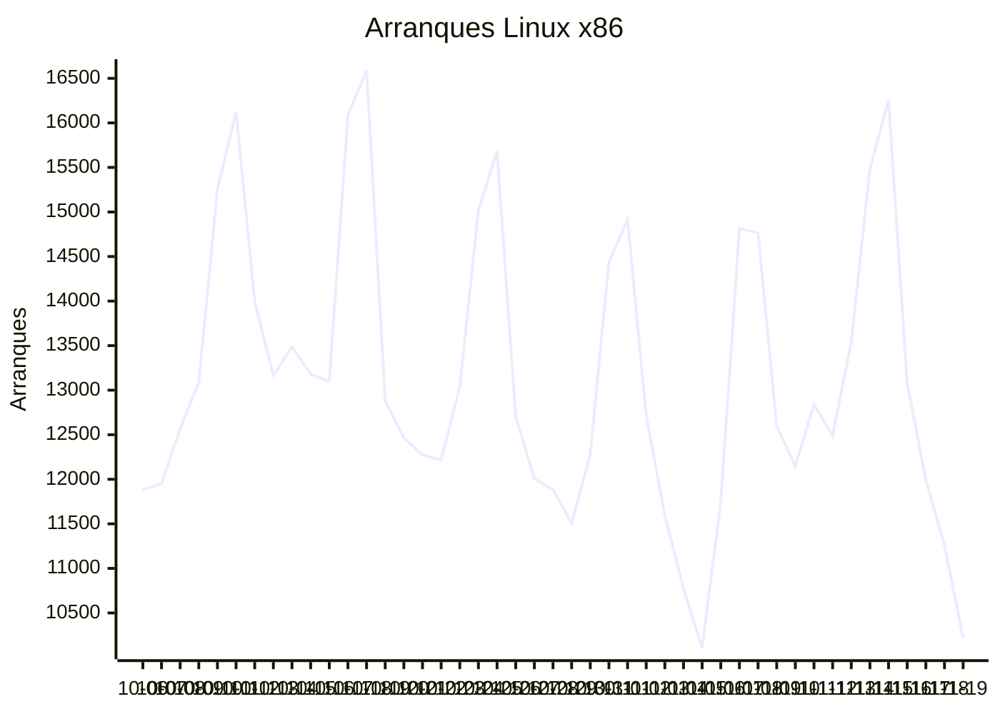
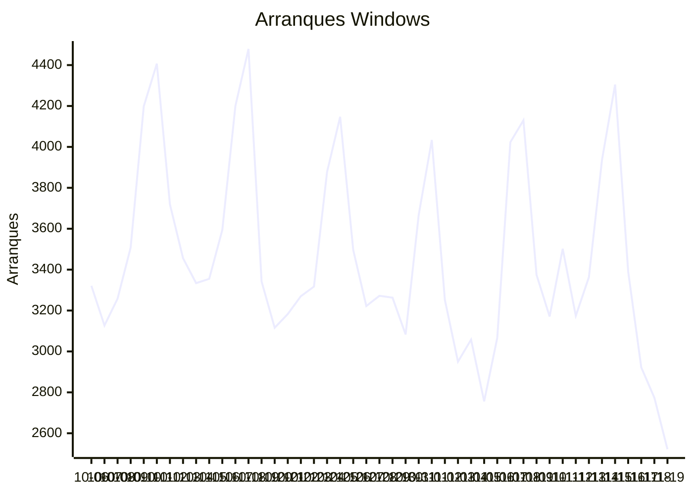
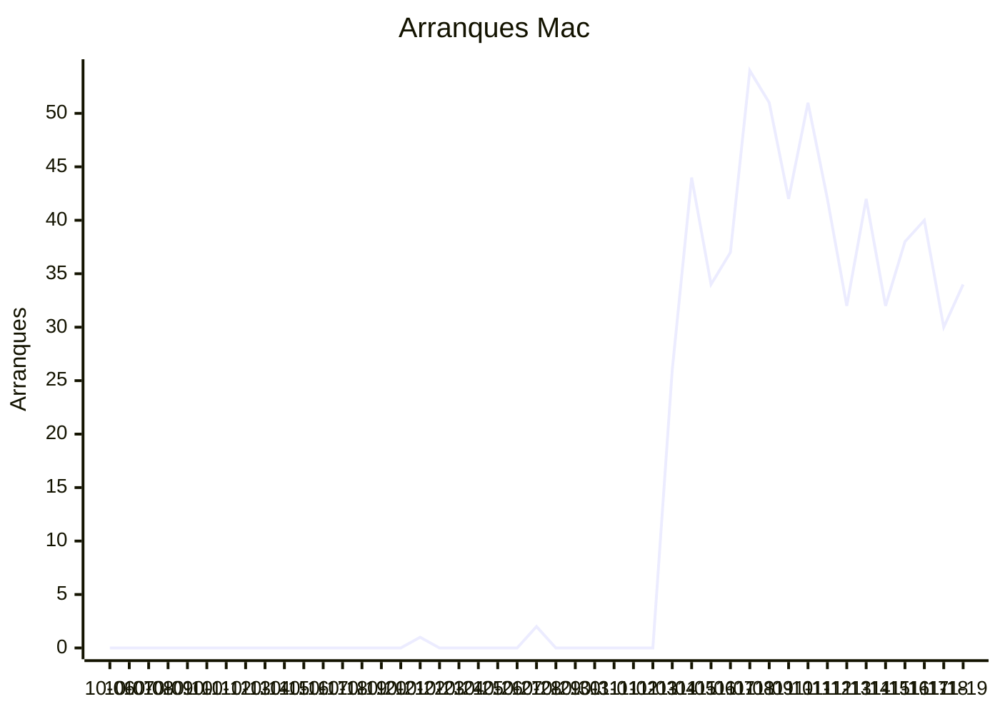
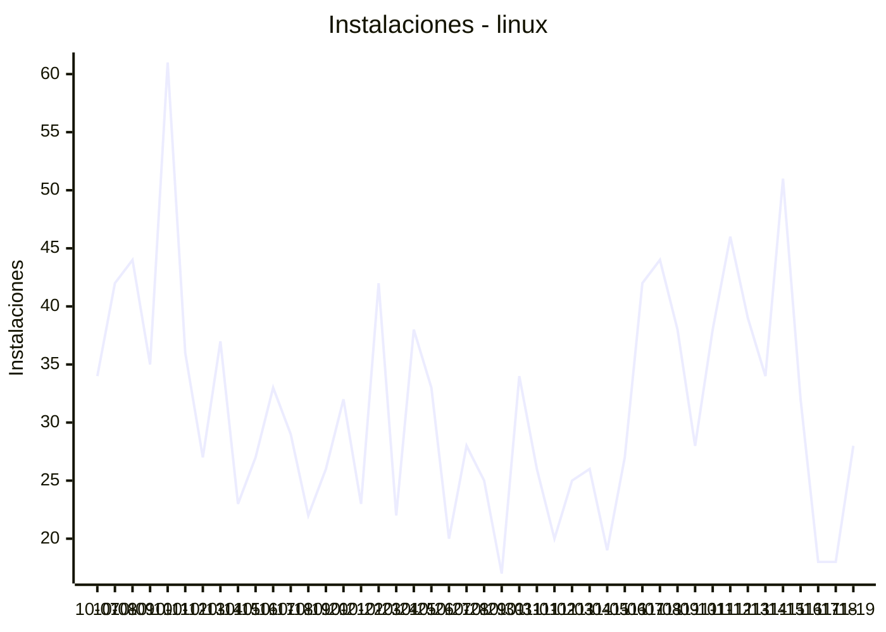
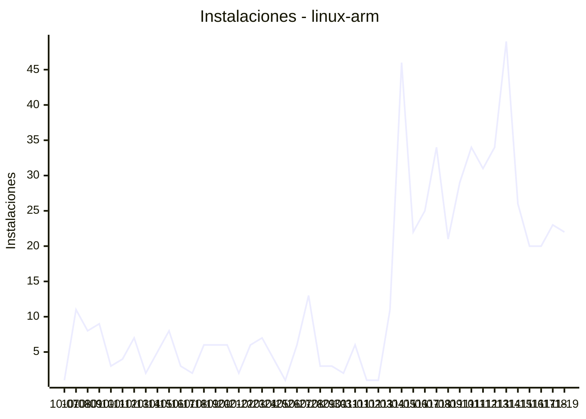
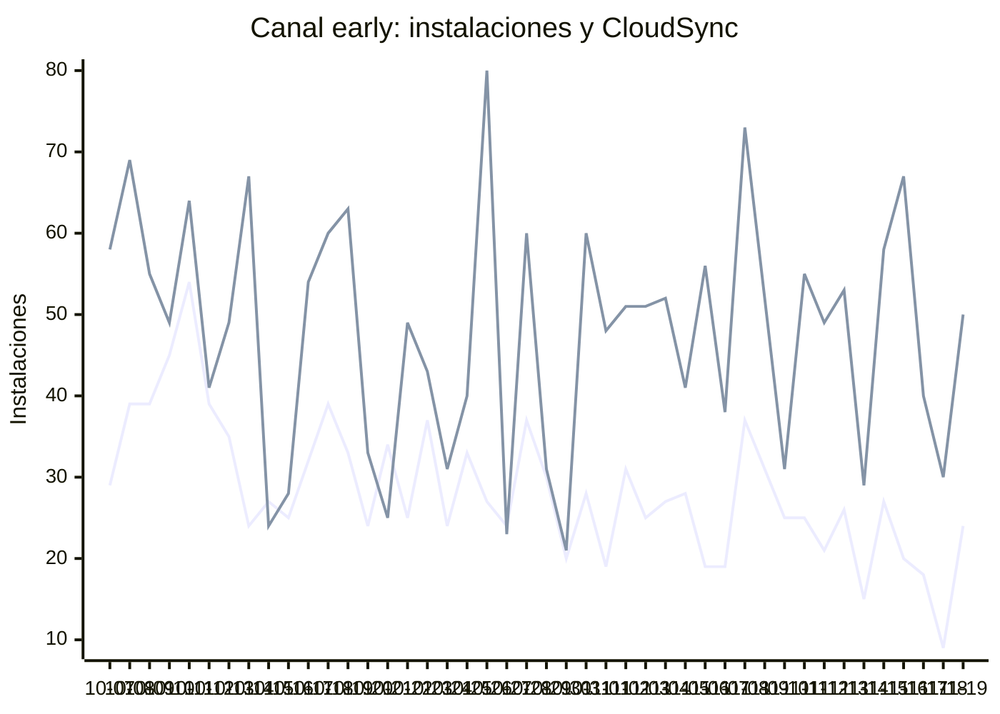

# Estadísticas de EmuDeck

Actualizado: 2026-11-20 21:34 UTC. Las gráficas no incluyen el día de hoy porque aún está incompleto.

## Arranques de la app (comprobaciones de actualización)

Cada arranque descarga el `latest*.yml` de su sistema. Cuenta arranques, no personas.

| Sistema | Ayer | Últimos 7 días |
|---|---|---|
| Linux x86 | 10217 | 91826 |
| Linux ARM | 88 | 953 |
| Windows | 2522 | 23213 |
| Mac | 34 | 248 |

Instalaciones nuevas estimadas en Windows (7 días, `.exe` menos `.blockmap`): **2314**

## Instalaciones de EmuDeck (beacons)

Cada `setup` descarga `system-<sistema>.txt` y cada instalación de un emulador `<emulador>-<plataforma>.txt`. Los emuladores cuentan también las actualizaciones. Histórico completo desde el primer día.

| Sistema | Ayer | Últimos 7 días | Últimos 30 días | Total |
|---|---|---|---|---|
| linux | 28 | 220 | 913 | 1441 |
| linux-arm | 22 | 194 | 508 | 608 |
| windows | 12 | 59 | 300 | 440 |

### Por mes

| Mes | Linux | Linux ARM | Windows | Total |
|---|---|---|---|---|
| 2026-11 | 599 | 455 | 189 | 1243 |
| 2026-10 | 790 | 128 | 237 | 1155 |

### Canal early (early + early-unstable)

Instalaciones de EmuDeck con el backend en una rama early, y cuántas de ellas instalan CloudSync.

| | Últimos 7 días | Últimos 30 días | Total |
|---|---|---|---|
| Instalaciones early | 139 | 765 | 1290 |
| Con CloudSync | 327 | 1387 | 2203 |
| % con CloudSync | | | 171% |

Línea de arriba: instalaciones early. Línea de abajo: de ellas, con CloudSync.

### Por emulador

| Emulador | Linux (total) | Linux ARM (total) | Windows (total) | Últimos 7 días | Últimos 30 días | Total |
|---|---|---|---|---|---|---|
| esde | 3220 | 634 | 904 | 882 | 3280 | 4758 |
| azahar | 3401 | 740 | 485 | 835 | 3104 | 4626 |
| ryujinx | 3344 | 729 | 492 | 837 | 3076 | 4565 |
| duckstation | 3659 | 678 | 193 | 789 | 3014 | 4530 |
| pcsx2 | 3856 | 40 | 517 | 668 | 2841 | 4413 |
| srm | 3194 | 593 | 613 | 846 | 3046 | 4400 |
| rpcs3 | 3504 | 696 | 190 | 789 | 2952 | 4390 |
| cemu | 3339 | 655 | 174 | 743 | 2773 | 4168 |
| xenia | 3105 | 556 | 421 | 702 | 2717 | 4082 |
| vita3k | 3024 | 592 | 129 | 657 | 2474 | 3745 |
| shadps4 | 2898 | 245 | 374 | 507 | 2255 | 3517 |
| cloudsync | 1451 | 68 | 769 | 348 | 1441 | 2288 |
| ppsspp | 1220 | 480 | 404 | 385 | 1429 | 2104 |
| dolphin | 1347 | 532 | 206 | 406 | 1420 | 2085 |
| ra | 1352 | 497 | 227 | 390 | 1406 | 2076 |
| xemu | 1129 | 411 | 152 | 306 | 1139 | 1692 |
| mgba | 1413 | 154 | 99 | 283 | 1103 | 1666 |
| melonds | 1108 | 418 | 139 | 310 | 1104 | 1665 |
| primehack | 1035 | 433 | 153 | 312 | 1116 | 1621 |
| supermodel | 964 | 394 | 50 | 261 | 933 | 1408 |
| scummvm | 920 | 364 | 99 | 259 | 922 | 1383 |
| model2 | 941 | 413 | 14 | 250 | 901 | 1368 |
| armsx2 | 302 | 761 | 0 | 290 | 827 | 1063 |
| bigpemu | 912 | 50 | 45 | 150 | 654 | 1007 |
| flycast | 242 | 60 | 40 | 62 | 220 | 342 |
| rmg | 239 | 84 | 0 | 59 | 206 | 323 |
| mame | 132 | 20 | 55 | 29 | 135 | 207 |
| eden | 144 | 11 | 21 | 20 | 97 | 176 |
| pegasus | 49 | 3 | 29 | 15 | 61 | 81 |
| yuzu | 18 | 0 | 8 | 3 | 20 | 26 |
| ares | 20 | 3 | 0 | 5 | 18 | 23 |
| citron | 6 | 2 | 2 | 2 | 6 | 10 |
