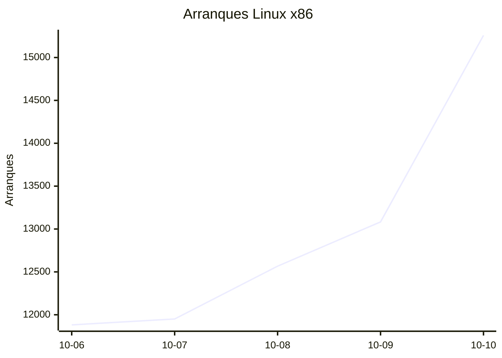
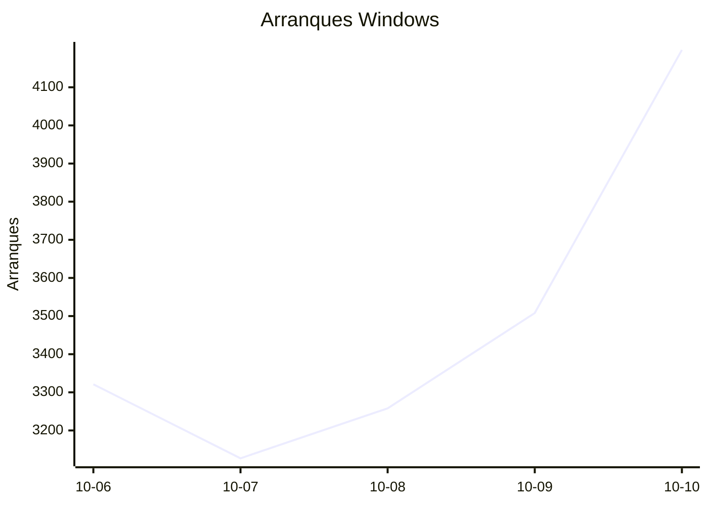
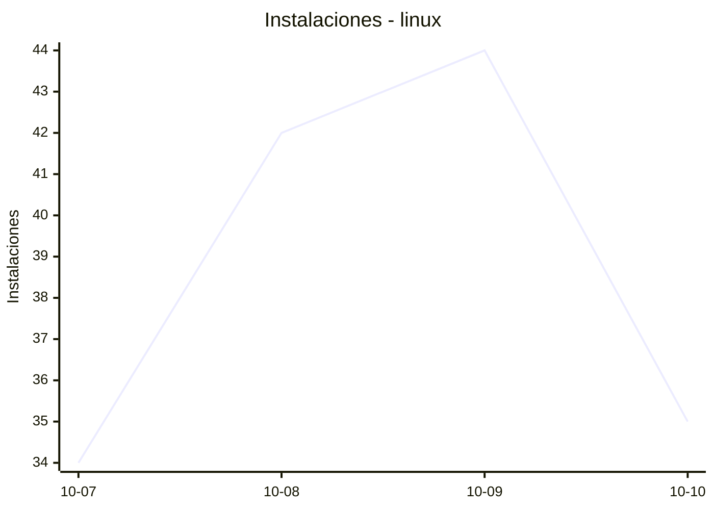
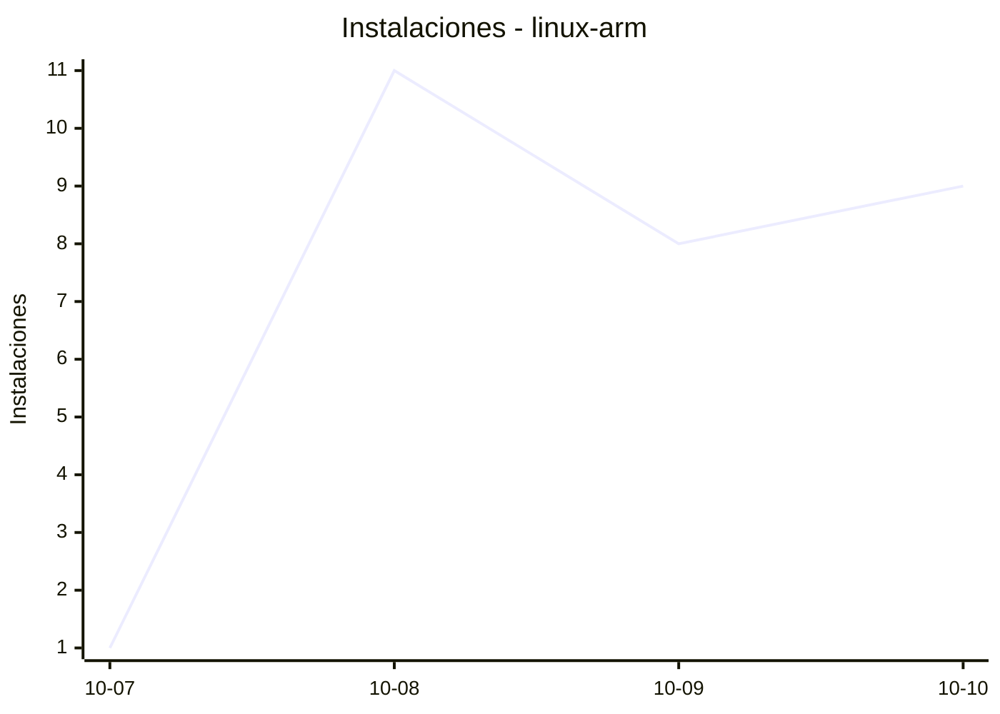
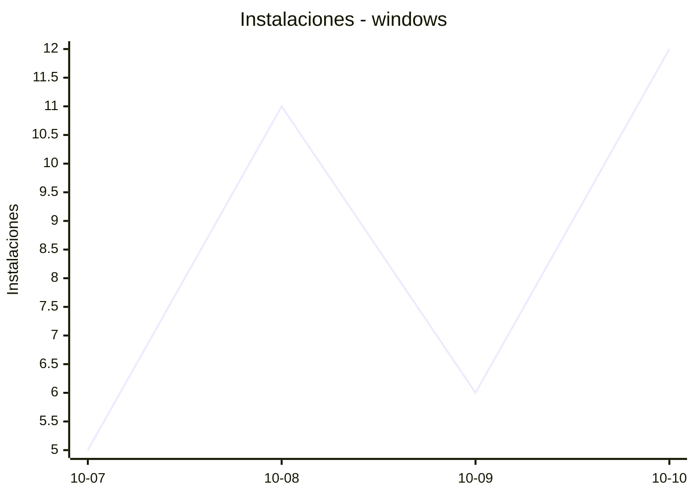
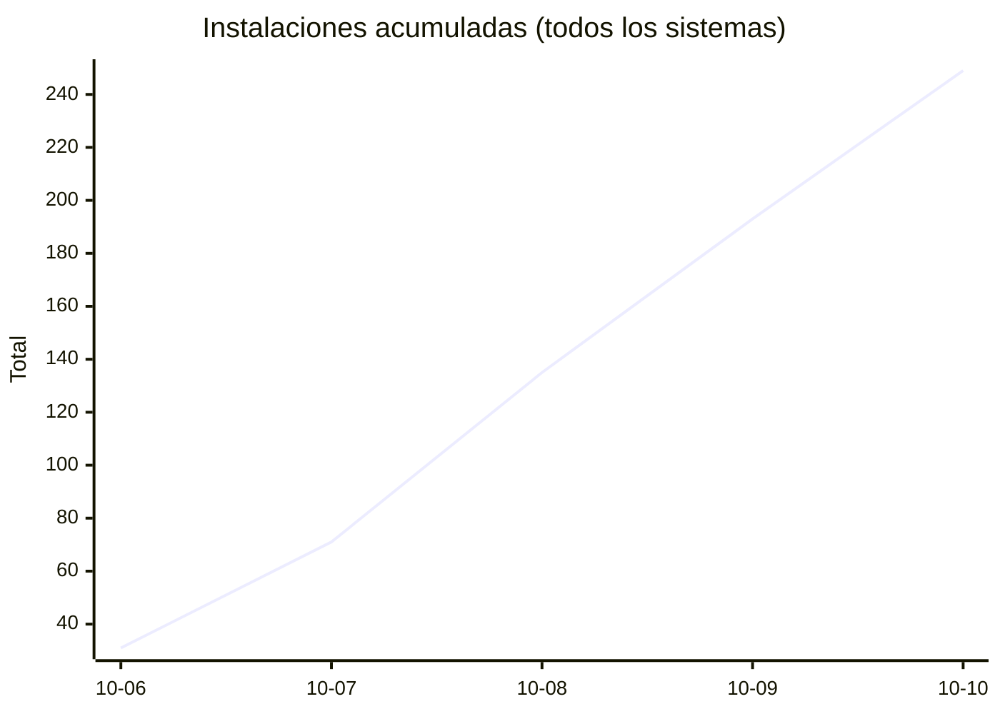
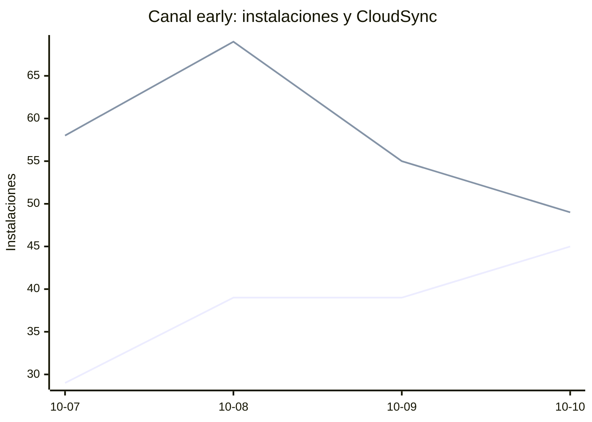

# Estadísticas de EmuDeck

Actualizado: 2026-10-11 22:14 UTC. Las gráficas no incluyen el día de hoy porque aún está incompleto.

## Arranques de la app (comprobaciones de actualización)

Cada arranque descarga el `latest*.yml` de su sistema. Cuenta arranques, no personas.

| Sistema | Ayer | Últimos 7 días |
|---|---|---|
| Linux x86 | 15258 | 64741 |
| Linux ARM | 222 | 971 |
| Windows | 4198 | 17412 |
| Mac | 0 | 0 |

Instalaciones nuevas estimadas en Windows (7 días, `.exe` menos `.blockmap`): **968**

## Instalaciones de EmuDeck (beacons)

Cada `setup` descarga `system-<sistema>.txt` y cada instalación de un emulador `<emulador>-<plataforma>.txt`. Los emuladores cuentan también las actualizaciones. Histórico completo desde el primer día.

| Sistema | Ayer | Últimos 7 días | Últimos 30 días | Total |
|---|---|---|---|---|
| linux | 35 | 155 | 155 | 231 |
| linux-arm | 9 | 29 | 29 | 35 |
| windows | 12 | 34 | 34 | 50 |

### Por mes

| Mes | Linux | Linux ARM | Windows | Total |
|---|---|---|---|---|
| 2026-10 | 155 | 29 | 34 | 218 |

### Canal early (early + early-unstable)

Instalaciones de EmuDeck con el backend en una rama early, y cuántas de ellas instalan CloudSync.

| | Últimos 7 días | Últimos 30 días | Total |
|---|---|---|---|
| Instalaciones early | 152 | 152 | 223 |
| Con CloudSync | 231 | 231 | 354 |
| % con CloudSync | | | 159% |

Línea de arriba: instalaciones early. Línea de abajo: de ellas, con CloudSync.

### Por emulador

| Emulador | Linux (total) | Linux ARM (total) | Windows (total) | Últimos 7 días | Últimos 30 días | Total |
|---|---|---|---|---|---|---|
| pcsx2 | 542 | 12 | 68 | 441 | 441 | 622 |
| azahar | 481 | 44 | 67 | 422 | 422 | 592 |
| duckstation | 526 | 42 | 23 | 416 | 416 | 591 |
| esde | 445 | 39 | 105 | 415 | 415 | 589 |
| ryujinx | 459 | 45 | 67 | 412 | 412 | 571 |
| rpcs3 | 481 | 41 | 22 | 385 | 385 | 544 |
| cemu | 478 | 43 | 16 | 386 | 386 | 537 |
| xenia | 429 | 37 | 47 | 362 | 362 | 513 |
| srm | 426 | 31 | 43 | 365 | 365 | 500 |
| shadps4 | 416 | 42 | 36 | 341 | 341 | 494 |
| vita3k | 431 | 37 | 11 | 332 | 332 | 479 |
| cloudsync | 258 | 13 | 101 | 244 | 244 | 372 |
| ppsspp | 205 | 30 | 47 | 187 | 187 | 282 |
| ra | 228 | 33 | 20 | 196 | 196 | 281 |
| dolphin | 221 | 32 | 24 | 189 | 189 | 277 |
| xemu | 186 | 23 | 20 | 153 | 153 | 229 |
| melonds | 188 | 22 | 17 | 150 | 150 | 227 |
| mgba | 180 | 17 | 17 | 164 | 164 | 214 |
| primehack | 166 | 24 | 21 | 150 | 150 | 211 |
| scummvm | 159 | 23 | 12 | 129 | 129 | 194 |
| model2 | 161 | 30 | 2 | 133 | 133 | 193 |
| supermodel | 157 | 30 | 5 | 130 | 130 | 192 |
| bigpemu | 130 | 3 | 2 | 101 | 101 | 135 |
| armsx2 | 40 | 45 | 0 | 65 | 65 | 85 |
| flycast | 44 | 5 | 5 | 42 | 42 | 54 |
| rmg | 38 | 10 | 0 | 41 | 41 | 48 |
| mame | 32 | 1 | 8 | 32 | 32 | 41 |
| eden | 13 | 3 | 0 | 4 | 4 | 16 |
| pegasus | 5 | 0 | 1 | 3 | 3 | 6 |
| yuzu | 3 | 0 | 0 | 2 | 2 | 3 |
| ares | 1 | 1 | 0 | 2 | 2 | 2 |
| citron | 1 | 0 | 0 | 0 | 0 | 1 |
