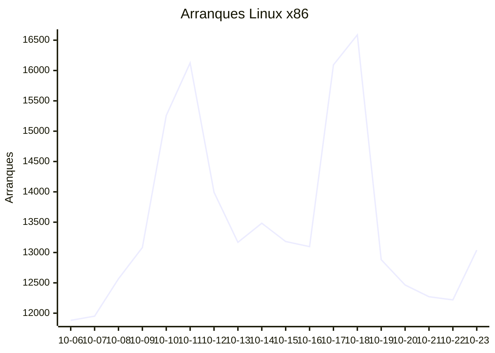
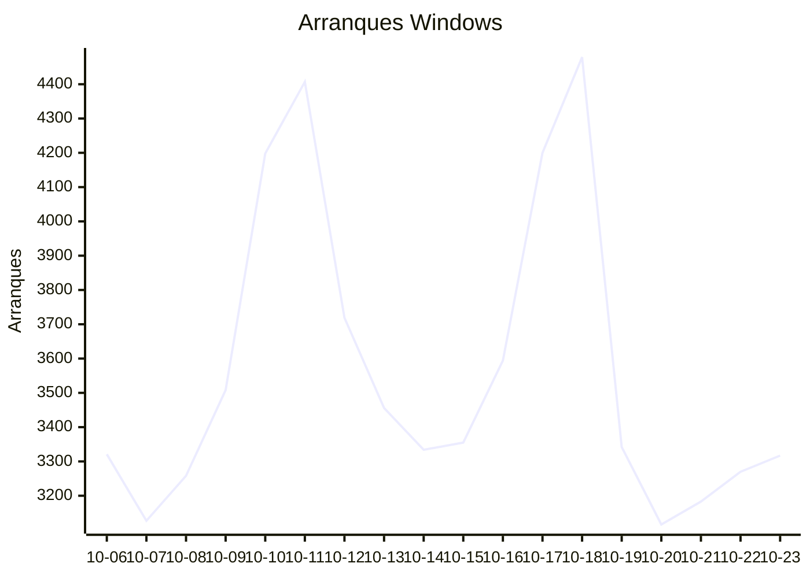
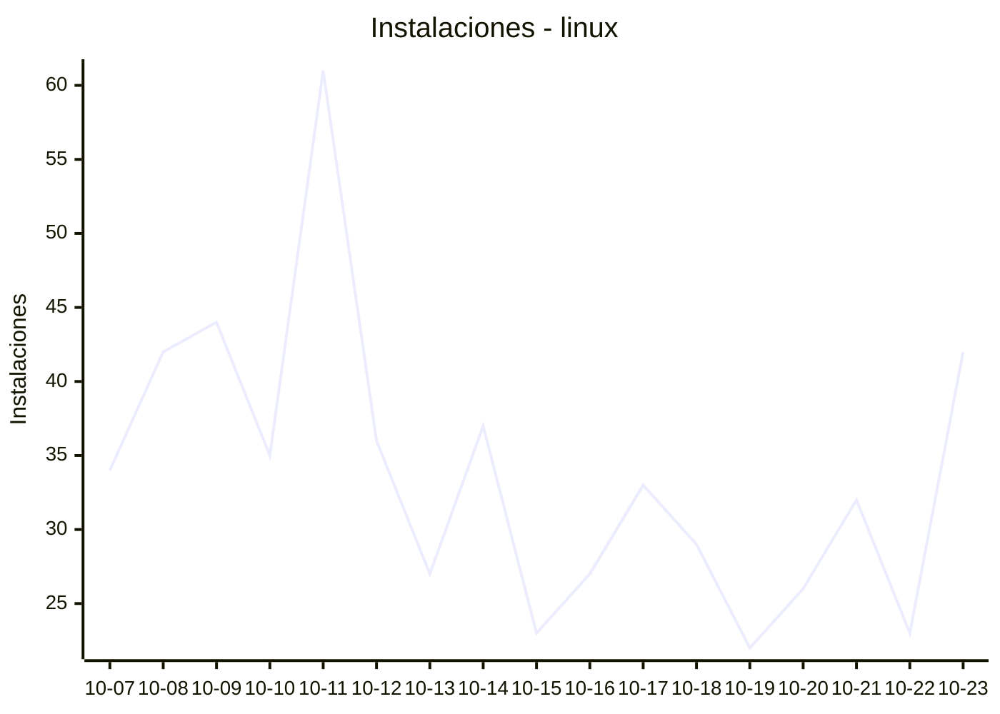
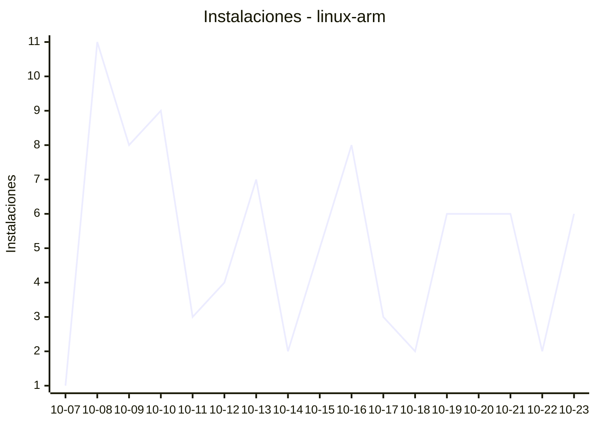
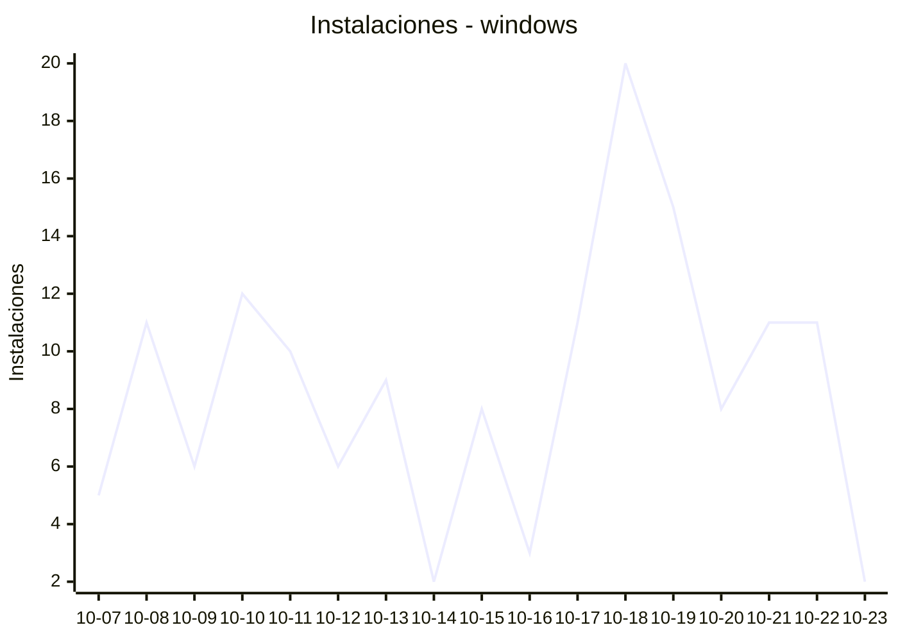
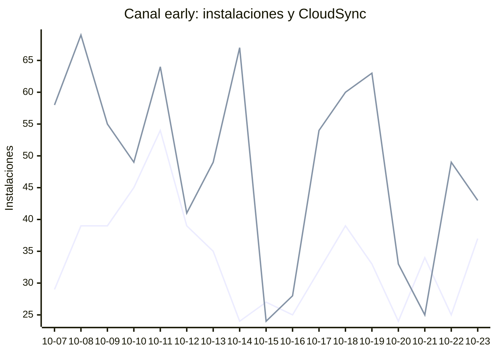

# Estadísticas de EmuDeck

Actualizado: 2026-10-24 05:39 UTC. Las gráficas no incluyen el día de hoy porque aún está incompleto.

## Arranques de la app (comprobaciones de actualización)

Cada arranque descarga el `latest*.yml` de su sistema. Cuenta arranques, no personas.

| Sistema | Ayer | Últimos 7 días |
|---|---|---|
| Linux x86 | 13039 | 95557 |
| Linux ARM | 153 | 1112 |
| Windows | 3317 | 24907 |
| Mac | 0 | 1 |

Instalaciones nuevas estimadas en Windows (7 días, `.exe` menos `.blockmap`): **2061**

## Instalaciones de EmuDeck (beacons)

Cada `setup` descarga `system-<sistema>.txt` y cada instalación de un emulador `<emulador>-<plataforma>.txt`. Los emuladores cuentan también las actualizaciones. Histórico completo desde el primer día.

| Sistema | Ayer | Últimos 7 días | Últimos 30 días | Total |
|---|---|---|---|---|
| linux | 42 | 207 | 573 | 601 |
| linux-arm | 6 | 31 | 89 | 92 |
| windows | 2 | 78 | 150 | 157 |

### Por mes

| Mes | Linux | Linux ARM | Windows | Total |
|---|---|---|---|---|
| 2026-10 | 573 | 89 | 150 | 812 |

### Canal early (early + early-unstable)

Instalaciones de EmuDeck con el backend en una rama early, y cuántas de ellas instalan CloudSync.

| | Últimos 7 días | Últimos 30 días | Total |
|---|---|---|---|
| Instalaciones early | 224 | 580 | 605 |
| Con CloudSync | 327 | 831 | 902 |
| % con CloudSync | | | 149% |

Línea de arriba: instalaciones early. Línea de abajo: de ellas, con CloudSync.

### Por emulador

| Emulador | Linux (total) | Linux ARM (total) | Windows (total) | Últimos 7 días | Últimos 30 días | Total |
|---|---|---|---|---|---|---|
| pcsx2 | 1605 | 20 | 184 | 690 | 1716 | 1809 |
| duckstation | 1543 | 122 | 78 | 677 | 1654 | 1743 |
| azahar | 1419 | 132 | 181 | 659 | 1642 | 1732 |
| ryujinx | 1372 | 131 | 187 | 654 | 1609 | 1690 |
| esde | 1294 | 102 | 288 | 643 | 1570 | 1684 |
| rpcs3 | 1446 | 119 | 75 | 638 | 1556 | 1640 |
| cemu | 1425 | 127 | 59 | 625 | 1532 | 1611 |
| srm | 1275 | 112 | 189 | 653 | 1515 | 1576 |
| xenia | 1306 | 104 | 152 | 606 | 1486 | 1562 |
| shadps4 | 1225 | 105 | 132 | 567 | 1387 | 1462 |
| vita3k | 1287 | 110 | 49 | 560 | 1372 | 1446 |
| cloudsync | 634 | 25 | 277 | 339 | 862 | 936 |
| ra | 577 | 82 | 92 | 275 | 717 | 751 |
| ppsspp | 533 | 77 | 137 | 271 | 709 | 747 |
| dolphin | 579 | 84 | 82 | 261 | 709 | 745 |
| mgba | 566 | 46 | 45 | 249 | 629 | 657 |
| melonds | 498 | 67 | 59 | 222 | 593 | 624 |
| xemu | 496 | 69 | 58 | 227 | 595 | 623 |
| primehack | 431 | 65 | 59 | 200 | 527 | 555 |
| supermodel | 423 | 80 | 13 | 175 | 494 | 516 |
| model2 | 417 | 83 | 7 | 171 | 486 | 507 |
| scummvm | 410 | 58 | 36 | 181 | 480 | 504 |
| bigpemu | 400 | 7 | 10 | 169 | 395 | 417 |
| armsx2 | 121 | 135 | 0 | 99 | 245 | 256 |
| flycast | 118 | 14 | 16 | 50 | 140 | 148 |
| rmg | 109 | 26 | 0 | 42 | 130 | 135 |
| eden | 73 | 7 | 0 | 38 | 72 | 80 |
| mame | 64 | 2 | 14 | 23 | 76 | 80 |
| pegasus | 11 | 0 | 12 | 7 | 21 | 23 |
| ares | 6 | 1 | 0 | 3 | 7 | 7 |
| yuzu | 7 | 0 | 0 | 1 | 7 | 7 |
| citron | 4 | 0 | 0 | 1 | 4 | 4 |
