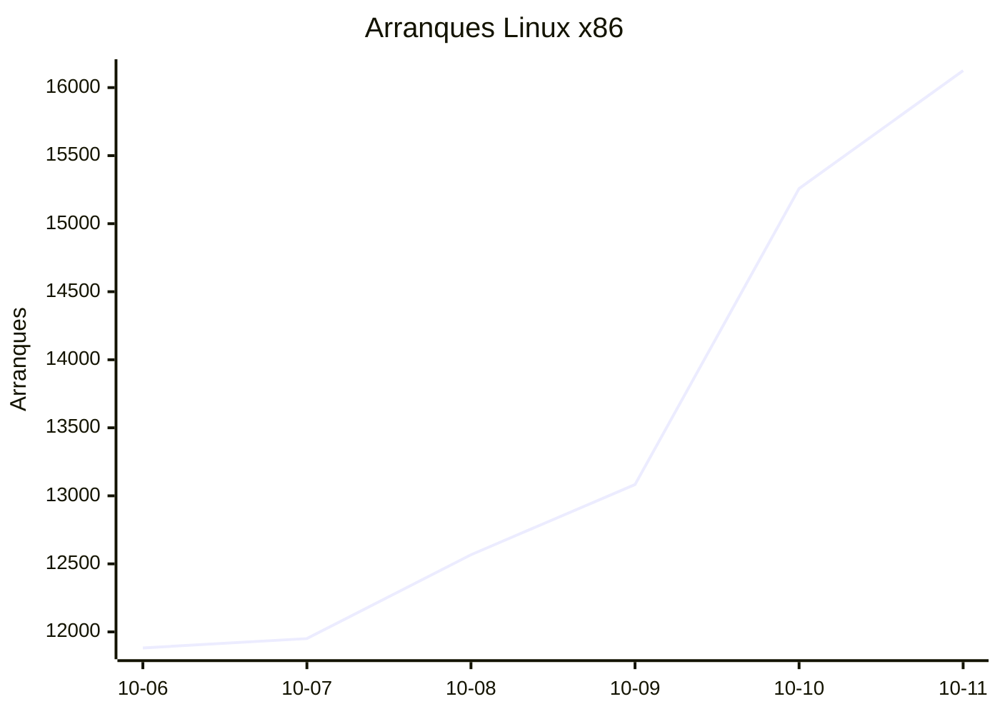
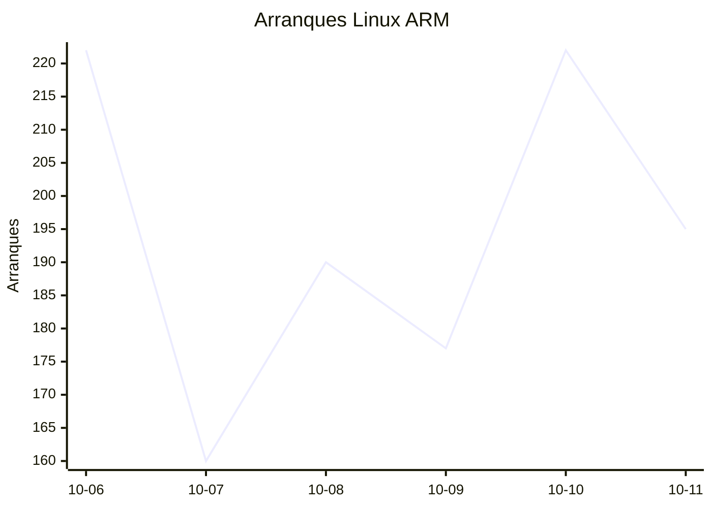
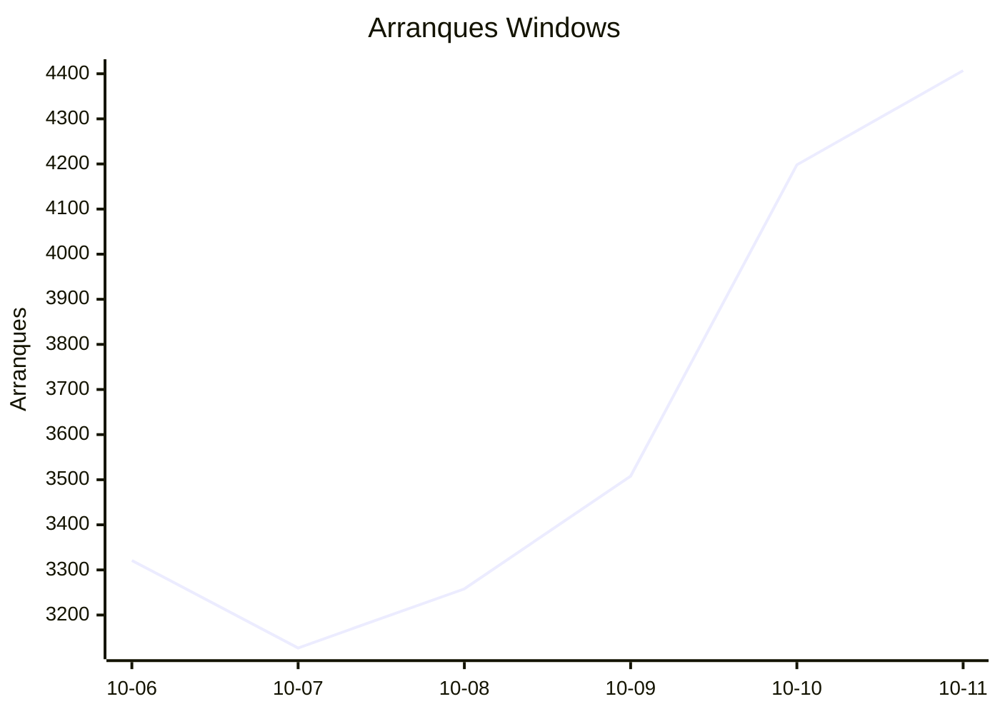
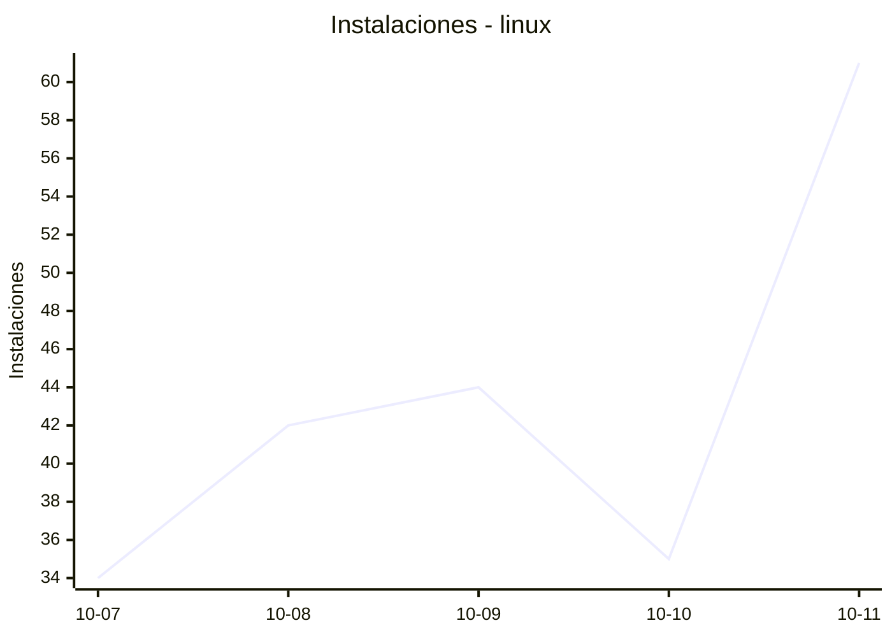
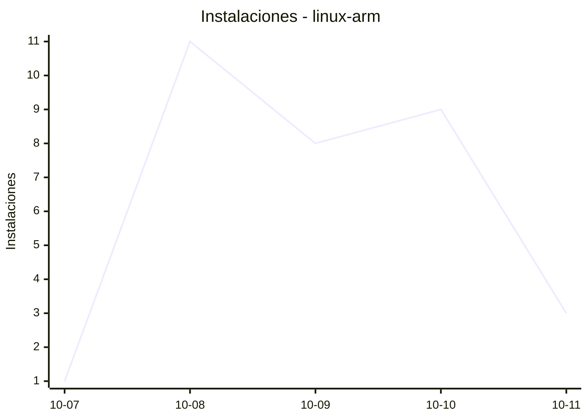
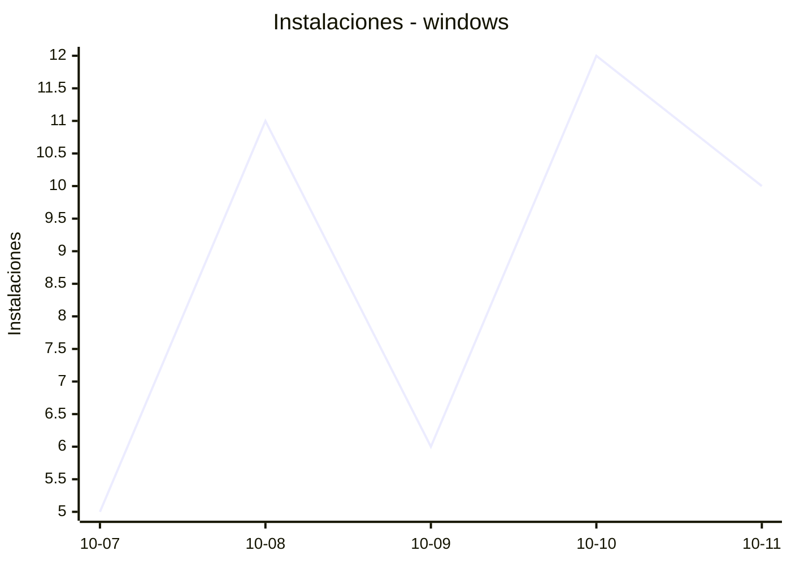
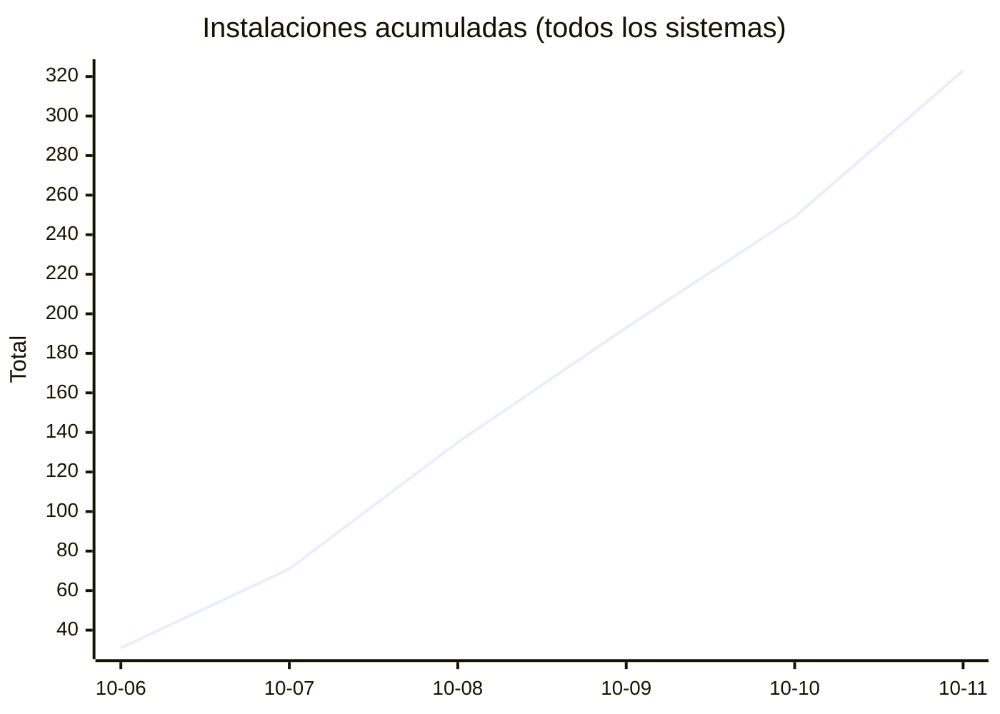
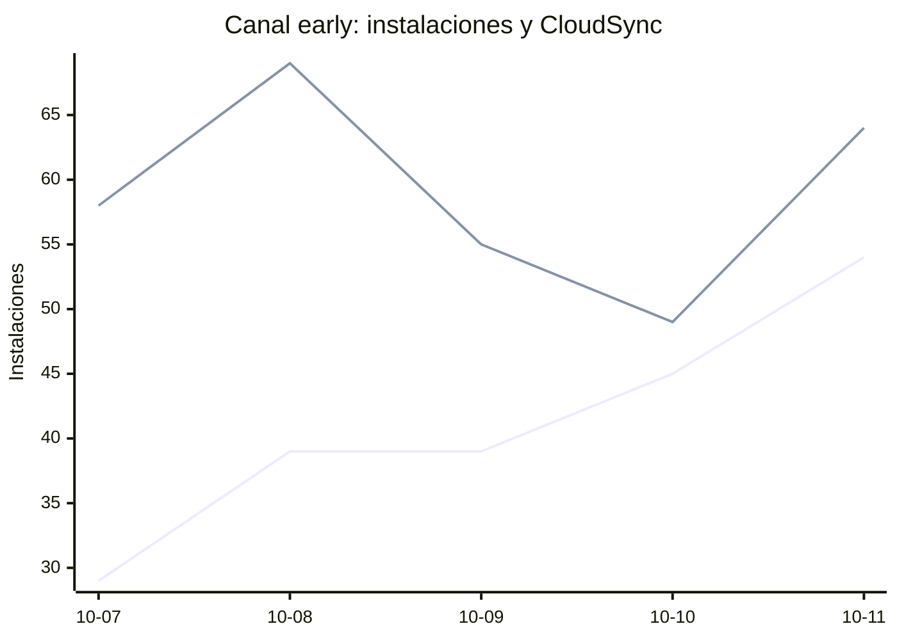

# Estadísticas de EmuDeck

Actualizado: 2026-10-12 03:29 UTC. Las gráficas no incluyen el día de hoy porque aún está incompleto.

## Arranques de la app (comprobaciones de actualización)

Cada arranque descarga el `latest*.yml` de su sistema. Cuenta arranques, no personas.

| Sistema | Ayer | Últimos 7 días |
|---|---|---|
| Linux x86 | 16125 | 80866 |
| Linux ARM | 195 | 1166 |
| Windows | 4407 | 21819 |
| Mac | 0 | 0 |

Instalaciones nuevas estimadas en Windows (7 días, `.exe` menos `.blockmap`): **1216**

## Instalaciones de EmuDeck (beacons)

Cada `setup` descarga `system-<sistema>.txt` y cada instalación de un emulador `<emulador>-<plataforma>.txt`. Los emuladores cuentan también las actualizaciones. Histórico completo desde el primer día.

| Sistema | Ayer | Últimos 7 días | Últimos 30 días | Total |
|---|---|---|---|---|
| linux | 61 | 216 | 216 | 241 |
| linux-arm | 3 | 32 | 32 | 37 |
| windows | 10 | 44 | 44 | 52 |

### Por mes

| Mes | Linux | Linux ARM | Windows | Total |
|---|---|---|---|---|
| 2026-10 | 216 | 32 | 44 | 292 |

### Canal early (early + early-unstable)

Instalaciones de EmuDeck con el backend en una rama early, y cuántas de ellas instalan CloudSync.

| | Últimos 7 días | Últimos 30 días | Total |
|---|---|---|---|
| Instalaciones early | 206 | 206 | 235 |
| Con CloudSync | 295 | 295 | 361 |
| % con CloudSync | | | 154% |

Línea de arriba: instalaciones early. Línea de abajo: de ellas, con CloudSync.

### Por emulador

| Emulador | Linux (total) | Linux ARM (total) | Windows (total) | Últimos 7 días | Últimos 30 días | Total |
|---|---|---|---|---|---|---|
| pcsx2 | 568 | 12 | 71 | 561 | 561 | 651 |
| azahar | 507 | 47 | 69 | 531 | 531 | 623 |
| duckstation | 552 | 45 | 23 | 530 | 530 | 620 |
| esde | 462 | 42 | 110 | 505 | 505 | 614 |
| ryujinx | 483 | 48 | 72 | 518 | 518 | 603 |
| rpcs3 | 506 | 44 | 23 | 487 | 487 | 573 |
| cemu | 506 | 46 | 16 | 487 | 487 | 568 |
| xenia | 453 | 40 | 49 | 466 | 466 | 542 |
| srm | 446 | 33 | 43 | 460 | 460 | 522 |
| shadps4 | 434 | 45 | 37 | 439 | 439 | 516 |
| vita3k | 452 | 40 | 11 | 425 | 425 | 503 |
| cloudsync | 263 | 13 | 103 | 311 | 311 | 379 |
| ppsspp | 215 | 32 | 50 | 258 | 258 | 297 |
| ra | 238 | 35 | 20 | 259 | 259 | 293 |
| dolphin | 231 | 34 | 24 | 254 | 254 | 289 |
| xemu | 196 | 25 | 20 | 210 | 210 | 241 |
| melonds | 196 | 24 | 17 | 204 | 204 | 237 |
| mgba | 188 | 19 | 17 | 197 | 197 | 224 |
| primehack | 173 | 26 | 21 | 190 | 190 | 220 |
| model2 | 168 | 32 | 2 | 176 | 176 | 202 |
| scummvm | 166 | 24 | 12 | 174 | 174 | 202 |
| supermodel | 165 | 32 | 5 | 176 | 176 | 202 |
| bigpemu | 136 | 3 | 2 | 121 | 121 | 141 |
| armsx2 | 42 | 48 | 0 | 76 | 76 | 90 |
| flycast | 48 | 6 | 5 | 53 | 53 | 59 |
| rmg | 39 | 12 | 0 | 45 | 45 | 51 |
| mame | 33 | 1 | 8 | 38 | 38 | 42 |
| eden | 13 | 3 | 0 | 8 | 8 | 16 |
| pegasus | 5 | 0 | 1 | 4 | 4 | 6 |
| yuzu | 4 | 0 | 0 | 4 | 4 | 4 |
| ares | 2 | 1 | 0 | 2 | 2 | 3 |
| citron | 1 | 0 | 0 | 1 | 1 | 1 |
