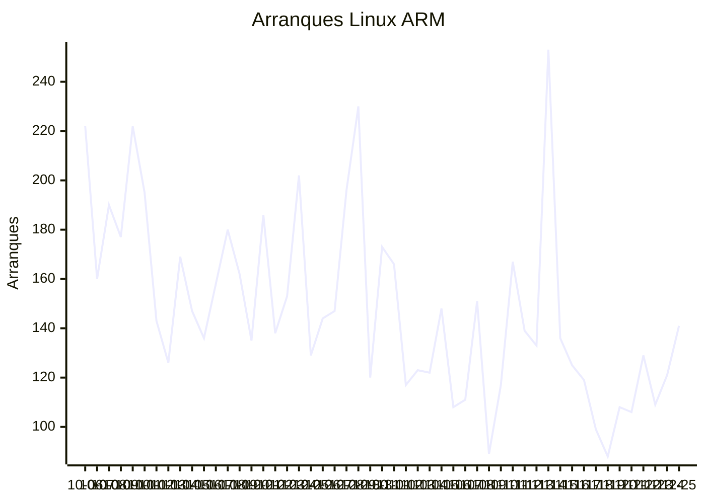
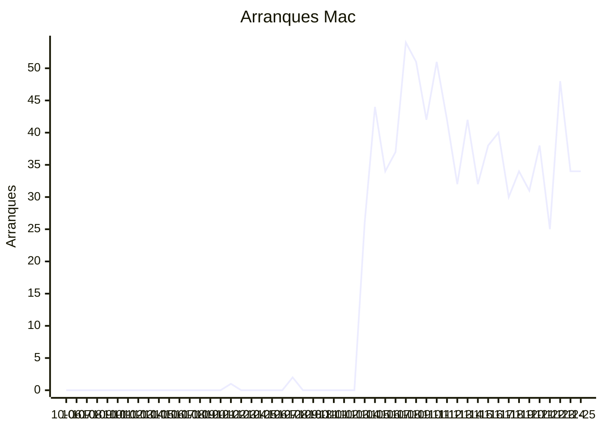
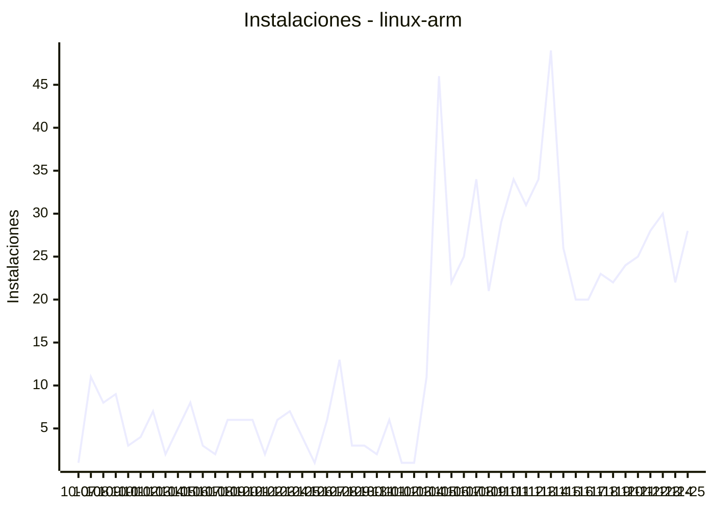
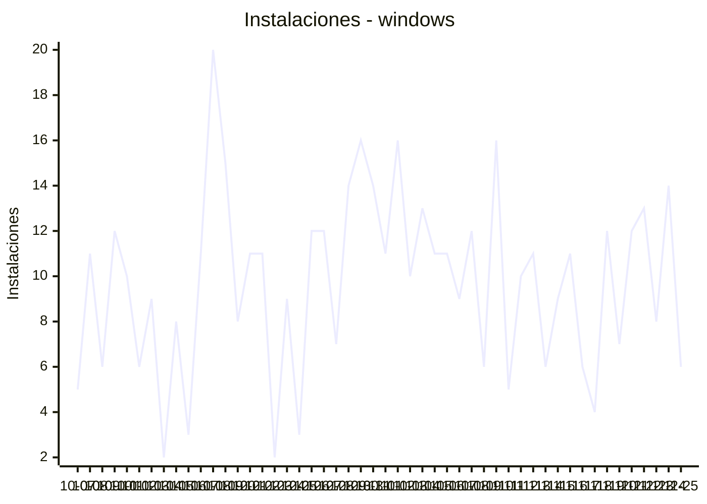
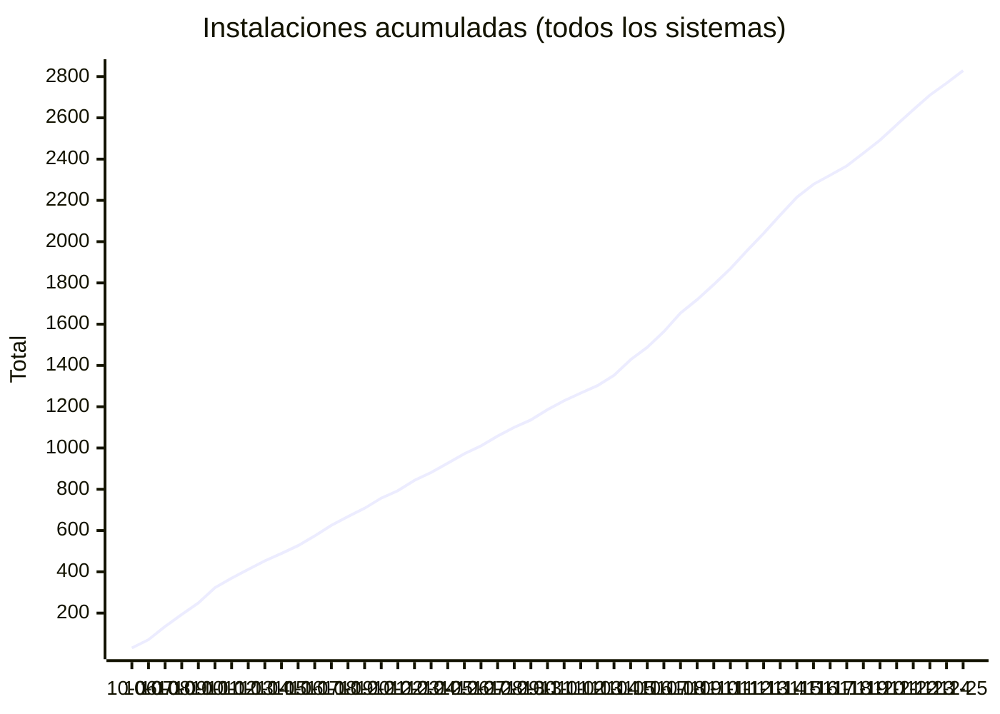
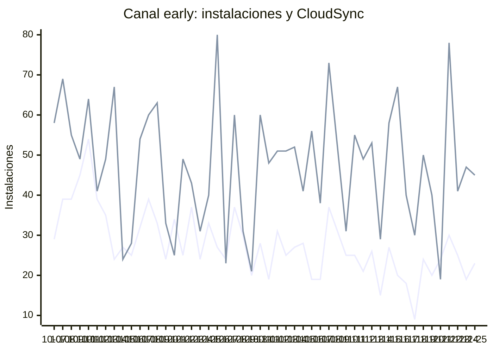

# Estadísticas de EmuDeck

Actualizado: 2026-11-26 12:14 UTC. Las gráficas no incluyen el día de hoy porque aún está incompleto.

## Arranques de la app (comprobaciones de actualización)

Cada arranque descarga el `latest*.yml` de su sistema. Cuenta arranques, no personas.

| Sistema | Ayer | Últimos 7 días |
|---|---|---|
| Linux x86 | 11069 | 80401 |
| Linux ARM | 141 | 802 |
| Windows | 2453 | 18659 |
| Mac | 34 | 244 |

Instalaciones nuevas estimadas en Windows (7 días, `.exe` menos `.blockmap`): **1944**

## Instalaciones de EmuDeck (beacons)

Cada `setup` descarga `system-<sistema>.txt` y cada instalación de un emulador `<emulador>-<plataforma>.txt`. Los emuladores cuentan también las actualizaciones. Histórico completo desde el primer día.

| Sistema | Ayer | Últimos 7 días | Últimos 30 días | Total |
|---|---|---|---|---|
| linux | 27 | 211 | 906 | 1601 |
| linux-arm | 28 | 179 | 639 | 755 |
| windows | 6 | 72 | 312 | 493 |

### Por mes

| Mes | Linux | Linux ARM | Windows | Total |
|---|---|---|---|---|
| 2026-11 | 782 | 612 | 249 | 1643 |
| 2026-10 | 790 | 128 | 237 | 1155 |

### Canal early (early + early-unstable)

Instalaciones de EmuDeck con el backend en una rama early, y cuántas de ellas instalan CloudSync.

| | Últimos 7 días | Últimos 30 días | Total |
|---|---|---|---|
| Instalaciones early | 165 | 726 | 1415 |
| Con CloudSync | 320 | 1389 | 2453 |
| % con CloudSync | | | 173% |

Línea de arriba: instalaciones early. Línea de abajo: de ellas, con CloudSync.

### Por emulador

| Emulador | Linux (total) | Linux ARM (total) | Windows (total) | Últimos 7 días | Últimos 30 días | Total |
|---|---|---|---|---|---|---|
| esde | 3613 | 764 | 1023 | 789 | 3370 | 5400 |
| azahar | 3805 | 897 | 544 | 783 | 3194 | 5246 |
| ryujinx | 3757 | 902 | 530 | 783 | 3165 | 5189 |
| duckstation | 4104 | 823 | 211 | 752 | 3069 | 5138 |
| rpcs3 | 3939 | 851 | 210 | 758 | 3026 | 5000 |
| srm | 3595 | 708 | 672 | 722 | 3073 | 4975 |
| pcsx2 | 4316 | 42 | 577 | 648 | 2787 | 4935 |
| cemu | 3720 | 798 | 194 | 684 | 2802 | 4712 |
| xenia | 3481 | 684 | 468 | 695 | 2775 | 4633 |
| vita3k | 3389 | 723 | 139 | 637 | 2532 | 4251 |
| shadps4 | 3250 | 260 | 414 | 503 | 2183 | 3924 |
| cloudsync | 1605 | 83 | 860 | 336 | 1445 | 2548 |
| ppsspp | 1360 | 601 | 457 | 395 | 1543 | 2418 |
| dolphin | 1487 | 668 | 220 | 375 | 1510 | 2375 |
| ra | 1493 | 626 | 252 | 382 | 1498 | 2371 |
| xemu | 1255 | 520 | 164 | 311 | 1206 | 1939 |
| melonds | 1222 | 527 | 153 | 309 | 1185 | 1902 |
| mgba | 1603 | 183 | 109 | 273 | 1116 | 1895 |
| primehack | 1146 | 540 | 167 | 305 | 1202 | 1853 |
| supermodel | 1064 | 493 | 52 | 269 | 1014 | 1609 |
| scummvm | 1024 | 460 | 107 | 272 | 1006 | 1591 |
| model2 | 1046 | 514 | 14 | 265 | 993 | 1574 |
| armsx2 | 339 | 921 | 0 | 246 | 936 | 1260 |
| bigpemu | 1022 | 58 | 50 | 148 | 645 | 1130 |
| flycast | 263 | 66 | 44 | 45 | 213 | 373 |
| rmg | 266 | 104 | 0 | 56 | 219 | 370 |
| mame | 146 | 24 | 68 | 38 | 150 | 238 |
| eden | 170 | 11 | 22 | 27 | 107 | 203 |
| pegasus | 56 | 3 | 31 | 13 | 63 | 90 |
| yuzu | 18 | 0 | 8 | 1 | 16 | 26 |
| ares | 22 | 3 | 0 | 2 | 16 | 25 |
| citron | 6 | 2 | 3 | 1 | 6 | 11 |
