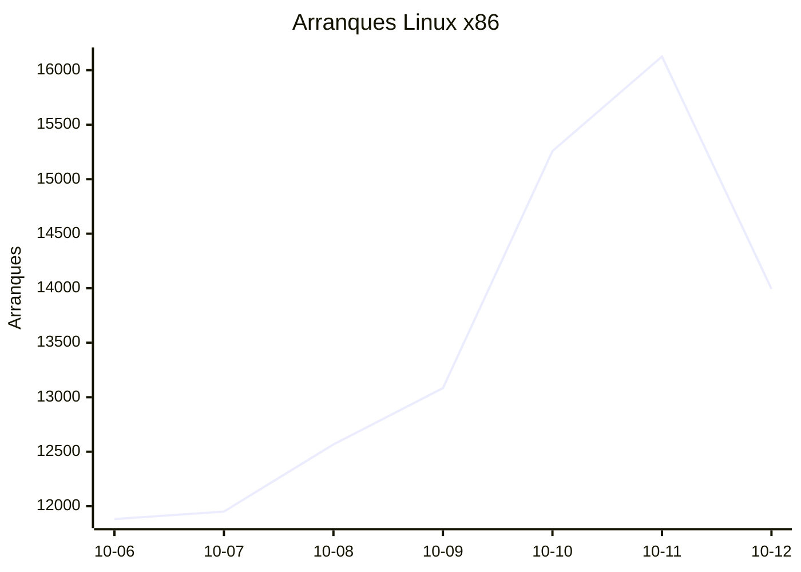
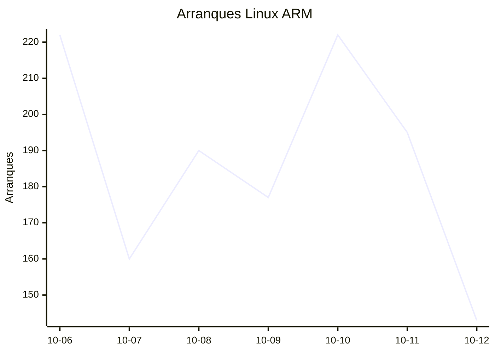
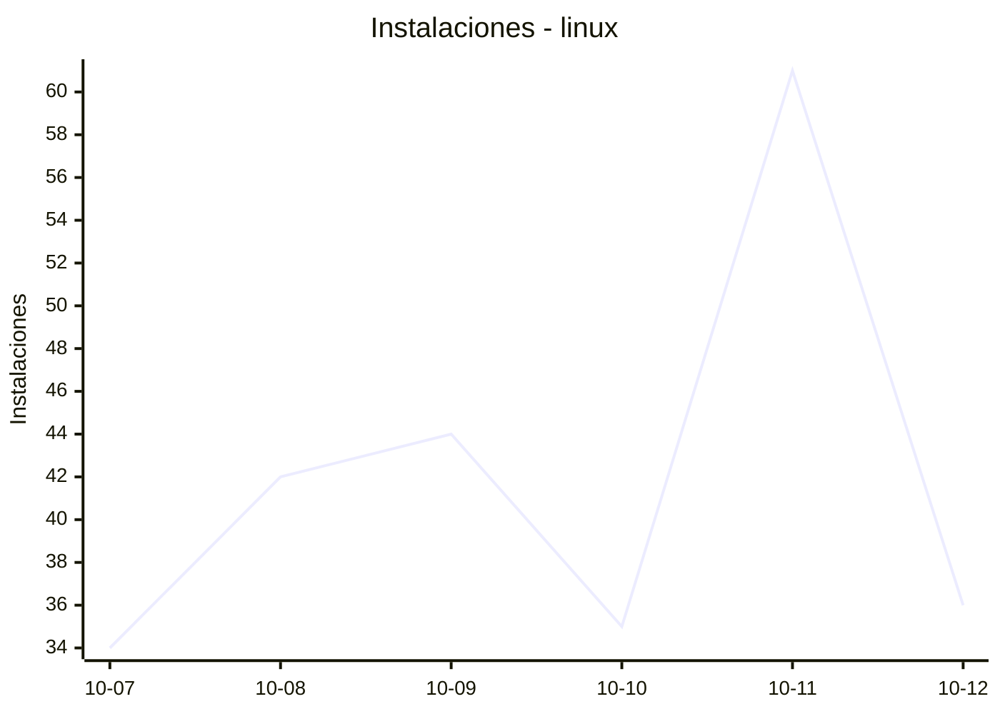
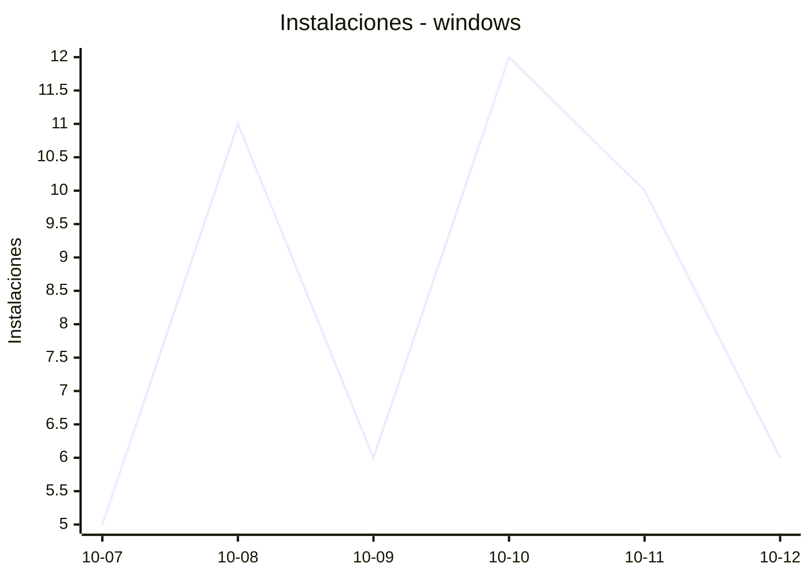
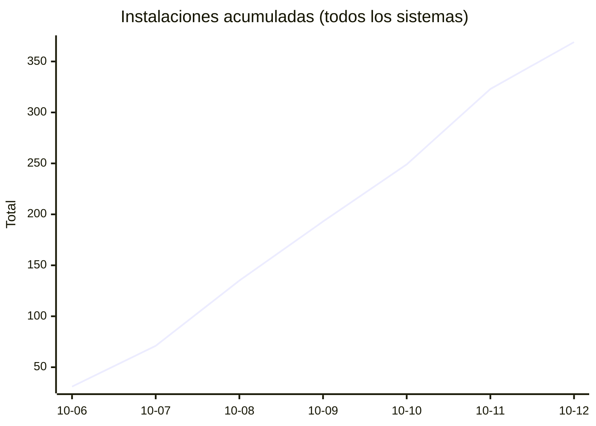
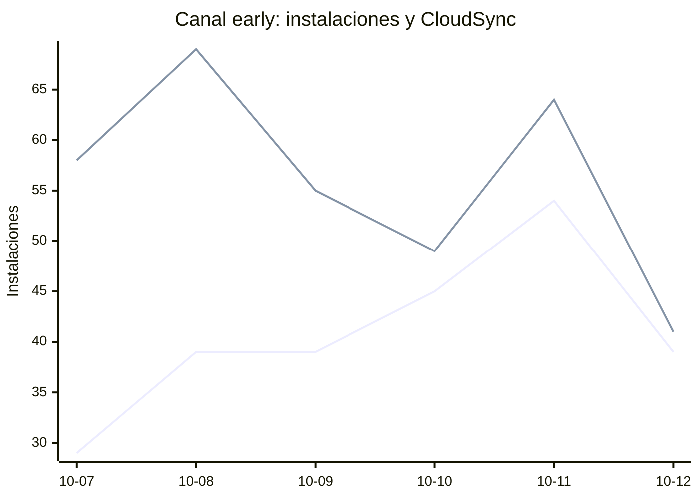

# Estadísticas de EmuDeck

Actualizado: 2026-10-13 21:12 UTC. Las gráficas no incluyen el día de hoy porque aún está incompleto.

## Arranques de la app (comprobaciones de actualización)

Cada arranque descarga el `latest*.yml` de su sistema. Cuenta arranques, no personas.

| Sistema | Ayer | Últimos 7 días |
|---|---|---|
| Linux x86 | 13994 | 94860 |
| Linux ARM | 143 | 1309 |
| Windows | 3719 | 25538 |
| Mac | 0 | 0 |

Instalaciones nuevas estimadas en Windows (7 días, `.exe` menos `.blockmap`): **1416**

## Instalaciones de EmuDeck (beacons)

Cada `setup` descarga `system-<sistema>.txt` y cada instalación de un emulador `<emulador>-<plataforma>.txt`. Los emuladores cuentan también las actualizaciones. Histórico completo desde el primer día.

| Sistema | Ayer | Últimos 7 días | Últimos 30 días | Total |
|---|---|---|---|---|
| linux | 36 | 252 | 252 | 295 |
| linux-arm | 4 | 36 | 36 | 46 |
| windows | 6 | 50 | 50 | 64 |

### Por mes

| Mes | Linux | Linux ARM | Windows | Total |
|---|---|---|---|---|
| 2026-10 | 252 | 36 | 50 | 338 |

### Canal early (early + early-unstable)

Instalaciones de EmuDeck con el backend en una rama early, y cuántas de ellas instalan CloudSync.

| | Últimos 7 días | Últimos 30 días | Total |
|---|---|---|---|
| Instalaciones early | 245 | 245 | 296 |
| Con CloudSync | 336 | 336 | 443 |
| % con CloudSync | | | 150% |

Línea de arriba: instalaciones early. Línea de abajo: de ellas, con CloudSync.

### Por emulador

| Emulador | Linux (total) | Linux ARM (total) | Windows (total) | Últimos 7 días | Últimos 30 días | Total |
|---|---|---|---|---|---|---|
| pcsx2 | 706 | 12 | 89 | 657 | 657 | 807 |
| azahar | 635 | 56 | 83 | 623 | 623 | 774 |
| duckstation | 691 | 54 | 27 | 622 | 622 | 772 |
| esde | 583 | 47 | 127 | 592 | 592 | 757 |
| ryujinx | 592 | 58 | 85 | 600 | 600 | 735 |
| cemu | 639 | 56 | 19 | 582 | 582 | 714 |
| rpcs3 | 627 | 54 | 29 | 572 | 572 | 710 |
| xenia | 578 | 48 | 60 | 557 | 557 | 686 |
| srm | 557 | 43 | 58 | 534 | 534 | 658 |
| shadps4 | 530 | 50 | 49 | 511 | 511 | 629 |
| vita3k | 566 | 48 | 13 | 506 | 506 | 627 |
| cloudsync | 328 | 13 | 122 | 354 | 354 | 463 |
| ppsspp | 262 | 40 | 63 | 300 | 300 | 365 |
| dolphin | 286 | 43 | 30 | 294 | 294 | 359 |
| ra | 289 | 43 | 27 | 302 | 302 | 359 |
| melonds | 243 | 32 | 22 | 240 | 240 | 297 |
| xemu | 242 | 33 | 22 | 248 | 248 | 297 |
| mgba | 252 | 22 | 20 | 233 | 233 | 294 |
| primehack | 209 | 34 | 23 | 222 | 222 | 266 |
| model2 | 205 | 43 | 4 | 205 | 205 | 252 |
| supermodel | 204 | 40 | 6 | 207 | 207 | 250 |
| scummvm | 204 | 30 | 12 | 202 | 202 | 246 |
| bigpemu | 174 | 3 | 2 | 136 | 136 | 179 |
| armsx2 | 56 | 57 | 0 | 88 | 88 | 113 |
| flycast | 63 | 9 | 5 | 60 | 60 | 77 |
| rmg | 52 | 16 | 0 | 52 | 52 | 68 |
| mame | 41 | 2 | 9 | 39 | 39 | 52 |
| eden | 26 | 3 | 0 | 12 | 12 | 29 |
| pegasus | 5 | 0 | 3 | 4 | 4 | 8 |
| ares | 3 | 1 | 0 | 4 | 4 | 4 |
| yuzu | 4 | 0 | 0 | 4 | 4 | 4 |
| citron | 1 | 0 | 0 | 1 | 1 | 1 |
