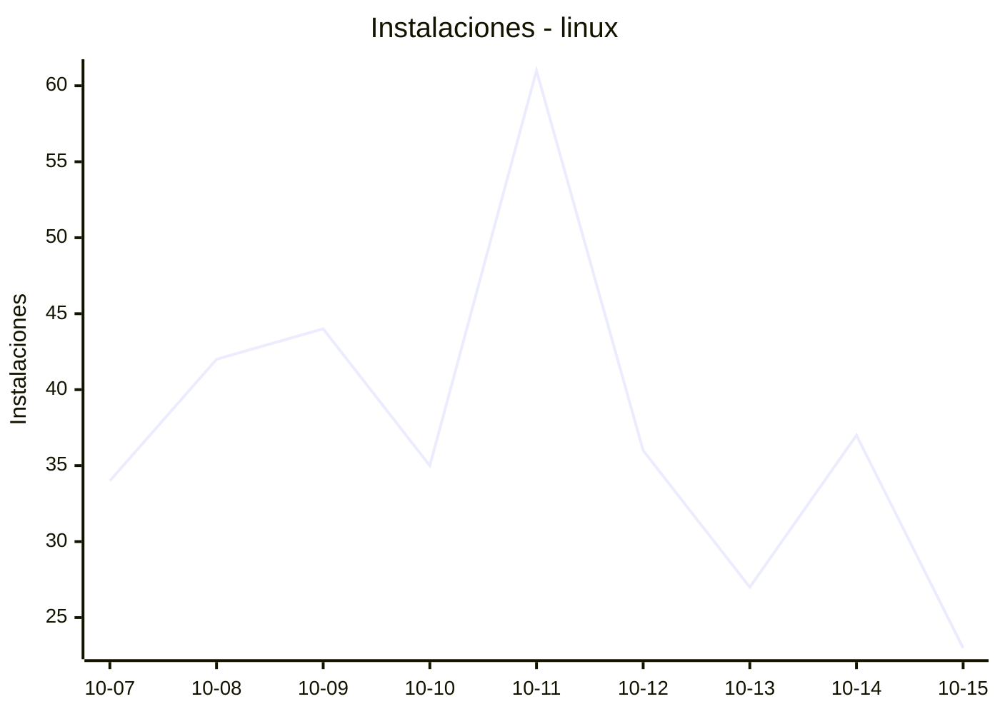
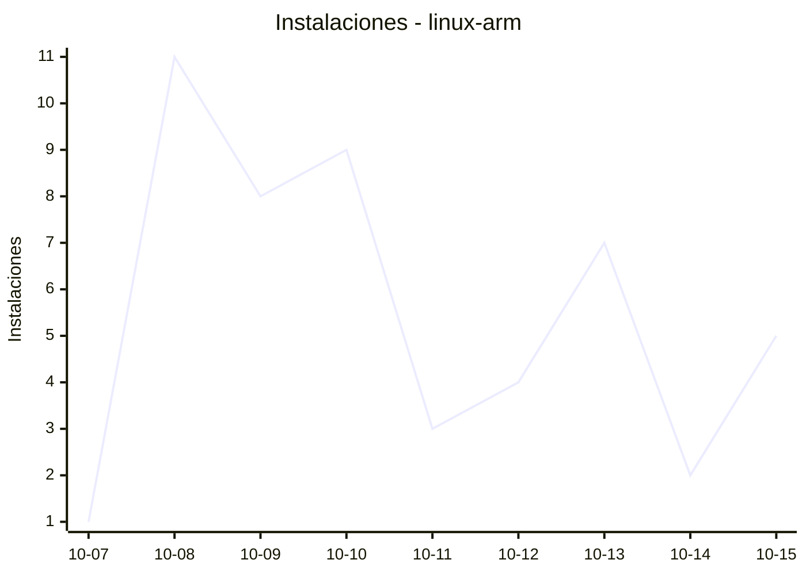
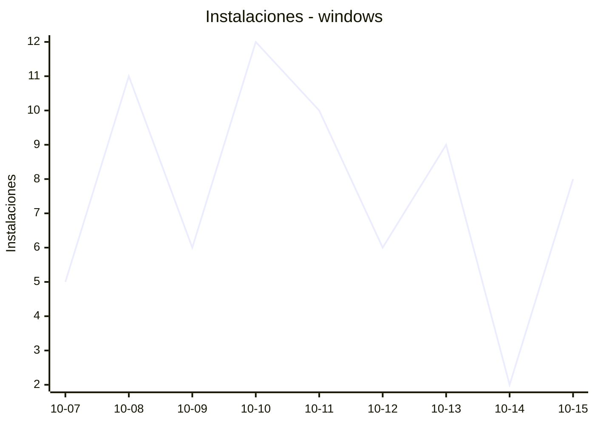
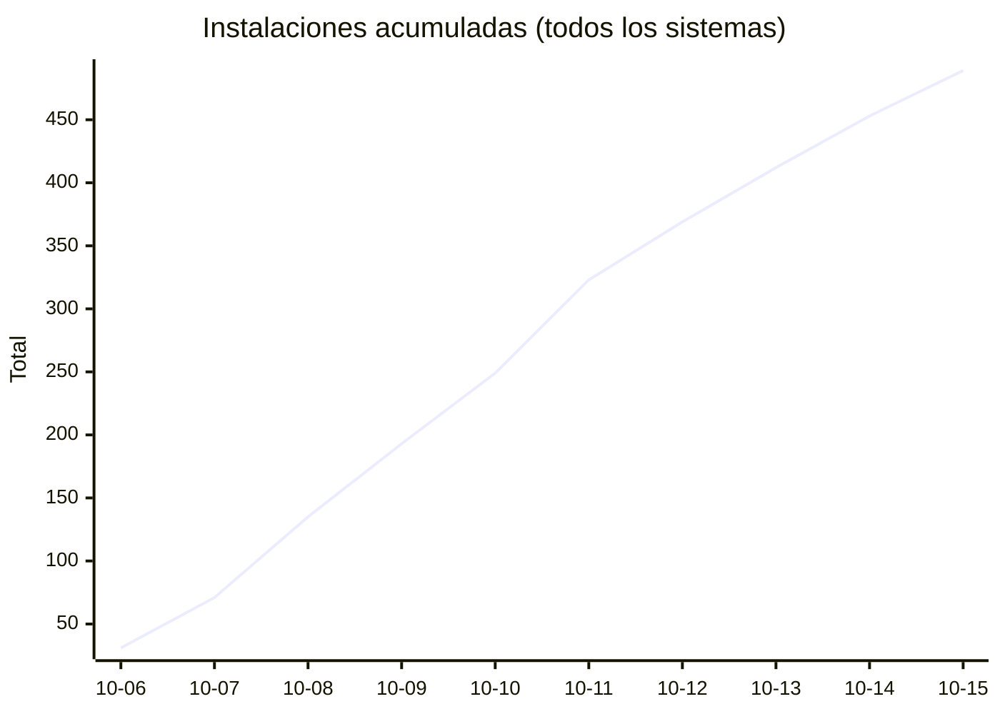
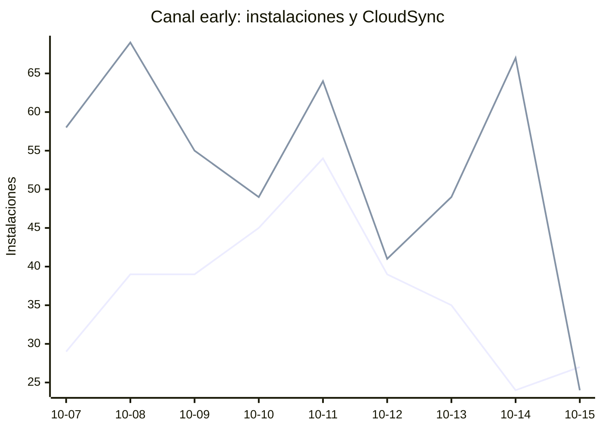

# Estadísticas de EmuDeck

Actualizado: 2026-10-16 05:14 UTC. Las gráficas no incluyen el día de hoy porque aún está incompleto.

## Arranques de la app (comprobaciones de actualización)

Cada arranque descarga el `latest*.yml` de su sistema. Cuenta arranques, no personas.

| Sistema | Ayer | Últimos 7 días |
|---|---|---|
| Linux x86 | 13181 | 98292 |
| Linux ARM | 147 | 1179 |
| Windows | 3355 | 25977 |
| Mac | 0 | 0 |

Instalaciones nuevas estimadas en Windows (7 días, `.exe` menos `.blockmap`): **1731**

## Instalaciones de EmuDeck (beacons)

Cada `setup` descarga `system-<sistema>.txt` y cada instalación de un emulador `<emulador>-<plataforma>.txt`. Los emuladores cuentan también las actualizaciones. Histórico completo desde el primer día.

| Sistema | Ayer | Últimos 7 días | Últimos 30 días | Total |
|---|---|---|---|---|
| linux | 23 | 263 | 339 | 366 |
| linux-arm | 5 | 38 | 50 | 53 |
| windows | 8 | 53 | 69 | 78 |

### Por mes

| Mes | Linux | Linux ARM | Windows | Total |
|---|---|---|---|---|
| 2026-10 | 339 | 50 | 69 | 458 |

### Canal early (early + early-unstable)

Instalaciones de EmuDeck con el backend en una rama early, y cuántas de ellas instalan CloudSync.

| | Últimos 7 días | Últimos 30 días | Total |
|---|---|---|---|
| Instalaciones early | 263 | 331 | 362 |
| Con CloudSync | 349 | 476 | 545 |
| % con CloudSync | | | 151% |

Línea de arriba: instalaciones early. Línea de abajo: de ellas, con CloudSync.

### Por emulador

| Emulador | Linux (total) | Linux ARM (total) | Windows (total) | Últimos 7 días | Últimos 30 días | Total |
|---|---|---|---|---|---|---|
| pcsx2 | 916 | 16 | 109 | 729 | 948 | 1041 |
| azahar | 823 | 72 | 103 | 706 | 905 | 998 |
| duckstation | 883 | 70 | 37 | 702 | 899 | 990 |
| esde | 750 | 62 | 156 | 671 | 860 | 968 |
| ryujinx | 786 | 73 | 104 | 684 | 877 | 963 |
| rpcs3 | 825 | 71 | 34 | 670 | 847 | 930 |
| cemu | 826 | 72 | 23 | 669 | 845 | 921 |
| xenia | 749 | 59 | 79 | 641 | 811 | 887 |
| srm | 715 | 52 | 79 | 608 | 786 | 846 |
| shadps4 | 706 | 59 | 67 | 588 | 751 | 832 |
| vita3k | 744 | 61 | 17 | 593 | 745 | 822 |
| cloudsync | 397 | 16 | 153 | 364 | 495 | 566 |
| dolphin | 358 | 51 | 43 | 325 | 415 | 452 |
| ppsspp | 323 | 47 | 74 | 322 | 406 | 444 |
| ra | 355 | 51 | 37 | 312 | 407 | 443 |
| mgba | 331 | 26 | 21 | 273 | 351 | 378 |
| melonds | 310 | 39 | 26 | 268 | 341 | 375 |
| xemu | 303 | 40 | 27 | 269 | 338 | 370 |
| primehack | 270 | 41 | 26 | 240 | 307 | 337 |
| supermodel | 269 | 47 | 8 | 241 | 298 | 324 |
| model2 | 263 | 50 | 4 | 231 | 291 | 317 |
| scummvm | 260 | 36 | 13 | 225 | 279 | 309 |
| bigpemu | 229 | 3 | 6 | 180 | 218 | 238 |
| armsx2 | 73 | 75 | 0 | 109 | 138 | 148 |
| flycast | 74 | 11 | 5 | 62 | 84 | 90 |
| rmg | 68 | 19 | 0 | 60 | 82 | 87 |
| mame | 45 | 2 | 9 | 34 | 51 | 56 |
| eden | 33 | 7 | 0 | 31 | 31 | 40 |
| pegasus | 9 | 0 | 7 | 13 | 14 | 16 |
| yuzu | 6 | 0 | 0 | 6 | 6 | 6 |
| ares | 3 | 1 | 0 | 3 | 4 | 4 |
| citron | 3 | 0 | 0 | 3 | 3 | 3 |
