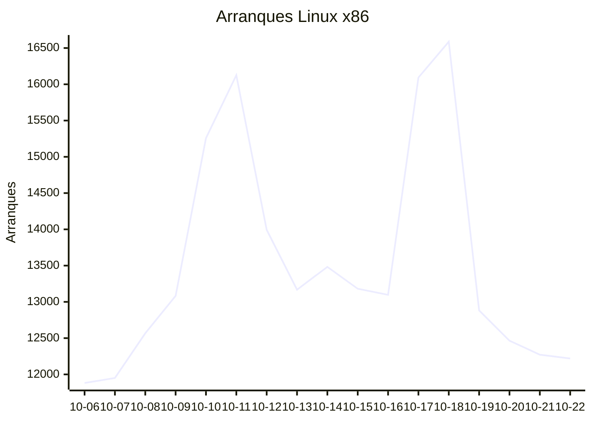
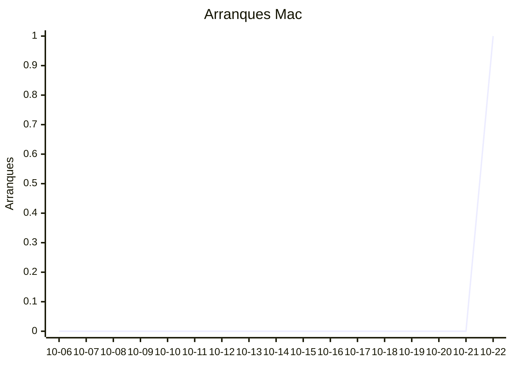
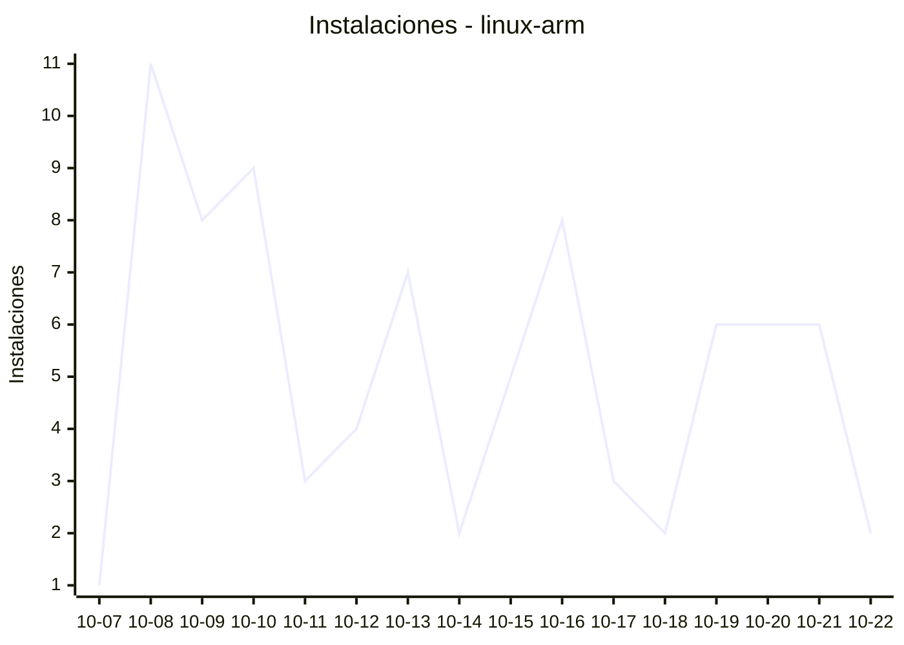
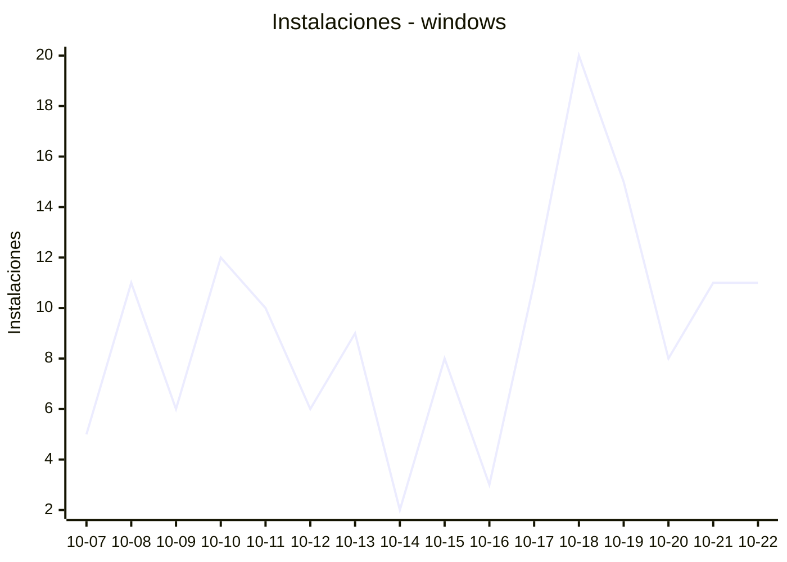
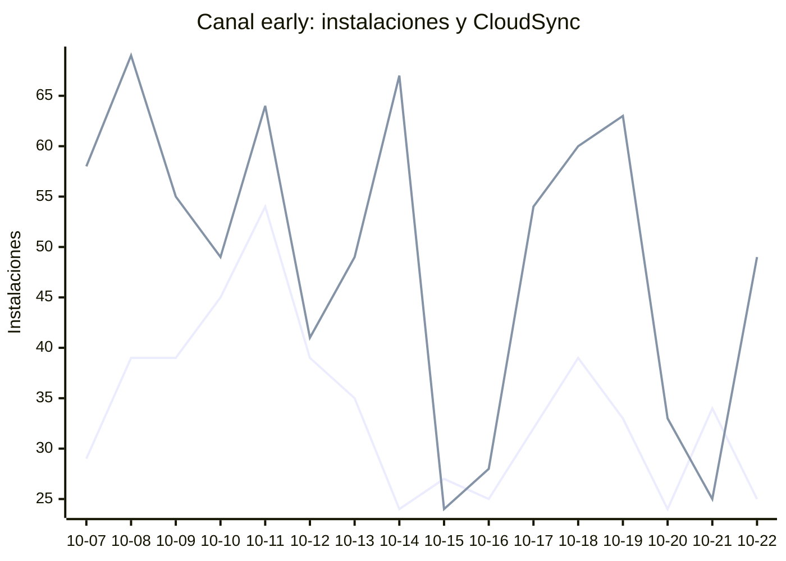

# Estadísticas de EmuDeck

Actualizado: 2026-10-23 03:16 UTC. Las gráficas no incluyen el día de hoy porque aún está incompleto.

## Arranques de la app (comprobaciones de actualización)

Cada arranque descarga el `latest*.yml` de su sistema. Cuenta arranques, no personas.

| Sistema | Ayer | Últimos 7 días |
|---|---|---|
| Linux x86 | 12219 | 95615 |
| Linux ARM | 138 | 1095 |
| Windows | 3270 | 25184 |
| Mac | 1 | 1 |

Instalaciones nuevas estimadas en Windows (7 días, `.exe` menos `.blockmap`): **2120**

## Instalaciones de EmuDeck (beacons)

Cada `setup` descarga `system-<sistema>.txt` y cada instalación de un emulador `<emulador>-<plataforma>.txt`. Los emuladores cuentan también las actualizaciones. Histórico completo desde el primer día.

| Sistema | Ayer | Últimos 7 días | Últimos 30 días | Total |
|---|---|---|---|---|
| linux | 23 | 192 | 531 | 557 |
| linux-arm | 2 | 33 | 83 | 87 |
| windows | 11 | 79 | 148 | 156 |

### Por mes

| Mes | Linux | Linux ARM | Windows | Total |
|---|---|---|---|---|
| 2026-10 | 531 | 83 | 148 | 762 |

### Canal early (early + early-unstable)

Instalaciones de EmuDeck con el backend en una rama early, y cuántas de ellas instalan CloudSync.

| | Últimos 7 días | Últimos 30 días | Total |
|---|---|---|---|
| Instalaciones early | 212 | 543 | 573 |
| Con CloudSync | 312 | 788 | 862 |
| % con CloudSync | | | 150% |

Línea de arriba: instalaciones early. Línea de abajo: de ellas, con CloudSync.

### Por emulador

| Emulador | Linux (total) | Linux ARM (total) | Windows (total) | Últimos 7 días | Últimos 30 días | Total |
|---|---|---|---|---|---|---|
| pcsx2 | 1503 | 20 | 182 | 664 | 1612 | 1705 |
| duckstation | 1451 | 113 | 71 | 643 | 1542 | 1635 |
| azahar | 1331 | 120 | 176 | 629 | 1534 | 1627 |
| esde | 1217 | 93 | 283 | 624 | 1484 | 1593 |
| ryujinx | 1291 | 117 | 173 | 617 | 1494 | 1581 |
| rpcs3 | 1353 | 112 | 72 | 603 | 1450 | 1537 |
| cemu | 1335 | 115 | 56 | 579 | 1424 | 1506 |
| srm | 1202 | 100 | 182 | 635 | 1421 | 1484 |
| xenia | 1220 | 96 | 146 | 573 | 1384 | 1462 |
| shadps4 | 1146 | 95 | 131 | 540 | 1291 | 1372 |
| vita3k | 1210 | 100 | 47 | 533 | 1278 | 1357 |
| cloudsync | 607 | 25 | 259 | 320 | 815 | 891 |
| ra | 534 | 77 | 90 | 259 | 666 | 701 |
| ppsspp | 492 | 73 | 133 | 254 | 660 | 698 |
| dolphin | 539 | 79 | 78 | 243 | 658 | 696 |
| mgba | 537 | 43 | 41 | 241 | 592 | 621 |
| melonds | 466 | 63 | 56 | 206 | 547 | 585 |
| xemu | 459 | 65 | 54 | 208 | 546 | 578 |
| primehack | 400 | 60 | 57 | 179 | 486 | 517 |
| supermodel | 393 | 75 | 12 | 156 | 454 | 480 |
| model2 | 388 | 78 | 7 | 156 | 447 | 473 |
| scummvm | 383 | 54 | 35 | 163 | 442 | 472 |
| bigpemu | 376 | 7 | 10 | 147 | 365 | 393 |
| armsx2 | 118 | 124 | 0 | 90 | 228 | 242 |
| flycast | 103 | 14 | 12 | 40 | 124 | 129 |
| rmg | 101 | 26 | 0 | 41 | 123 | 127 |
| eden | 72 | 7 | 0 | 40 | 71 | 79 |
| mame | 58 | 2 | 14 | 18 | 69 | 74 |
| pegasus | 11 | 0 | 11 | 6 | 20 | 22 |
| ares | 5 | 1 | 0 | 2 | 6 | 6 |
| yuzu | 6 | 0 | 0 | 0 | 6 | 6 |
| citron | 4 | 0 | 0 | 1 | 4 | 4 |
