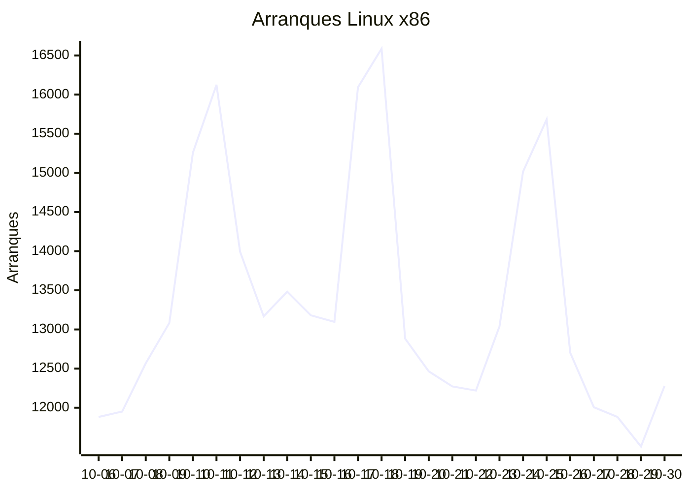
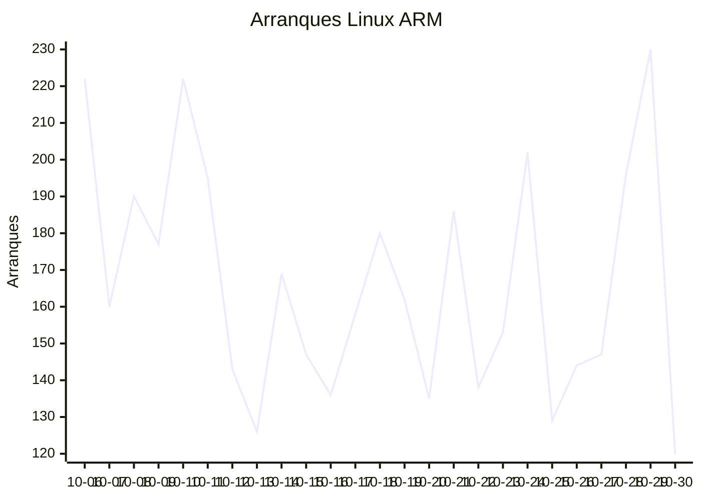
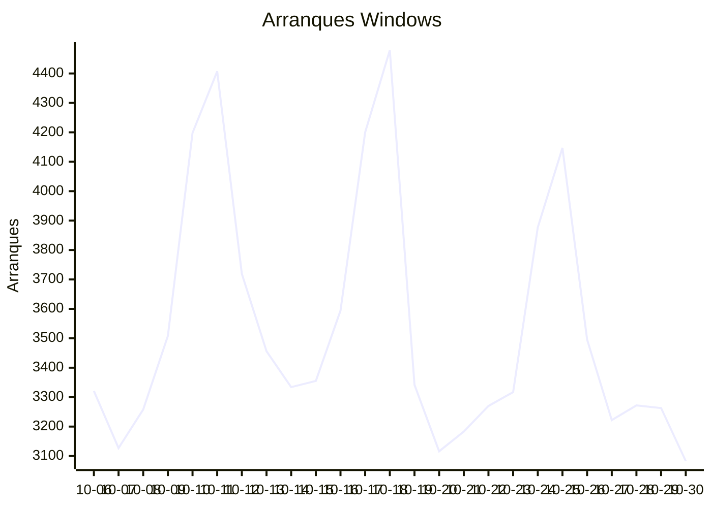
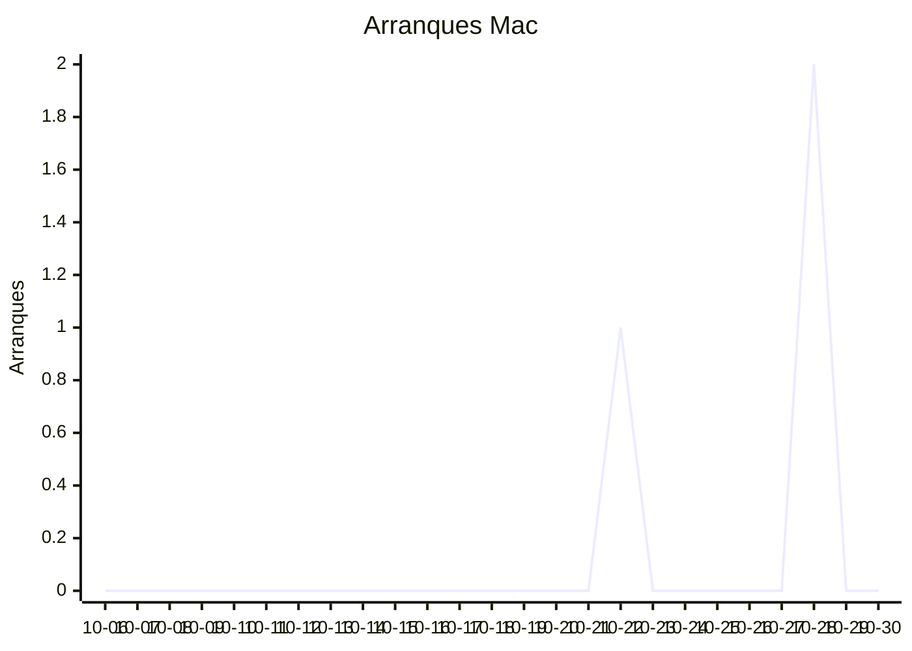
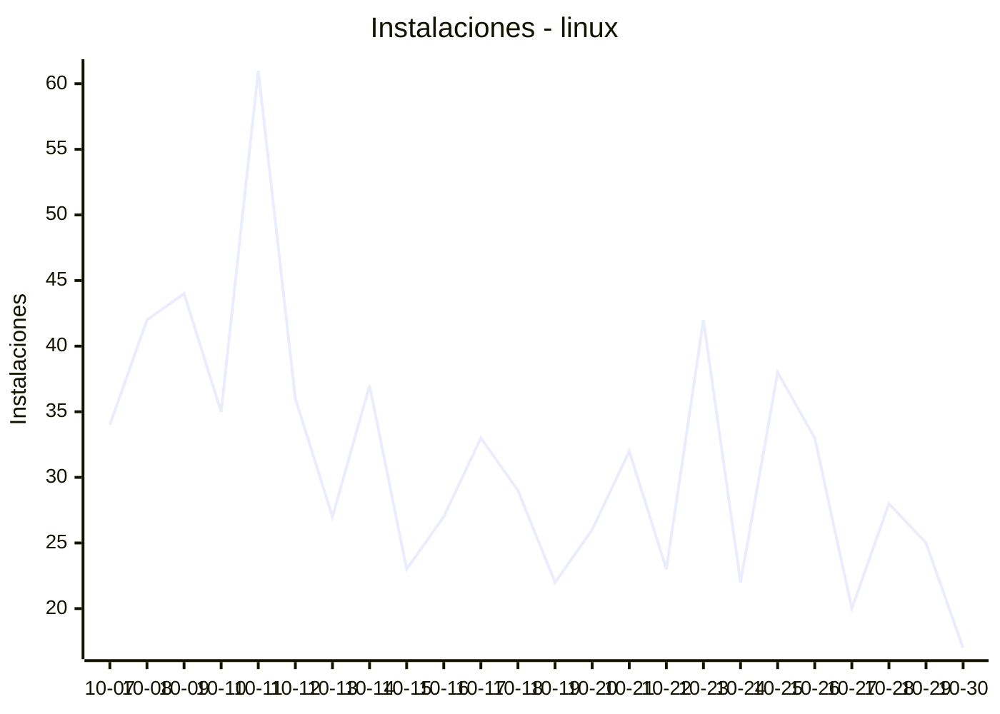
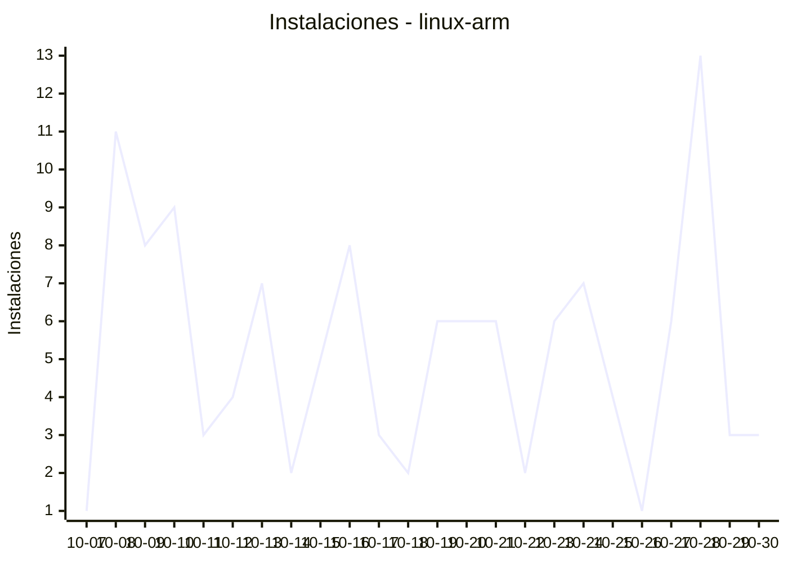
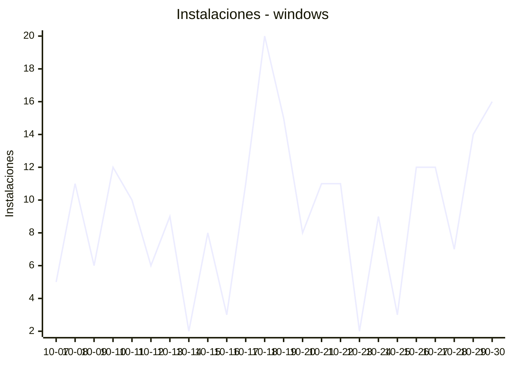
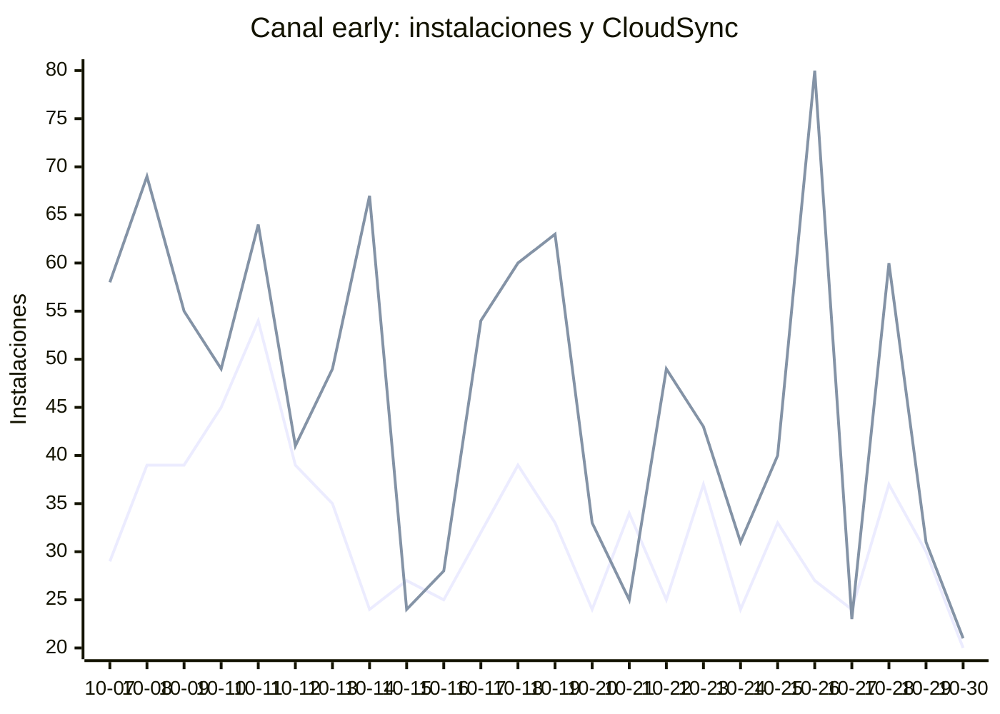

# Estadísticas de EmuDeck

Actualizado: 2026-10-31 16:35 UTC. Las gráficas no incluyen el día de hoy porque aún está incompleto.

## Arranques de la app (comprobaciones de actualización)

Cada arranque descarga el `latest*.yml` de su sistema. Cuenta arranques, no personas.

| Sistema | Ayer | Últimos 7 días |
|---|---|---|
| Linux x86 | 12279 | 91075 |
| Linux ARM | 120 | 1168 |
| Windows | 3083 | 24360 |
| Mac | 0 | 2 |

Instalaciones nuevas estimadas en Windows (7 días, `.exe` menos `.blockmap`): **2300**

## Instalaciones de EmuDeck (beacons)

Cada `setup` descarga `system-<sistema>.txt` y cada instalación de un emulador `<emulador>-<plataforma>.txt`. Los emuladores cuentan también las actualizaciones. Histórico completo desde el primer día.

| Sistema | Ayer | Últimos 7 días | Últimos 30 días | Total |
|---|---|---|---|---|
| linux | 17 | 183 | 756 | 800 |
| linux-arm | 3 | 37 | 126 | 130 |
| windows | 16 | 73 | 223 | 237 |

### Por mes

| Mes | Linux | Linux ARM | Windows | Total |
|---|---|---|---|---|
| 2026-10 | 756 | 126 | 223 | 1105 |

### Canal early (early + early-unstable)

Instalaciones de EmuDeck con el backend en una rama early, y cuántas de ellas instalan CloudSync.

| | Últimos 7 días | Últimos 30 días | Total |
|---|---|---|---|
| Instalaciones early | 195 | 775 | 817 |
| Con CloudSync | 286 | 1117 | 1217 |
| % con CloudSync | | | 149% |

Línea de arriba: instalaciones early. Línea de abajo: de ellas, con CloudSync.

### Por emulador

| Emulador | Linux (total) | Linux ARM (total) | Windows (total) | Últimos 7 días | Últimos 30 días | Total |
|---|---|---|---|---|---|---|
| pcsx2 | 2227 | 23 | 269 | 655 | 2371 | 2519 |
| esde | 1833 | 180 | 442 | 682 | 2252 | 2455 |
| azahar | 1943 | 204 | 274 | 633 | 2275 | 2421 |
| duckstation | 2122 | 183 | 109 | 616 | 2270 | 2414 |
| ryujinx | 1900 | 193 | 260 | 609 | 2218 | 2353 |
| rpcs3 | 2013 | 184 | 104 | 603 | 2159 | 2301 |
| cemu | 1950 | 189 | 92 | 573 | 2105 | 2231 |
| srm | 1770 | 163 | 294 | 597 | 2112 | 2227 |
| xenia | 1820 | 149 | 232 | 587 | 2073 | 2201 |
| shadps4 | 1699 | 160 | 209 | 553 | 1940 | 2068 |
| vita3k | 1777 | 163 | 71 | 512 | 1884 | 2011 |
| cloudsync | 833 | 40 | 392 | 301 | 1163 | 1265 |
| ppsspp | 711 | 110 | 210 | 269 | 978 | 1031 |
| dolphin | 773 | 128 | 115 | 255 | 964 | 1016 |
| ra | 771 | 118 | 121 | 240 | 957 | 1010 |
| mgba | 803 | 57 | 61 | 236 | 865 | 921 |
| xemu | 667 | 97 | 85 | 210 | 805 | 849 |
| melonds | 652 | 93 | 81 | 186 | 779 | 826 |
| primehack | 579 | 92 | 84 | 188 | 715 | 755 |
| supermodel | 556 | 106 | 22 | 155 | 649 | 684 |
| scummvm | 540 | 79 | 56 | 156 | 636 | 675 |
| model2 | 549 | 110 | 8 | 145 | 631 | 667 |
| bigpemu | 543 | 11 | 16 | 141 | 536 | 570 |
| armsx2 | 164 | 215 | 0 | 108 | 353 | 379 |
| flycast | 146 | 18 | 20 | 35 | 175 | 184 |
| rmg | 138 | 28 | 0 | 31 | 161 | 166 |
| eden | 85 | 9 | 4 | 14 | 86 | 98 |
| mame | 76 | 3 | 19 | 17 | 93 | 98 |
| pegasus | 21 | 1 | 17 | 13 | 34 | 39 |
| yuzu | 9 | 0 | 3 | 4 | 11 | 12 |
| ares | 10 | 1 | 0 | 3 | 10 | 11 |
| citron | 5 | 0 | 0 | 1 | 5 | 5 |
