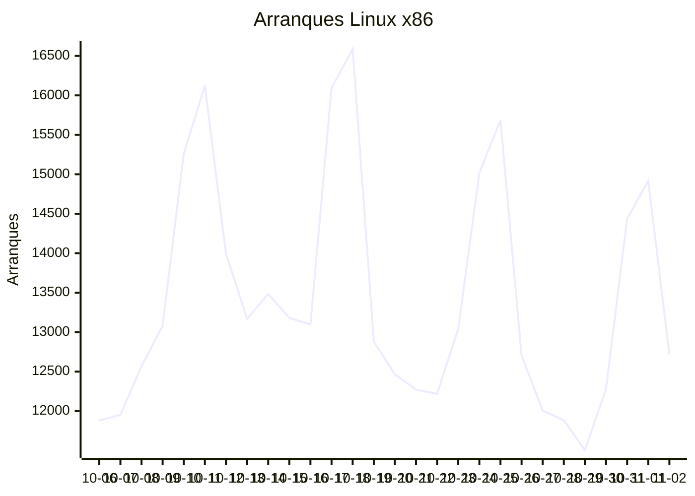
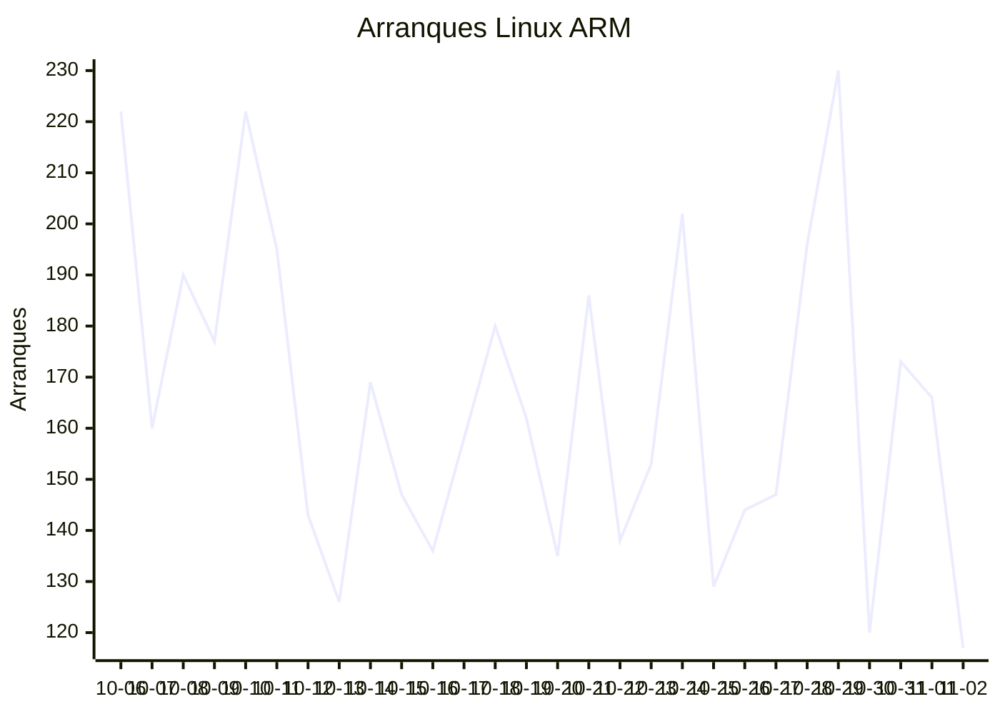
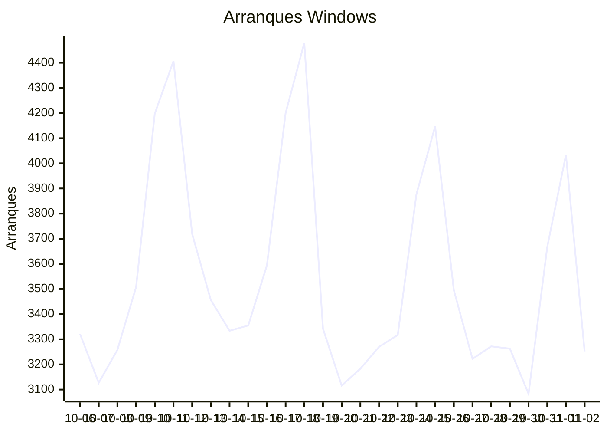
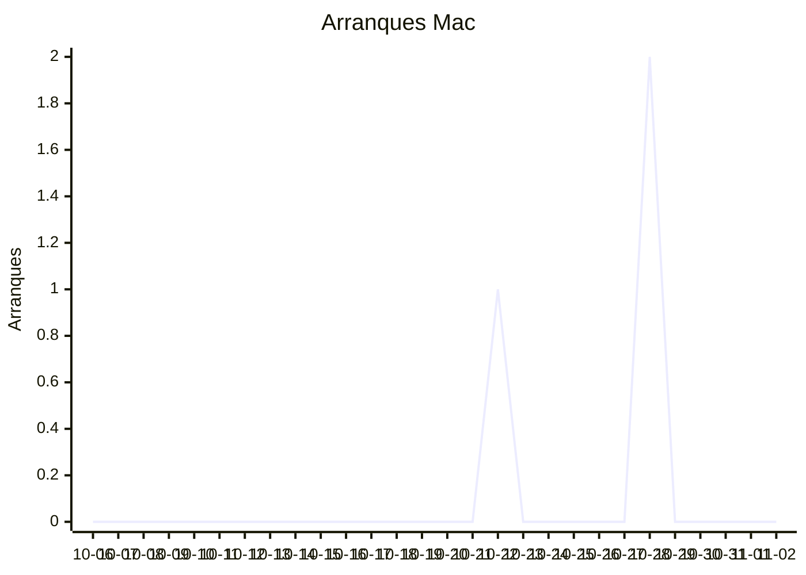
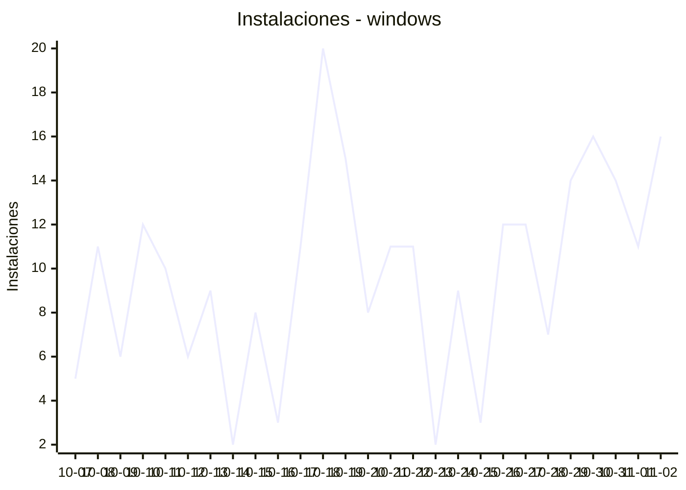
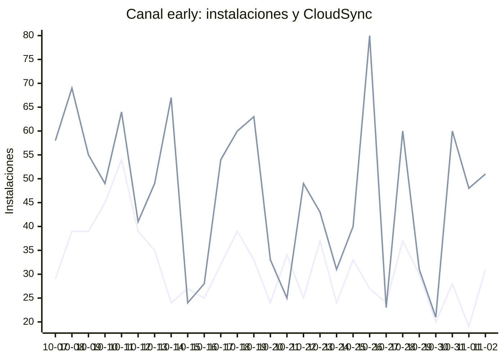

# Estadísticas de EmuDeck

Actualizado: 2026-11-03 05:10 UTC. Las gráficas no incluyen el día de hoy porque aún está incompleto.

## Arranques de la app (comprobaciones de actualización)

Cada arranque descarga el `latest*.yml` de su sistema. Cuenta arranques, no personas.

| Sistema | Ayer | Últimos 7 días |
|---|---|---|
| Linux x86 | 12716 | 89744 |
| Linux ARM | 117 | 1149 |
| Windows | 3252 | 23793 |
| Mac | 0 | 2 |

Instalaciones nuevas estimadas en Windows (7 días, `.exe` menos `.blockmap`): **2263**

## Instalaciones de EmuDeck (beacons)

Cada `setup` descarga `system-<sistema>.txt` y cada instalación de un emulador `<emulador>-<plataforma>.txt`. Los emuladores cuentan también las actualizaciones. Histórico completo desde el primer día.

| Sistema | Ayer | Últimos 7 días | Últimos 30 días | Total |
|---|---|---|---|---|
| linux | 20 | 170 | 836 | 860 |
| linux-arm | 1 | 34 | 135 | 138 |
| windows | 16 | 90 | 264 | 271 |

### Por mes

| Mes | Linux | Linux ARM | Windows | Total |
|---|---|---|---|---|
| 2026-11 | 46 | 7 | 27 | 80 |
| 2026-10 | 790 | 128 | 237 | 1155 |

### Canal early (early + early-unstable)

Instalaciones de EmuDeck con el backend en una rama early, y cuántas de ellas instalan CloudSync.

| | Últimos 7 días | Últimos 30 días | Total |
|---|---|---|---|
| Instalaciones early | 189 | 853 | 877 |
| Con CloudSync | 294 | 1276 | 1344 |
| % con CloudSync | | | 153% |

Línea de arriba: instalaciones early. Línea de abajo: de ellas, con CloudSync.

### Por emulador

| Emulador | Linux (total) | Linux ARM (total) | Windows (total) | Últimos 7 días | Últimos 30 días | Total |
|---|---|---|---|---|---|---|
| pcsx2 | 2410 | 24 | 313 | 611 | 2659 | 2747 |
| esde | 1993 | 193 | 521 | 693 | 2597 | 2707 |
| azahar | 2106 | 220 | 312 | 607 | 2548 | 2638 |
| duckstation | 2300 | 200 | 122 | 572 | 2533 | 2622 |
| ryujinx | 2047 | 209 | 291 | 545 | 2464 | 2547 |
| rpcs3 | 2190 | 200 | 118 | 559 | 2428 | 2508 |
| cemu | 2106 | 205 | 108 | 527 | 2342 | 2419 |
| srm | 1913 | 174 | 326 | 527 | 2351 | 2413 |
| xenia | 1965 | 164 | 265 | 548 | 2322 | 2394 |
| shadps4 | 1841 | 173 | 238 | 521 | 2176 | 2252 |
| vita3k | 1916 | 177 | 82 | 472 | 2099 | 2175 |
| cloudsync | 919 | 41 | 437 | 306 | 1325 | 1397 |
| ppsspp | 761 | 117 | 242 | 261 | 1087 | 1120 |
| dolphin | 835 | 137 | 129 | 249 | 1069 | 1101 |
| ra | 831 | 126 | 137 | 234 | 1063 | 1094 |
| mgba | 869 | 62 | 65 | 222 | 968 | 996 |
| xemu | 713 | 105 | 99 | 197 | 890 | 917 |
| melonds | 698 | 100 | 91 | 182 | 858 | 889 |
| primehack | 626 | 99 | 98 | 186 | 797 | 823 |
| supermodel | 598 | 114 | 27 | 154 | 717 | 739 |
| scummvm | 577 | 86 | 65 | 152 | 703 | 728 |
| model2 | 589 | 118 | 10 | 146 | 695 | 717 |
| bigpemu | 579 | 16 | 21 | 131 | 593 | 616 |
| armsx2 | 175 | 234 | 0 | 98 | 399 | 409 |
| flycast | 153 | 21 | 25 | 40 | 194 | 199 |
| rmg | 144 | 31 | 0 | 26 | 171 | 175 |
| mame | 82 | 6 | 22 | 25 | 106 | 110 |
| eden | 89 | 9 | 7 | 14 | 97 | 105 |
| pegasus | 24 | 1 | 21 | 19 | 44 | 46 |
| yuzu | 10 | 0 | 4 | 4 | 14 | 14 |
| ares | 10 | 2 | 0 | 3 | 12 | 12 |
| citron | 5 | 0 | 0 | 0 | 5 | 5 |
