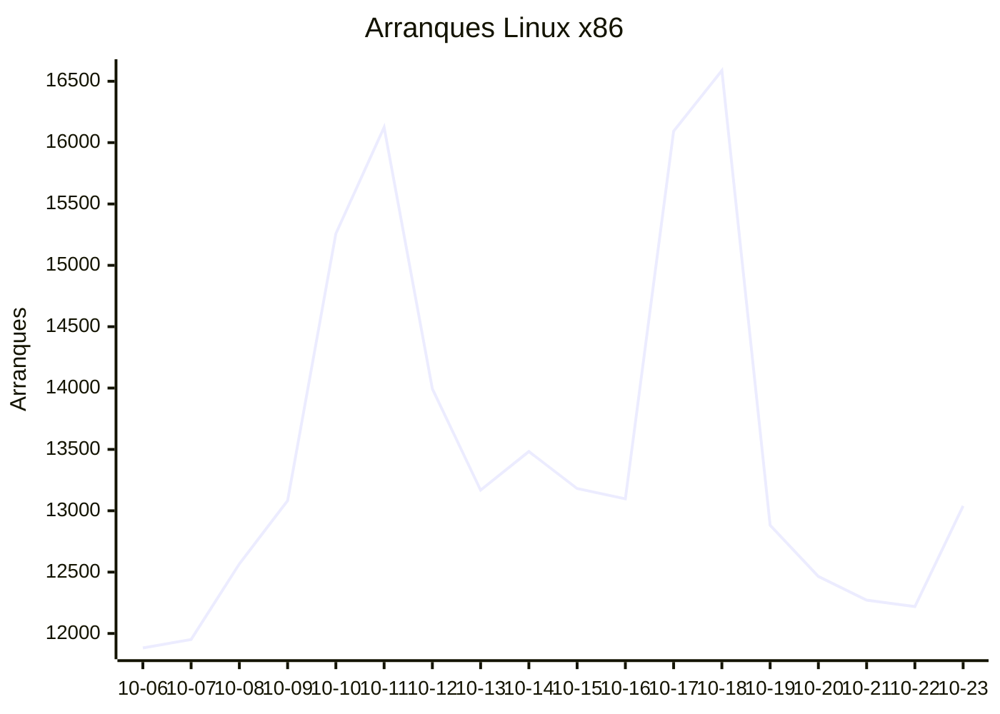
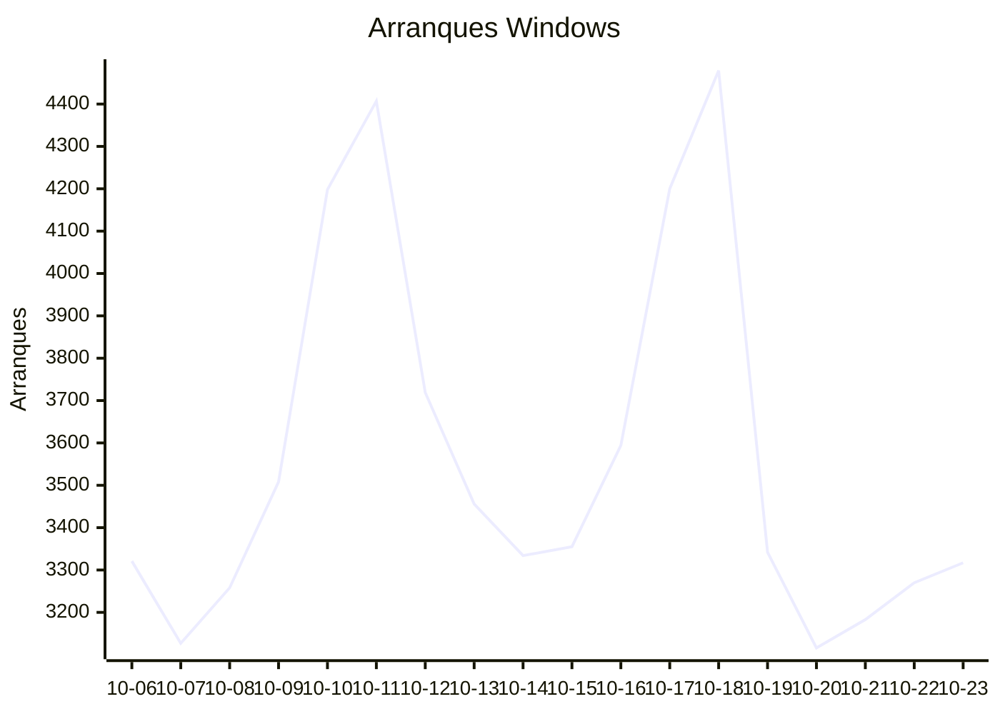
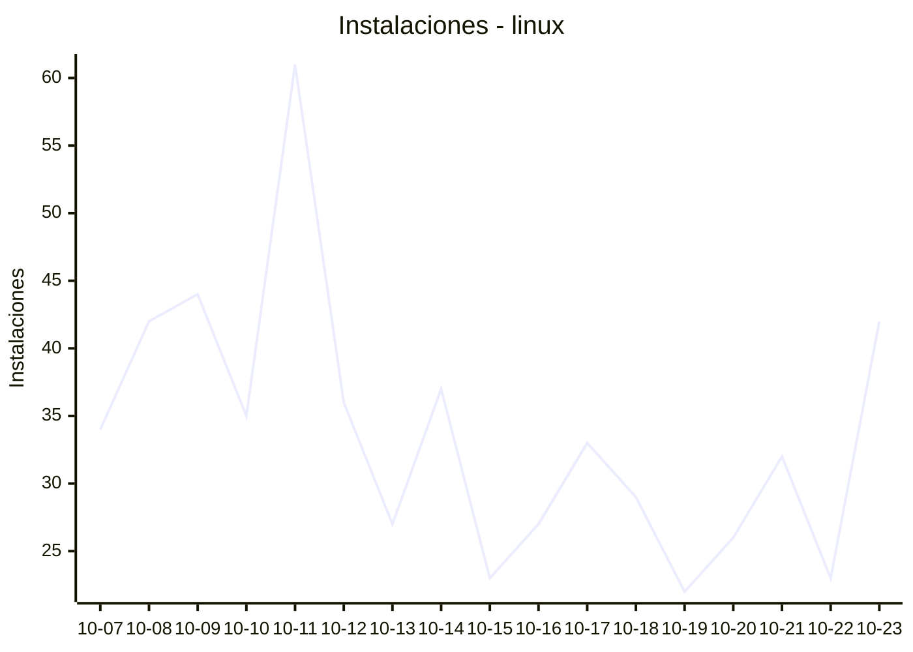
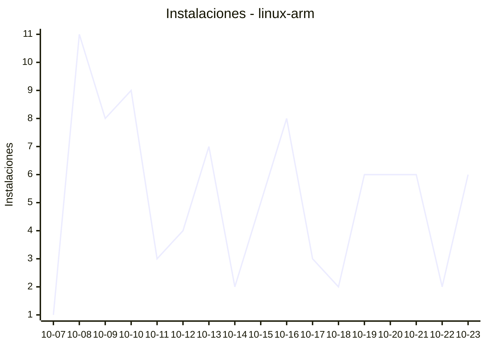
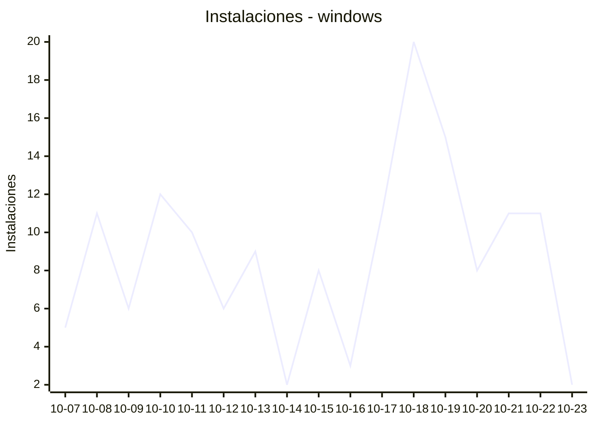
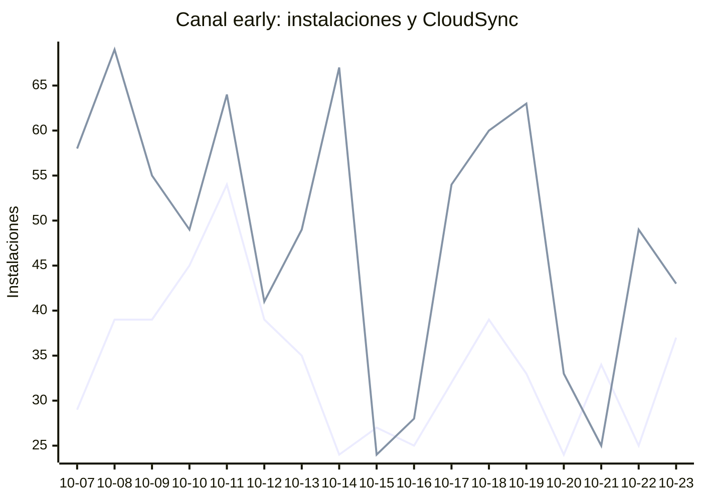

# Estadísticas de EmuDeck

Actualizado: 2026-10-24 01:47 UTC. Las gráficas no incluyen el día de hoy porque aún está incompleto.

## Arranques de la app (comprobaciones de actualización)

Cada arranque descarga el `latest*.yml` de su sistema. Cuenta arranques, no personas.

| Sistema | Ayer | Últimos 7 días |
|---|---|---|
| Linux x86 | 13039 | 95557 |
| Linux ARM | 153 | 1112 |
| Windows | 3317 | 24907 |
| Mac | 0 | 1 |

Instalaciones nuevas estimadas en Windows (7 días, `.exe` menos `.blockmap`): **2061**

## Instalaciones de EmuDeck (beacons)

Cada `setup` descarga `system-<sistema>.txt` y cada instalación de un emulador `<emulador>-<plataforma>.txt`. Los emuladores cuentan también las actualizaciones. Histórico completo desde el primer día.

| Sistema | Ayer | Últimos 7 días | Últimos 30 días | Total |
|---|---|---|---|---|
| linux | 42 | 207 | 573 | 596 |
| linux-arm | 6 | 31 | 89 | 92 |
| windows | 2 | 78 | 150 | 157 |

### Por mes

| Mes | Linux | Linux ARM | Windows | Total |
|---|---|---|---|---|
| 2026-10 | 573 | 89 | 150 | 812 |

### Canal early (early + early-unstable)

Instalaciones de EmuDeck con el backend en una rama early, y cuántas de ellas instalan CloudSync.

| | Últimos 7 días | Últimos 30 días | Total |
|---|---|---|---|
| Instalaciones early | 224 | 580 | 604 |
| Con CloudSync | 327 | 831 | 896 |
| % con CloudSync | | | 148% |

Línea de arriba: instalaciones early. Línea de abajo: de ellas, con CloudSync.

### Por emulador

| Emulador | Linux (total) | Linux ARM (total) | Windows (total) | Últimos 7 días | Últimos 30 días | Total |
|---|---|---|---|---|---|---|
| pcsx2 | 1589 | 20 | 184 | 690 | 1716 | 1793 |
| duckstation | 1529 | 122 | 78 | 677 | 1654 | 1729 |
| azahar | 1407 | 132 | 181 | 659 | 1642 | 1720 |
| ryujinx | 1364 | 130 | 183 | 654 | 1609 | 1677 |
| esde | 1279 | 102 | 286 | 643 | 1570 | 1667 |
| rpcs3 | 1433 | 119 | 75 | 638 | 1556 | 1627 |
| cemu | 1412 | 127 | 59 | 625 | 1532 | 1598 |
| srm | 1265 | 112 | 189 | 653 | 1515 | 1566 |
| xenia | 1294 | 104 | 149 | 606 | 1486 | 1547 |
| shadps4 | 1216 | 105 | 132 | 567 | 1387 | 1453 |
| vita3k | 1278 | 110 | 49 | 560 | 1372 | 1437 |
| cloudsync | 630 | 25 | 274 | 339 | 862 | 929 |
| ra | 572 | 82 | 92 | 275 | 717 | 746 |
| ppsspp | 527 | 77 | 136 | 271 | 709 | 740 |
| dolphin | 573 | 84 | 81 | 261 | 709 | 738 |
| mgba | 562 | 46 | 45 | 249 | 629 | 653 |
| melonds | 494 | 67 | 59 | 222 | 593 | 620 |
| xemu | 493 | 69 | 58 | 227 | 595 | 620 |
| primehack | 429 | 65 | 59 | 200 | 527 | 553 |
| supermodel | 421 | 80 | 13 | 175 | 494 | 514 |
| model2 | 416 | 83 | 7 | 171 | 486 | 506 |
| scummvm | 409 | 58 | 36 | 181 | 480 | 503 |
| bigpemu | 396 | 7 | 10 | 169 | 395 | 413 |
| armsx2 | 120 | 135 | 0 | 99 | 245 | 255 |
| flycast | 116 | 14 | 15 | 50 | 140 | 145 |
| rmg | 108 | 26 | 0 | 42 | 130 | 134 |
| eden | 73 | 7 | 0 | 38 | 72 | 80 |
| mame | 64 | 2 | 14 | 23 | 76 | 80 |
| pegasus | 11 | 0 | 12 | 7 | 21 | 23 |
| ares | 6 | 1 | 0 | 3 | 7 | 7 |
| yuzu | 7 | 0 | 0 | 1 | 7 | 7 |
| citron | 4 | 0 | 0 | 1 | 4 | 4 |
