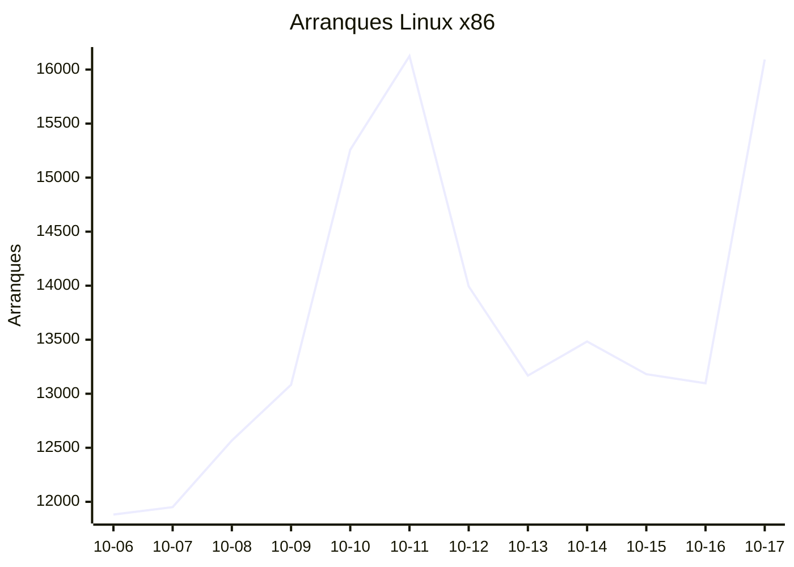
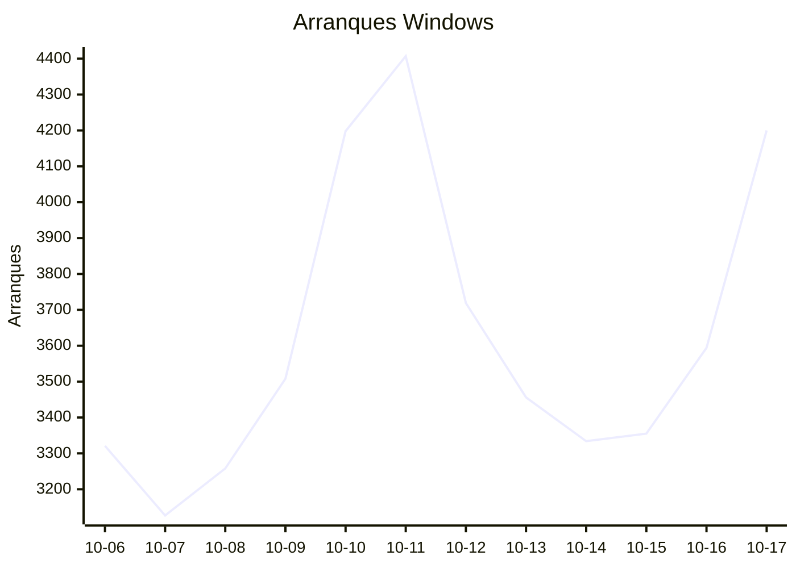
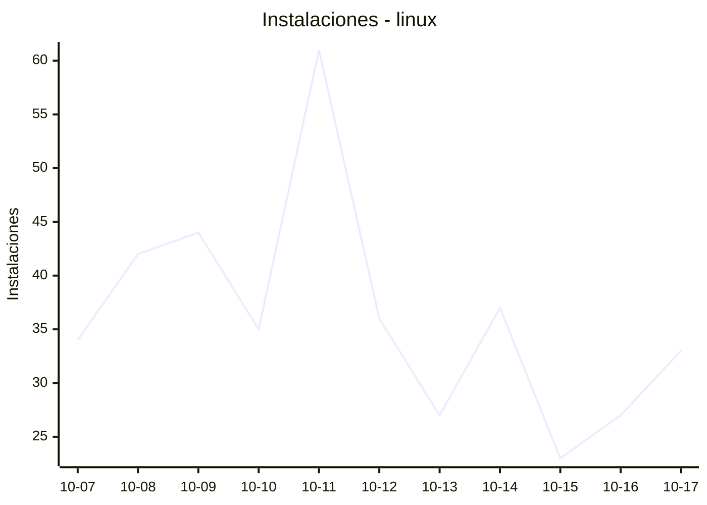
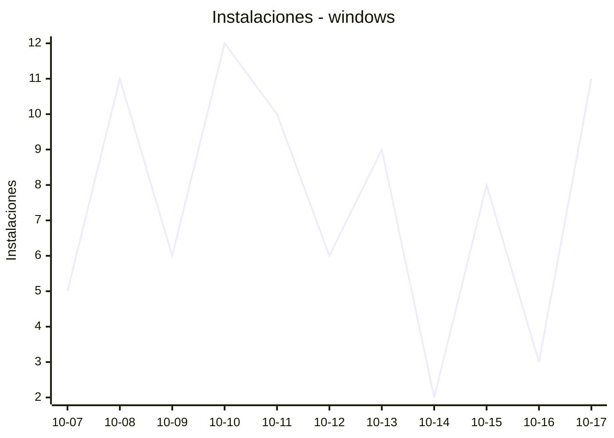
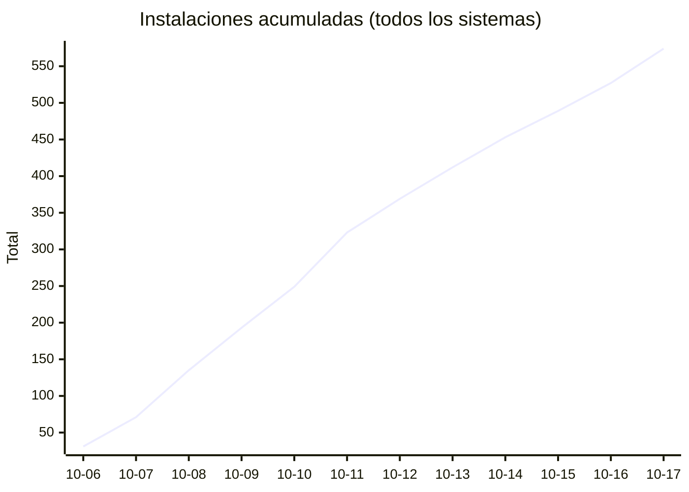
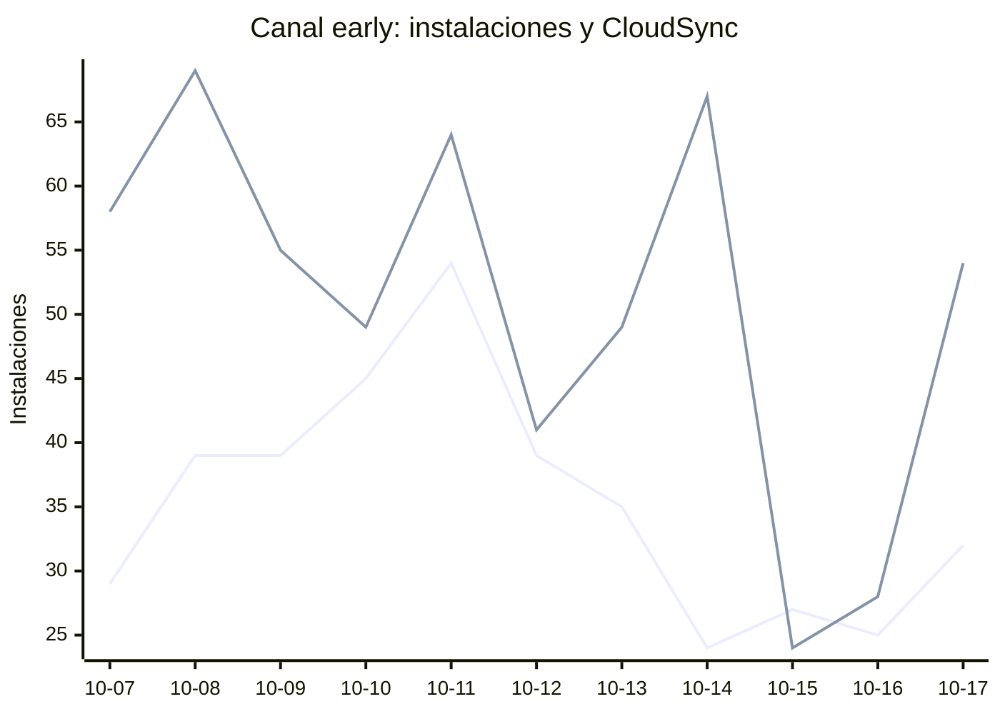

# Estadísticas de EmuDeck

Actualizado: 2026-10-18 06:49 UTC. Las gráficas no incluyen el día de hoy porque aún está incompleto.

## Arranques de la app (comprobaciones de actualización)

Cada arranque descarga el `latest*.yml` de su sistema. Cuenta arranques, no personas.

| Sistema | Ayer | Últimos 7 días |
|---|---|---|
| Linux x86 | 16093 | 99141 |
| Linux ARM | 158 | 1074 |
| Windows | 4200 | 26065 |
| Mac | 0 | 0 |

Instalaciones nuevas estimadas en Windows (7 días, `.exe` menos `.blockmap`): **1915**

## Instalaciones de EmuDeck (beacons)

Cada `setup` descarga `system-<sistema>.txt` y cada instalación de un emulador `<emulador>-<plataforma>.txt`. Los emuladores cuentan también las actualizaciones. Histórico completo desde el primer día.

| Sistema | Ayer | Últimos 7 días | Últimos 30 días | Total |
|---|---|---|---|---|
| linux | 33 | 244 | 399 | 433 |
| linux-arm | 3 | 32 | 61 | 64 |
| windows | 11 | 49 | 83 | 95 |

### Por mes

| Mes | Linux | Linux ARM | Windows | Total |
|---|---|---|---|---|
| 2026-10 | 399 | 61 | 83 | 543 |

### Canal early (early + early-unstable)

Instalaciones de EmuDeck con el backend en una rama early, y cuántas de ellas instalan CloudSync.

| | Últimos 7 días | Últimos 30 días | Total |
|---|---|---|---|
| Instalaciones early | 236 | 388 | 425 |
| Con CloudSync | 327 | 558 | 629 |
| % con CloudSync | | | 148% |

Línea de arriba: instalaciones early. Línea de abajo: de ellas, con CloudSync.

### Por emulador

| Emulador | Linux (total) | Linux ARM (total) | Windows (total) | Últimos 7 días | Últimos 30 días | Total |
|---|---|---|---|---|---|---|
| pcsx2 | 1116 | 18 | 123 | 703 | 1144 | 1257 |
| duckstation | 1080 | 79 | 42 | 677 | 1093 | 1201 |
| azahar | 995 | 81 | 124 | 666 | 1088 | 1200 |
| ryujinx | 957 | 82 | 126 | 652 | 1064 | 1165 |
| esde | 905 | 70 | 181 | 618 | 1033 | 1156 |
| rpcs3 | 1008 | 81 | 40 | 643 | 1028 | 1129 |
| cemu | 996 | 80 | 29 | 626 | 1012 | 1105 |
| xenia | 902 | 67 | 92 | 611 | 973 | 1061 |
| srm | 880 | 66 | 100 | 595 | 960 | 1046 |
| shadps4 | 862 | 66 | 86 | 579 | 920 | 1014 |
| vita3k | 907 | 70 | 23 | 578 | 910 | 1000 |
| cloudsync | 456 | 17 | 177 | 333 | 577 | 650 |
| dolphin | 424 | 57 | 49 | 296 | 485 | 530 |
| ppsspp | 388 | 53 | 86 | 292 | 479 | 527 |
| ra | 418 | 58 | 47 | 283 | 479 | 523 |
| mgba | 398 | 33 | 26 | 255 | 419 | 457 |
| melonds | 367 | 43 | 33 | 253 | 403 | 443 |
| xemu | 359 | 47 | 34 | 246 | 399 | 440 |
| primehack | 314 | 45 | 33 | 205 | 355 | 392 |
| supermodel | 311 | 52 | 8 | 212 | 342 | 371 |
| model2 | 307 | 55 | 5 | 205 | 338 | 367 |
| scummvm | 304 | 40 | 18 | 198 | 327 | 362 |
| bigpemu | 268 | 3 | 7 | 151 | 252 | 278 |
| armsx2 | 82 | 87 | 0 | 93 | 158 | 169 |
| flycast | 81 | 13 | 6 | 52 | 94 | 100 |
| rmg | 79 | 20 | 0 | 52 | 93 | 99 |
| mame | 49 | 2 | 9 | 23 | 55 | 60 |
| eden | 52 | 7 | 0 | 45 | 49 | 59 |
| pegasus | 9 | 0 | 10 | 13 | 16 | 19 |
| yuzu | 6 | 0 | 0 | 4 | 6 | 6 |
| ares | 3 | 1 | 0 | 2 | 4 | 4 |
| citron | 3 | 0 | 0 | 3 | 3 | 3 |
