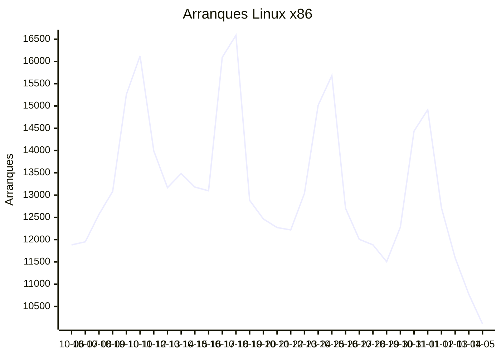
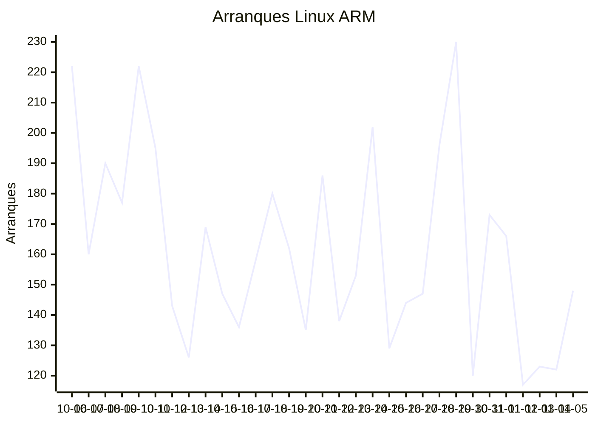
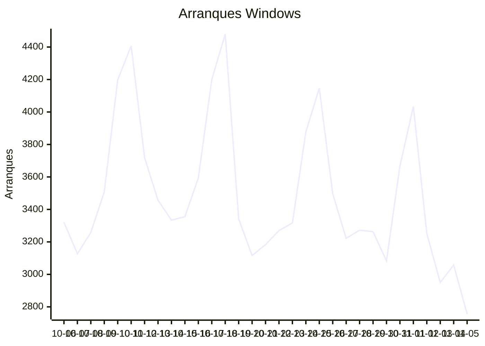
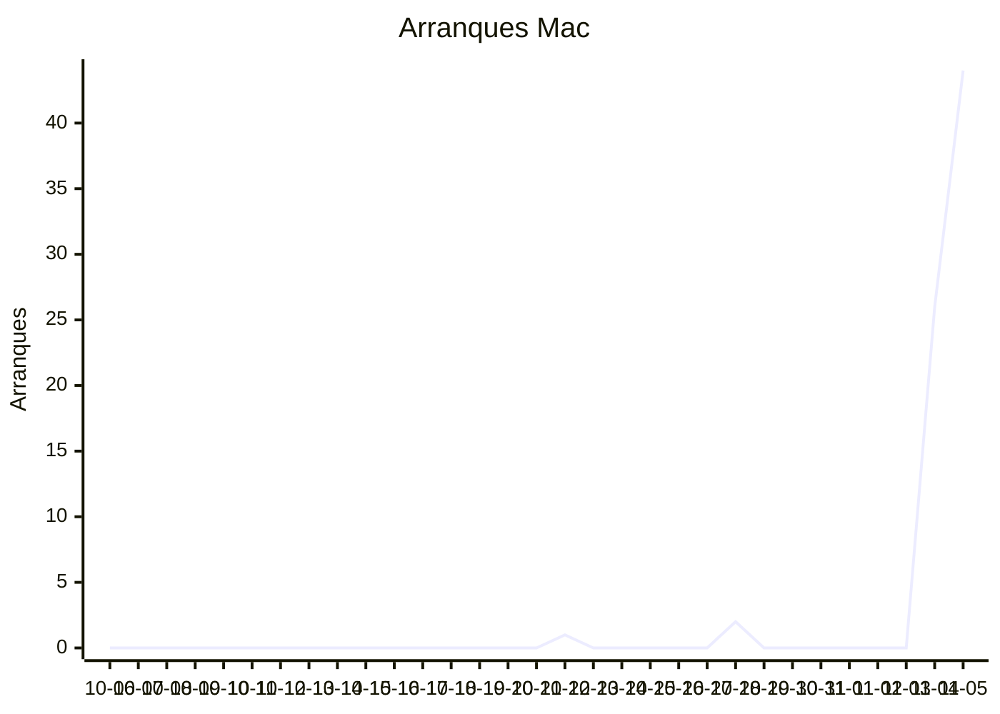
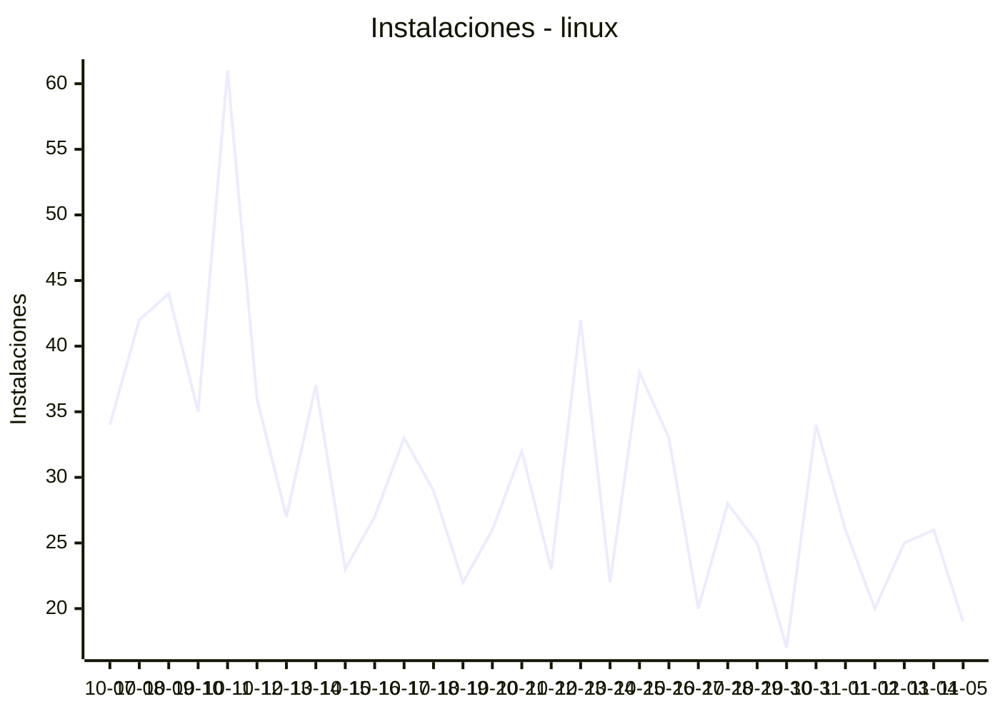
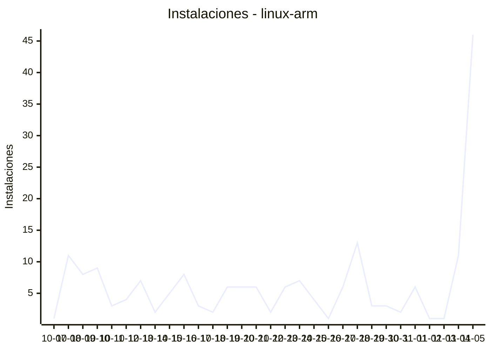
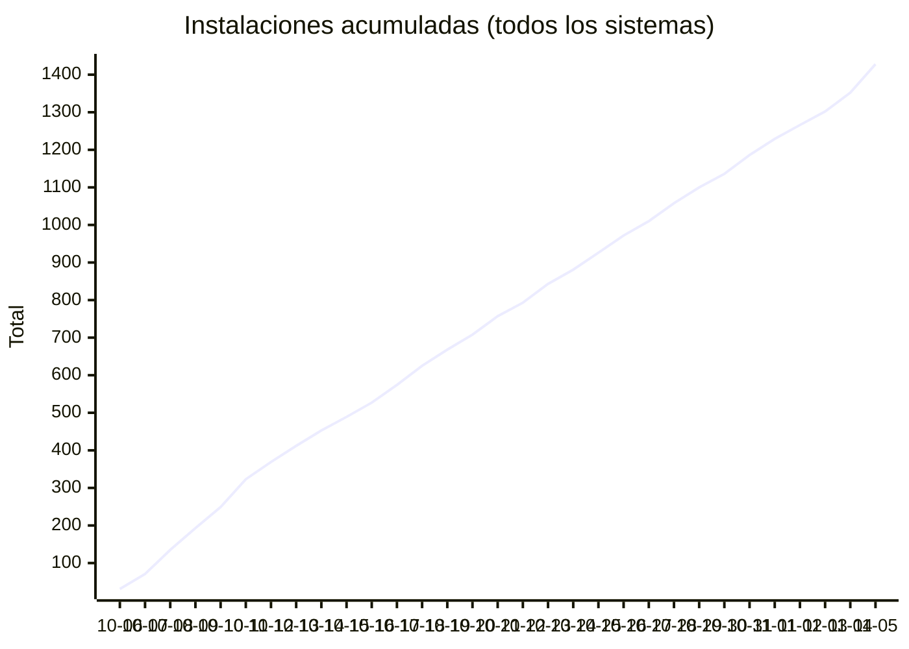
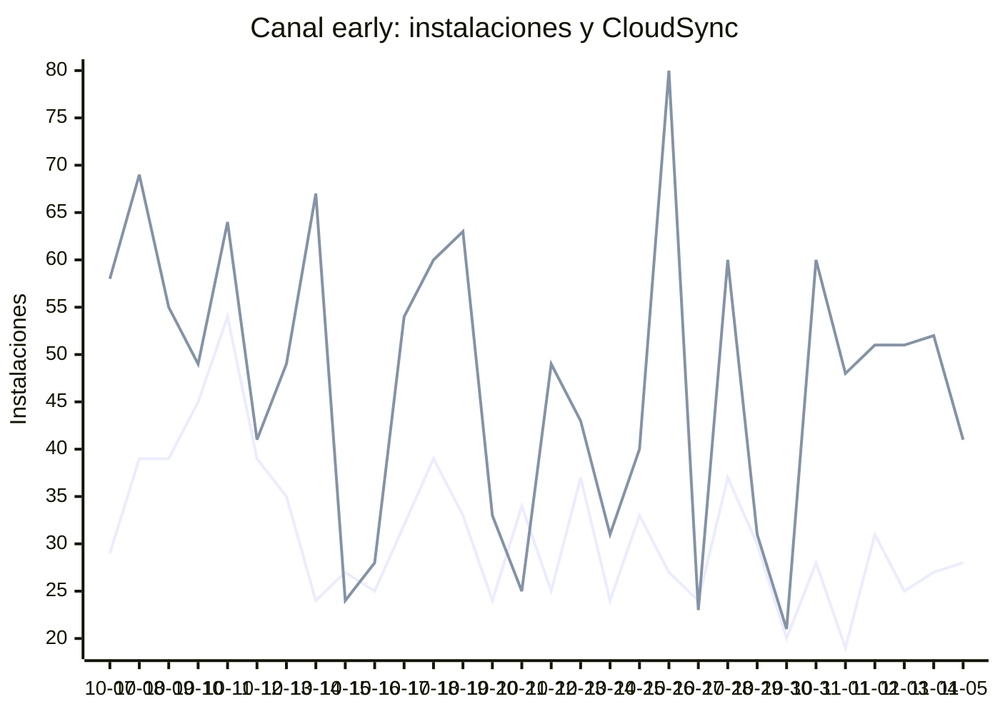

# Estadísticas de EmuDeck

Actualizado: 2026-11-06 00:25 UTC. Las gráficas no incluyen el día de hoy porque aún está incompleto.

## Arranques de la app (comprobaciones de actualización)

Cada arranque descarga el `latest*.yml` de su sistema. Cuenta arranques, no personas.

| Sistema | Ayer | Últimos 7 días |
|---|---|---|
| Linux x86 | 10107 | 86823 |
| Linux ARM | 148 | 969 |
| Windows | 2756 | 22800 |
| Mac | 44 | 70 |

Instalaciones nuevas estimadas en Windows (7 días, `.exe` menos `.blockmap`): **2228**

## Instalaciones de EmuDeck (beacons)

Cada `setup` descarga `system-<sistema>.txt` y cada instalación de un emulador `<emulador>-<plataforma>.txt`. Los emuladores cuentan también las actualizaciones. Histórico completo desde el primer día.

| Sistema | Ayer | Últimos 7 días | Últimos 30 días | Total |
|---|---|---|---|---|
| linux | 19 | 167 | 906 | 929 |
| linux-arm | 46 | 70 | 193 | 197 |
| windows | 11 | 91 | 298 | 306 |

### Por mes

| Mes | Linux | Linux ARM | Windows | Total |
|---|---|---|---|---|
| 2026-11 | 116 | 65 | 61 | 242 |
| 2026-10 | 790 | 128 | 237 | 1155 |

### Canal early (early + early-unstable)

Instalaciones de EmuDeck con el backend en una rama early, y cuántas de ellas instalan CloudSync.

| | Últimos 7 días | Últimos 30 días | Total |
|---|---|---|---|
| Instalaciones early | 178 | 933 | 957 |
| Con CloudSync | 324 | 1420 | 1487 |
| % con CloudSync | | | 155% |

Línea de arriba: instalaciones early. Línea de abajo: de ellas, con CloudSync.

### Por emulador

| Emulador | Linux (total) | Linux ARM (total) | Windows (total) | Últimos 7 días | Últimos 30 días | Total |
|---|---|---|---|---|---|---|
| pcsx2 | 2608 | 27 | 359 | 630 | 2917 | 2994 |
| esde | 2156 | 241 | 596 | 751 | 2899 | 2993 |
| azahar | 2290 | 276 | 343 | 638 | 2830 | 2909 |
| duckstation | 2487 | 257 | 141 | 611 | 2807 | 2885 |
| ryujinx | 2222 | 265 | 329 | 602 | 2745 | 2816 |
| rpcs3 | 2369 | 250 | 138 | 596 | 2686 | 2757 |
| srm | 2069 | 220 | 385 | 578 | 2622 | 2674 |
| cemu | 2267 | 256 | 124 | 550 | 2582 | 2647 |
| xenia | 2109 | 205 | 303 | 557 | 2556 | 2617 |
| shadps4 | 1982 | 191 | 268 | 503 | 2375 | 2441 |
| vita3k | 2063 | 221 | 98 | 494 | 2316 | 2382 |
| cloudsync | 992 | 45 | 503 | 338 | 1471 | 1540 |
| ppsspp | 820 | 158 | 277 | 273 | 1219 | 1255 |
| ra | 905 | 168 | 163 | 271 | 1204 | 1236 |
| dolphin | 897 | 185 | 148 | 261 | 1199 | 1230 |
| mgba | 941 | 66 | 69 | 230 | 1055 | 1076 |
| xemu | 761 | 140 | 114 | 203 | 988 | 1015 |
| melonds | 749 | 138 | 103 | 204 | 961 | 990 |
| primehack | 684 | 135 | 118 | 214 | 910 | 937 |
| supermodel | 648 | 149 | 32 | 177 | 807 | 829 |
| scummvm | 623 | 118 | 75 | 170 | 791 | 816 |
| model2 | 639 | 156 | 12 | 170 | 785 | 807 |
| bigpemu | 633 | 21 | 22 | 153 | 658 | 676 |
| armsx2 | 196 | 296 | 0 | 138 | 482 | 492 |
| flycast | 164 | 22 | 27 | 41 | 208 | 213 |
| rmg | 155 | 34 | 0 | 30 | 185 | 189 |
| mame | 92 | 7 | 27 | 35 | 121 | 126 |
| eden | 91 | 9 | 7 | 13 | 99 | 107 |
| pegasus | 27 | 1 | 21 | 14 | 47 | 49 |
| yuzu | 12 | 0 | 5 | 7 | 17 | 17 |
| ares | 10 | 2 | 0 | 2 | 12 | 12 |
| citron | 6 | 0 | 0 | 1 | 6 | 6 |
