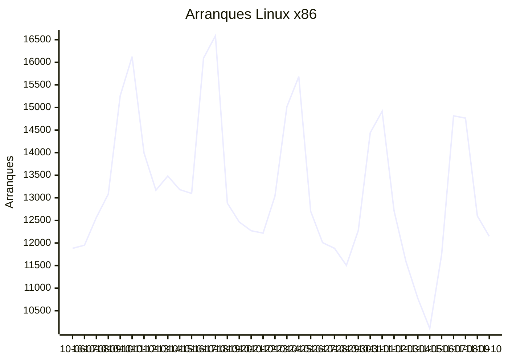
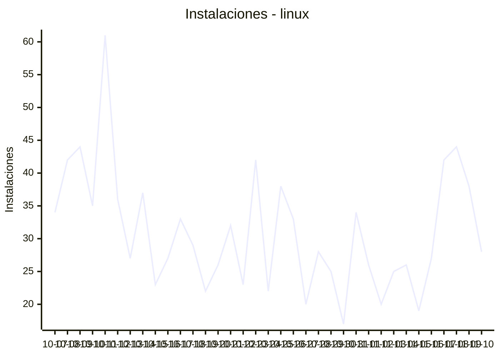
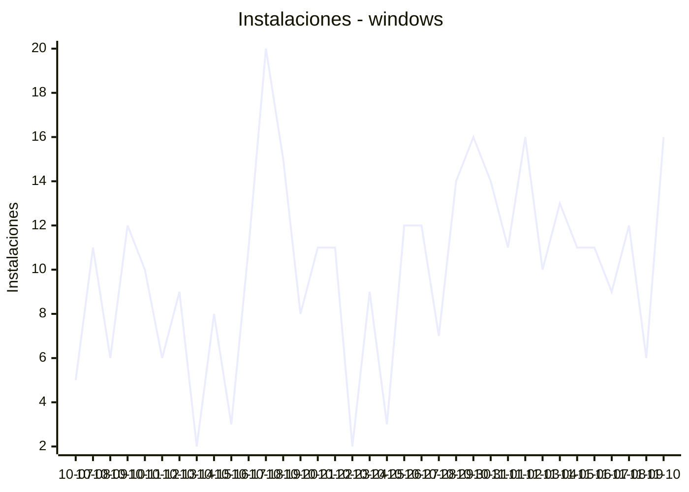
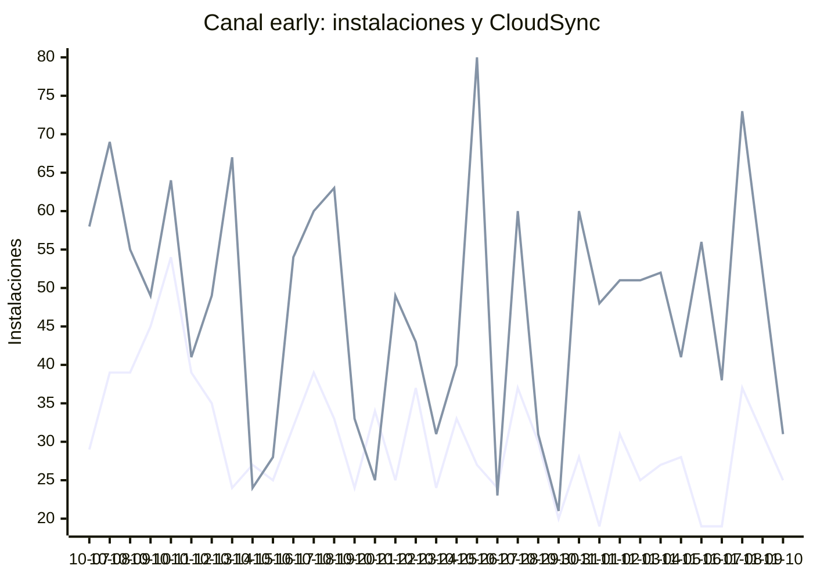

# Estadísticas de EmuDeck

Actualizado: 2026-11-11 01:09 UTC. Las gráficas no incluyen el día de hoy porque aún está incompleto.

## Arranques de la app (comprobaciones de actualización)

Cada arranque descarga el `latest*.yml` de su sistema. Cuenta arranques, no personas.

| Sistema | Ayer | Últimos 7 días |
|---|---|---|
| Linux x86 | 12149 | 86956 |
| Linux ARM | 117 | 846 |
| Windows | 3171 | 23579 |
| Mac | 42 | 288 |

Instalaciones nuevas estimadas en Windows (7 días, `.exe` menos `.blockmap`): **2371**

## Instalaciones de EmuDeck (beacons)

Cada `setup` descarga `system-<sistema>.txt` y cada instalación de un emulador `<emulador>-<plataforma>.txt`. Los emuladores cuentan también las actualizaciones. Histórico completo desde el primer día.

| Sistema | Ayer | Últimos 7 días | Últimos 30 días | Total |
|---|---|---|---|---|
| linux | 28 | 224 | 869 | 1107 |
| linux-arm | 29 | 188 | 292 | 329 |
| windows | 16 | 78 | 308 | 359 |

### Por mes

| Mes | Linux | Linux ARM | Windows | Total |
|---|---|---|---|---|
| 2026-11 | 295 | 196 | 115 | 606 |
| 2026-10 | 790 | 128 | 237 | 1155 |

### Canal early (early + early-unstable)

Instalaciones de EmuDeck con el backend en una rama early, y cuántas de ellas instalan CloudSync.

| | Últimos 7 días | Últimos 30 días | Total |
|---|---|---|---|
| Instalaciones early | 186 | 858 | 1087 |
| Con CloudSync | 343 | 1375 | 1734 |
| % con CloudSync | | | 160% |

Línea de arriba: instalaciones early. Línea de abajo: de ellas, con CloudSync.

### Por emulador

| Emulador | Linux (total) | Linux ARM (total) | Windows (total) | Últimos 7 días | Últimos 30 días | Total |
|---|---|---|---|---|---|---|
| esde | 2511 | 345 | 699 | 786 | 2954 | 3555 |
| pcsx2 | 3025 | 32 | 418 | 666 | 2839 | 3475 |
| azahar | 2662 | 402 | 391 | 760 | 2846 | 3455 |
| duckstation | 2885 | 376 | 161 | 746 | 2816 | 3422 |
| ryujinx | 2582 | 394 | 389 | 762 | 2777 | 3365 |
| rpcs3 | 2746 | 371 | 163 | 717 | 2723 | 3280 |
| srm | 2431 | 329 | 475 | 760 | 2722 | 3235 |
| cemu | 2620 | 367 | 143 | 666 | 2578 | 3130 |
| xenia | 2442 | 303 | 346 | 649 | 2565 | 3091 |
| vita3k | 2381 | 327 | 113 | 606 | 2331 | 2821 |
| shadps4 | 2280 | 214 | 317 | 518 | 2308 | 2811 |
| cloudsync | 1138 | 48 | 608 | 348 | 1417 | 1794 |
| ppsspp | 964 | 246 | 327 | 388 | 1244 | 1537 |
| ra | 1055 | 268 | 187 | 377 | 1219 | 1510 |
| dolphin | 1044 | 285 | 170 | 371 | 1212 | 1499 |
| mgba | 1107 | 83 | 83 | 264 | 1054 | 1273 |
| xemu | 889 | 221 | 133 | 308 | 1006 | 1243 |
| melonds | 870 | 221 | 115 | 301 | 973 | 1206 |
| primehack | 804 | 223 | 133 | 313 | 943 | 1160 |
| supermodel | 757 | 221 | 38 | 262 | 818 | 1016 |
| scummvm | 721 | 194 | 83 | 254 | 799 | 998 |
| model2 | 744 | 232 | 13 | 259 | 791 | 989 |
| bigpemu | 731 | 31 | 31 | 165 | 654 | 793 |
| armsx2 | 230 | 426 | 0 | 241 | 569 | 656 |
| flycast | 195 | 32 | 33 | 58 | 202 | 260 |
| rmg | 189 | 45 | 0 | 57 | 185 | 234 |
| mame | 110 | 13 | 37 | 47 | 118 | 160 |
| eden | 102 | 11 | 19 | 27 | 116 | 132 |
| pegasus | 35 | 2 | 24 | 14 | 55 | 61 |
| yuzu | 13 | 0 | 8 | 6 | 17 | 21 |
| ares | 14 | 2 | 0 | 4 | 14 | 16 |
| citron | 6 | 0 | 1 | 2 | 6 | 7 |
