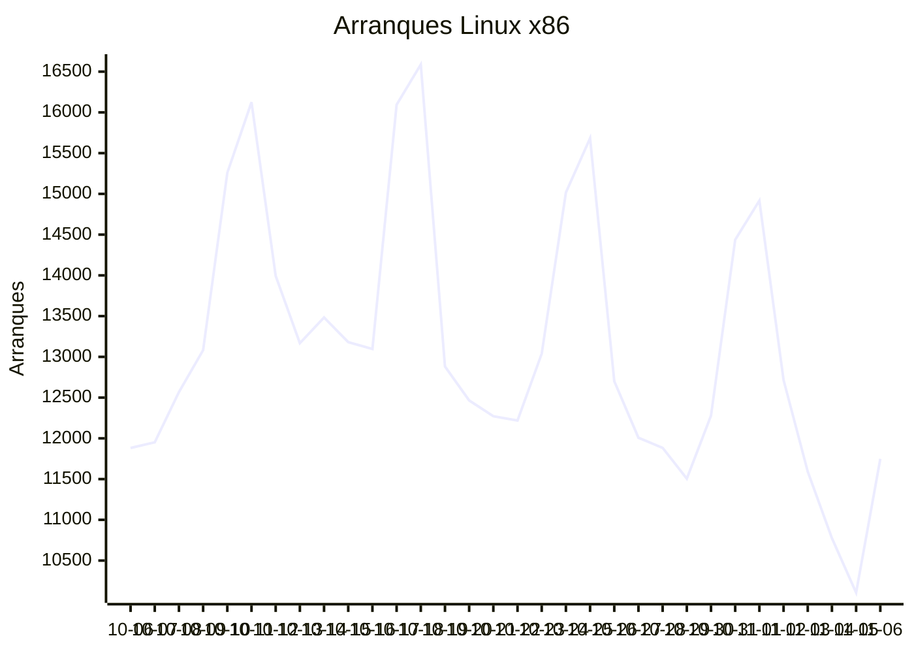
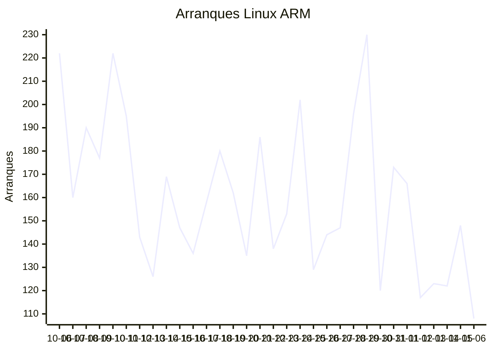
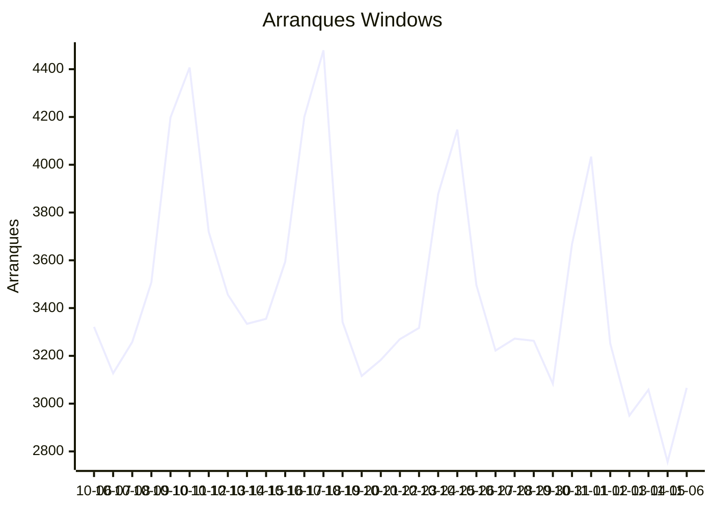
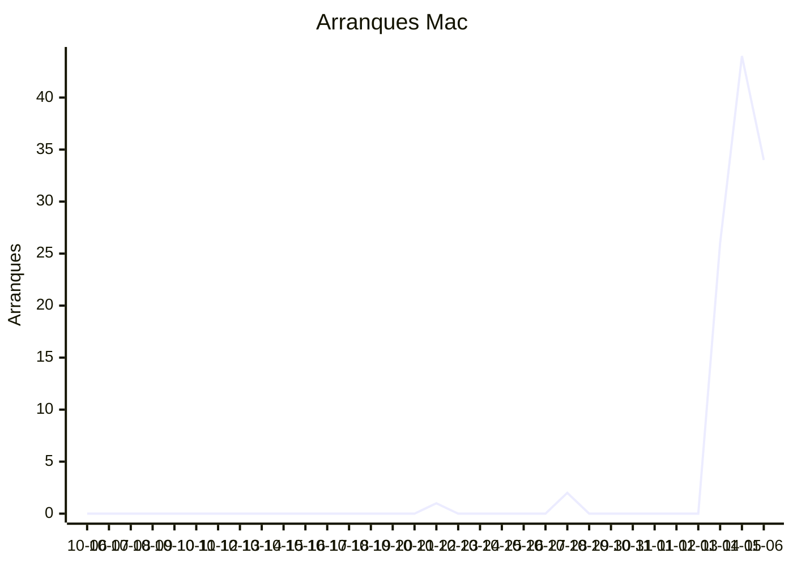
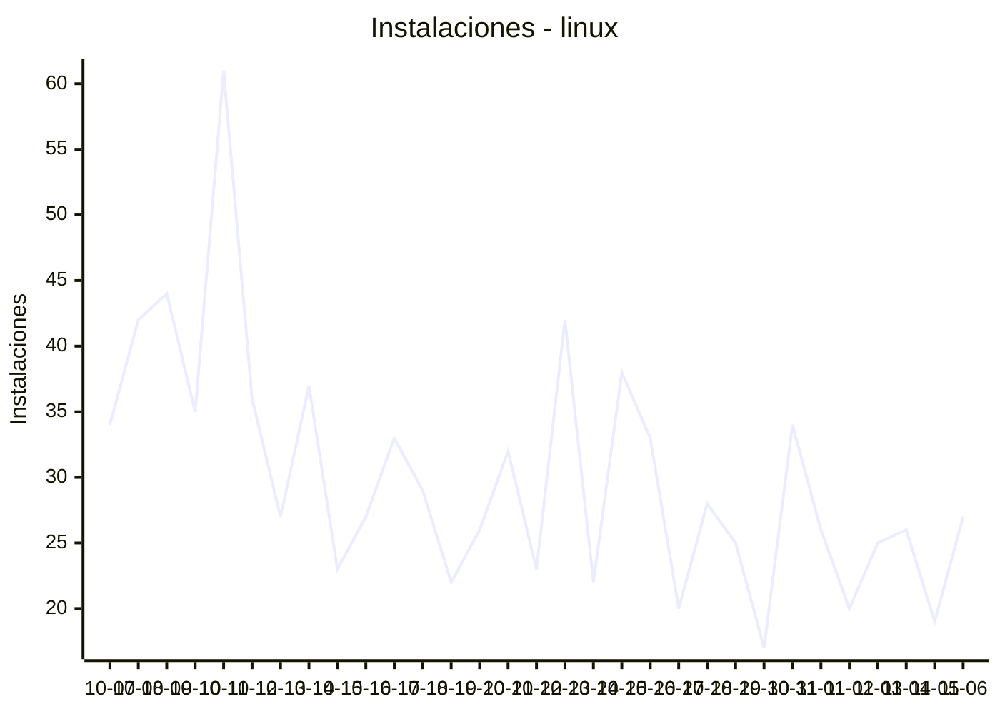
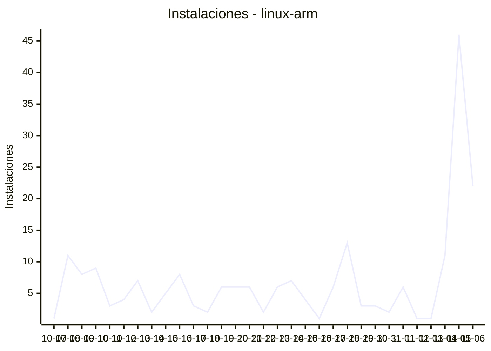
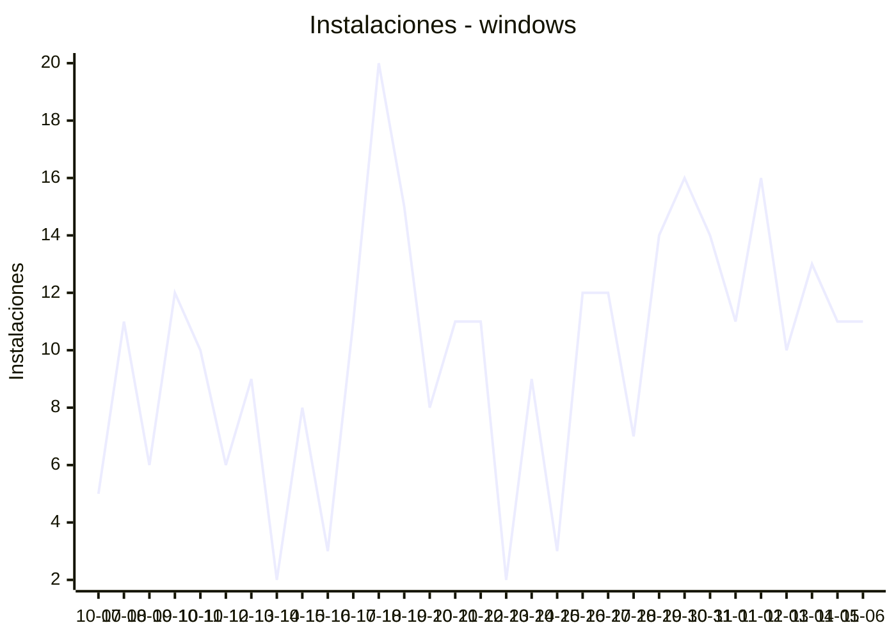
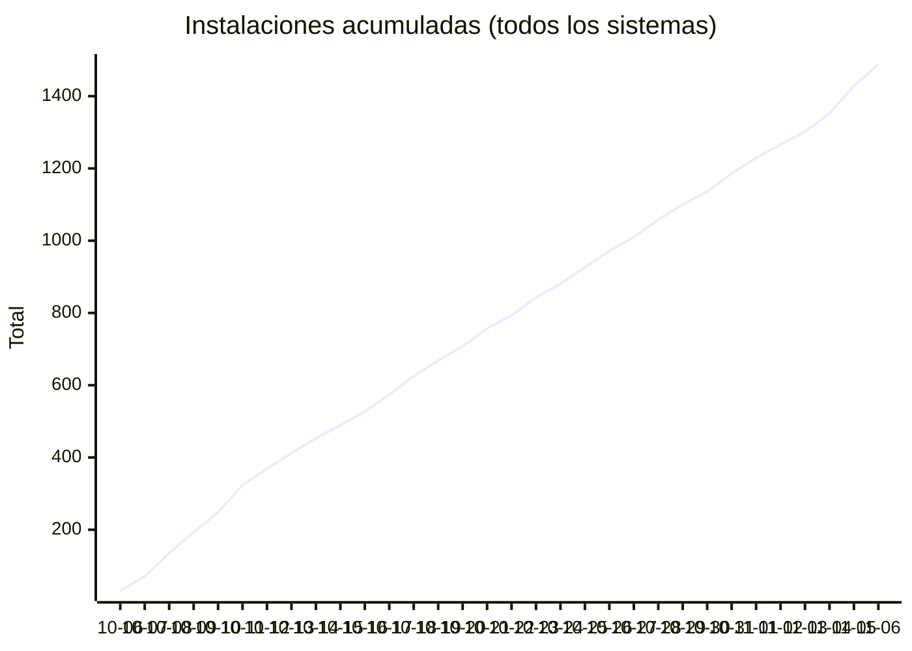

# Estadísticas de EmuDeck

Actualizado: 2026-11-07 06:14 UTC. Las gráficas no incluyen el día de hoy porque aún está incompleto.

## Arranques de la app (comprobaciones de actualización)

Cada arranque descarga el `latest*.yml` de su sistema. Cuenta arranques, no personas.

| Sistema | Ayer | Últimos 7 días |
|---|---|---|
| Linux x86 | 11748 | 86292 |
| Linux ARM | 108 | 957 |
| Windows | 3066 | 22783 |
| Mac | 34 | 104 |

Instalaciones nuevas estimadas en Windows (7 días, `.exe` menos `.blockmap`): **2213**

## Instalaciones de EmuDeck (beacons)

Cada `setup` descarga `system-<sistema>.txt` y cada instalación de un emulador `<emulador>-<plataforma>.txt`. Los emuladores cuentan también las actualizaciones. Histórico completo desde el primer día.

| Sistema | Ayer | Últimos 7 días | Últimos 30 días | Total |
|---|---|---|---|---|
| linux | 27 | 177 | 899 | 963 |
| linux-arm | 22 | 89 | 214 | 225 |
| windows | 11 | 86 | 304 | 316 |

### Por mes

| Mes | Linux | Linux ARM | Windows | Total |
|---|---|---|---|---|
| 2026-11 | 143 | 87 | 72 | 302 |
| 2026-10 | 790 | 128 | 237 | 1155 |

### Canal early (early + early-unstable)

Instalaciones de EmuDeck con el backend en una rama early, y cuántas de ellas instalan CloudSync.

| | Últimos 7 días | Últimos 30 días | Total |
|---|---|---|---|
| Instalaciones early | 177 | 923 | 979 |
| Con CloudSync | 359 | 1418 | 1554 |
| % con CloudSync | | | 159% |

Línea de arriba: instalaciones early. Línea de abajo: de ellas, con CloudSync.

### Por emulador

| Emulador | Linux (total) | Linux ARM (total) | Windows (total) | Últimos 7 días | Últimos 30 días | Total |
|---|---|---|---|---|---|---|
| esde | 2232 | 254 | 616 | 732 | 2900 | 3102 |
| pcsx2 | 2697 | 28 | 371 | 628 | 2904 | 3096 |
| azahar | 2368 | 302 | 352 | 643 | 2830 | 3022 |
| duckstation | 2571 | 281 | 146 | 627 | 2810 | 2998 |
| ryujinx | 2305 | 286 | 343 | 615 | 2749 | 2934 |
| rpcs3 | 2457 | 270 | 145 | 620 | 2701 | 2872 |
| srm | 2154 | 248 | 408 | 616 | 2652 | 2810 |
| cemu | 2348 | 279 | 128 | 558 | 2583 | 2755 |
| xenia | 2181 | 220 | 313 | 560 | 2554 | 2714 |
| shadps4 | 2045 | 192 | 278 | 490 | 2349 | 2515 |
| vita3k | 2132 | 240 | 101 | 505 | 2321 | 2473 |
| cloudsync | 1030 | 45 | 531 | 363 | 1466 | 1606 |
| ppsspp | 841 | 176 | 288 | 282 | 1229 | 1305 |
| ra | 934 | 191 | 168 | 295 | 1217 | 1293 |
| dolphin | 922 | 208 | 153 | 275 | 1205 | 1283 |
| mgba | 985 | 70 | 73 | 228 | 1058 | 1128 |
| xemu | 784 | 156 | 118 | 217 | 996 | 1058 |
| melonds | 770 | 155 | 105 | 212 | 960 | 1030 |
| primehack | 708 | 155 | 122 | 234 | 926 | 985 |
| supermodel | 671 | 164 | 33 | 190 | 818 | 868 |
| scummvm | 642 | 134 | 76 | 183 | 797 | 852 |
| model2 | 661 | 171 | 12 | 184 | 793 | 844 |
| bigpemu | 662 | 24 | 22 | 147 | 665 | 708 |
| armsx2 | 205 | 322 | 0 | 153 | 493 | 527 |
| flycast | 167 | 24 | 29 | 38 | 204 | 220 |
| rmg | 160 | 36 | 0 | 28 | 183 | 196 |
| mame | 95 | 9 | 29 | 33 | 124 | 133 |
| eden | 94 | 10 | 7 | 16 | 102 | 111 |
| pegasus | 28 | 1 | 23 | 15 | 48 | 52 |
| yuzu | 12 | 0 | 5 | 6 | 17 | 17 |
| ares | 12 | 2 | 0 | 4 | 13 | 14 |
| citron | 6 | 0 | 1 | 1 | 6 | 7 |
