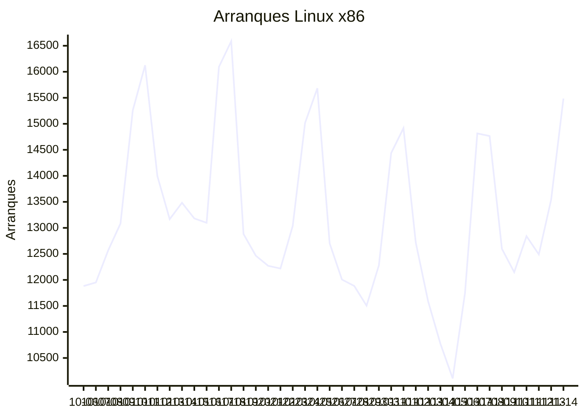
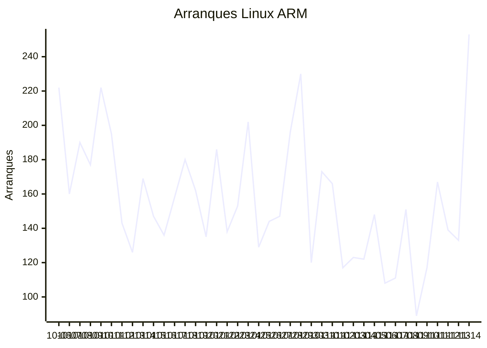
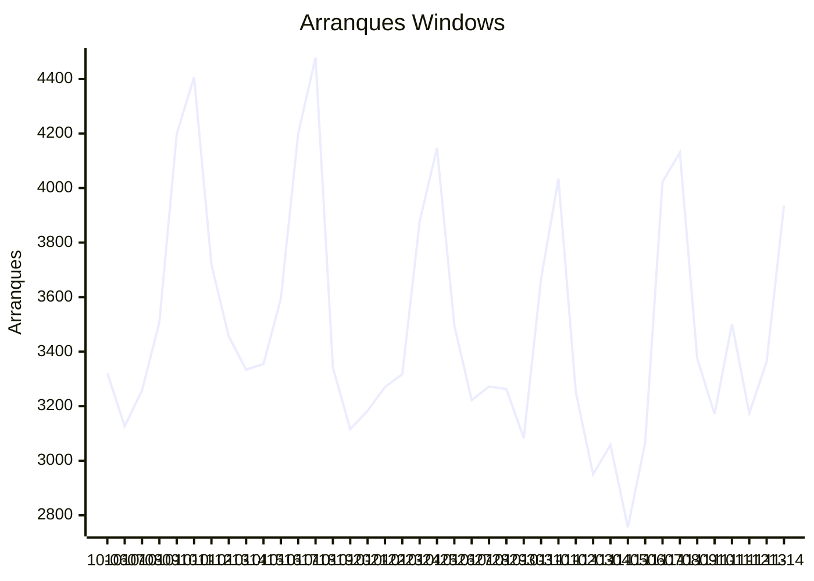
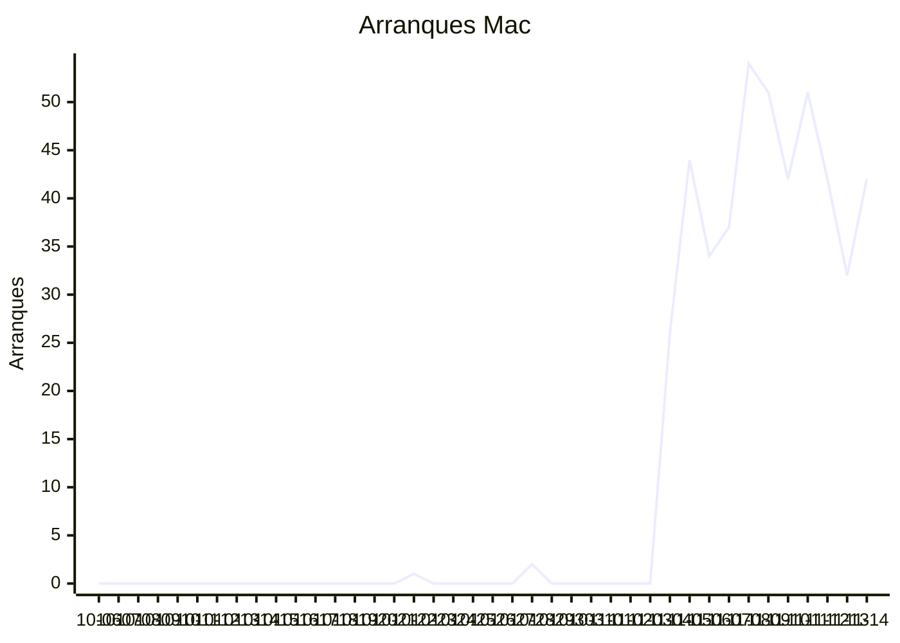
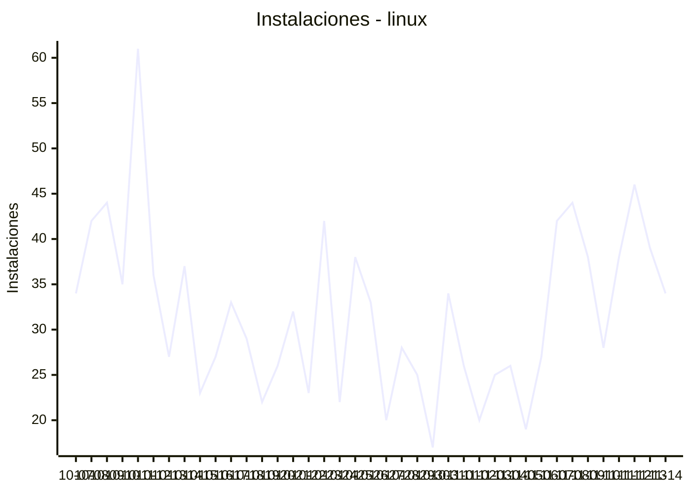
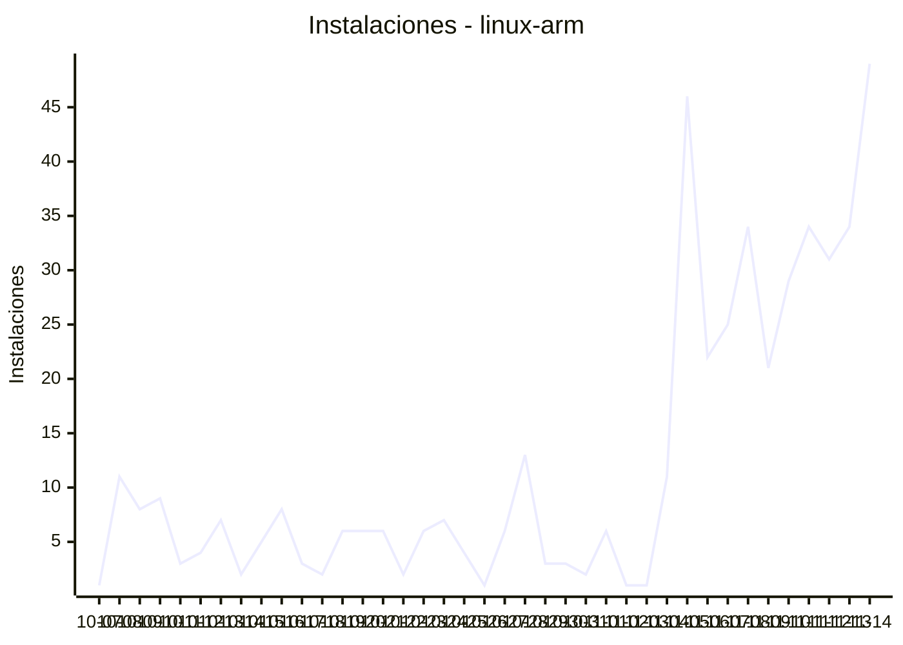
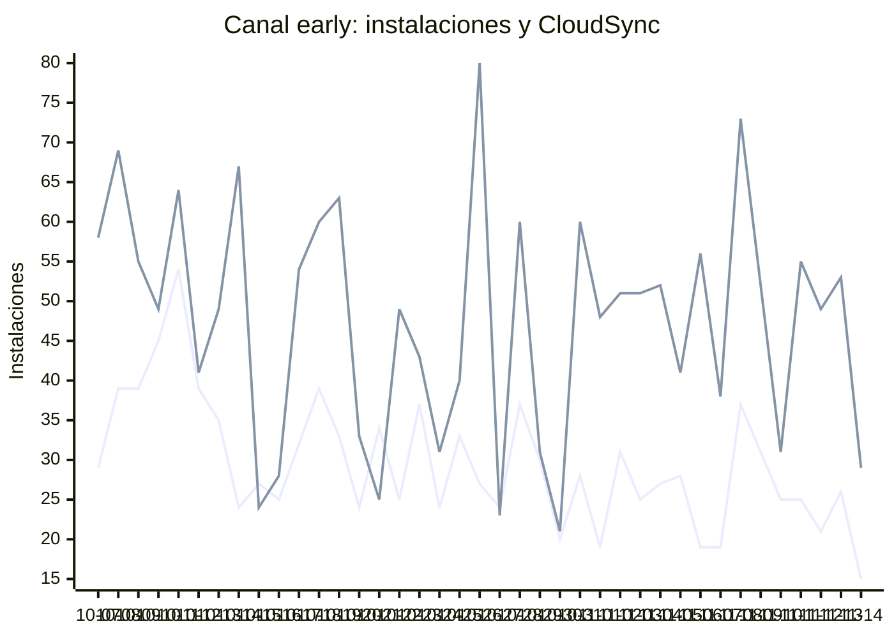

# Estadísticas de EmuDeck

Actualizado: 2026-11-15 18:10 UTC. Las gráficas no incluyen el día de hoy porque aún está incompleto.

## Arranques de la app (comprobaciones de actualización)

Cada arranque descarga el `latest*.yml` de su sistema. Cuenta arranques, no personas.

| Sistema | Ayer | Últimos 7 días |
|---|---|---|
| Linux x86 | 15485 | 93869 |
| Linux ARM | 253 | 1049 |
| Windows | 3936 | 24651 |
| Mac | 42 | 314 |

Instalaciones nuevas estimadas en Windows (7 días, `.exe` menos `.blockmap`): **2546**

## Instalaciones de EmuDeck (beacons)

Cada `setup` descarga `system-<sistema>.txt` y cada instalación de un emulador `<emulador>-<plataforma>.txt`. Los emuladores cuentan también las actualizaciones. Histórico completo desde el primer día.

| Sistema | Ayer | Últimos 7 días | Últimos 30 días | Total |
|---|---|---|---|---|
| linux | 34 | 267 | 903 | 1306 |
| linux-arm | 49 | 232 | 422 | 497 |
| windows | 6 | 66 | 315 | 397 |

```mermaid
xychart-beta
    title "Instalaciones - windows"
    x-axis ["10-07", "10-08", "10-09", "10-10", "10-11", "10-12", "10-13", "10-14", "10-15", "10-16", "10-17", "10-18", "10-19", "10-20", "10-21", "10-22", "10-23", "10-24", "10-25", "10-26", "10-27", "10-28", "10-29", "10-30", "10-31", "11-01", "11-02", "11-03", "11-04", "11-05", "11-06", "11-07", "11-08", "11-09", "11-10", "11-11", "11-12", "11-13", "11-14"]
    y-axis "Instalaciones"
    line [5, 11, 6, 12, 10, 6, 9, 2, 8, 3, 11, 20, 15, 8, 11, 11, 2, 9, 3, 12, 12, 7, 14, 16, 14, 11, 16, 10, 13, 11, 11, 9, 12, 6, 16, 5, 10, 11, 6]
```

### Por mes

| Mes | Linux | Linux ARM | Windows | Total |
|---|---|---|---|---|
| 2026-11 | 452 | 344 | 147 | 943 |
| 2026-10 | 790 | 128 | 237 | 1155 |

### Canal early (early + early-unstable)

Instalaciones de EmuDeck con el backend en una rama early, y cuántas de ellas instalan CloudSync.

| | Últimos 7 días | Últimos 30 días | Total |
|---|---|---|---|
| Instalaciones early | 180 | 820 | 1195 |
| Con CloudSync | 342 | 1380 | 1958 |
| % con CloudSync | | | 164% |

Línea de arriba: instalaciones early. Línea de abajo: de ellas, con CloudSync.

### Por emulador

| Emulador | Linux (total) | Linux ARM (total) | Windows (total) | Últimos 7 días | Últimos 30 días | Total |
|---|---|---|---|---|---|---|
| esde | 2888 | 500 | 816 | 920 | 3150 | 4204 |
| azahar | 3051 | 597 | 437 | 854 | 2994 | 4085 |
| duckstation | 3311 | 543 | 175 | 826 | 2944 | 4029 |
| ryujinx | 2996 | 581 | 439 | 866 | 2951 | 4016 |
| pcsx2 | 3481 | 38 | 469 | 703 | 2858 | 3988 |
| rpcs3 | 3165 | 562 | 177 | 828 | 2874 | 3904 |
| srm | 2853 | 483 | 541 | 874 | 2934 | 3877 |
| cemu | 3008 | 536 | 156 | 760 | 2690 | 3700 |
| xenia | 2811 | 444 | 380 | 736 | 2661 | 3635 |
| vita3k | 2729 | 479 | 120 | 684 | 2428 | 3328 |
| shadps4 | 2630 | 232 | 341 | 547 | 2313 | 3203 |
| cloudsync | 1303 | 56 | 667 | 354 | 1425 | 2026 |
| ppsspp | 1120 | 385 | 364 | 460 | 1374 | 1869 |
| dolphin | 1221 | 430 | 185 | 445 | 1328 | 1836 |
| ra | 1231 | 398 | 205 | 433 | 1333 | 1834 |
| xemu | 1040 | 329 | 141 | 360 | 1091 | 1510 |
| mgba | 1267 | 121 | 91 | 289 | 1071 | 1479 |
| melonds | 1011 | 331 | 126 | 345 | 1044 | 1468 |
| primehack | 946 | 349 | 142 | 360 | 1051 | 1437 |
| supermodel | 882 | 318 | 42 | 295 | 877 | 1242 |
| scummvm | 843 | 290 | 90 | 292 | 874 | 1223 |
| model2 | 865 | 332 | 13 | 290 | 853 | 1210 |
| bigpemu | 835 | 39 | 35 | 162 | 654 | 909 |
| armsx2 | 272 | 620 | 0 | 303 | 711 | 892 |
| flycast | 218 | 39 | 37 | 55 | 198 | 294 |
| rmg | 215 | 62 | 0 | 71 | 186 | 277 |
| mame | 124 | 13 | 47 | 46 | 127 | 184 |
| eden | 132 | 11 | 20 | 43 | 123 | 163 |
| pegasus | 39 | 3 | 28 | 14 | 52 | 70 |
| yuzu | 16 | 0 | 8 | 7 | 18 | 24 |
| ares | 17 | 3 | 0 | 5 | 15 | 20 |
| citron | 6 | 0 | 2 | 1 | 5 | 8 |
