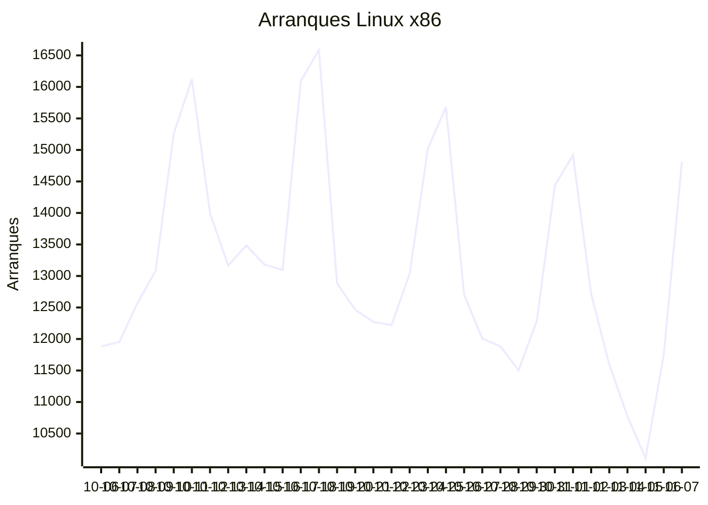
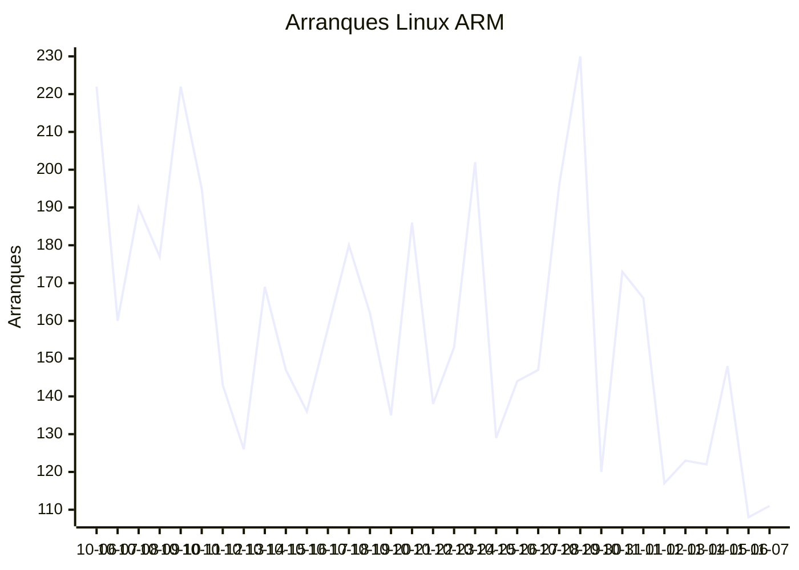
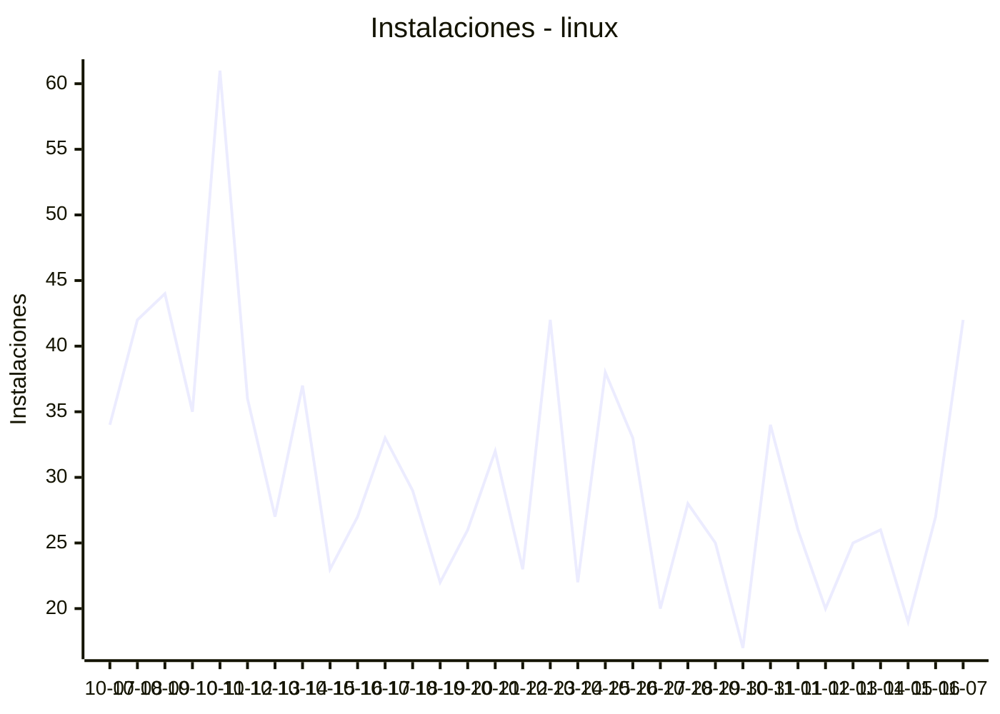
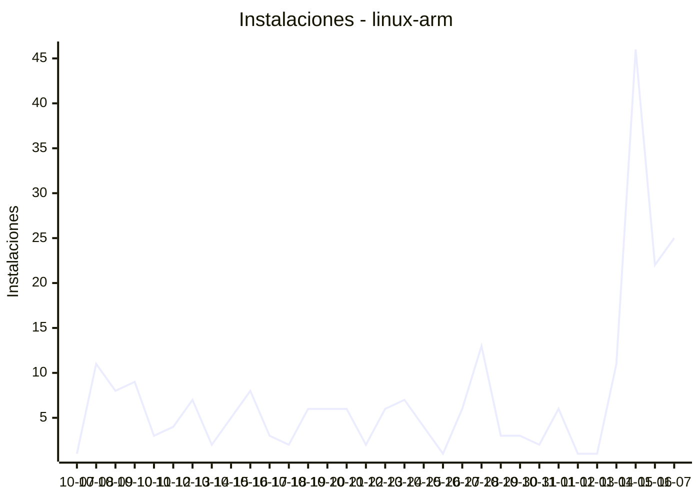
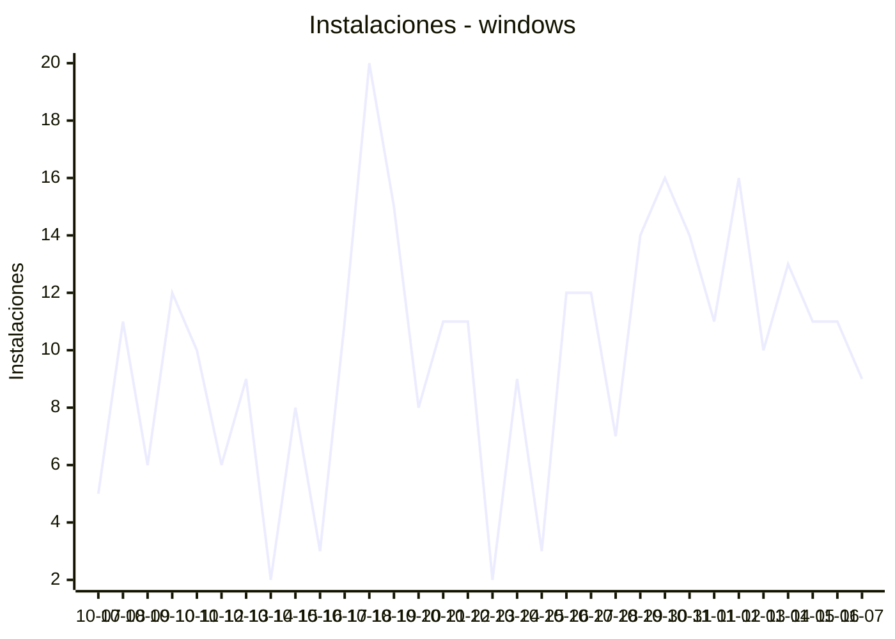
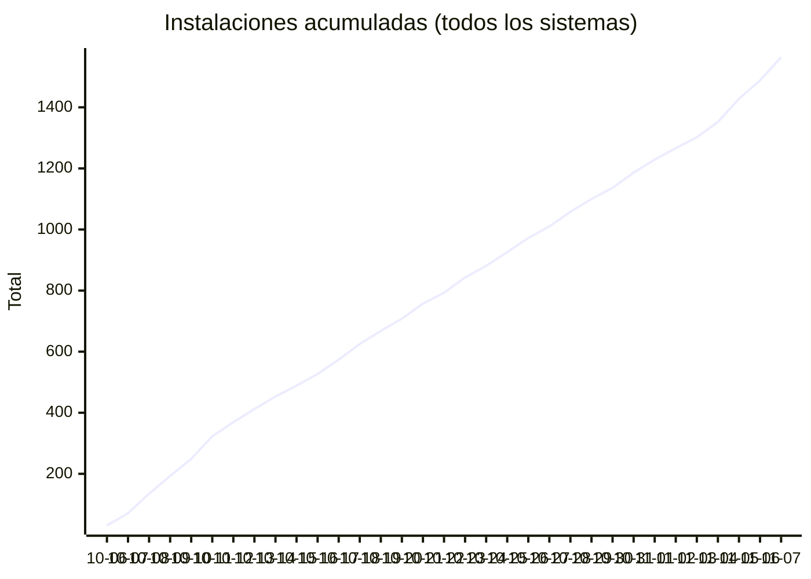
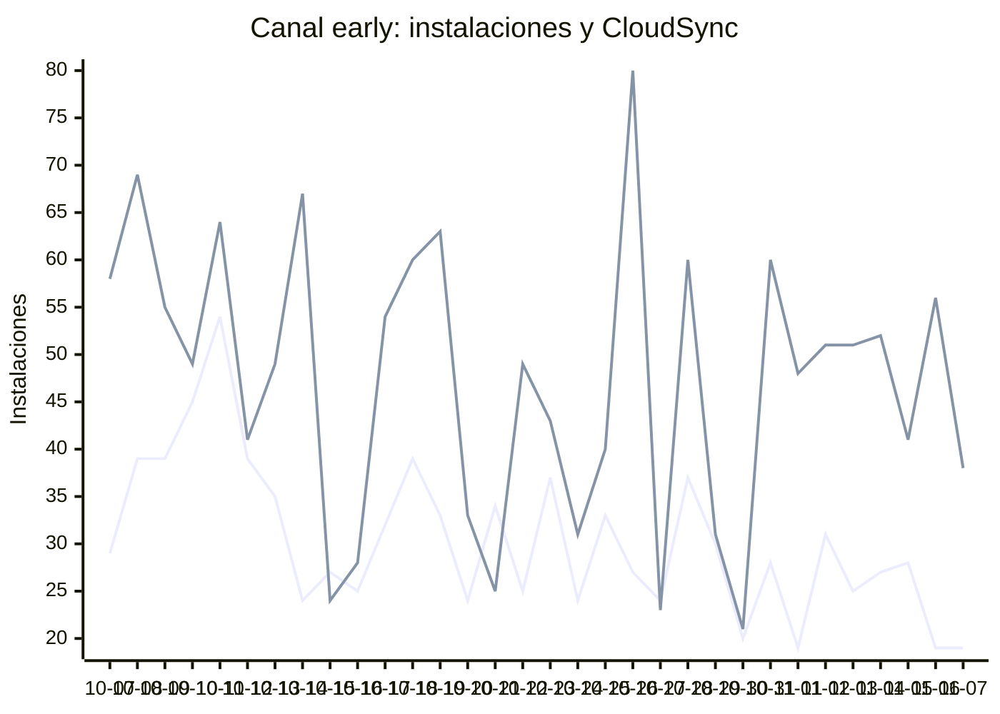

# Estadísticas de EmuDeck

Actualizado: 2026-11-08 01:37 UTC. Las gráficas no incluyen el día de hoy porque aún está incompleto.

## Arranques de la app (comprobaciones de actualización)

Cada arranque descarga el `latest*.yml` de su sistema. Cuenta arranques, no personas.

| Sistema | Ayer | Últimos 7 días |
|---|---|---|
| Linux x86 | 14815 | 86670 |
| Linux ARM | 111 | 895 |
| Windows | 4023 | 23139 |
| Mac | 37 | 141 |

Instalaciones nuevas estimadas en Windows (7 días, `.exe` menos `.blockmap`): **2239**

## Instalaciones de EmuDeck (beacons)

Cada `setup` descarga `system-<sistema>.txt` y cada instalación de un emulador `<emulador>-<plataforma>.txt`. Los emuladores cuentan también las actualizaciones. Histórico completo desde el primer día.

| Sistema | Ayer | Últimos 7 días | Últimos 30 días | Total |
|---|---|---|---|---|
| linux | 42 | 185 | 899 | 1000 |
| linux-arm | 25 | 112 | 228 | 247 |
| windows | 9 | 81 | 302 | 326 |

### Por mes

| Mes | Linux | Linux ARM | Windows | Total |
|---|---|---|---|---|
| 2026-11 | 185 | 112 | 81 | 378 |
| 2026-10 | 790 | 128 | 237 | 1155 |

### Canal early (early + early-unstable)

Instalaciones de EmuDeck con el backend en una rama early, y cuántas de ellas instalan CloudSync.

| | Últimos 7 días | Últimos 30 días | Total |
|---|---|---|---|
| Instalaciones early | 168 | 903 | 1002 |
| Con CloudSync | 337 | 1387 | 1594 |
| % con CloudSync | | | 159% |

Línea de arriba: instalaciones early. Línea de abajo: de ellas, con CloudSync.

### Por emulador

| Emulador | Linux (total) | Linux ARM (total) | Windows (total) | Últimos 7 días | Últimos 30 días | Total |
|---|---|---|---|---|---|---|
| esde | 2297 | 266 | 633 | 681 | 2901 | 3196 |
| pcsx2 | 2781 | 29 | 382 | 619 | 2884 | 3192 |
| azahar | 2448 | 324 | 363 | 659 | 2846 | 3135 |
| duckstation | 2652 | 303 | 153 | 643 | 2820 | 3108 |
| ryujinx | 2377 | 312 | 357 | 643 | 2769 | 3046 |
| rpcs3 | 2535 | 290 | 150 | 625 | 2716 | 2975 |
| srm | 2217 | 266 | 421 | 641 | 2668 | 2904 |
| cemu | 2420 | 299 | 133 | 579 | 2599 | 2852 |
| xenia | 2248 | 239 | 322 | 565 | 2566 | 2809 |
| shadps4 | 2111 | 198 | 287 | 483 | 2354 | 2596 |
| vita3k | 2204 | 258 | 105 | 516 | 2337 | 2567 |
| cloudsync | 1047 | 46 | 555 | 340 | 1435 | 1648 |
| ppsspp | 868 | 194 | 297 | 301 | 1236 | 1359 |
| ra | 959 | 209 | 174 | 311 | 1212 | 1342 |
| dolphin | 951 | 227 | 158 | 292 | 1208 | 1336 |
| mgba | 1013 | 72 | 76 | 229 | 1055 | 1161 |
| xemu | 806 | 173 | 123 | 231 | 1000 | 1102 |
| melonds | 793 | 171 | 109 | 230 | 967 | 1073 |
| primehack | 732 | 170 | 127 | 252 | 931 | 1029 |
| supermodel | 692 | 179 | 35 | 207 | 823 | 906 |
| scummvm | 662 | 149 | 79 | 200 | 807 | 890 |
| model2 | 682 | 186 | 12 | 200 | 794 | 880 |
| bigpemu | 684 | 25 | 26 | 154 | 672 | 735 |
| armsx2 | 216 | 346 | 0 | 171 | 517 | 562 |
| flycast | 180 | 25 | 29 | 47 | 205 | 234 |
| rmg | 166 | 38 | 0 | 35 | 175 | 204 |
| mame | 98 | 9 | 31 | 38 | 115 | 138 |
| eden | 98 | 10 | 12 | 17 | 111 | 120 |
| pegasus | 30 | 1 | 23 | 15 | 51 | 54 |
| yuzu | 12 | 0 | 5 | 5 | 17 | 17 |
| ares | 12 | 2 | 0 | 3 | 13 | 14 |
| citron | 6 | 0 | 1 | 2 | 7 | 7 |
