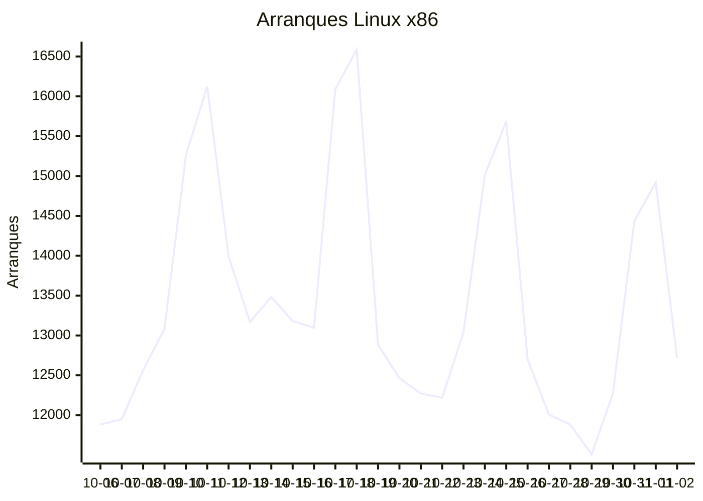
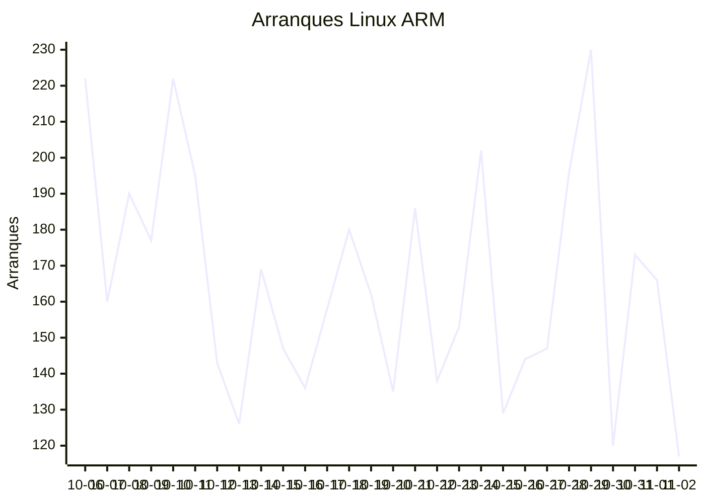
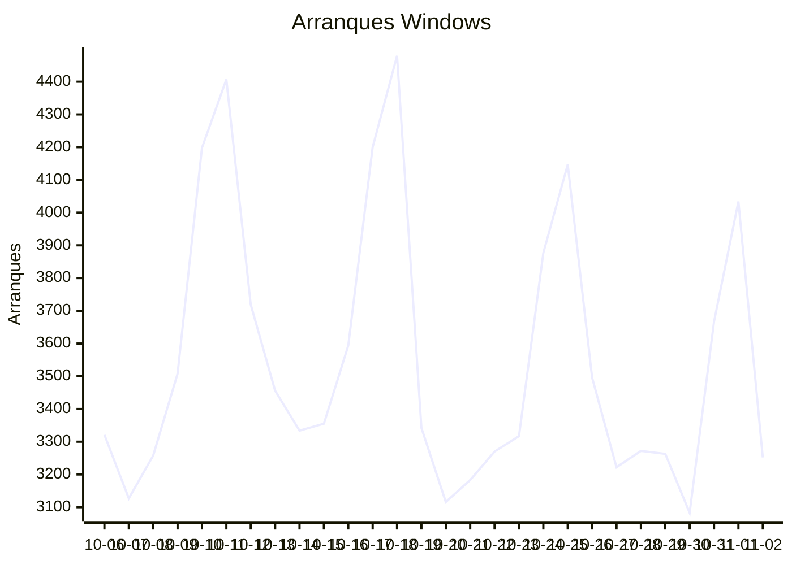
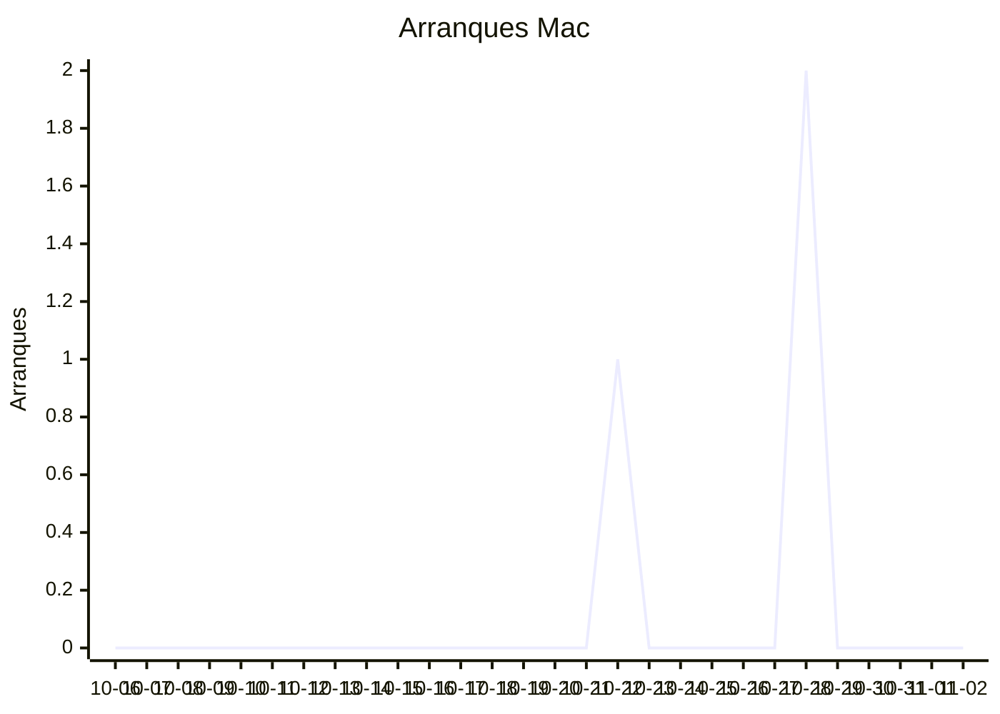
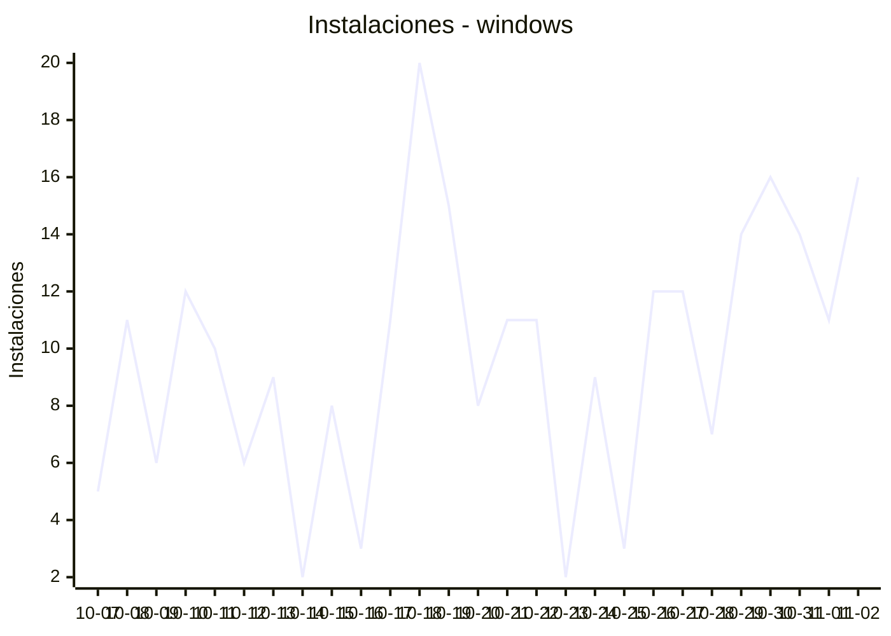
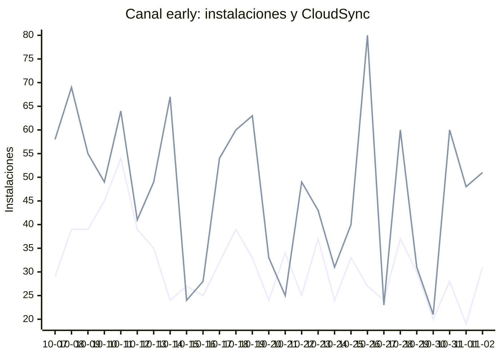

# Estadísticas de EmuDeck

Actualizado: 2026-11-03 23:35 UTC. Las gráficas no incluyen el día de hoy porque aún está incompleto.

## Arranques de la app (comprobaciones de actualización)

Cada arranque descarga el `latest*.yml` de su sistema. Cuenta arranques, no personas.

| Sistema | Ayer | Últimos 7 días |
|---|---|---|
| Linux x86 | 12716 | 89744 |
| Linux ARM | 117 | 1149 |
| Windows | 3252 | 23793 |
| Mac | 0 | 2 |

Instalaciones nuevas estimadas en Windows (7 días, `.exe` menos `.blockmap`): **2263**

## Instalaciones de EmuDeck (beacons)

Cada `setup` descarga `system-<sistema>.txt` y cada instalación de un emulador `<emulador>-<plataforma>.txt`. Los emuladores cuentan también las actualizaciones. Histórico completo desde el primer día.

| Sistema | Ayer | Últimos 7 días | Últimos 30 días | Total |
|---|---|---|---|---|
| linux | 20 | 170 | 836 | 882 |
| linux-arm | 1 | 34 | 135 | 139 |
| windows | 16 | 90 | 264 | 281 |

### Por mes

| Mes | Linux | Linux ARM | Windows | Total |
|---|---|---|---|---|
| 2026-11 | 46 | 7 | 27 | 80 |
| 2026-10 | 790 | 128 | 237 | 1155 |

### Canal early (early + early-unstable)

Instalaciones de EmuDeck con el backend en una rama early, y cuántas de ellas instalan CloudSync.

| | Últimos 7 días | Últimos 30 días | Total |
|---|---|---|---|
| Instalaciones early | 189 | 853 | 901 |
| Con CloudSync | 294 | 1276 | 1391 |
| % con CloudSync | | | 154% |

Línea de arriba: instalaciones early. Línea de abajo: de ellas, con CloudSync.

### Por emulador

| Emulador | Linux (total) | Linux ARM (total) | Windows (total) | Últimos 7 días | Últimos 30 días | Total |
|---|---|---|---|---|---|---|
| pcsx2 | 2454 | 24 | 329 | 611 | 2659 | 2807 |
| esde | 2033 | 195 | 536 | 693 | 2597 | 2764 |
| azahar | 2149 | 221 | 321 | 607 | 2548 | 2691 |
| duckstation | 2344 | 201 | 127 | 572 | 2533 | 2672 |
| ryujinx | 2089 | 210 | 300 | 545 | 2464 | 2599 |
| rpcs3 | 2235 | 201 | 123 | 559 | 2428 | 2559 |
| srm | 1952 | 174 | 343 | 527 | 2351 | 2469 |
| cemu | 2143 | 206 | 112 | 527 | 2342 | 2461 |
| xenia | 1999 | 165 | 276 | 548 | 2322 | 2440 |
| shadps4 | 1873 | 173 | 246 | 521 | 2176 | 2292 |
| vita3k | 1946 | 179 | 87 | 472 | 2099 | 2212 |
| cloudsync | 952 | 43 | 451 | 306 | 1325 | 1446 |
| ppsspp | 775 | 118 | 252 | 261 | 1087 | 1145 |
| ra | 857 | 127 | 145 | 234 | 1063 | 1129 |
| dolphin | 851 | 138 | 135 | 249 | 1069 | 1124 |
| mgba | 880 | 62 | 66 | 222 | 968 | 1008 |
| xemu | 724 | 106 | 103 | 197 | 890 | 933 |
| melonds | 709 | 101 | 93 | 182 | 858 | 903 |
| primehack | 640 | 100 | 104 | 186 | 797 | 844 |
| supermodel | 608 | 115 | 29 | 154 | 717 | 752 |
| scummvm | 589 | 87 | 66 | 152 | 703 | 742 |
| model2 | 599 | 119 | 10 | 146 | 695 | 728 |
| bigpemu | 591 | 16 | 21 | 131 | 593 | 628 |
| armsx2 | 178 | 235 | 0 | 98 | 399 | 413 |
| flycast | 155 | 21 | 26 | 40 | 194 | 202 |
| rmg | 146 | 31 | 0 | 26 | 171 | 177 |
| mame | 84 | 6 | 23 | 25 | 106 | 113 |
| eden | 89 | 9 | 7 | 14 | 97 | 105 |
| pegasus | 25 | 1 | 21 | 19 | 44 | 47 |
| yuzu | 10 | 0 | 5 | 4 | 14 | 15 |
| ares | 10 | 2 | 0 | 3 | 12 | 12 |
| citron | 5 | 0 | 0 | 0 | 5 | 5 |
