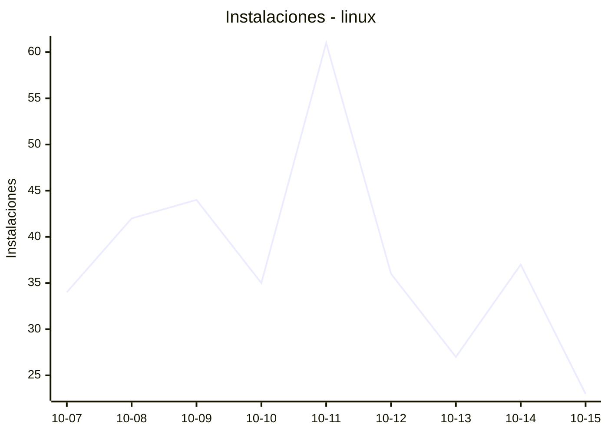
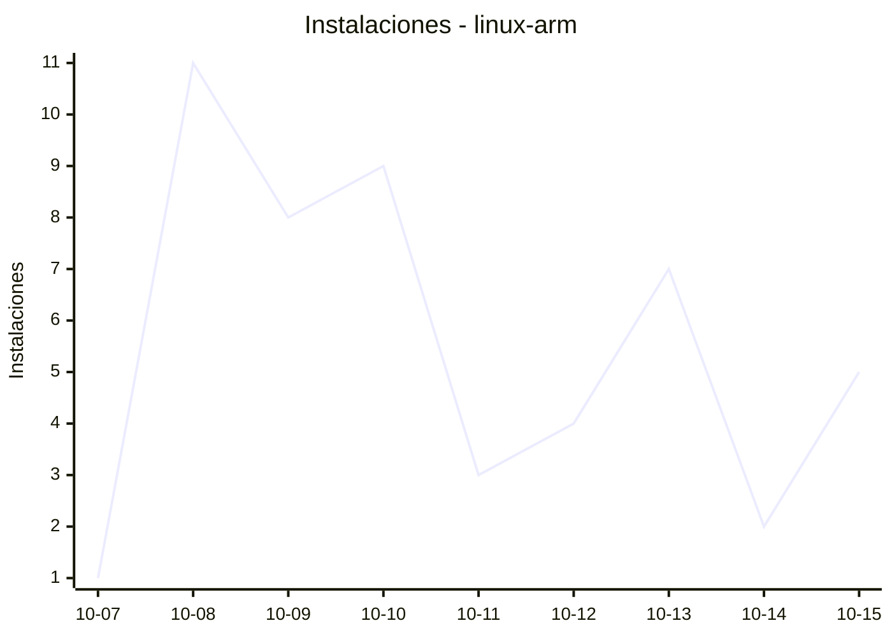
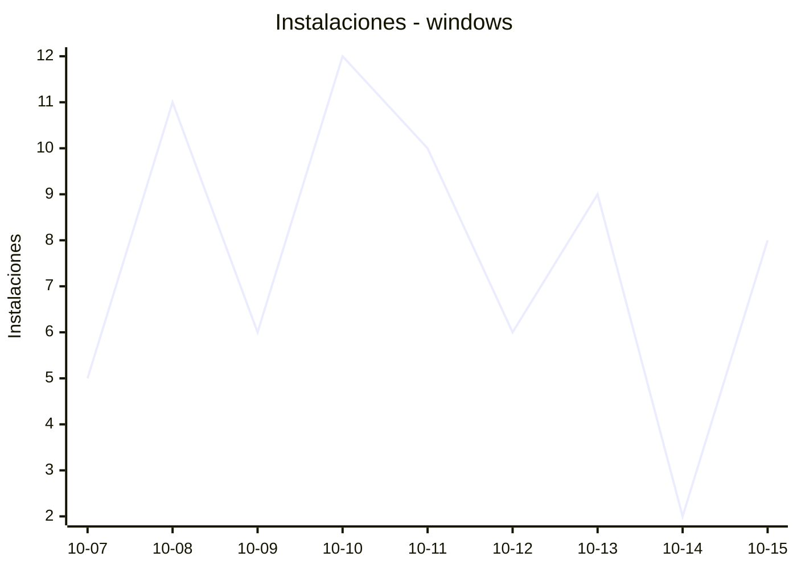
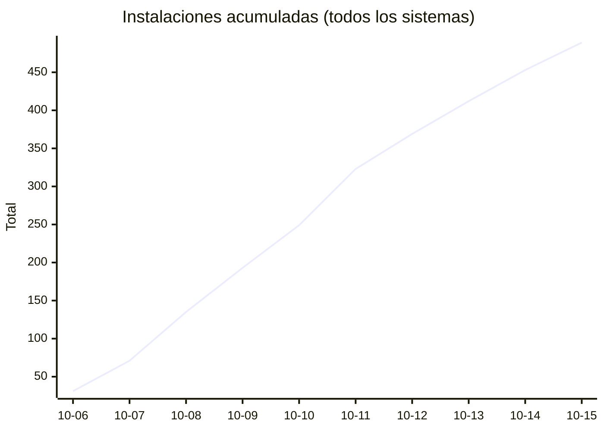
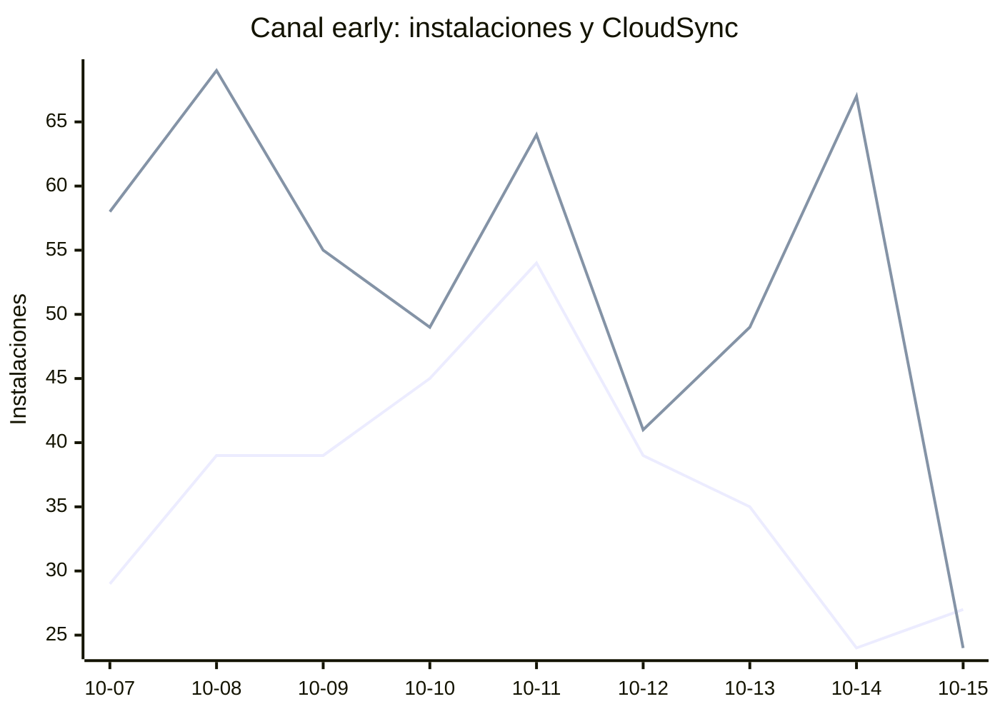

# Estadísticas de EmuDeck

Actualizado: 2026-10-16 23:35 UTC. Las gráficas no incluyen el día de hoy porque aún está incompleto.

## Arranques de la app (comprobaciones de actualización)

Cada arranque descarga el `latest*.yml` de su sistema. Cuenta arranques, no personas.

| Sistema | Ayer | Últimos 7 días |
|---|---|---|
| Linux x86 | 13181 | 98292 |
| Linux ARM | 147 | 1179 |
| Windows | 3355 | 25977 |
| Mac | 0 | 0 |

Instalaciones nuevas estimadas en Windows (7 días, `.exe` menos `.blockmap`): **1731**

## Instalaciones de EmuDeck (beacons)

Cada `setup` descarga `system-<sistema>.txt` y cada instalación de un emulador `<emulador>-<plataforma>.txt`. Los emuladores cuentan también las actualizaciones. Histórico completo desde el primer día.

| Sistema | Ayer | Últimos 7 días | Últimos 30 días | Total |
|---|---|---|---|---|
| linux | 23 | 263 | 339 | 387 |
| linux-arm | 5 | 38 | 50 | 61 |
| windows | 8 | 53 | 69 | 79 |

### Por mes

| Mes | Linux | Linux ARM | Windows | Total |
|---|---|---|---|---|
| 2026-10 | 339 | 50 | 69 | 458 |

### Canal early (early + early-unstable)

Instalaciones de EmuDeck con el backend en una rama early, y cuántas de ellas instalan CloudSync.

| | Últimos 7 días | Últimos 30 días | Total |
|---|---|---|---|
| Instalaciones early | 263 | 331 | 379 |
| Con CloudSync | 349 | 476 | 568 |
| % con CloudSync | | | 150% |

Línea de arriba: instalaciones early. Línea de abajo: de ellas, con CloudSync.

### Por emulador

| Emulador | Linux (total) | Linux ARM (total) | Windows (total) | Últimos 7 días | Últimos 30 días | Total |
|---|---|---|---|---|---|---|
| pcsx2 | 971 | 18 | 110 | 729 | 948 | 1099 |
| azahar | 875 | 78 | 104 | 706 | 905 | 1057 |
| duckstation | 935 | 77 | 37 | 702 | 899 | 1049 |
| ryujinx | 833 | 78 | 110 | 684 | 877 | 1021 |
| esde | 794 | 66 | 158 | 671 | 860 | 1018 |
| rpcs3 | 874 | 76 | 34 | 670 | 847 | 984 |
| cemu | 870 | 76 | 23 | 669 | 845 | 969 |
| xenia | 796 | 63 | 79 | 641 | 811 | 938 |
| srm | 758 | 64 | 87 | 608 | 786 | 909 |
| shadps4 | 750 | 64 | 69 | 588 | 751 | 883 |
| vita3k | 790 | 67 | 17 | 593 | 745 | 874 |
| cloudsync | 413 | 16 | 160 | 364 | 495 | 589 |
| dolphin | 380 | 54 | 43 | 325 | 415 | 477 |
| ra | 377 | 55 | 38 | 312 | 407 | 470 |
| ppsspp | 344 | 51 | 74 | 322 | 406 | 469 |
| mgba | 347 | 32 | 22 | 273 | 351 | 401 |
| melonds | 329 | 41 | 28 | 268 | 341 | 398 |
| xemu | 321 | 44 | 28 | 269 | 338 | 393 |
| primehack | 282 | 43 | 26 | 240 | 307 | 351 |
| supermodel | 281 | 50 | 8 | 241 | 298 | 339 |
| model2 | 277 | 53 | 5 | 231 | 291 | 335 |
| scummvm | 271 | 38 | 13 | 225 | 279 | 322 |
| bigpemu | 235 | 3 | 6 | 180 | 218 | 244 |
| armsx2 | 73 | 82 | 0 | 109 | 138 | 155 |
| flycast | 78 | 12 | 5 | 62 | 84 | 95 |
| rmg | 72 | 20 | 0 | 60 | 82 | 92 |
| mame | 46 | 2 | 9 | 34 | 51 | 57 |
| eden | 35 | 7 | 0 | 31 | 31 | 42 |
| pegasus | 9 | 0 | 7 | 13 | 14 | 16 |
| yuzu | 6 | 0 | 0 | 6 | 6 | 6 |
| ares | 3 | 1 | 0 | 3 | 4 | 4 |
| citron | 3 | 0 | 0 | 3 | 3 | 3 |
