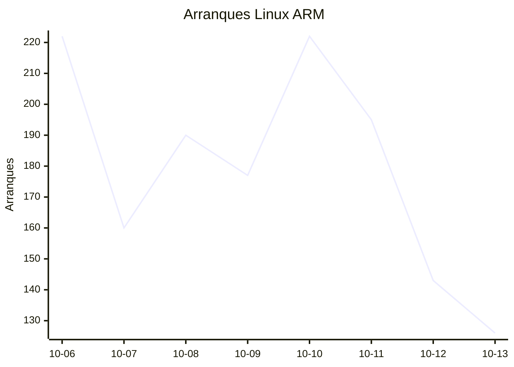
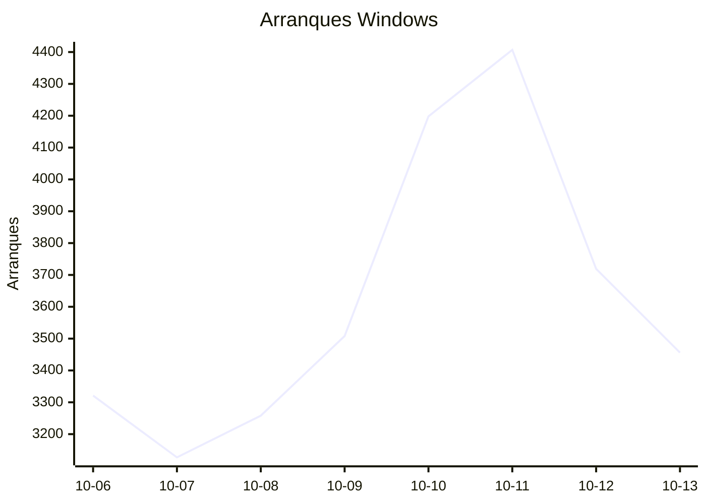
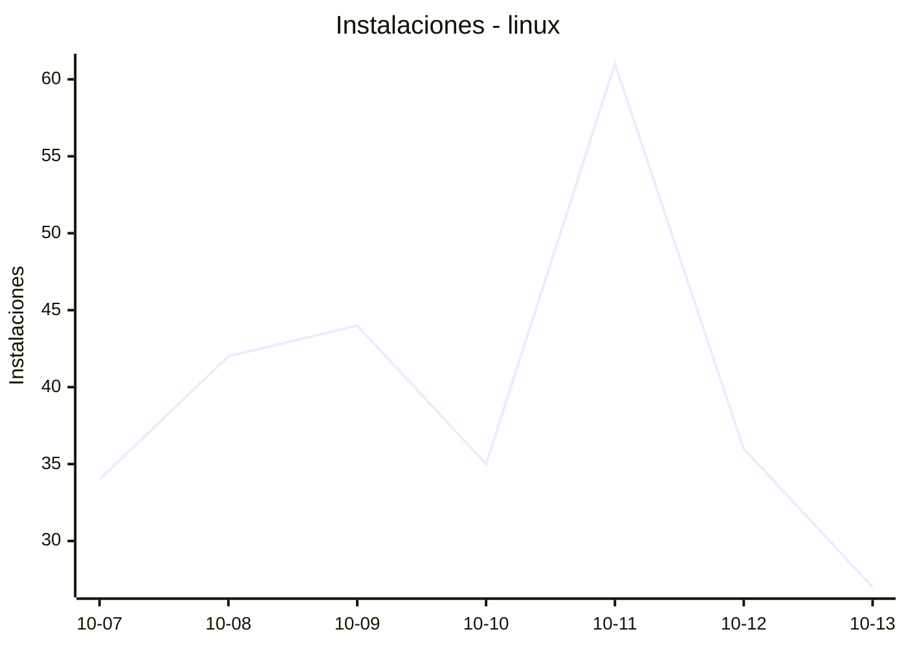
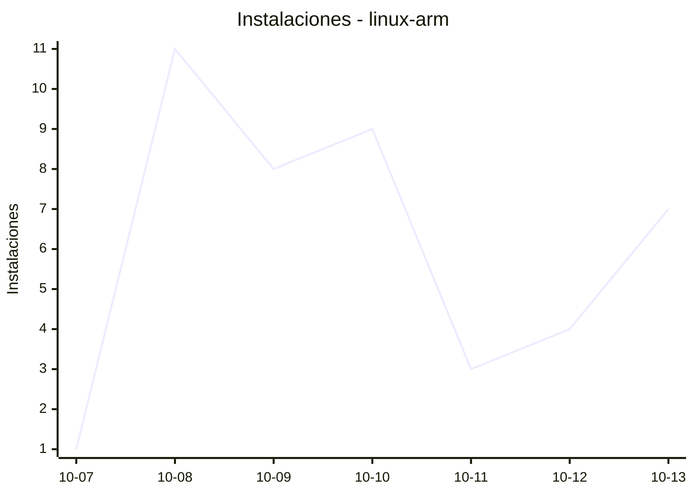
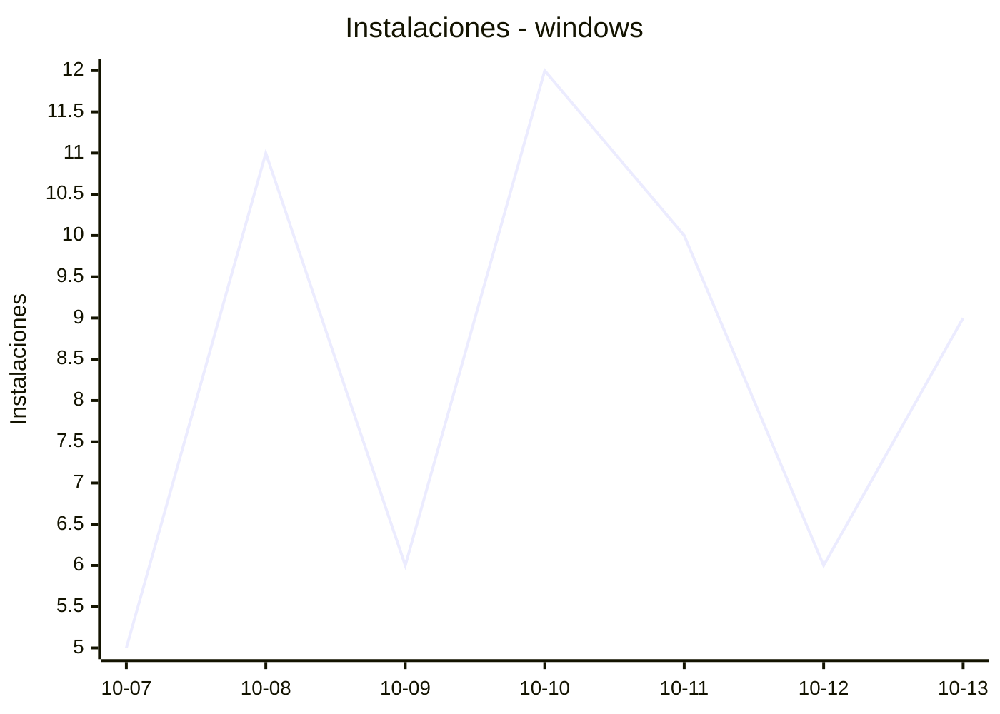
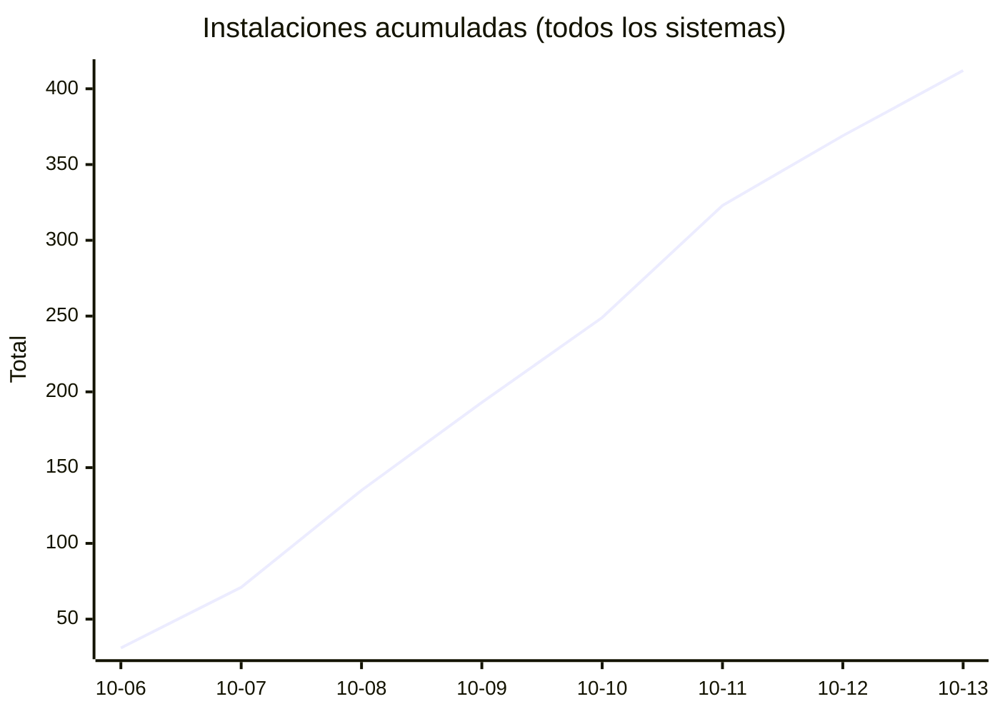
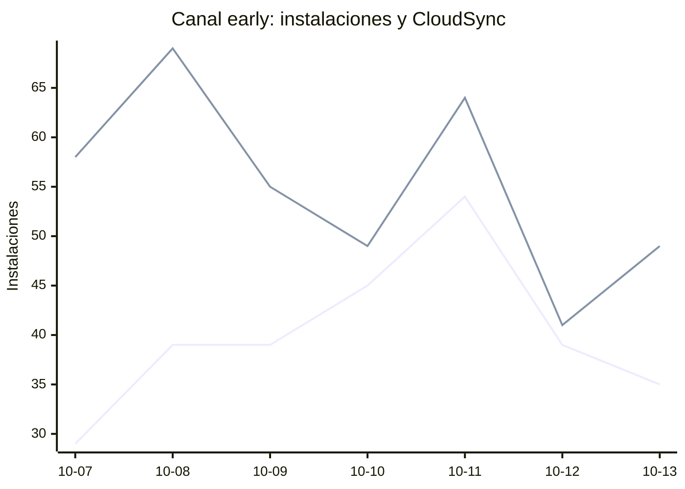

# Estadísticas de EmuDeck

Actualizado: 2026-10-14 16:42 UTC. Las gráficas no incluyen el día de hoy porque aún está incompleto.

## Arranques de la app (comprobaciones de actualización)

Cada arranque descarga el `latest*.yml` de su sistema. Cuenta arranques, no personas.

| Sistema | Ayer | Últimos 7 días |
|---|---|---|
| Linux x86 | 13168 | 96146 |
| Linux ARM | 126 | 1213 |
| Windows | 3456 | 25673 |
| Mac | 0 | 0 |

Instalaciones nuevas estimadas en Windows (7 días, `.exe` menos `.blockmap`): **1566**

## Instalaciones de EmuDeck (beacons)

Cada `setup` descarga `system-<sistema>.txt` y cada instalación de un emulador `<emulador>-<plataforma>.txt`. Los emuladores cuentan también las actualizaciones. Histórico completo desde el primer día.

| Sistema | Ayer | Últimos 7 días | Últimos 30 días | Total |
|---|---|---|---|---|
| linux | 27 | 279 | 279 | 323 |
| linux-arm | 7 | 43 | 43 | 47 |
| windows | 9 | 59 | 59 | 68 |

### Por mes

| Mes | Linux | Linux ARM | Windows | Total |
|---|---|---|---|---|
| 2026-10 | 279 | 43 | 59 | 381 |

### Canal early (early + early-unstable)

Instalaciones de EmuDeck con el backend en una rama early, y cuántas de ellas instalan CloudSync.

| | Últimos 7 días | Últimos 30 días | Total |
|---|---|---|---|
| Instalaciones early | 280 | 280 | 316 |
| Con CloudSync | 385 | 385 | 494 |
| % con CloudSync | | | 156% |

Línea de arriba: instalaciones early. Línea de abajo: de ellas, con CloudSync.

### Por emulador

| Emulador | Linux (total) | Linux ARM (total) | Windows (total) | Últimos 7 días | Últimos 30 días | Total |
|---|---|---|---|---|---|---|
| pcsx2 | 799 | 15 | 96 | 753 | 753 | 910 |
| azahar | 715 | 62 | 88 | 717 | 717 | 865 |
| duckstation | 776 | 60 | 28 | 715 | 715 | 864 |
| esde | 658 | 55 | 137 | 686 | 686 | 850 |
| ryujinx | 668 | 63 | 89 | 685 | 685 | 820 |
| rpcs3 | 715 | 61 | 31 | 660 | 660 | 807 |
| cemu | 716 | 62 | 20 | 666 | 666 | 798 |
| xenia | 651 | 54 | 67 | 645 | 645 | 772 |
| srm | 621 | 47 | 60 | 622 | 622 | 728 |
| shadps4 | 608 | 54 | 52 | 579 | 579 | 714 |
| vita3k | 641 | 54 | 13 | 579 | 579 | 708 |
| cloudsync | 361 | 15 | 138 | 403 | 403 | 514 |
| dolphin | 317 | 44 | 37 | 336 | 336 | 398 |
| ppsspp | 288 | 41 | 68 | 340 | 340 | 397 |
| ra | 318 | 44 | 28 | 336 | 336 | 390 |
| mgba | 286 | 23 | 20 | 278 | 278 | 329 |
| melonds | 271 | 33 | 22 | 274 | 274 | 326 |
| xemu | 267 | 34 | 24 | 275 | 275 | 325 |
| primehack | 234 | 35 | 24 | 246 | 246 | 293 |
| model2 | 230 | 44 | 4 | 234 | 234 | 278 |
| supermodel | 228 | 41 | 6 | 232 | 232 | 275 |
| scummvm | 227 | 31 | 12 | 225 | 225 | 270 |
| bigpemu | 202 | 3 | 3 | 166 | 166 | 208 |
| armsx2 | 67 | 63 | 0 | 107 | 107 | 130 |
| flycast | 66 | 10 | 5 | 73 | 73 | 81 |
| rmg | 56 | 17 | 0 | 65 | 65 | 73 |
| mame | 42 | 2 | 9 | 48 | 48 | 53 |
| eden | 31 | 6 | 0 | 21 | 21 | 37 |
| pegasus | 5 | 0 | 4 | 6 | 6 | 9 |
| yuzu | 6 | 0 | 0 | 4 | 4 | 6 |
| ares | 3 | 1 | 0 | 4 | 4 | 4 |
| citron | 1 | 0 | 0 | 1 | 1 | 1 |
