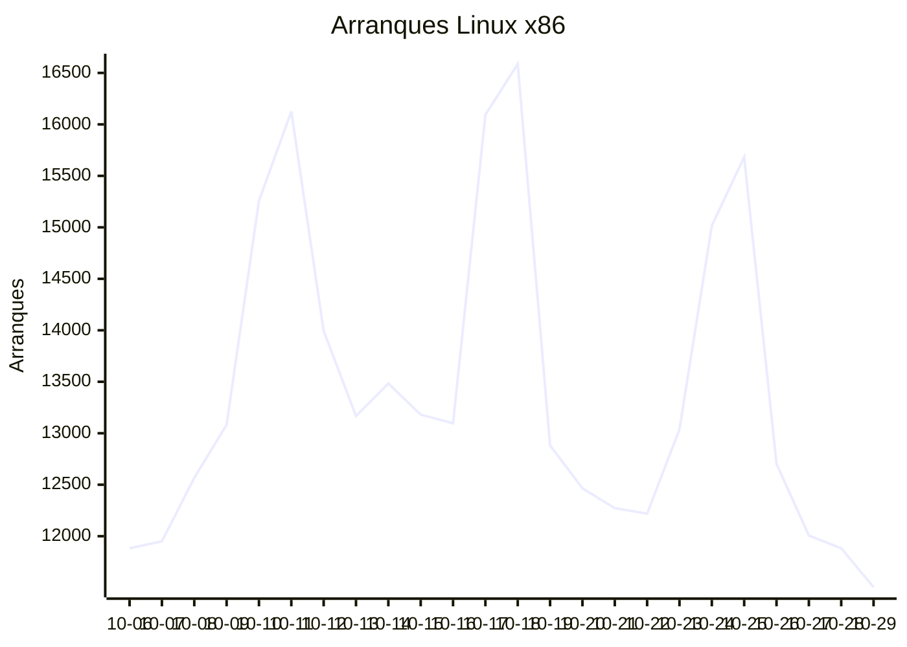
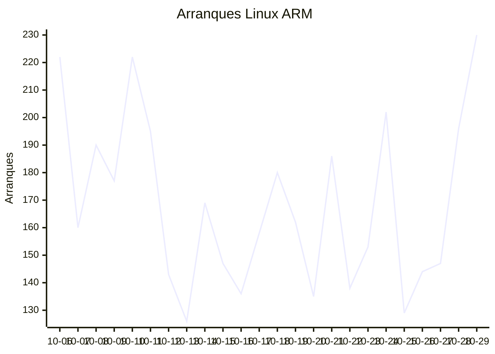
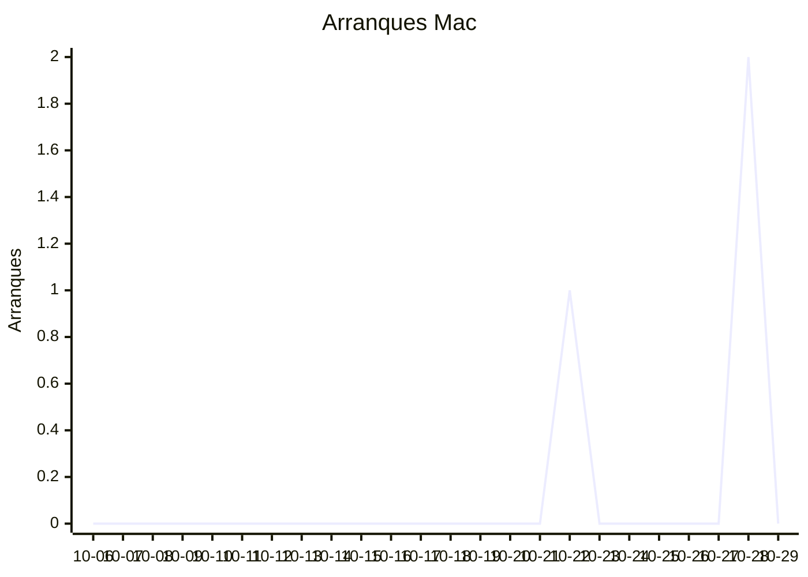
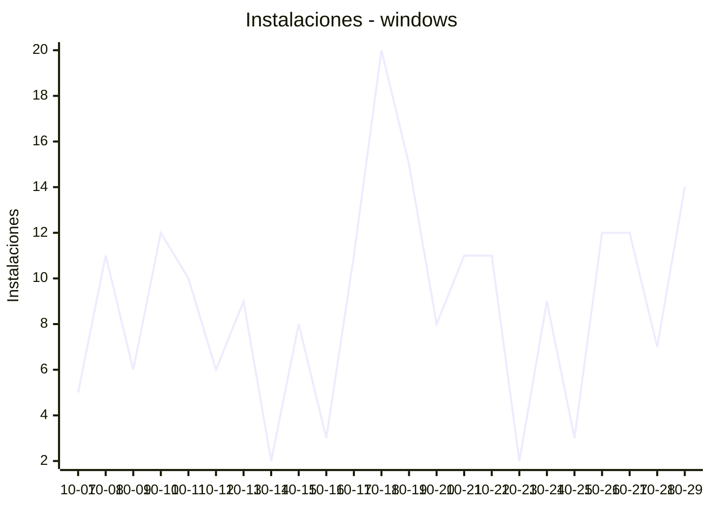
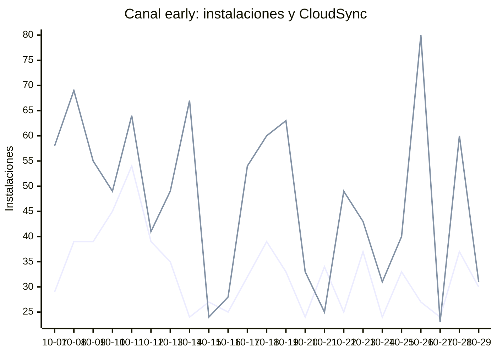

# Estadísticas de EmuDeck

Actualizado: 2026-10-30 00:29 UTC. Las gráficas no incluyen el día de hoy porque aún está incompleto.

## Arranques de la app (comprobaciones de actualización)

Cada arranque descarga el `latest*.yml` de su sistema. Cuenta arranques, no personas.

| Sistema | Ayer | Últimos 7 días |
|---|---|---|
| Linux x86 | 11505 | 91835 |
| Linux ARM | 230 | 1201 |
| Windows | 3263 | 24594 |
| Mac | 0 | 2 |

Instalaciones nuevas estimadas en Windows (7 días, `.exe` menos `.blockmap`): **2332**

## Instalaciones de EmuDeck (beacons)

Cada `setup` descarga `system-<sistema>.txt` y cada instalación de un emulador `<emulador>-<plataforma>.txt`. Los emuladores cuentan también las actualizaciones. Histórico completo desde el primer día.

| Sistema | Ayer | Últimos 7 días | Últimos 30 días | Total |
|---|---|---|---|---|
| linux | 25 | 208 | 739 | 761 |
| linux-arm | 3 | 40 | 123 | 127 |
| windows | 14 | 59 | 207 | 214 |

### Por mes

| Mes | Linux | Linux ARM | Windows | Total |
|---|---|---|---|---|
| 2026-10 | 739 | 123 | 207 | 1069 |

### Canal early (early + early-unstable)

Instalaciones de EmuDeck con el backend en una rama early, y cuántas de ellas instalan CloudSync.

| | Últimos 7 días | Últimos 30 días | Total |
|---|---|---|---|
| Instalaciones early | 212 | 755 | 780 |
| Con CloudSync | 308 | 1096 | 1161 |
| % con CloudSync | | | 149% |

Línea de arriba: instalaciones early. Línea de abajo: de ellas, con CloudSync.

### Por emulador

| Emulador | Linux (total) | Linux ARM (total) | Windows (total) | Últimos 7 días | Últimos 30 días | Total |
|---|---|---|---|---|---|---|
| pcsx2 | 2096 | 23 | 249 | 675 | 2287 | 2368 |
| duckstation | 2003 | 171 | 103 | 654 | 2196 | 2277 |
| azahar | 1833 | 191 | 251 | 658 | 2192 | 2275 |
| esde | 1694 | 155 | 398 | 664 | 2148 | 2247 |
| ryujinx | 1789 | 181 | 249 | 649 | 2143 | 2219 |
| rpcs3 | 1891 | 173 | 101 | 640 | 2090 | 2165 |
| cemu | 1840 | 176 | 87 | 608 | 2032 | 2103 |
| srm | 1667 | 158 | 274 | 623 | 2044 | 2099 |
| xenia | 1708 | 139 | 216 | 615 | 1999 | 2063 |
| shadps4 | 1600 | 149 | 194 | 581 | 1872 | 1943 |
| vita3k | 1672 | 152 | 69 | 544 | 1822 | 1893 |
| cloudsync | 801 | 40 | 359 | 318 | 1133 | 1200 |
| ppsspp | 677 | 107 | 195 | 286 | 946 | 979 |
| dolphin | 738 | 123 | 109 | 280 | 938 | 970 |
| ra | 732 | 114 | 117 | 267 | 933 | 963 |
| mgba | 740 | 54 | 58 | 233 | 825 | 852 |
| xemu | 635 | 95 | 82 | 239 | 785 | 812 |
| melonds | 618 | 90 | 78 | 210 | 757 | 786 |
| primehack | 551 | 90 | 80 | 210 | 696 | 721 |
| supermodel | 529 | 103 | 19 | 176 | 630 | 651 |
| scummvm | 513 | 77 | 55 | 179 | 621 | 645 |
| model2 | 521 | 107 | 8 | 168 | 615 | 636 |
| bigpemu | 504 | 10 | 14 | 140 | 505 | 528 |
| armsx2 | 154 | 201 | 0 | 116 | 344 | 355 |
| flycast | 135 | 17 | 20 | 43 | 167 | 172 |
| rmg | 133 | 27 | 0 | 32 | 155 | 160 |
| eden | 82 | 9 | 3 | 15 | 86 | 94 |
| mame | 71 | 2 | 17 | 17 | 86 | 90 |
| pegasus | 19 | 0 | 16 | 13 | 33 | 35 |
| ares | 9 | 1 | 0 | 4 | 10 | 10 |
| yuzu | 8 | 0 | 2 | 4 | 10 | 10 |
| citron | 5 | 0 | 0 | 1 | 5 | 5 |
