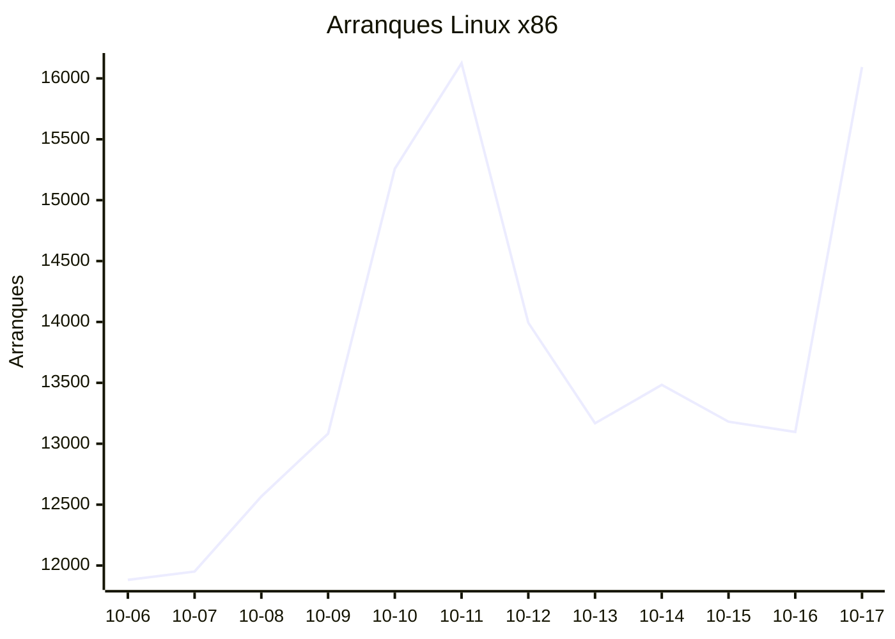
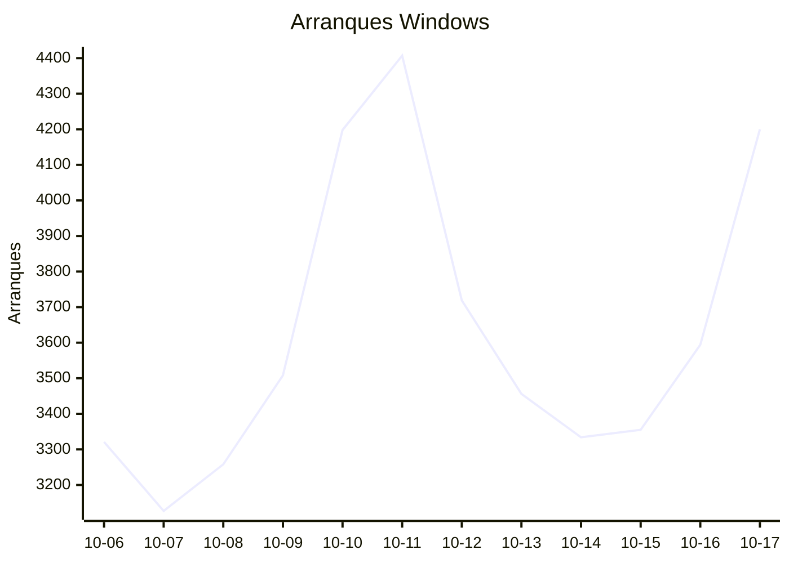
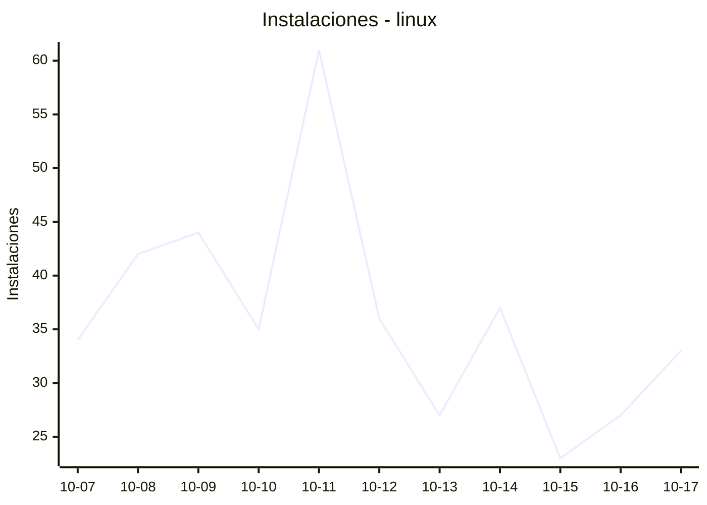
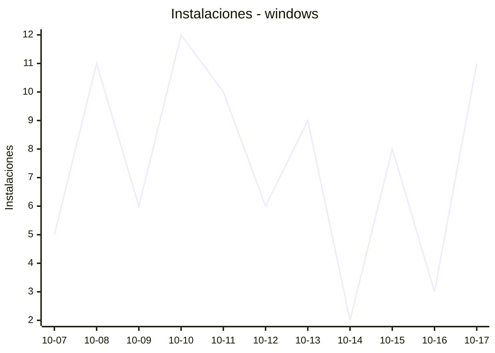
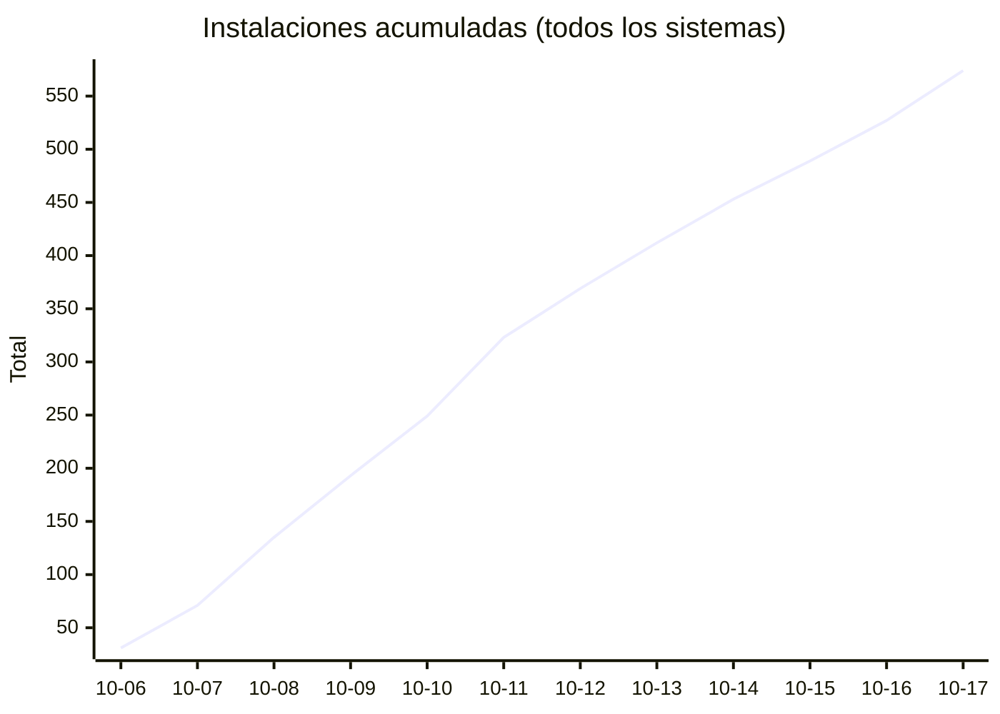
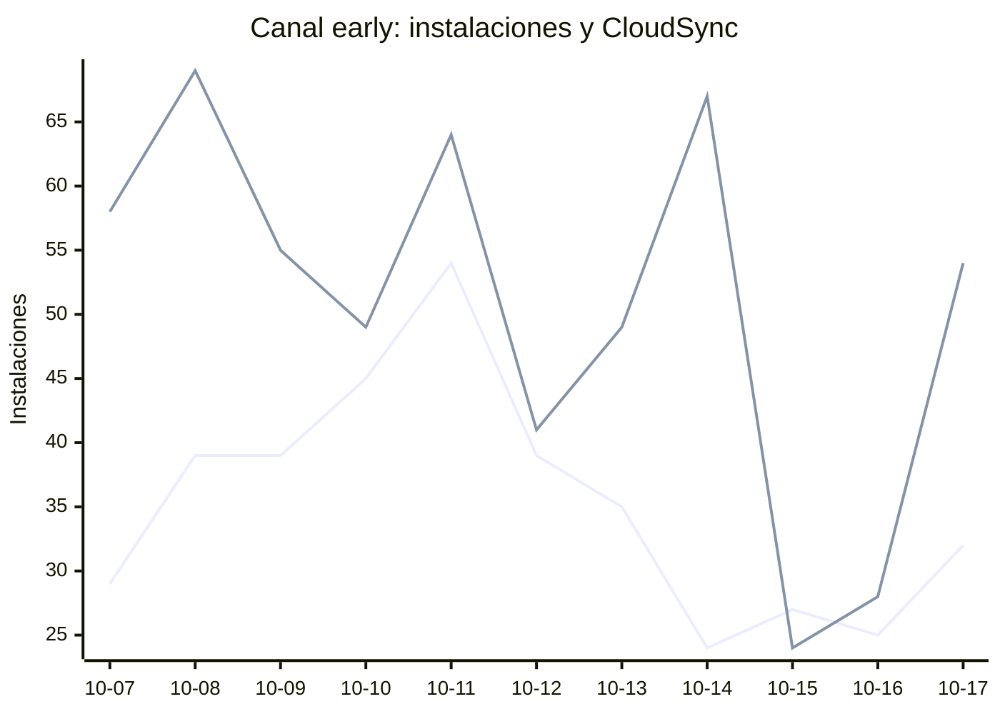

# Estadísticas de EmuDeck

Actualizado: 2026-10-18 00:40 UTC. Las gráficas no incluyen el día de hoy porque aún está incompleto.

## Arranques de la app (comprobaciones de actualización)

Cada arranque descarga el `latest*.yml` de su sistema. Cuenta arranques, no personas.

| Sistema | Ayer | Últimos 7 días |
|---|---|---|
| Linux x86 | 16093 | 99141 |
| Linux ARM | 158 | 1074 |
| Windows | 4200 | 26065 |
| Mac | 0 | 0 |

Instalaciones nuevas estimadas en Windows (7 días, `.exe` menos `.blockmap`): **1915**

## Instalaciones de EmuDeck (beacons)

Cada `setup` descarga `system-<sistema>.txt` y cada instalación de un emulador `<emulador>-<plataforma>.txt`. Los emuladores cuentan también las actualizaciones. Histórico completo desde el primer día.

| Sistema | Ayer | Últimos 7 días | Últimos 30 días | Total |
|---|---|---|---|---|
| linux | 33 | 244 | 399 | 423 |
| linux-arm | 3 | 32 | 61 | 64 |
| windows | 11 | 49 | 83 | 92 |

### Por mes

| Mes | Linux | Linux ARM | Windows | Total |
|---|---|---|---|---|
| 2026-10 | 399 | 61 | 83 | 543 |

### Canal early (early + early-unstable)

Instalaciones de EmuDeck con el backend en una rama early, y cuántas de ellas instalan CloudSync.

| | Últimos 7 días | Últimos 30 días | Total |
|---|---|---|---|
| Instalaciones early | 236 | 388 | 416 |
| Con CloudSync | 327 | 558 | 624 |
| % con CloudSync | | | 150% |

Línea de arriba: instalaciones early. Línea de abajo: de ellas, con CloudSync.

### Por emulador

| Emulador | Linux (total) | Linux ARM (total) | Windows (total) | Últimos 7 días | Últimos 30 días | Total |
|---|---|---|---|---|---|---|
| pcsx2 | 1088 | 18 | 120 | 703 | 1144 | 1226 |
| duckstation | 1054 | 79 | 41 | 677 | 1093 | 1174 |
| azahar | 969 | 80 | 119 | 666 | 1088 | 1168 |
| ryujinx | 935 | 81 | 122 | 652 | 1064 | 1138 |
| esde | 886 | 70 | 176 | 618 | 1033 | 1132 |
| rpcs3 | 982 | 81 | 39 | 643 | 1028 | 1102 |
| cemu | 973 | 80 | 28 | 626 | 1012 | 1081 |
| xenia | 883 | 67 | 88 | 611 | 973 | 1038 |
| srm | 851 | 65 | 95 | 595 | 960 | 1011 |
| shadps4 | 843 | 65 | 83 | 579 | 920 | 991 |
| vita3k | 889 | 69 | 21 | 578 | 910 | 979 |
| cloudsync | 453 | 17 | 175 | 333 | 577 | 645 |
| dolphin | 414 | 57 | 47 | 296 | 485 | 518 |
| ppsspp | 379 | 53 | 83 | 292 | 479 | 515 |
| ra | 408 | 58 | 45 | 283 | 479 | 511 |
| mgba | 385 | 32 | 26 | 255 | 419 | 443 |
| melonds | 358 | 43 | 32 | 253 | 403 | 433 |
| xemu | 349 | 47 | 32 | 246 | 399 | 428 |
| primehack | 306 | 45 | 31 | 205 | 355 | 382 |
| supermodel | 304 | 52 | 8 | 212 | 342 | 364 |
| model2 | 300 | 55 | 5 | 205 | 338 | 360 |
| scummvm | 297 | 40 | 17 | 198 | 327 | 354 |
| bigpemu | 261 | 3 | 6 | 151 | 252 | 270 |
| armsx2 | 80 | 87 | 0 | 93 | 158 | 167 |
| flycast | 80 | 13 | 6 | 52 | 94 | 99 |
| rmg | 77 | 20 | 0 | 52 | 93 | 97 |
| mame | 48 | 2 | 9 | 23 | 55 | 59 |
| eden | 50 | 7 | 0 | 45 | 49 | 57 |
| pegasus | 9 | 0 | 9 | 13 | 16 | 18 |
| yuzu | 6 | 0 | 0 | 4 | 6 | 6 |
| ares | 3 | 1 | 0 | 2 | 4 | 4 |
| citron | 3 | 0 | 0 | 3 | 3 | 3 |
