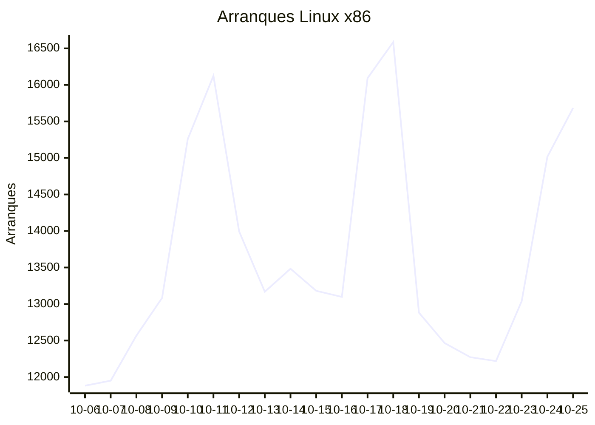
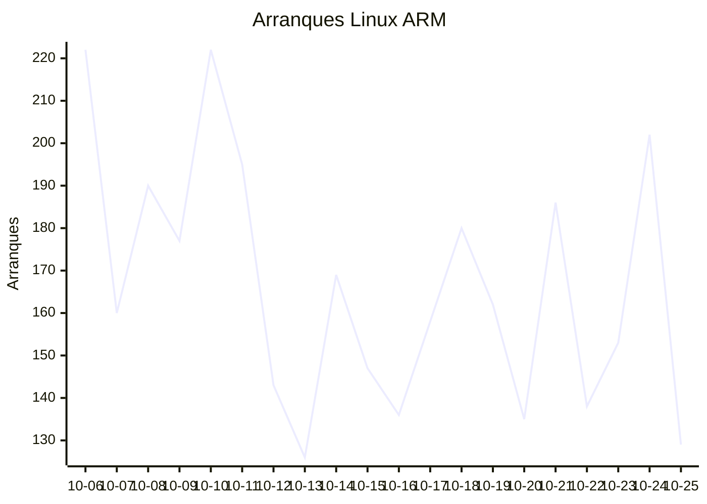
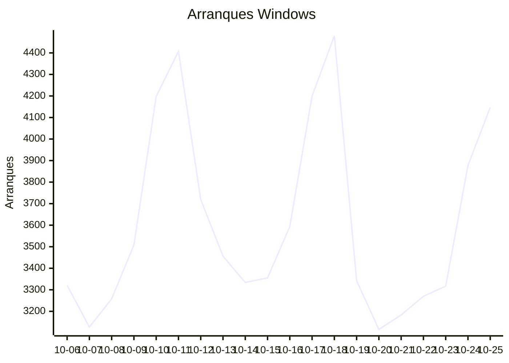
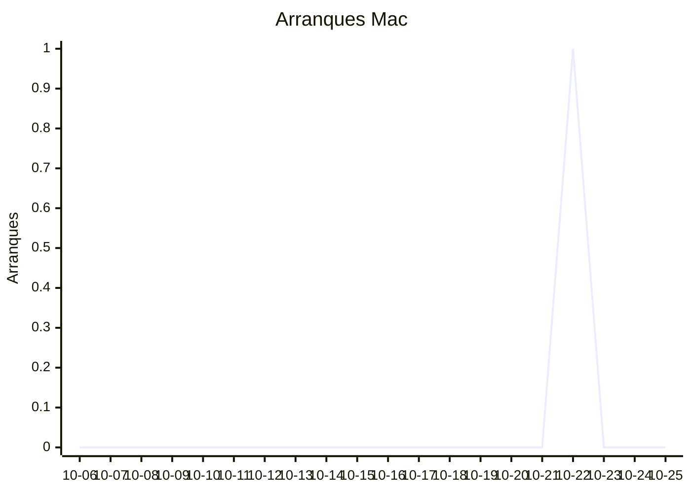
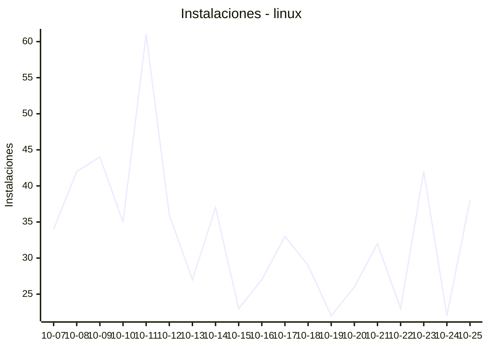
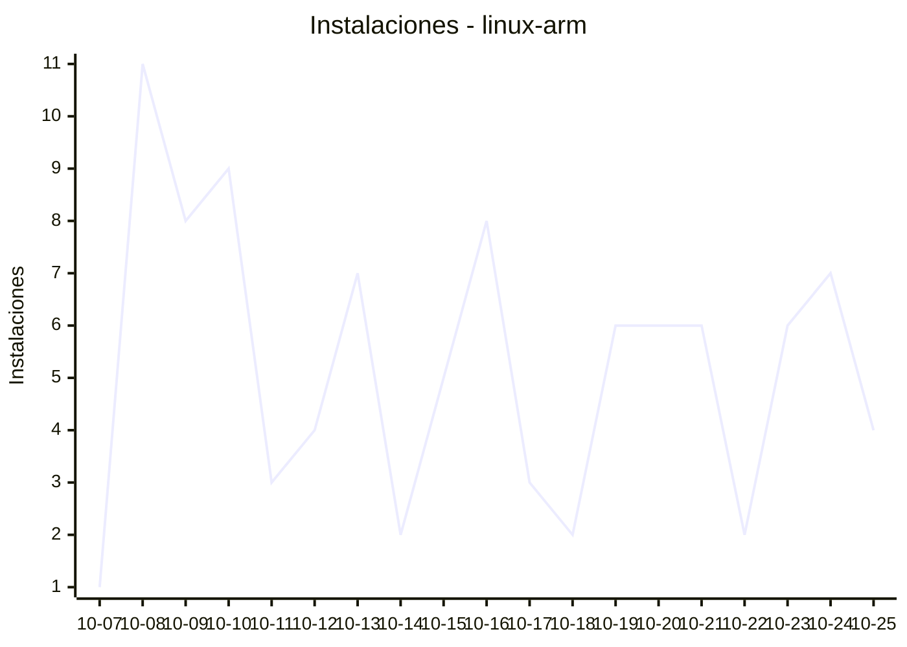
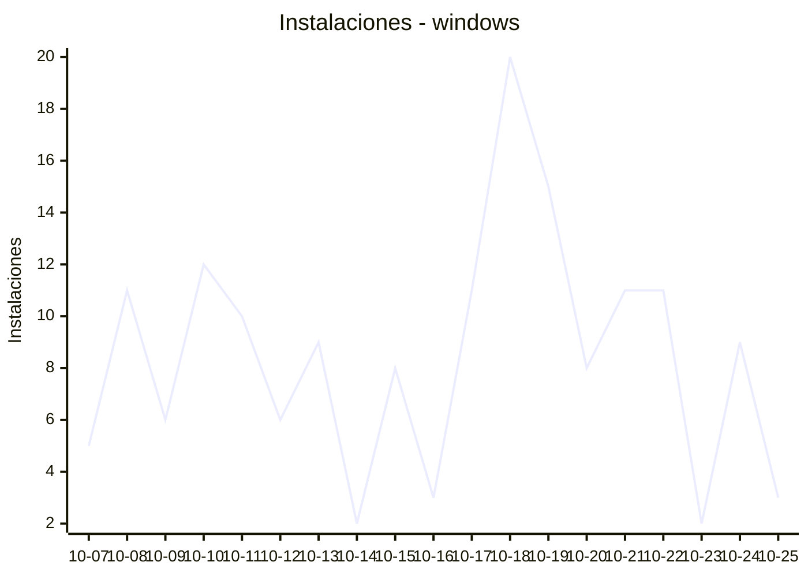
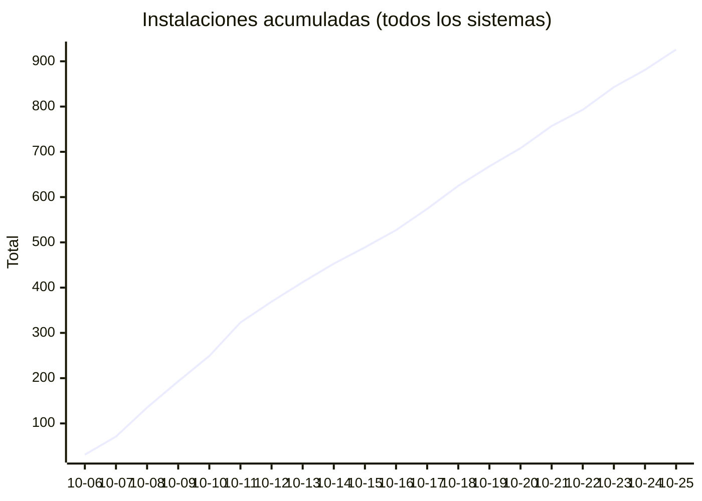
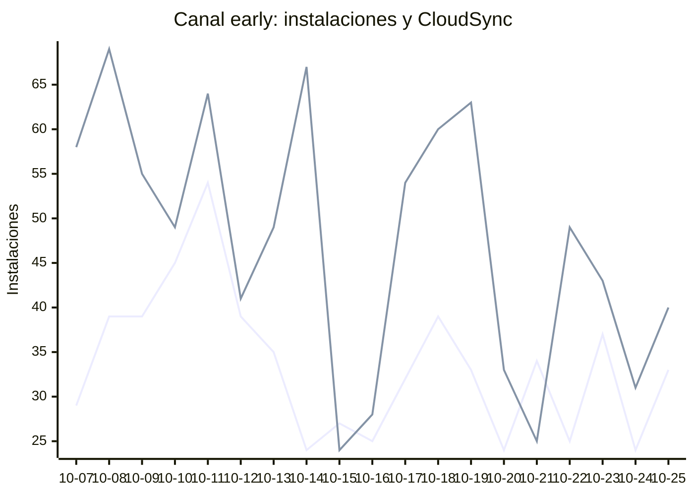

# Estadísticas de EmuDeck

Actualizado: 2026-10-26 00:38 UTC. Las gráficas no incluyen el día de hoy porque aún está incompleto.

## Arranques de la app (comprobaciones de actualización)

Cada arranque descarga el `latest*.yml` de su sistema. Cuenta arranques, no personas.

| Sistema | Ayer | Últimos 7 días |
|---|---|---|
| Linux x86 | 15683 | 93576 |
| Linux ARM | 129 | 1105 |
| Windows | 4147 | 24252 |
| Mac | 0 | 1 |

Instalaciones nuevas estimadas en Windows (7 días, `.exe` menos `.blockmap`): **2055**

## Instalaciones de EmuDeck (beacons)

Cada `setup` descarga `system-<sistema>.txt` y cada instalación de un emulador `<emulador>-<plataforma>.txt`. Los emuladores cuentan también las actualizaciones. Histórico completo desde el primer día.

| Sistema | Ayer | Últimos 7 días | Últimos 30 días | Total |
|---|---|---|---|---|
| linux | 38 | 205 | 633 | 654 |
| linux-arm | 4 | 37 | 100 | 103 |
| windows | 3 | 59 | 162 | 170 |

### Por mes

| Mes | Linux | Linux ARM | Windows | Total |
|---|---|---|---|---|
| 2026-10 | 633 | 100 | 162 | 895 |

### Canal early (early + early-unstable)

Instalaciones de EmuDeck con el backend en una rama early, y cuántas de ellas instalan CloudSync.

| | Últimos 7 días | Últimos 30 días | Total |
|---|---|---|---|
| Instalaciones early | 210 | 637 | 660 |
| Con CloudSync | 284 | 902 | 966 |
| % con CloudSync | | | 146% |

Línea de arriba: instalaciones early. Línea de abajo: de ellas, con CloudSync.

### Por emulador

| Emulador | Linux (total) | Linux ARM (total) | Windows (total) | Últimos 7 días | Últimos 30 días | Total |
|---|---|---|---|---|---|---|
| pcsx2 | 1796 | 22 | 202 | 682 | 1944 | 2020 |
| duckstation | 1718 | 139 | 85 | 671 | 1868 | 1942 |
| azahar | 1578 | 154 | 197 | 662 | 1853 | 1929 |
| ryujinx | 1539 | 149 | 209 | 662 | 1828 | 1897 |
| esde | 1451 | 115 | 318 | 652 | 1790 | 1884 |
| rpcs3 | 1619 | 139 | 83 | 644 | 1773 | 1841 |
| srm | 1435 | 131 | 227 | 668 | 1744 | 1793 |
| cemu | 1584 | 142 | 66 | 624 | 1728 | 1792 |
| xenia | 1463 | 113 | 170 | 620 | 1685 | 1746 |
| shadps4 | 1372 | 116 | 145 | 556 | 1568 | 1633 |
| vita3k | 1432 | 125 | 54 | 549 | 1547 | 1611 |
| cloudsync | 687 | 26 | 289 | 296 | 936 | 1002 |
| ra | 629 | 91 | 99 | 269 | 790 | 819 |
| ppsspp | 580 | 87 | 150 | 263 | 785 | 817 |
| dolphin | 630 | 94 | 87 | 255 | 781 | 811 |
| mgba | 638 | 51 | 48 | 253 | 715 | 737 |
| xemu | 545 | 77 | 65 | 227 | 661 | 687 |
| melonds | 539 | 74 | 64 | 211 | 649 | 677 |
| primehack | 472 | 71 | 68 | 199 | 586 | 611 |
| supermodel | 458 | 85 | 15 | 171 | 538 | 558 |
| scummvm | 446 | 63 | 42 | 173 | 527 | 551 |
| model2 | 451 | 88 | 7 | 165 | 526 | 546 |
| bigpemu | 442 | 10 | 11 | 166 | 444 | 463 |
| armsx2 | 135 | 157 | 0 | 118 | 283 | 292 |
| flycast | 122 | 15 | 17 | 47 | 149 | 154 |
| rmg | 120 | 26 | 0 | 43 | 142 | 146 |
| mame | 67 | 2 | 15 | 22 | 80 | 84 |
| eden | 73 | 9 | 0 | 16 | 74 | 82 |
| pegasus | 15 | 0 | 12 | 8 | 25 | 27 |
| yuzu | 8 | 0 | 2 | 4 | 10 | 10 |
| ares | 7 | 1 | 0 | 4 | 8 | 8 |
| citron | 4 | 0 | 0 | 0 | 4 | 4 |
