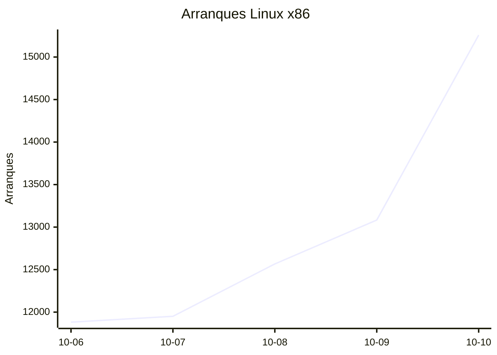
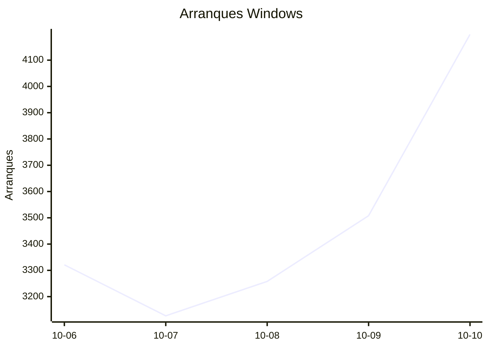
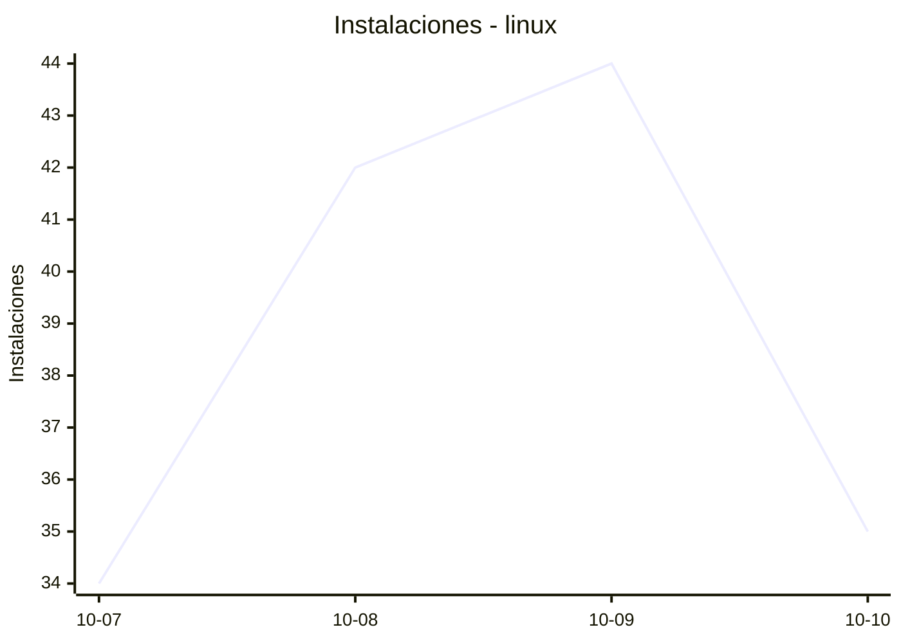
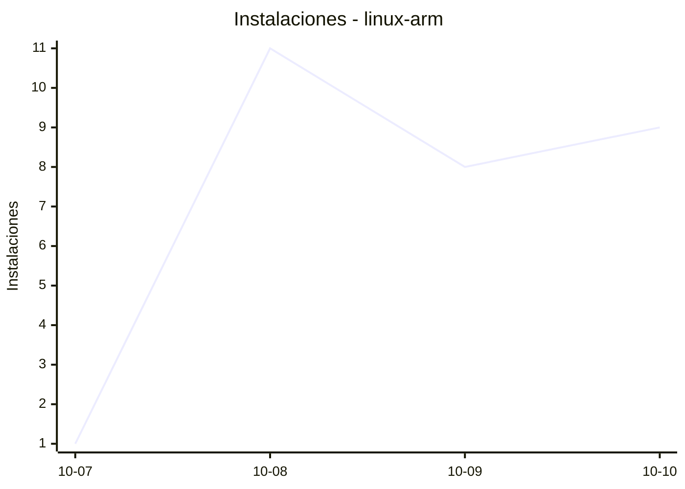
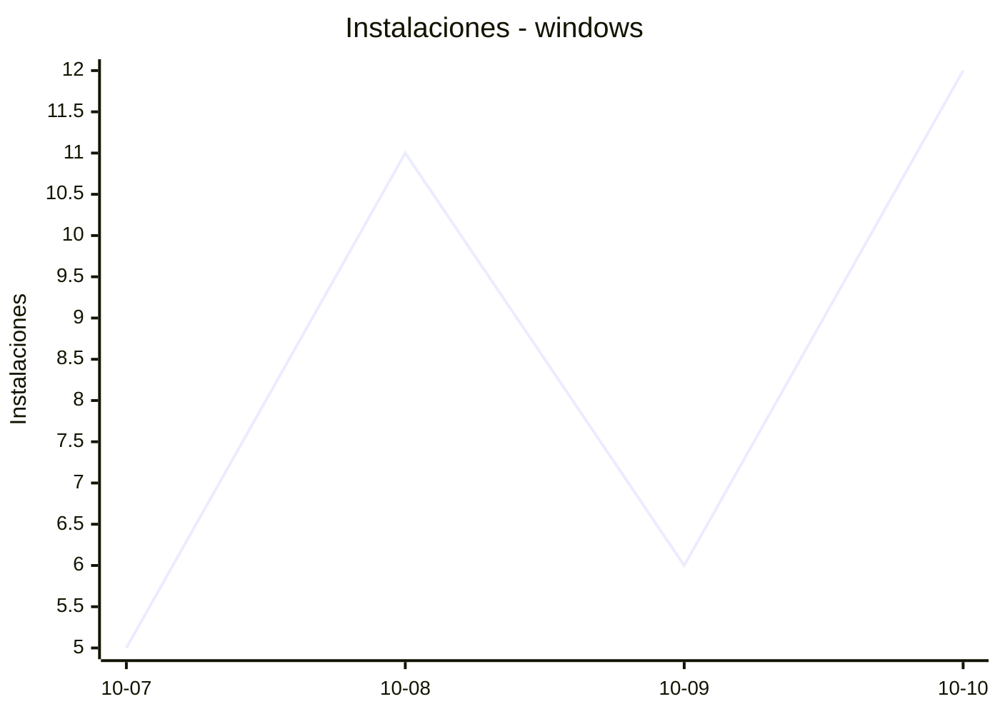
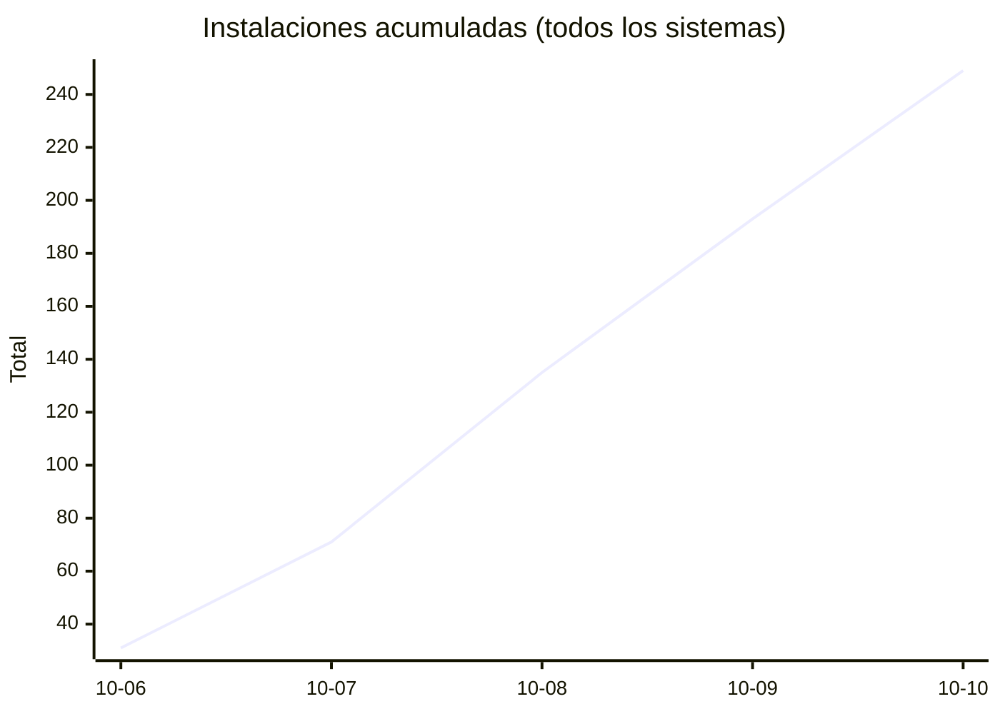
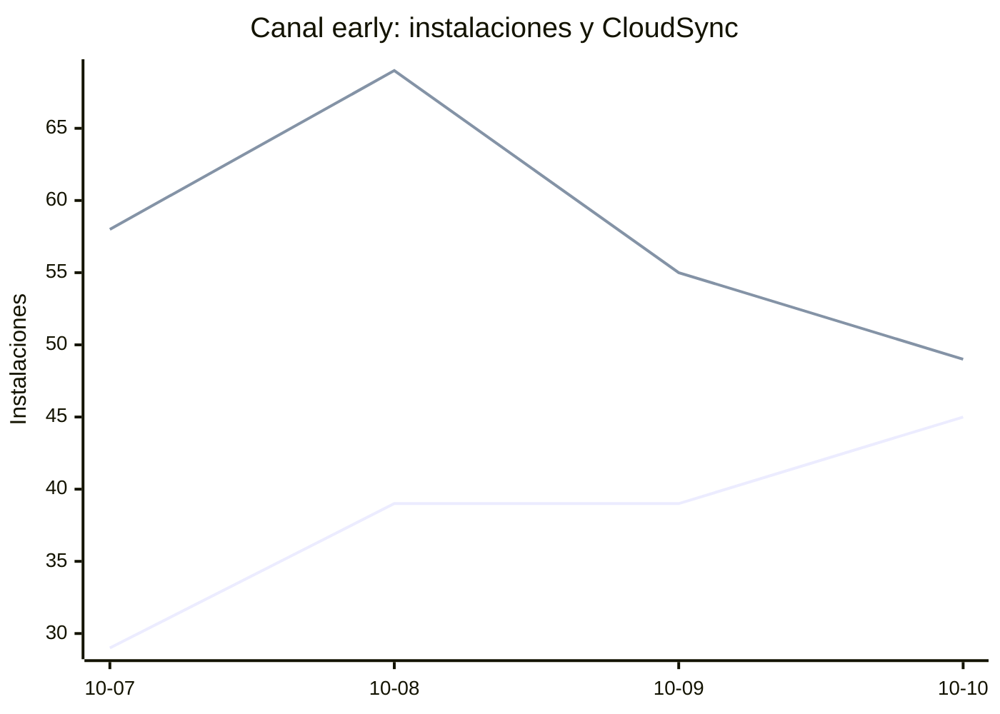

# Estadísticas de EmuDeck

Actualizado: 2026-10-11 02:57 UTC. Las gráficas no incluyen el día de hoy porque aún está incompleto.

## Arranques de la app (comprobaciones de actualización)

Cada arranque descarga el `latest*.yml` de su sistema. Cuenta arranques, no personas.

| Sistema | Ayer | Últimos 7 días |
|---|---|---|
| Linux x86 | 15258 | 64741 |
| Linux ARM | 222 | 971 |
| Windows | 4198 | 17412 |
| Mac | 0 | 0 |

Instalaciones nuevas estimadas en Windows (7 días, `.exe` menos `.blockmap`): **968**

## Instalaciones de EmuDeck (beacons)

Cada `setup` descarga `system-<sistema>.txt` y cada instalación de un emulador `<emulador>-<plataforma>.txt`. Los emuladores cuentan también las actualizaciones. Histórico completo desde el primer día.

| Sistema | Ayer | Últimos 7 días | Últimos 30 días | Total |
|---|---|---|---|---|
| linux | 35 | 155 | 155 | 189 |
| linux-arm | 9 | 29 | 29 | 32 |
| windows | 12 | 34 | 34 | 43 |

### Por mes

| Mes | Linux | Linux ARM | Windows | Total |
|---|---|---|---|---|
| 2026-10 | 155 | 29 | 34 | 218 |

### Canal early (early + early-unstable)

Instalaciones de EmuDeck con el backend en una rama early, y cuántas de ellas instalan CloudSync.

| | Últimos 7 días | Últimos 30 días | Total |
|---|---|---|---|
| Instalaciones early | 152 | 152 | 185 |
| Con CloudSync | 231 | 231 | 301 |
| % con CloudSync | | | 163% |

Línea de arriba: instalaciones early. Línea de abajo: de ellas, con CloudSync.

### Por emulador

| Emulador | Linux (total) | Linux ARM (total) | Windows (total) | Últimos 7 días | Últimos 30 días | Total |
|---|---|---|---|---|---|---|
| pcsx2 | 471 | 11 | 60 | 441 | 441 | 542 |
| esde | 391 | 37 | 94 | 415 | 415 | 522 |
| azahar | 418 | 42 | 60 | 422 | 422 | 520 |
| duckstation | 452 | 40 | 19 | 416 | 416 | 511 |
| ryujinx | 401 | 43 | 58 | 412 | 412 | 502 |
| rpcs3 | 413 | 39 | 21 | 385 | 385 | 473 |
| cemu | 412 | 41 | 15 | 386 | 386 | 468 |
| xenia | 366 | 35 | 40 | 362 | 362 | 441 |
| srm | 371 | 27 | 31 | 365 | 365 | 429 |
| shadps4 | 355 | 38 | 30 | 341 | 341 | 423 |
| vita3k | 366 | 35 | 11 | 332 | 332 | 412 |
| cloudsync | 216 | 13 | 87 | 244 | 244 | 316 |
| ra | 185 | 32 | 20 | 196 | 196 | 237 |
| ppsspp | 164 | 29 | 40 | 187 | 187 | 233 |
| dolphin | 179 | 31 | 22 | 189 | 189 | 232 |
| mgba | 163 | 17 | 12 | 164 | 164 | 192 |
| melonds | 153 | 21 | 17 | 150 | 150 | 191 |
| xemu | 148 | 22 | 19 | 153 | 153 | 189 |
| primehack | 137 | 23 | 20 | 150 | 150 | 180 |
| model2 | 132 | 27 | 2 | 133 | 133 | 161 |
| scummvm | 126 | 22 | 12 | 129 | 129 | 160 |
| supermodel | 127 | 27 | 5 | 130 | 130 | 159 |
| bigpemu | 120 | 3 | 2 | 101 | 101 | 125 |
| armsx2 | 34 | 43 | 0 | 65 | 65 | 77 |
| flycast | 39 | 5 | 4 | 42 | 42 | 48 |
| rmg | 35 | 10 | 0 | 41 | 41 | 45 |
| mame | 29 | 1 | 6 | 32 | 32 | 36 |
| eden | 10 | 2 | 0 | 4 | 4 | 12 |
| pegasus | 5 | 0 | 1 | 3 | 3 | 6 |
| ares | 1 | 1 | 0 | 2 | 2 | 2 |
| yuzu | 2 | 0 | 0 | 2 | 2 | 2 |
| citron | 1 | 0 | 0 | 0 | 0 | 1 |
