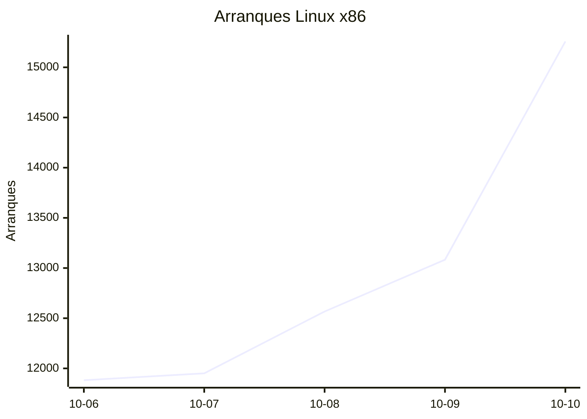
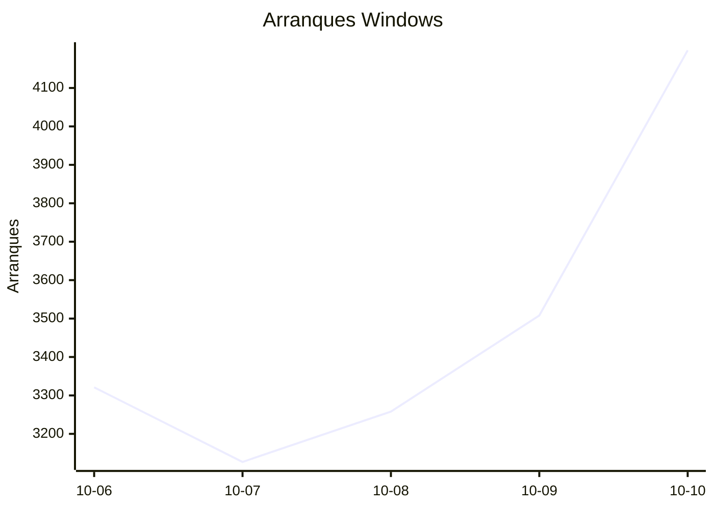
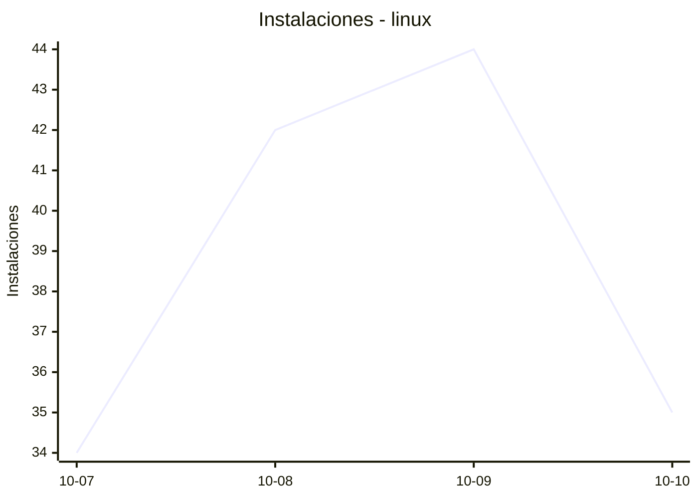
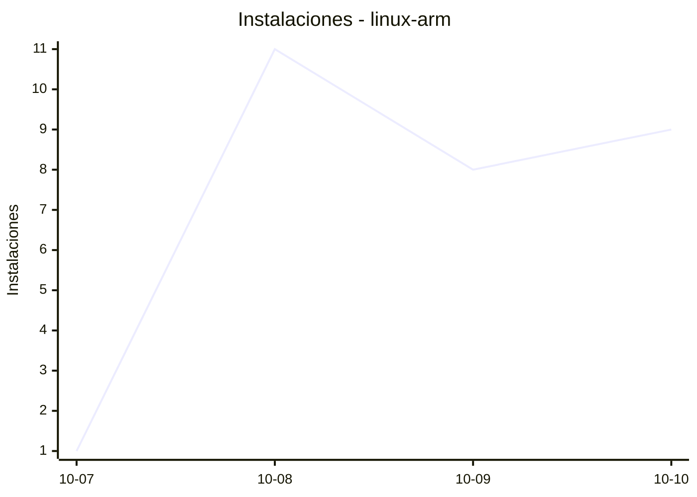
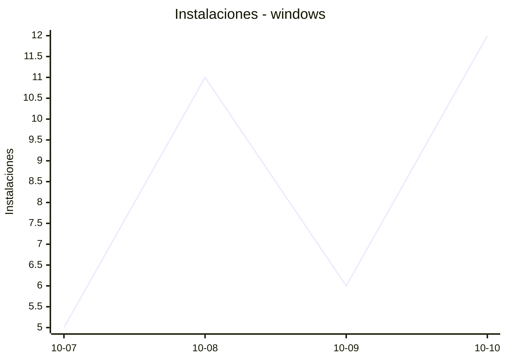
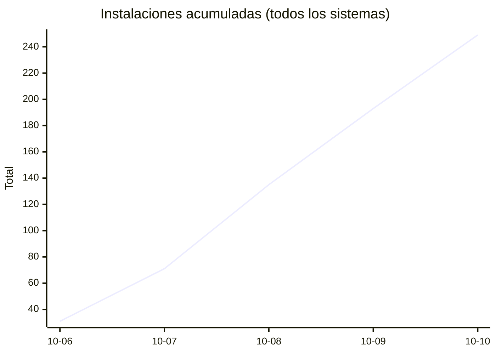
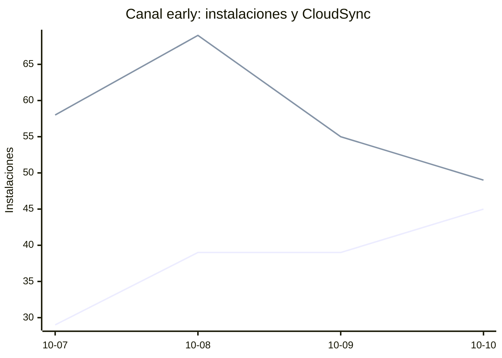

# Estadísticas de EmuDeck

Actualizado: 2026-10-11 22:40 UTC. Las gráficas no incluyen el día de hoy porque aún está incompleto.

## Arranques de la app (comprobaciones de actualización)

Cada arranque descarga el `latest*.yml` de su sistema. Cuenta arranques, no personas.

| Sistema | Ayer | Últimos 7 días |
|---|---|---|
| Linux x86 | 15258 | 64741 |
| Linux ARM | 222 | 971 |
| Windows | 4198 | 17412 |
| Mac | 0 | 0 |

Instalaciones nuevas estimadas en Windows (7 días, `.exe` menos `.blockmap`): **968**

## Instalaciones de EmuDeck (beacons)

Cada `setup` descarga `system-<sistema>.txt` y cada instalación de un emulador `<emulador>-<plataforma>.txt`. Los emuladores cuentan también las actualizaciones. Histórico completo desde el primer día.

| Sistema | Ayer | Últimos 7 días | Últimos 30 días | Total |
|---|---|---|---|---|
| linux | 35 | 155 | 155 | 234 |
| linux-arm | 9 | 29 | 29 | 35 |
| windows | 12 | 34 | 34 | 51 |

### Por mes

| Mes | Linux | Linux ARM | Windows | Total |
|---|---|---|---|---|
| 2026-10 | 155 | 29 | 34 | 218 |

### Canal early (early + early-unstable)

Instalaciones de EmuDeck con el backend en una rama early, y cuántas de ellas instalan CloudSync.

| | Últimos 7 días | Últimos 30 días | Total |
|---|---|---|---|
| Instalaciones early | 152 | 152 | 226 |
| Con CloudSync | 231 | 231 | 356 |
| % con CloudSync | | | 158% |

Línea de arriba: instalaciones early. Línea de abajo: de ellas, con CloudSync.

### Por emulador

| Emulador | Linux (total) | Linux ARM (total) | Windows (total) | Últimos 7 días | Últimos 30 días | Total |
|---|---|---|---|---|---|---|
| pcsx2 | 545 | 12 | 69 | 441 | 441 | 626 |
| azahar | 485 | 44 | 68 | 422 | 422 | 597 |
| duckstation | 530 | 42 | 23 | 416 | 416 | 595 |
| esde | 446 | 39 | 106 | 415 | 415 | 591 |
| ryujinx | 462 | 45 | 69 | 412 | 412 | 576 |
| rpcs3 | 484 | 41 | 22 | 385 | 385 | 547 |
| cemu | 482 | 43 | 16 | 386 | 386 | 541 |
| xenia | 433 | 37 | 48 | 362 | 362 | 518 |
| srm | 428 | 31 | 43 | 365 | 365 | 502 |
| shadps4 | 419 | 42 | 37 | 341 | 341 | 498 |
| vita3k | 434 | 37 | 11 | 332 | 332 | 482 |
| cloudsync | 258 | 13 | 103 | 244 | 244 | 374 |
| ppsspp | 208 | 30 | 48 | 187 | 187 | 286 |
| ra | 231 | 33 | 20 | 196 | 196 | 284 |
| dolphin | 224 | 32 | 24 | 189 | 189 | 280 |
| xemu | 189 | 23 | 20 | 153 | 153 | 232 |
| melonds | 191 | 22 | 17 | 150 | 150 | 230 |
| mgba | 181 | 17 | 17 | 164 | 164 | 215 |
| primehack | 168 | 24 | 21 | 150 | 150 | 213 |
| model2 | 164 | 30 | 2 | 133 | 133 | 196 |
| scummvm | 161 | 23 | 12 | 129 | 129 | 196 |
| supermodel | 160 | 30 | 5 | 130 | 130 | 195 |
| bigpemu | 132 | 3 | 2 | 101 | 101 | 137 |
| armsx2 | 40 | 45 | 0 | 65 | 65 | 85 |
| flycast | 47 | 5 | 5 | 42 | 42 | 57 |
| rmg | 39 | 10 | 0 | 41 | 41 | 49 |
| mame | 33 | 1 | 8 | 32 | 32 | 42 |
| eden | 13 | 3 | 0 | 4 | 4 | 16 |
| pegasus | 5 | 0 | 1 | 3 | 3 | 6 |
| yuzu | 3 | 0 | 0 | 2 | 2 | 3 |
| ares | 1 | 1 | 0 | 2 | 2 | 2 |
| citron | 1 | 0 | 0 | 0 | 0 | 1 |
