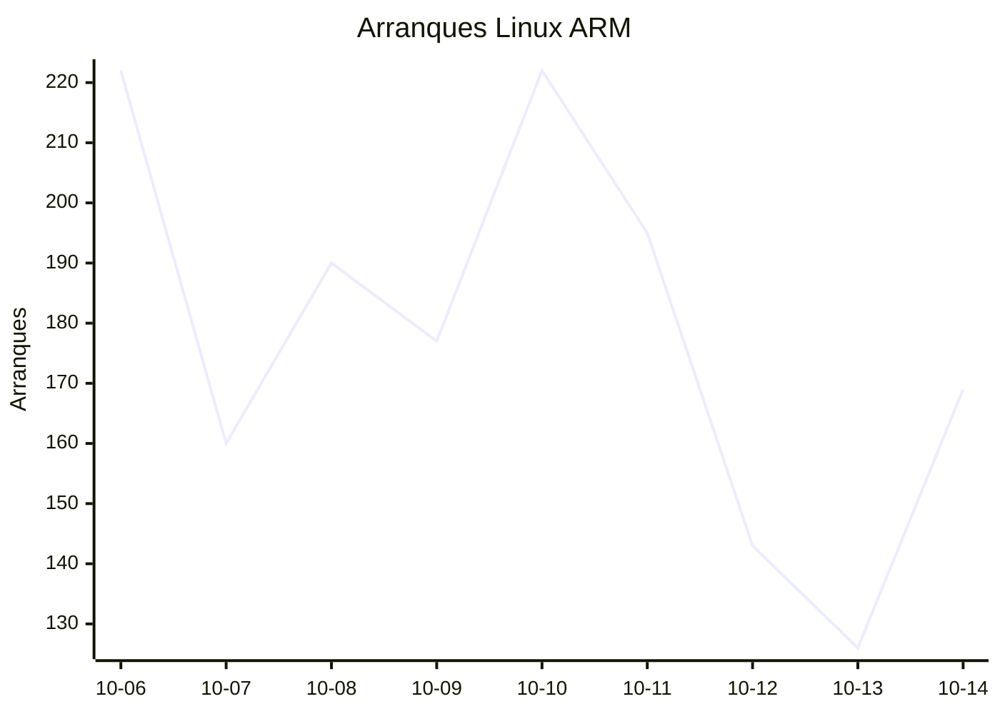
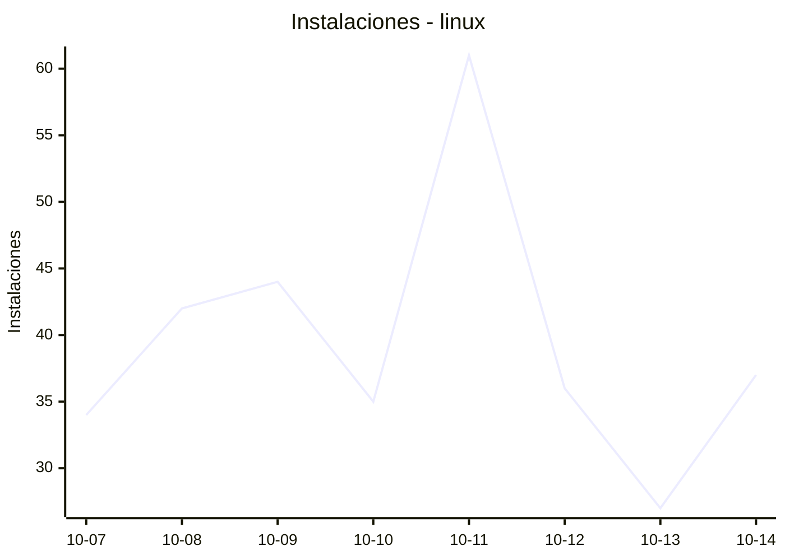
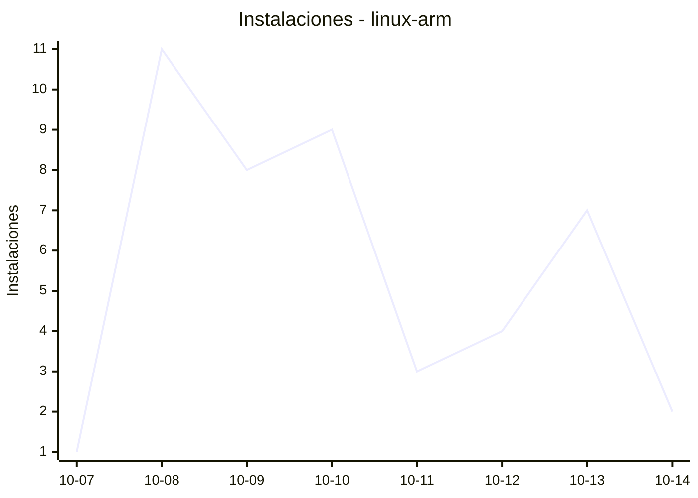
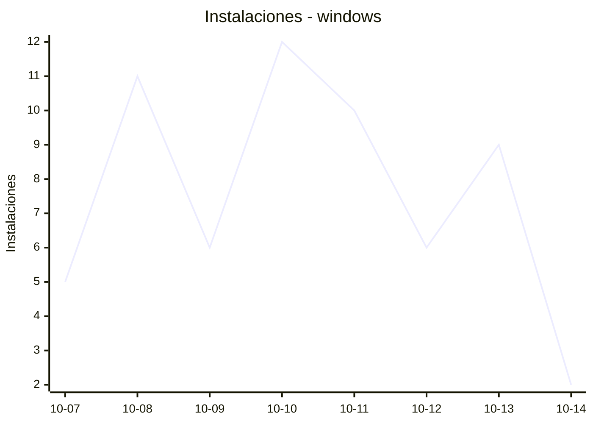
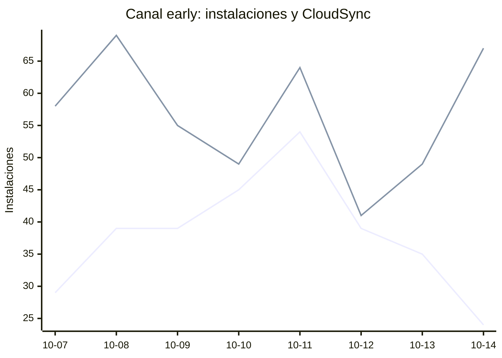

# Estadísticas de EmuDeck

Actualizado: 2026-10-15 07:19 UTC. Las gráficas no incluyen el día de hoy porque aún está incompleto.

## Arranques de la app (comprobaciones de actualización)

Cada arranque descarga el `latest*.yml` de su sistema. Cuenta arranques, no personas.

| Sistema | Ayer | Últimos 7 días |
|---|---|---|
| Linux x86 | 13483 | 97678 |
| Linux ARM | 169 | 1222 |
| Windows | 3334 | 25880 |
| Mac | 0 | 0 |

Instalaciones nuevas estimadas en Windows (7 días, `.exe` menos `.blockmap`): **1663**

## Instalaciones de EmuDeck (beacons)

Cada `setup` descarga `system-<sistema>.txt` y cada instalación de un emulador `<emulador>-<plataforma>.txt`. Los emuladores cuentan también las actualizaciones. Histórico completo desde el primer día.

| Sistema | Ayer | Últimos 7 días | Últimos 30 días | Total |
|---|---|---|---|---|
| linux | 37 | 282 | 316 | 342 |
| linux-arm | 2 | 44 | 45 | 49 |
| windows | 2 | 56 | 61 | 69 |

### Por mes

| Mes | Linux | Linux ARM | Windows | Total |
|---|---|---|---|---|
| 2026-10 | 316 | 45 | 61 | 422 |

### Canal early (early + early-unstable)

Instalaciones de EmuDeck con el backend en una rama early, y cuántas de ellas instalan CloudSync.

| | Últimos 7 días | Últimos 30 días | Total |
|---|---|---|---|
| Instalaciones early | 275 | 304 | 334 |
| Con CloudSync | 394 | 452 | 522 |
| % con CloudSync | | | 156% |

Línea de arriba: instalaciones early. Línea de abajo: de ellas, con CloudSync.

### Por emulador

| Emulador | Linux (total) | Linux ARM (total) | Windows (total) | Últimos 7 días | Últimos 30 días | Total |
|---|---|---|---|---|---|---|
| pcsx2 | 854 | 15 | 98 | 778 | 873 | 967 |
| azahar | 765 | 66 | 92 | 739 | 827 | 923 |
| duckstation | 824 | 64 | 32 | 738 | 825 | 920 |
| esde | 705 | 59 | 143 | 709 | 793 | 907 |
| ryujinx | 720 | 66 | 94 | 704 | 788 | 880 |
| rpcs3 | 765 | 64 | 33 | 698 | 776 | 862 |
| cemu | 772 | 65 | 22 | 695 | 775 | 859 |
| xenia | 700 | 55 | 68 | 668 | 747 | 823 |
| srm | 660 | 48 | 63 | 628 | 704 | 771 |
| shadps4 | 652 | 56 | 57 | 603 | 684 | 765 |
| vita3k | 690 | 56 | 14 | 614 | 682 | 760 |
| cloudsync | 382 | 16 | 144 | 410 | 470 | 542 |
| dolphin | 336 | 46 | 40 | 350 | 384 | 422 |
| ra | 337 | 47 | 32 | 346 | 381 | 416 |
| ppsspp | 303 | 43 | 68 | 348 | 379 | 414 |
| melonds | 291 | 35 | 24 | 286 | 317 | 350 |
| xemu | 285 | 36 | 25 | 288 | 314 | 346 |
| mgba | 301 | 23 | 21 | 278 | 313 | 345 |
| primehack | 250 | 37 | 24 | 260 | 283 | 311 |
| supermodel | 251 | 43 | 7 | 256 | 277 | 301 |
| model2 | 246 | 46 | 4 | 251 | 273 | 296 |
| scummvm | 243 | 32 | 12 | 238 | 260 | 287 |
| bigpemu | 213 | 3 | 5 | 179 | 197 | 221 |
| armsx2 | 71 | 67 | 0 | 112 | 125 | 138 |
| flycast | 70 | 10 | 5 | 69 | 78 | 85 |
| rmg | 62 | 17 | 0 | 65 | 71 | 79 |
| mame | 43 | 2 | 9 | 47 | 49 | 54 |
| eden | 31 | 6 | 0 | 29 | 29 | 37 |
| pegasus | 8 | 0 | 5 | 7 | 8 | 13 |
| yuzu | 6 | 0 | 0 | 6 | 6 | 6 |
| ares | 3 | 1 | 0 | 3 | 4 | 4 |
| citron | 3 | 0 | 0 | 2 | 2 | 3 |
