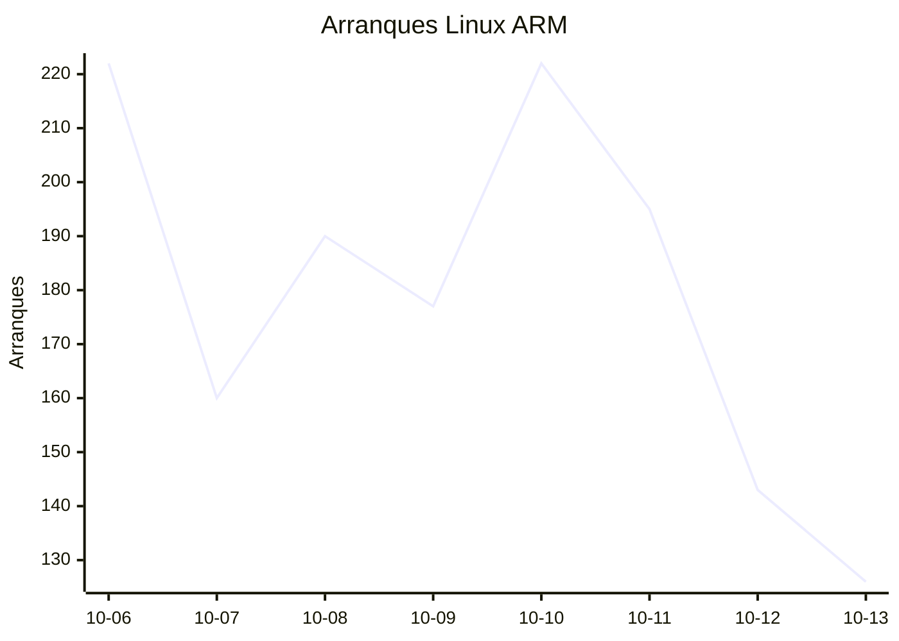
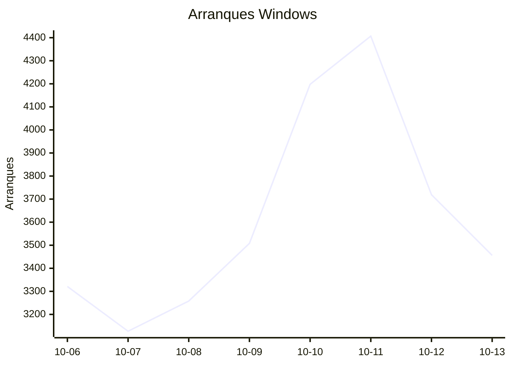
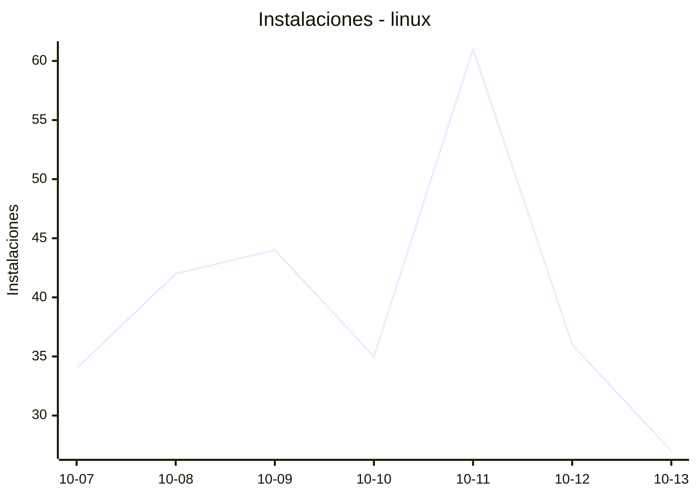
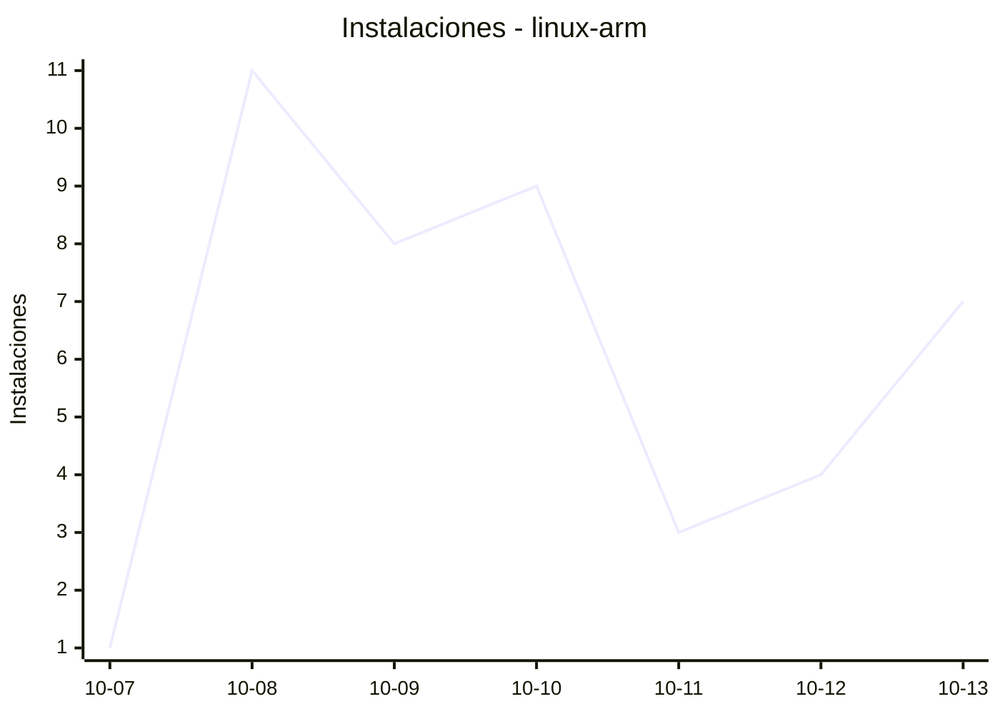
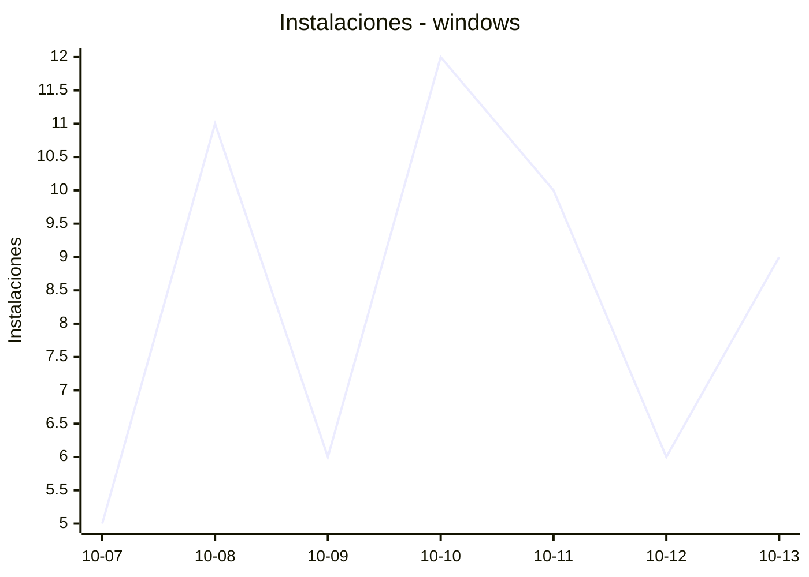
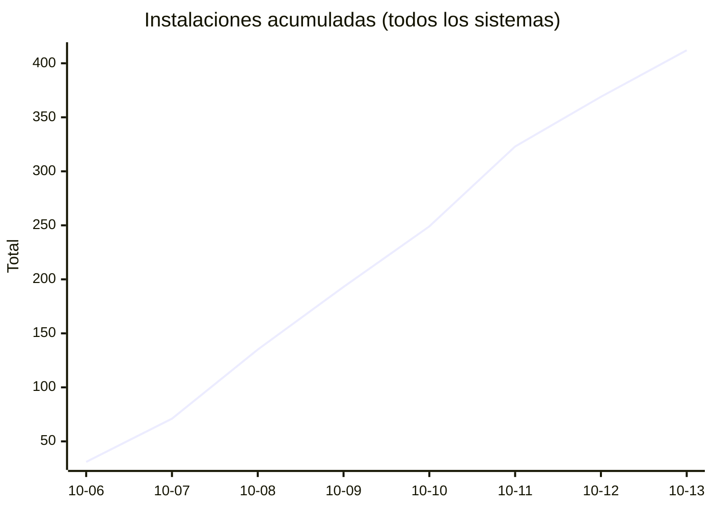
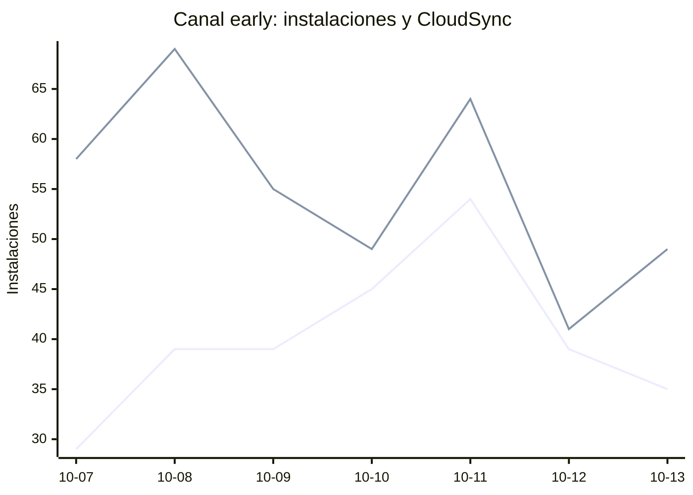

# Estadísticas de EmuDeck

Actualizado: 2026-10-14 09:41 UTC. Las gráficas no incluyen el día de hoy porque aún está incompleto.

## Arranques de la app (comprobaciones de actualización)

Cada arranque descarga el `latest*.yml` de su sistema. Cuenta arranques, no personas.

| Sistema | Ayer | Últimos 7 días |
|---|---|---|
| Linux x86 | 13168 | 96146 |
| Linux ARM | 126 | 1213 |
| Windows | 3456 | 25673 |
| Mac | 0 | 0 |

Instalaciones nuevas estimadas en Windows (7 días, `.exe` menos `.blockmap`): **1566**

## Instalaciones de EmuDeck (beacons)

Cada `setup` descarga `system-<sistema>.txt` y cada instalación de un emulador `<emulador>-<plataforma>.txt`. Los emuladores cuentan también las actualizaciones. Histórico completo desde el primer día.

| Sistema | Ayer | Últimos 7 días | Últimos 30 días | Total |
|---|---|---|---|---|
| linux | 27 | 279 | 279 | 315 |
| linux-arm | 7 | 43 | 43 | 46 |
| windows | 9 | 59 | 59 | 68 |

### Por mes

| Mes | Linux | Linux ARM | Windows | Total |
|---|---|---|---|---|
| 2026-10 | 279 | 43 | 59 | 381 |

### Canal early (early + early-unstable)

Instalaciones de EmuDeck con el backend en una rama early, y cuántas de ellas instalan CloudSync.

| | Últimos 7 días | Últimos 30 días | Total |
|---|---|---|---|
| Instalaciones early | 280 | 280 | 312 |
| Con CloudSync | 385 | 385 | 485 |
| % con CloudSync | | | 155% |

Línea de arriba: instalaciones early. Línea de abajo: de ellas, con CloudSync.

### Por emulador

| Emulador | Linux (total) | Linux ARM (total) | Windows (total) | Últimos 7 días | Últimos 30 días | Total |
|---|---|---|---|---|---|---|
| pcsx2 | 771 | 15 | 96 | 753 | 753 | 882 |
| azahar | 691 | 60 | 88 | 717 | 717 | 839 |
| duckstation | 752 | 58 | 28 | 715 | 715 | 838 |
| esde | 642 | 53 | 135 | 686 | 686 | 830 |
| ryujinx | 651 | 61 | 88 | 685 | 685 | 800 |
| rpcs3 | 689 | 59 | 30 | 660 | 660 | 778 |
| cemu | 693 | 60 | 20 | 666 | 666 | 773 |
| xenia | 628 | 52 | 66 | 645 | 645 | 746 |
| srm | 598 | 46 | 60 | 622 | 622 | 704 |
| shadps4 | 582 | 53 | 51 | 579 | 579 | 686 |
| vita3k | 621 | 52 | 13 | 579 | 579 | 686 |
| cloudsync | 355 | 14 | 136 | 403 | 403 | 505 |
| dolphin | 309 | 43 | 36 | 336 | 336 | 388 |
| ppsspp | 280 | 40 | 68 | 340 | 340 | 388 |
| ra | 309 | 43 | 28 | 336 | 336 | 380 |
| mgba | 279 | 23 | 20 | 278 | 278 | 322 |
| melonds | 261 | 32 | 22 | 274 | 274 | 315 |
| xemu | 259 | 33 | 23 | 275 | 275 | 315 |
| primehack | 226 | 34 | 24 | 246 | 246 | 284 |
| model2 | 220 | 43 | 4 | 234 | 234 | 267 |
| supermodel | 219 | 40 | 6 | 232 | 232 | 265 |
| scummvm | 219 | 30 | 12 | 225 | 225 | 261 |
| bigpemu | 195 | 3 | 3 | 166 | 166 | 201 |
| armsx2 | 66 | 61 | 0 | 107 | 107 | 127 |
| flycast | 64 | 10 | 5 | 73 | 73 | 79 |
| rmg | 54 | 17 | 0 | 65 | 65 | 71 |
| mame | 41 | 2 | 9 | 48 | 48 | 52 |
| eden | 26 | 6 | 0 | 21 | 21 | 32 |
| pegasus | 5 | 0 | 4 | 6 | 6 | 9 |
| yuzu | 6 | 0 | 0 | 4 | 4 | 6 |
| ares | 3 | 1 | 0 | 4 | 4 | 4 |
| citron | 1 | 0 | 0 | 1 | 1 | 1 |
