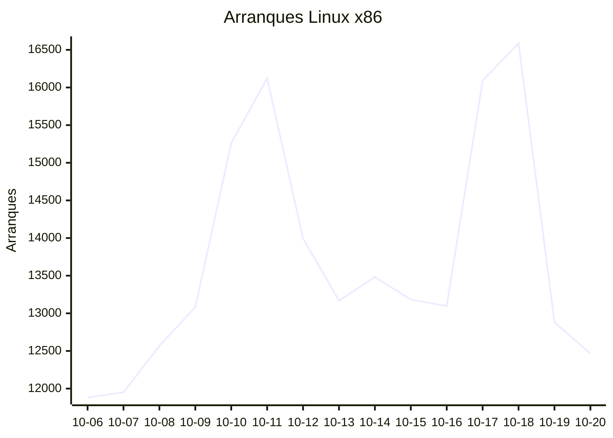
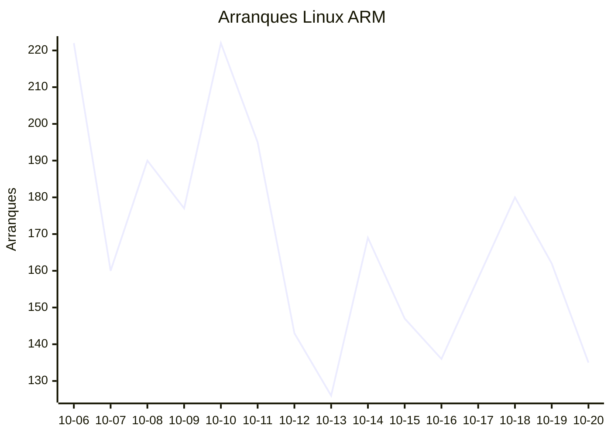
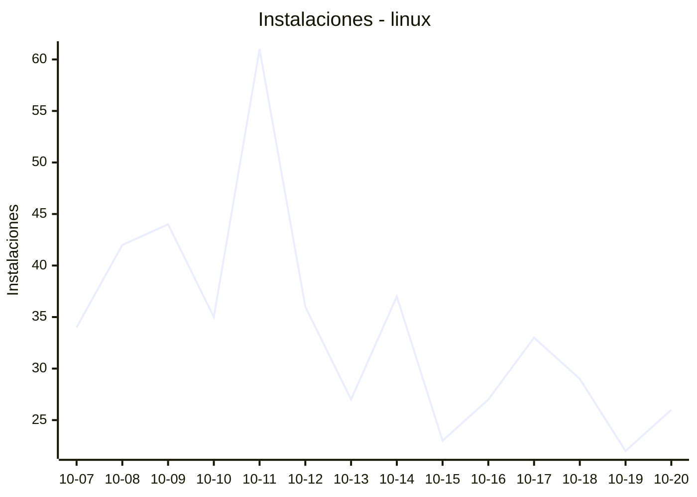
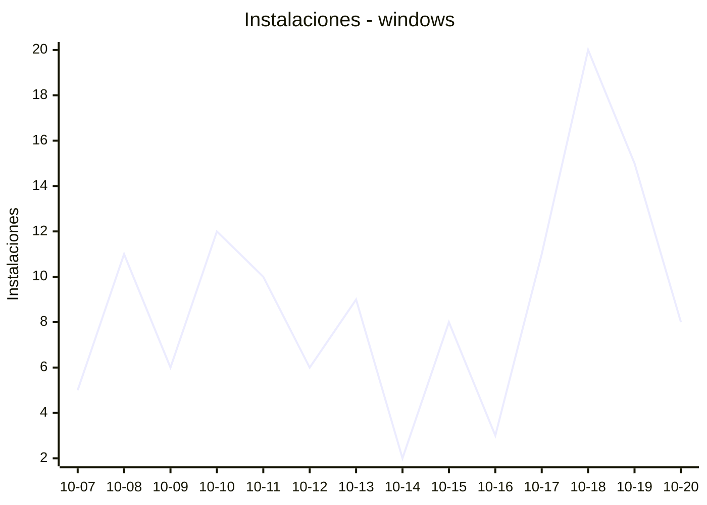
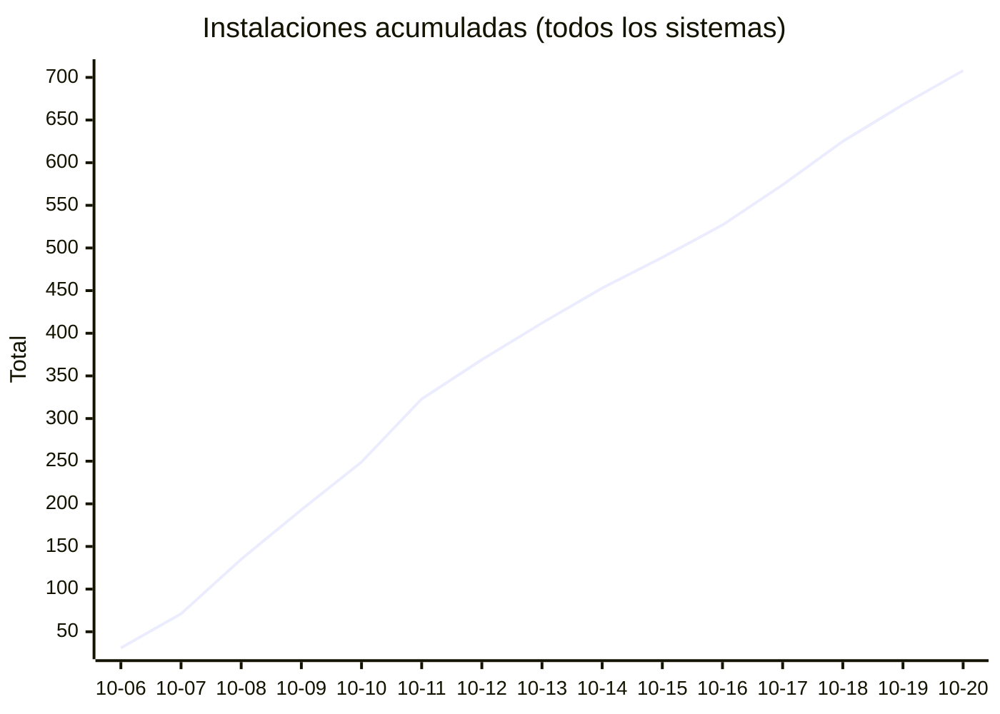
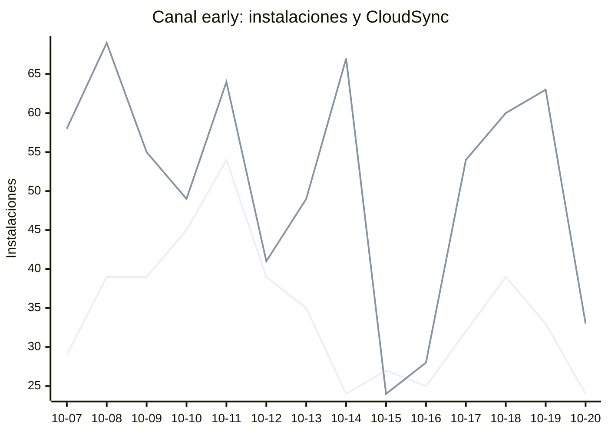

# Estadísticas de EmuDeck

Actualizado: 2026-10-21 21:12 UTC. Las gráficas no incluyen el día de hoy porque aún está incompleto.

## Arranques de la app (comprobaciones de actualización)

Cada arranque descarga el `latest*.yml` de su sistema. Cuenta arranques, no personas.

| Sistema | Ayer | Últimos 7 días |
|---|---|---|
| Linux x86 | 12465 | 97788 |
| Linux ARM | 135 | 1087 |
| Windows | 3116 | 25420 |
| Mac | 0 | 0 |

Instalaciones nuevas estimadas en Windows (7 días, `.exe` menos `.blockmap`): **2069**

## Instalaciones de EmuDeck (beacons)

Cada `setup` descarga `system-<sistema>.txt` y cada instalación de un emulador `<emulador>-<plataforma>.txt`. Los emuladores cuentan también las actualizaciones. Histórico completo desde el primer día.

| Sistema | Ayer | Últimos 7 días | Últimos 30 días | Total |
|---|---|---|---|---|
| linux | 26 | 197 | 476 | 528 |
| linux-arm | 6 | 32 | 75 | 84 |
| windows | 8 | 67 | 126 | 143 |

### Por mes

| Mes | Linux | Linux ARM | Windows | Total |
|---|---|---|---|---|
| 2026-10 | 476 | 75 | 126 | 677 |

### Canal early (early + early-unstable)

Instalaciones de EmuDeck con el backend en una rama early, y cuántas de ellas instalan CloudSync.

| | Últimos 7 días | Últimos 30 días | Total |
|---|---|---|---|
| Instalaciones early | 204 | 484 | 540 |
| Con CloudSync | 329 | 714 | 799 |
| % con CloudSync | | | 148% |

Línea de arriba: instalaciones early. Línea de abajo: de ellas, con CloudSync.

### Por emulador

| Emulador | Linux (total) | Linux ARM (total) | Windows (total) | Últimos 7 días | Últimos 30 días | Total |
|---|---|---|---|---|---|---|
| pcsx2 | 1394 | 19 | 168 | 673 | 1426 | 1581 |
| duckstation | 1344 | 108 | 60 | 641 | 1356 | 1512 |
| azahar | 1234 | 115 | 162 | 634 | 1351 | 1511 |
| esde | 1130 | 88 | 248 | 616 | 1302 | 1466 |
| ryujinx | 1191 | 110 | 163 | 633 | 1318 | 1464 |
| rpcs3 | 1258 | 106 | 62 | 617 | 1277 | 1426 |
| cemu | 1229 | 109 | 48 | 583 | 1249 | 1386 |
| srm | 1111 | 96 | 162 | 602 | 1224 | 1369 |
| xenia | 1131 | 92 | 134 | 576 | 1221 | 1357 |
| shadps4 | 1064 | 89 | 122 | 568 | 1147 | 1275 |
| vita3k | 1127 | 96 | 38 | 553 | 1132 | 1261 |
| cloudsync | 561 | 23 | 244 | 338 | 741 | 828 |
| ppsspp | 465 | 71 | 121 | 252 | 592 | 657 |
| dolphin | 511 | 76 | 69 | 250 | 586 | 656 |
| ra | 507 | 75 | 73 | 252 | 588 | 655 |
| mgba | 497 | 42 | 36 | 243 | 521 | 575 |
| melonds | 439 | 61 | 48 | 217 | 491 | 548 |
| xemu | 436 | 63 | 47 | 213 | 488 | 546 |
| primehack | 378 | 58 | 50 | 191 | 437 | 486 |
| supermodel | 373 | 72 | 11 | 178 | 410 | 456 |
| model2 | 369 | 75 | 7 | 173 | 407 | 451 |
| scummvm | 363 | 52 | 30 | 173 | 398 | 445 |
| bigpemu | 345 | 5 | 8 | 154 | 320 | 358 |
| armsx2 | 105 | 117 | 0 | 87 | 194 | 222 |
| flycast | 98 | 14 | 11 | 37 | 110 | 123 |
| rmg | 96 | 25 | 0 | 42 | 107 | 121 |
| eden | 70 | 7 | 0 | 47 | 68 | 77 |
| mame | 56 | 2 | 12 | 15 | 63 | 70 |
| pegasus | 10 | 0 | 10 | 11 | 17 | 20 |
| yuzu | 6 | 0 | 0 | 2 | 6 | 6 |
| ares | 4 | 1 | 0 | 1 | 5 | 5 |
| citron | 4 | 0 | 0 | 3 | 4 | 4 |
