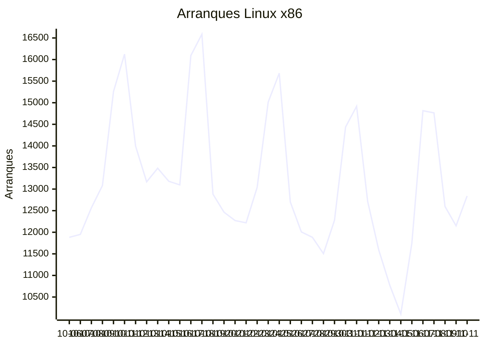
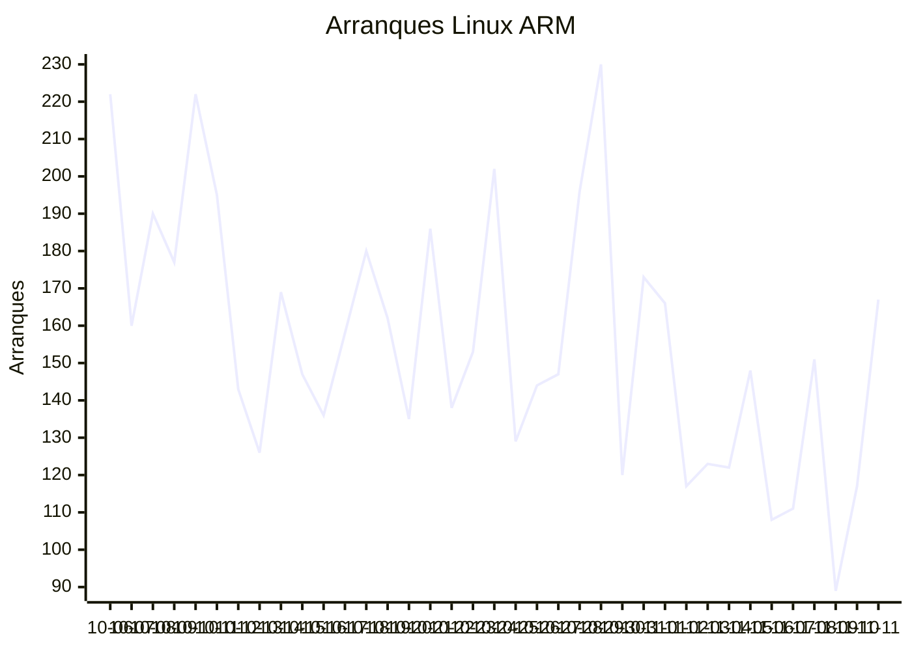
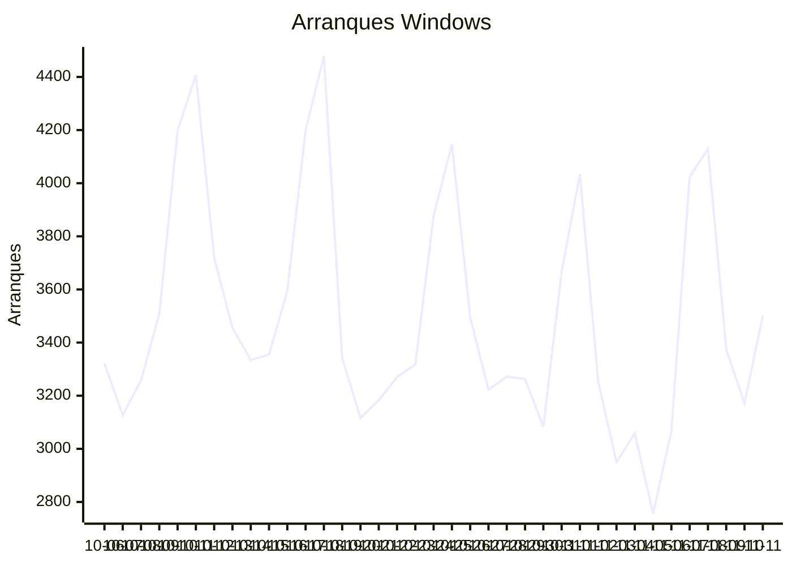
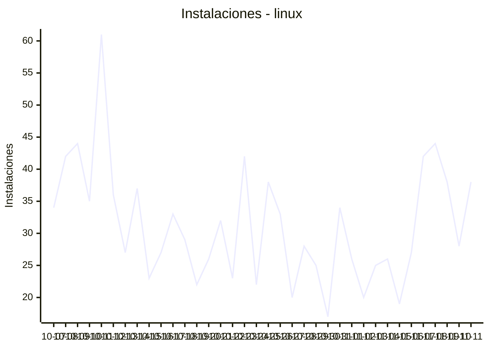
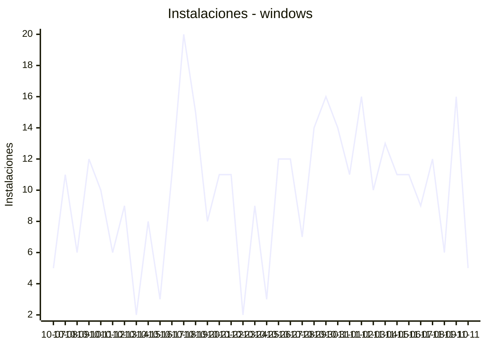
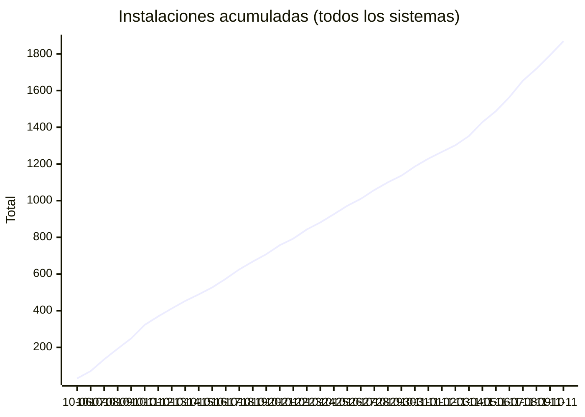
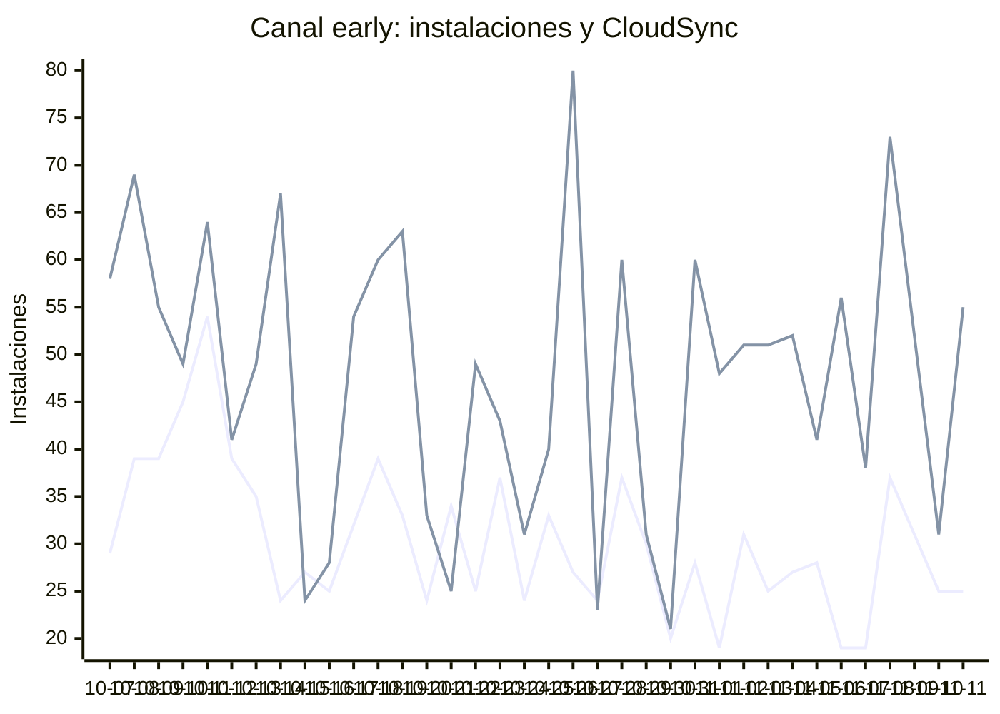

# Estadísticas de EmuDeck

Actualizado: 2026-11-12 23:35 UTC. Las gráficas no incluyen el día de hoy porque aún está incompleto.

## Arranques de la app (comprobaciones de actualización)

Cada arranque descarga el `latest*.yml` de su sistema. Cuenta arranques, no personas.

| Sistema | Ayer | Últimos 7 días |
|---|---|---|
| Linux x86 | 12841 | 89022 |
| Linux ARM | 167 | 891 |
| Windows | 3502 | 24023 |
| Mac | 51 | 313 |

Instalaciones nuevas estimadas en Windows (7 días, `.exe` menos `.blockmap`): **2482**

## Instalaciones de EmuDeck (beacons)

Cada `setup` descarga `system-<sistema>.txt` y cada instalación de un emulador `<emulador>-<plataforma>.txt`. Los emuladores cuentan también las actualizaciones. Histórico completo desde el primer día.

| Sistema | Ayer | Últimos 7 días | Últimos 30 días | Total |
|---|---|---|---|---|
| linux | 38 | 236 | 871 | 1190 |
| linux-arm | 34 | 211 | 322 | 392 |
| windows | 5 | 70 | 307 | 374 |

### Por mes

| Mes | Linux | Linux ARM | Windows | Total |
|---|---|---|---|---|
| 2026-11 | 333 | 230 | 120 | 683 |
| 2026-10 | 790 | 128 | 237 | 1155 |

### Canal early (early + early-unstable)

Instalaciones de EmuDeck con el backend en una rama early, y cuántas de ellas instalan CloudSync.

| | Últimos 7 días | Últimos 30 días | Total |
|---|---|---|---|
| Instalaciones early | 184 | 844 | 1133 |
| Con CloudSync | 346 | 1389 | 1838 |
| % con CloudSync | | | 162% |

Línea de arriba: instalaciones early. Línea de abajo: de ellas, con CloudSync.

### Por emulador

| Emulador | Linux (total) | Linux ARM (total) | Windows (total) | Últimos 7 días | Últimos 30 días | Total |
|---|---|---|---|---|---|---|
| esde | 2655 | 400 | 736 | 792 | 2971 | 3791 |
| azahar | 2808 | 472 | 414 | 770 | 2863 | 3694 |
| pcsx2 | 3202 | 34 | 436 | 656 | 2829 | 3672 |
| duckstation | 3050 | 440 | 163 | 761 | 2833 | 3653 |
| ryujinx | 2744 | 466 | 413 | 789 | 2820 | 3623 |
| rpcs3 | 2903 | 436 | 167 | 731 | 2741 | 3506 |
| srm | 2596 | 380 | 495 | 786 | 2764 | 3471 |
| cemu | 2768 | 428 | 145 | 679 | 2585 | 3341 |
| xenia | 2576 | 356 | 362 | 661 | 2562 | 3294 |
| vita3k | 2512 | 384 | 115 | 615 | 2336 | 3011 |
| shadps4 | 2408 | 225 | 325 | 500 | 2302 | 2958 |
| cloudsync | 1223 | 50 | 627 | 353 | 1431 | 1900 |
| ppsspp | 1027 | 297 | 343 | 405 | 1265 | 1667 |
| ra | 1125 | 318 | 189 | 397 | 1238 | 1632 |
| dolphin | 1119 | 337 | 173 | 398 | 1239 | 1629 |
| mgba | 1177 | 100 | 85 | 273 | 1054 | 1362 |
| xemu | 947 | 264 | 135 | 321 | 1016 | 1346 |
| melonds | 928 | 265 | 119 | 320 | 991 | 1312 |
| primehack | 856 | 273 | 136 | 327 | 964 | 1265 |
| supermodel | 803 | 260 | 39 | 273 | 831 | 1102 |
| scummvm | 767 | 233 | 84 | 269 | 817 | 1084 |
| model2 | 789 | 276 | 13 | 278 | 812 | 1078 |
| bigpemu | 775 | 33 | 34 | 166 | 660 | 842 |
| armsx2 | 245 | 495 | 0 | 255 | 594 | 740 |
| flycast | 203 | 36 | 34 | 64 | 203 | 273 |
| rmg | 203 | 55 | 0 | 68 | 192 | 258 |
| mame | 117 | 13 | 43 | 48 | 121 | 173 |
| eden | 122 | 11 | 20 | 44 | 131 | 153 |
| pegasus | 36 | 3 | 26 | 17 | 58 | 65 |
| yuzu | 15 | 0 | 8 | 7 | 18 | 23 |
| ares | 16 | 2 | 0 | 4 | 12 | 18 |
| citron | 6 | 0 | 2 | 2 | 7 | 8 |
