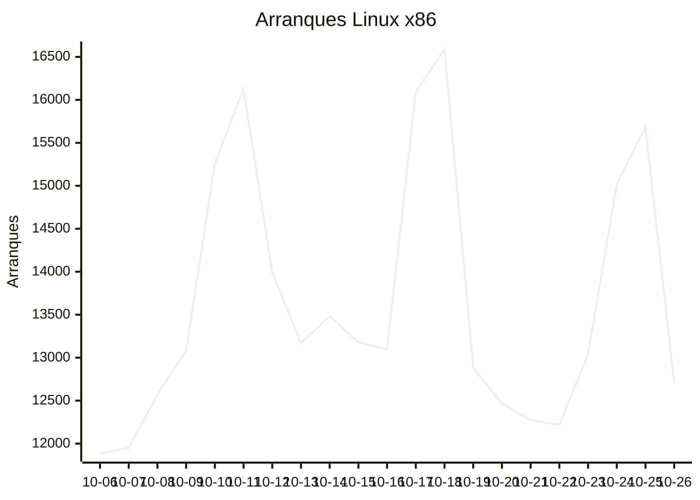
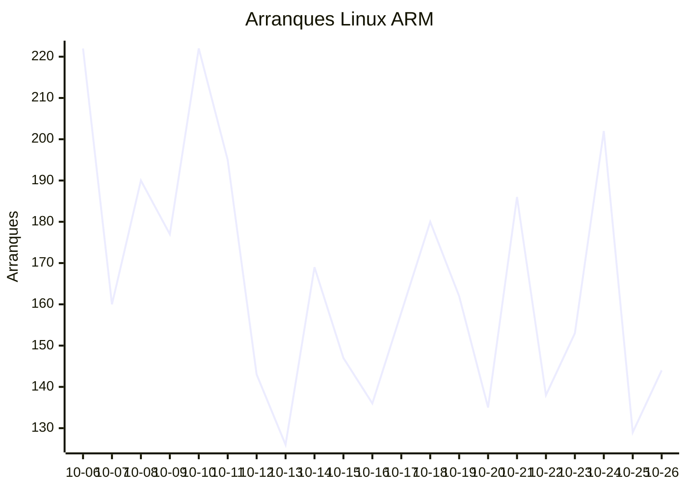
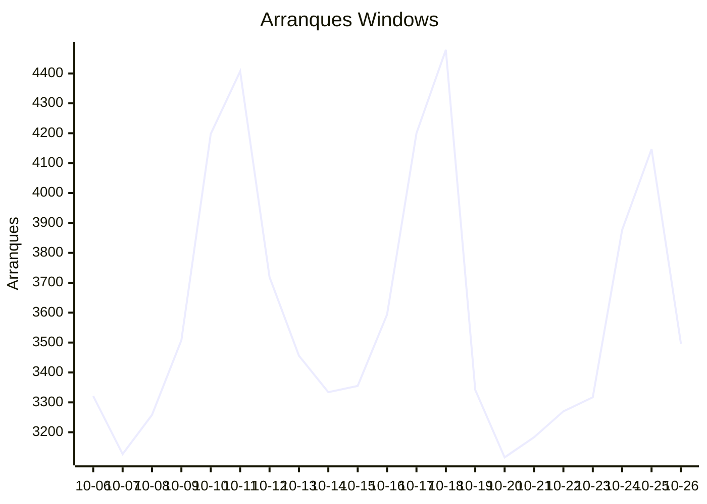
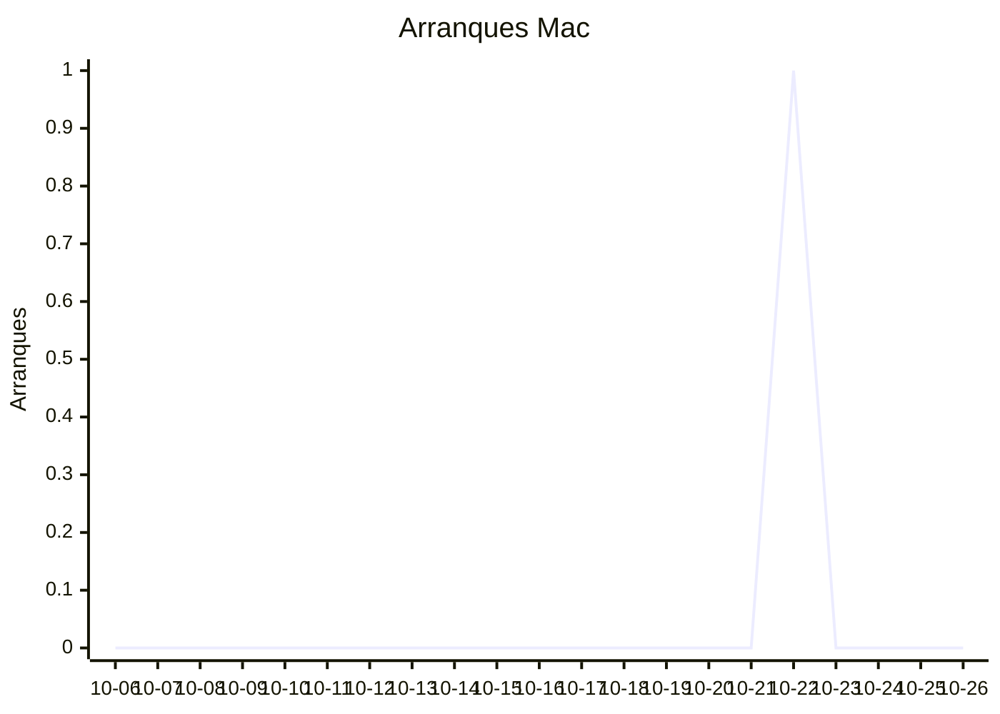
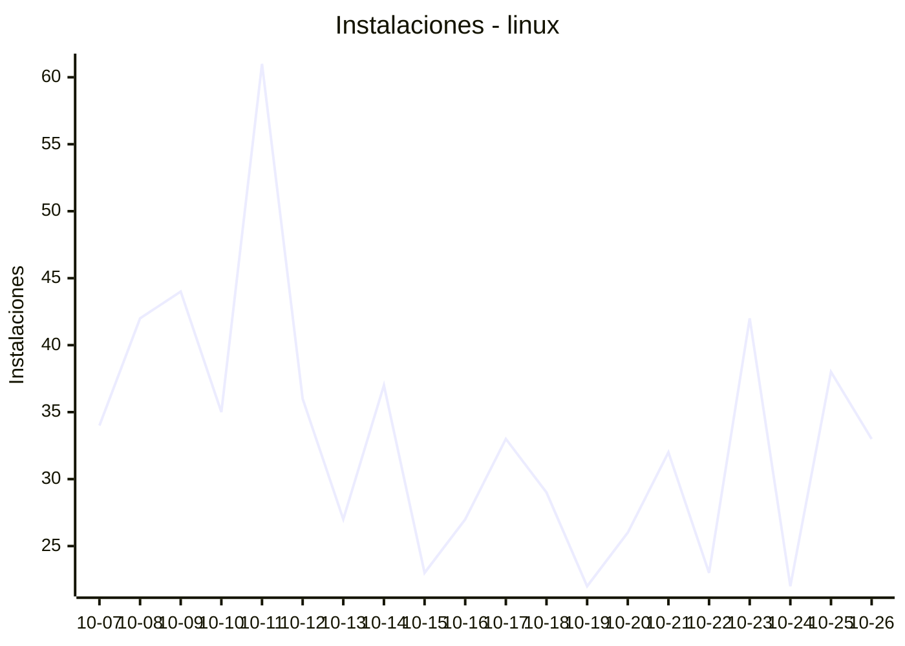
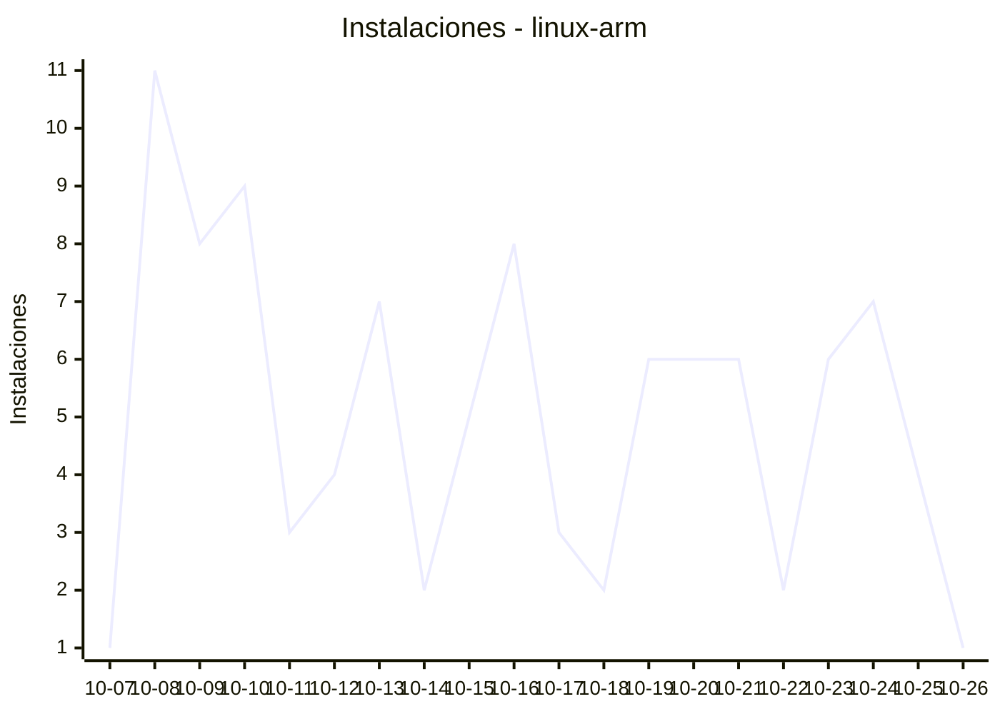
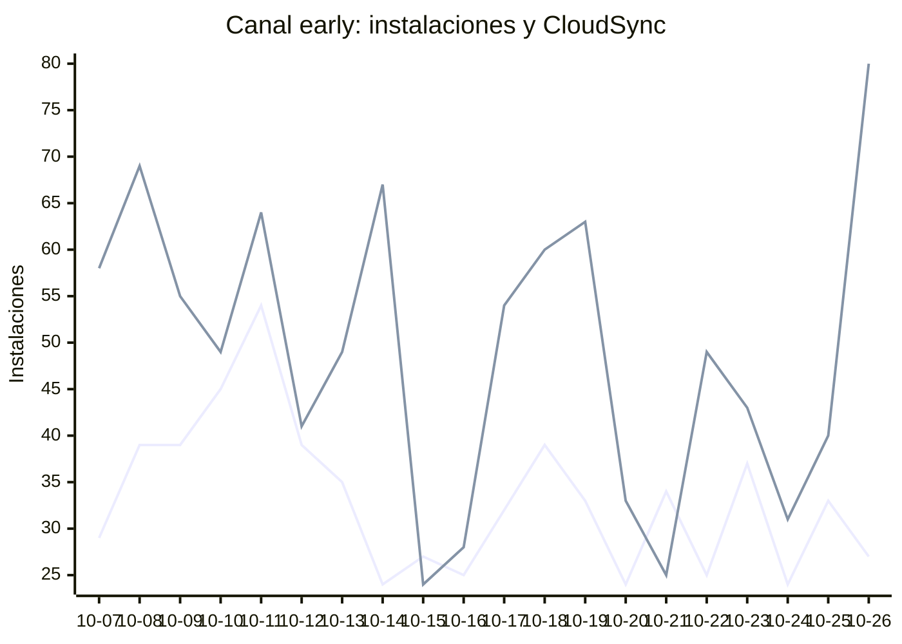

# Estadísticas de EmuDeck

Actualizado: 2026-10-27 21:36 UTC. Las gráficas no incluyen el día de hoy porque aún está incompleto.

## Arranques de la app (comprobaciones de actualización)

Cada arranque descarga el `latest*.yml` de su sistema. Cuenta arranques, no personas.

| Sistema | Ayer | Últimos 7 días |
|---|---|---|
| Linux x86 | 12702 | 93396 |
| Linux ARM | 144 | 1087 |
| Windows | 3496 | 24406 |
| Mac | 0 | 1 |

Instalaciones nuevas estimadas en Windows (7 días, `.exe` menos `.blockmap`): **2207**

## Instalaciones de EmuDeck (beacons)

Cada `setup` descarga `system-<sistema>.txt` y cada instalación de un emulador `<emulador>-<plataforma>.txt`. Los emuladores cuentan también las actualizaciones. Histórico completo desde el primer día.

| Sistema | Ayer | Últimos 7 días | Últimos 30 días | Total |
|---|---|---|---|---|
| linux | 33 | 216 | 666 | 704 |
| linux-arm | 1 | 32 | 101 | 108 |
| windows | 12 | 56 | 174 | 190 |

### Por mes

| Mes | Linux | Linux ARM | Windows | Total |
|---|---|---|---|---|
| 2026-10 | 666 | 101 | 174 | 941 |

### Canal early (early + early-unstable)

Instalaciones de EmuDeck con el backend en una rama early, y cuántas de ellas instalan CloudSync.

| | Últimos 7 días | Últimos 30 días | Total |
|---|---|---|---|
| Instalaciones early | 204 | 664 | 704 |
| Con CloudSync | 301 | 982 | 1064 |
| % con CloudSync | | | 151% |

Línea de arriba: instalaciones early. Línea de abajo: de ellas, con CloudSync.

### Por emulador

| Emulador | Linux (total) | Linux ARM (total) | Windows (total) | Últimos 7 días | Últimos 30 días | Total |
|---|---|---|---|---|---|---|
| pcsx2 | 1941 | 22 | 224 | 693 | 2048 | 2187 |
| duckstation | 1859 | 146 | 96 | 671 | 1961 | 2101 |
| azahar | 1692 | 161 | 225 | 660 | 1941 | 2078 |
| esde | 1573 | 131 | 356 | 671 | 1904 | 2060 |
| ryujinx | 1656 | 154 | 234 | 665 | 1919 | 2044 |
| rpcs3 | 1747 | 147 | 94 | 658 | 1869 | 1988 |
| cemu | 1703 | 151 | 77 | 628 | 1815 | 1931 |
| srm | 1542 | 135 | 246 | 668 | 1824 | 1923 |
| xenia | 1576 | 118 | 191 | 621 | 1774 | 1885 |
| shadps4 | 1476 | 122 | 170 | 569 | 1655 | 1768 |
| vita3k | 1542 | 130 | 62 | 554 | 1627 | 1734 |
| cloudsync | 741 | 33 | 329 | 315 | 1019 | 1103 |
| ppsspp | 626 | 91 | 171 | 266 | 826 | 888 |
| ra | 680 | 96 | 109 | 271 | 829 | 885 |
| dolphin | 679 | 100 | 98 | 260 | 820 | 877 |
| mgba | 684 | 51 | 53 | 252 | 746 | 788 |
| xemu | 585 | 81 | 73 | 230 | 693 | 739 |
| melonds | 570 | 77 | 71 | 211 | 676 | 718 |
| primehack | 503 | 74 | 74 | 198 | 611 | 651 |
| supermodel | 490 | 89 | 18 | 175 | 563 | 597 |
| scummvm | 474 | 65 | 48 | 176 | 551 | 587 |
| model2 | 482 | 92 | 8 | 164 | 549 | 582 |
| bigpemu | 470 | 10 | 12 | 156 | 462 | 492 |
| armsx2 | 147 | 172 | 0 | 118 | 301 | 319 |
| flycast | 130 | 16 | 18 | 49 | 154 | 164 |
| rmg | 128 | 27 | 0 | 41 | 145 | 155 |
| eden | 82 | 9 | 1 | 19 | 83 | 92 |
| mame | 71 | 2 | 16 | 20 | 81 | 89 |
| pegasus | 18 | 0 | 12 | 8 | 25 | 30 |
| yuzu | 8 | 0 | 2 | 4 | 10 | 10 |
| ares | 8 | 1 | 0 | 4 | 9 | 9 |
| citron | 5 | 0 | 0 | 1 | 5 | 5 |
